# Estudo Aprofundado do Algoritmo `CaloHitMaker`

Este documento apresenta um estudo detalhado da evolução, arquitetura, funcionamento e escopo do algoritmo **`CaloHitMaker`** (`reconstruction/calorimeter/CaloHitBuilder/src/CaloHitMaker.{h,cxx}`), comparando sua **versão original (baseline)** com a **versão atual (após a integração dos PRs #18 e #19)**.

O estudo analisa as funções, objetivos físicos e algorítmicos, trechos de código e a relação de cada funcionalidade com as geometrias **`GeoV1`** e **`GeoV2`**.

---

## 1. Visão Geral e Contexto Histórico

O algoritmo `CaloHitMaker` é o componente central da reconstrução de calorimetria durante a etapa de simulação do Lorenzetti. Sua função primária no ciclo do Geant4 é capturar cada passo de partícula (`G4Step`), determinar em qual célula sensível de leitura (*readout cell*) a energia foi depositada, aplicar correções de resposta física (saturação, tempo, atenuação) e acumular a energia no objeto correspondente (`xAOD::CaloHit`).

### Comparação Dimensional do Código

| Versão | Linhas em `CaloHitMaker.h` | Linhas em `CaloHitMaker.cxx` | Complexidade / Escopo |
| :--- | :---: | :---: | :--- |
| **Original (Baseline)** | 95 | 303 | Calorímetro genérico cilíndrico, grade uniforme $(\eta, \phi)$, integração direta de energia. |
| **Atual (`HEAD`)** | 298 (+209) | 1.700 (+1.423) | Suporte completo a células reais do ATLAS, segmentação acordeão, tubos FCAL, leitura dupla Tile, lei de Birks, simulação rápida (frozen showers), coleção de carga do EMEC e saída *free-running hits*. |

---

## 2. Quadro Resumo: Funcionalidades, Modificações e Escopo (`GeoV1` vs `GeoV2`)

| Funcionalidade / Modificação | Funções / Métodos C++ | Flags Python (`CaloHitFlags`) | Escopo | Descrição Resumida |
| :--- | :--- | :--- | :---: | :--- |
| **Filtro de Meio Ativo** | `execute` | `ActiveEnergyOnly` | **GeoV1 e GeoV2** | Descarta depósitos em materiais inativos (absorvedores, paredes de criostato), aceitando apenas `liquidArgon` e cintiladores. |
| **Saturação de Birks** | `birksEnergy` | `BirksLaw` | **GeoV1 e GeoV2** | Aplica a lei de Birks no cintilador plástico ($k_B$) e no argônio líquido ($k/F$, dependente de densidade e correção HIP). |
| **Tempo de Voo (TOF) ATLAS** | `hitTime`, `larHitTime`, `tileTime` | `AtlasHitTime` | **GeoV1 e GeoV2** *(parcial)* | Subtrai o tempo de voo $r/c$ do tempo global para alinhar partículas ultrarrelativísticas no BC 0. Em `GeoV2`, adiciona atrasos de fibra e PMT. |
| **Verificação no Ponto Médio do Passo** | `execute` (`rpos`) | N/A (fixo) | **GeoV1 e GeoV2** | Avalia se o passo pertence ao volume pelo seu ponto médio $0.5(p_{pre} + p_{post})$, evitando recusas espúrias na face de entrada. |
| **Células Arbitrárias $(r, z)$** | `findCell`, `useCells` | Ativado via `Cells` na geometria | **Exclusivo GeoV2** | Substitui o grid $(\eta, \phi)$ por caixas $(r, z)$ com centros e larguras variáveis (usado no Tile e HEC). |
| **Leitura Dupla Tile (Dual Readout)** | `tilePmtWeights`, `tileNPmt` | `TileDualReadout`, `TilePmtSplit` | **Exclusivo GeoV2** | Modela a partição de luz entre dois PMTs por célula Tile via perfil empírico U-shape ou interpolação linear. |
| **Módulos Especiais e Reposição Tile** | `tileNPmt`, `m_replaceCollectionKey` | Ativado via `Cells` na geometria | **Exclusivo GeoV2** | Trata módulos com 1 PMT (C10, E1-E4) e redireciona a energia da célula ausente D4 (EBA15/EBC18) para a célula D5. |
| **Segmentação Realista EMB e PSB** | `embSampSeg`, `embFindCell`, `psbGapCell` | Ativado via `Cells` na geometria | **Exclusivo GeoV2** | Mapeia o acordeão do barril LAr segundo as rotinas `SampSeg` do Athena e calcula a célula pelo gap do eletrodo no presampler. |
| **Compartimentos EMEC** | `emecFindCell` | Ativado via `Cells` na geometria | **Exclusivo GeoV2** | Segmenta as rodas interna e externa do endcap eletromagnético em 11 compartimentos usando planos divisores em $Z$. |
| **Projeção de Módulo no HEC** | `cellRadius` | Ativado via `Cells` na geometria | **Exclusivo GeoV2** | Projeta o raio no eixo de cada um dos 32 módulos em cunha do HEC ($r \cos(\phi - \phi_c)$). |
| **Leitura por Eletrodos no FCAL** | `fcalStep`, `fcalFillHit` | Ativado via `fcal_modules` | **Exclusivo GeoV2** | Mapeia números de cópia de gaps de eletrodos em canais/tiles de leitura do FCAL. |
| **Chuveiros Congelados FCAL** | `isShowerSpot`, `fcalSpot`, `fcalTileID` | Ativado se houver spots sem touchable | **Exclusivo GeoV2** | Trata depósitos de parametrização rápida (*frozen showers*) sem volume físico através de mapa 2D de tubos. |
| **Coleção de Carga Portada EMEC** | `emecChargeEnergy`, `emecLArPhiShift` | `FreeRunningFlags.EmecChargeCollection` | **Exclusivo GeoV2** | Calcula corrente induzida (Ramo) e campos elétricos realistas no acordeão usando mapas `ec.fieldzv03` e `HVEMECMap_v02.dat`. |
| **Hits Free-Running (Layout ATLAS)** | `freeRunningTile`, `freeRunningLAr` | `FreeRunningFlags.Enable` | **Exclusivo GeoV2** | Empacota identificadores compactos ATLAS de 64 bits e grava árvores no formato exato da ntupla de HITS do Athena. |
| **Deslocamento Azimutal $\phi$** | `m_phiShift`, `findPhi` | Ativado via `PhiShift` na geometria | **Exclusivo GeoV2** | Compensa a rotação de meio absorvedor ($-\pi/1024$ no barril, $-\pi/768$ no endcap). |

---

## 3. Análise da Versão Original (Baseline)

Na versão original (commit `2f27295`), o `CaloHitMaker` assumia uma geometria cilíndrica perfeita e idealizada:

1. **Grid Regular Bidimensional**: A amostragem era particionada exclusivamente por vetores lineares uniformes `m_etaBins` e `m_phiBins`.
2. **Pré-Alocação Exaustiva**: No método `pre_execute()`, todos os hits de cada bin $(\eta, \phi)$ eram instanciados no `xAOD::CaloHitCollection`, calculando o centro como o ponto médio aritmético do bin:
   ```cpp
   // Versão Original: pre_execute
   for ( unsigned etaBin = 0; etaBin < m_nEtaBins; ++etaBin){
     for ( unsigned phiBin = 0; phiBin < m_nPhiBins; ++phiBin){
       float etaCenter = m_etaBins[etaBin] + deltaEta / 2;
       float phiCenter = m_phiBins[phiBin] + deltaPhi / 2;
       unsigned bin = m_nPhiBins * etaBin + phiBin;
       auto *hit = new xAOD::CaloHit( etaCenter, phiCenter, deltaEta, deltaPhi, hash(bin), 
                                      (CaloSampling)m_sampling, (Detector)m_detector,
                                      m_bc_duration, m_bcid_start, m_bcid_end );
       collection->insert( hit->hash(), hit);
     }
   }
   ```
3. **Seleção Geométrica Simples**: Em `execute()`, testava-se apenas a posição do ponto pré-passo (`PreStepPoint`):
   ```cpp
   // Versão Original: execute
   G4ThreeVector pos = step->GetPreStepPoint()->GetPosition();
   auto vpos = TVector3( pos.x(), pos.y(), pos.z());
   float eta = vpos.PseudoRapidity();
   float phi = vpos.Phi();
   float radius = vpos.Perp();

   if( !(radius > m_rMin && radius <= m_rMax) ) return StatusCode::SUCCESS;
   if( !(pos.z() > m_zMin && pos.z() <= m_zMax) ) return StatusCode::SUCCESS;

   int etaBin = find(m_etaBins, eta);
   int phiBin = find(m_phiBins, phi);
   int bin = m_nPhiBins * etaBin + phiBin;
   xAOD::CaloHit *hit = nullptr;
   if (collection->retrieve(hash(bin), hit)) {
     hit->fill( step , 1*m_noiseStd);
   }
   ```
4. **Limitações Físicas do Baseline**:
   - Não havia distinção entre depósitos no absorvedor (chumbo/ferro) e no meio ativo (LAr/cintilador).
   - Não havia saturação da resposta a partículas de alta densidade de ionização (Birks).
   - O tempo de voo era apenas o tempo global do Geant4, sem compensação de $r/c$, o que jogava depósitos distantes em *bunch crossings* incorretos.
   - Não suportava calorímetros não-cilíndricos (como o acordeão de LAr ou os eletrodos de matriz do FCAL).

---

## 4. Detalhamento das Modificações e Novas Funções

Abaixo são detalhadas as modificações introduzidas nos últimos PRs, com seus objetivos, funções C++ e o escopo de geometria correspondente.

### 4.1. Filtro de Meio Ativo (`m_activeEnergyOnly`)
- **Objetivo**: Garantir que apenas a energia depositada no meio sensível (*active medium*) seja contabilizada nos hits do calorímetro. No baseline, se um passo ocorresse dentro do envelope geométrico da amostragem (por exemplo, na placa de chumbo do absorvedor), a energia era creditada na célula, inflando artificialmente o sinal.
- **Função**: Integrada diretamente no início de `CaloHitMaker::execute`:
  ```cpp
  if( m_activeEnergyOnly ){
    const G4Material *material = step->GetPreStepPoint()->GetMaterial();
    if( !material ) return StatusCode::SUCCESS;
    const G4String &materialName = material->GetName();
    if( materialName != "liquidArgon" && materialName != "PLASTIC SCINTILLATOR" && materialName != "ATLAS_TILE_PVT" )
      return StatusCode::SUCCESS;
  }
  ```
- **Relação com Geometrias**:
  - **GeoV1 e GeoV2**: Tanto `GeoV1` quanto `GeoV2` utilizam definições de materiais como `liquidArgon` e `PLASTIC SCINTILLATOR`. A flag `CaloHitFlags.ActiveEnergyOnly` controla esta verificação.

---

### 4.2. Lei de Birks para Saturação de Cintilação e Ionização (`birksEnergy`)
- **Objetivo**: Modelar a recombinação e saturação de ionização não linear para partículas altamente ionizantes ($dE/dx$ elevado), idêntico à implementação do Athena/ATLAS.
- **Função C++**: `float CaloHitMaker::birksEnergy( const G4Step *step ) const`:
  - **Cintilador Plástico** (Tile):
    $$E_{\text{vis}} = \frac{E}{1 + k_B \cdot \frac{dE/dx}{\rho}}$$
    onde $k_B = 0{,}02002\text{ g}/(\text{MeV}\cdot\text{cm}^2)$, com correção para cargas $|Z| > 1$.
  - **Argônio Líquido** (LAr):
    $$E_{\text{vis}} = E \cdot \frac{1 + \frac{k}{F} \cdot 1{,}51}{1 + \frac{k}{F} \cdot \frac{dE/dx}{\rho}} \cdot k_{\text{HIP}}$$
    onde $k = \text{BirksLArK}$ ($0{,}05832$ para barril/EMEC e $0{,}0486$ para HEC/FCAL), $F = 10\text{ kV/cm}$, $\rho = 1{,}396\text{ g/cm}^3$, e $k_{\text{HIP}}$ corrige partículas com $dE/dx > 969\text{ MeV/cm}$.
- **Trecho de Código**:
  ```cpp
  if( name == "PLASTIC SCINTILLATOR" ){
    const double charge = step->GetPreStepPoint()->GetCharge();
    if( charge == 0. ) return (float)edep;
    double kB = 0.02002 * g / (MeV * cm2);
    if( std::abs(charge) > 1.0 ) kB *= 7.2 / 12.6;
    const double dedx = edep / length / material->GetDensity();
    return (float)( edep / (1. + kB * dedx) );
  }
  if( name == "liquidArgon" ){
    const double dE = edep / MeV;
    const double dX = length / cm;
    if( dX < 1e-5 ) return (float)edep;
    const double kOverField = m_birksLArK / 10.;
    double dEdX = dE / dX;
    const double corrected = dE * (1 + kOverField * 1.51) / (1 + kOverField * dEdX / 1.396);
    if( dEdX > 12000.0 ) dEdX = 12000.0;
    const double kHIP = (dEdX > 969.) ? 0.000754 * dEdX + 0.2692 : 1.0;
    return (float)( corrected * kHIP * MeV );
  }
  ```
- **Relação com Geometrias**:
  - **GeoV1 e GeoV2**: O cálculo opera apenas nas propriedades do `G4Step` e nos materiais do Geant4, sem depender da estrutura geométrica de células. Portanto, funciona perfeitamente em ambas as geometrias quando `CaloHitFlags.BirksLaw = True`.

---

### 4.3. Correção de Tempo de Voo (TOF) e Bunch Crossing (`hitTime`, `larHitTime`, `tileTime`)
- **Objetivo**: No colisor, as colisões ocorrem a cada 25 ns (bunch crossing). Para que partículas com $\beta \approx 1$ oriundas do ponto de interação sejam atribuídas ao BC 0 independentemente da distância radial ou longitudinal do calorímetro, deve-se subtrair o tempo de voo:
  $$t_{\text{hit}} = t_{\text{global}} - \frac{r}{c}$$
- **Funções C++**:
  - `larHitTime`: Utiliza o ponto médio de pre e post-step (ou pre-step no EMB) e subtrai $|r|/c$.
  - `tileTime`: Implementa o algoritmo de simulação do Tile do ATLAS (`TileGeoG4SDCalc::MakePmtEdepTime`), calculando o atraso óptico dentro das fibras e da telha cintiladora com índice de refração $n = 1{,}59$:
    $$t = t_{\text{global}} + \frac{r_{\text{cell}} \left(n - \frac{2}{\sin\theta_{\text{cell}}}\right) + |x| (1 - n \sin\theta_{\text{hit}})}{c}$$
    e adicionando os atrasos diferenciais para os dois PMTs: $dt_{\text{Up}}$ e $dt_{\text{Down}}$.
- **Trecho de Código**:
  ```cpp
  double CaloHitMaker::larHitTime( const G4Step *step ) const
  {
    const G4StepPoint *preP = step->GetPreStepPoint(), *postP = step->GetPostStepPoint();
    if( std::abs(m_atlasBarrelEc) == 1 && m_atlasLArPart == 1 )
      return preP->GetGlobalTime() / ns - preP->GetPosition().mag() / CLHEP::c_light;
    const double tglobal = 0.5 * ( preP->GetGlobalTime() + postP->GetGlobalTime() ) / ns;
    return tglobal - ( 0.5 * ( preP->GetPosition() + postP->GetPosition() ) ).mag() / CLHEP::c_light;
  }
  ```
- **Relação com Geometrias**:
  - **GeoV1**: Aplica a correção básica do LAr ($t_{\text{global}} - r/c$) para todos os calorímetros, pois `m_cellRCentre` não está preenchido.
  - **GeoV2**: Executa a física completa, incluindo a propagação em fibra óptica e atrasos assimétricos de PMT no Tile.

---

### 4.4. Verificação no Ponto Médio do Passo (PR #16 Bugfix)
- **Objetivo**: Corrigir um defeito sutil de contorno: passos de partículas que entravam pela face inferior de um volume fino (como cintiladores de fenda E1-E4 ou tiras finas de LAr) tinham seu `PreStepPoint` exatamente sobre o plano limítrofe. Devido ao teste estrito `r > m_rMin`, esses passos eram rejeitados.
- **Modificação em C++**:
  ```cpp
  const G4ThreeVector rpos = 0.5*( pos + step->GetPostStepPoint()->GetPosition() );
  const float rradius = rpos.perp();
  if( !sampSeg && !(rradius > m_rMin && rradius <= m_rMax) )
    return StatusCode::SUCCESS;
  if( !(rpos.z() > m_zMin && rpos.z() <= m_zMax))
    return StatusCode::SUCCESS;
  ```
- **Relação com Geometrias**:
  - **GeoV1 e GeoV2**: Beneficia ambas as geometrias, tornando a aceitação de passos geometricamente consistente.

---

### 4.5. Células Baseadas em Caixas Geométricas $(r, z)$ (`findCell`, `useCells`)
- **Objetivo**: O calorímetro Tile real do ATLAS não possui células em anéis de pseudorapidez uniforme. As células são blocos cilíndricos com limites radiais e axiais bem definidos em milímetros (ex.: células A, BC, D).
- **Funções C++**:
  - `useCells()`: Retorna verdadeiro quando o vetor `m_cellEta` não está vazio.
  - `findCell(radius, z)`: Percorre os vetores de caixas `m_cellBoxRMin`, `m_cellBoxRMax`, `m_cellBoxZMin`, `m_cellBoxZMax` e localiza o índice da célula:
  ```cpp
  int CaloHitMaker::findCell( float radius, float z ) const
  {
    for ( unsigned box = 0; box < m_cellBoxIndex.size(); ++box ){
      if( radius > m_cellBoxRMin[box] && radius <= m_cellBoxRMax[box] &&
          z > m_cellBoxZMin[box] && z <= m_cellBoxZMax[box] )
        return m_cellBoxIndex[box];
    }
    return -1;
  }
  ```
- **Relação com Geometrias**:
  - **Exclusivo GeoV2**: Em `GeoV1`, a sensibilidade é definida unicamente por `EtaBins` e `PhiBins`. Apenas `GeoV2/python/detectors/TILE.py` popula o dicionário `Cells` com caixas $(r, z)$.

---

### 4.6. Leitura Dupla Tile (Dual Readout) e Perfis U-shape (`tilePmtWeights`)
- **Objetivo**: Simular realisticamente a coleta de luz em cada lado da telha de cintilador. No ATLAS, cada célula do Tile é lida por dois tubos fotomultiplicadores (PMT 0 e PMT 1), conectados via fibras ópticas em extremidades opostas em $\phi$.
- **Funções C++**:
  - `m_tileDualReadout`: $0$ = desativado, $1$ = perfil U-shape (tabelas experimentais de calibração do ATLAS), $2$ = interpolação linear.
  - `tilePmtWeights`: Recupera os fatores de atenuação da classe `TileUShape` (`TileUShape::amplitude(table, \pm \phi_{\text{local}})`).
  ```cpp
  void CaloHitMaker::tilePmtWeights( float phiLocal, float z, float &w0, float &w1, bool replaced ) const
  {
    if( m_tileDualReadout == 1 ){
      int layer = (m_sampling - 5) % 3;
      int part  = (m_sampling <= 7) ? 0 : ( z > 0 ? 1 : 2 );
      if( replaced ){ part = ( z > 0 ? 1 : 2 ); layer = 2; }
      else if( m_uShapePart >= 0 ){ part = m_uShapePart; layer = m_uShapeLayer; }
      const double *t = TileUShape::table( part, layer );
      w1 = TileUShape::amplitude( t, -phiLocal );
      w0 = TileUShape::amplitude( t,  phiLocal );
      return;
    }
    // Modo linear...
  }
  ```
- **Relação com Geometrias**:
  - **Exclusivo GeoV2**: Em `initialize()`, existe uma checagem mandatória:
    ```cpp
    if( m_tileDualReadout > 0 && isTile() && !useCells() ){
      MSG_FATAL( "TileDualReadout needs the ATLAS tile cells (CellEta)." );
    }
    ```
    Como `GeoV1` não possui `CellEta`, a leitura dupla só roda em `GeoV2`.

---

### 4.7. Redirecionamento de Células Especiais e Reposição em Tile (D4 $\rightarrow$ D5)
- **Objetivo**: No detector ATLAS real, os módulos estendidos EBA15 e EBC18 não possuem a célula física D4 devido à passagem de serviços do criostato. A energia depositada nessa região é encaminhada para o canal de leitura da célula D5.
- **Implementação**:
  - `tileNPmt(cell, phiBin)` retorna `0` quando a célula deve ser substituída.
  - O hit depositado é recuperado do container da amostragem de substituição através de `m_replaceCollectionKey`:
  ```cpp
  if( replacedCell ){
    SG::ReadHandle<xAOD::CaloHitCollection> replaced( m_replaceCollectionKey, ctx );
    xAOD::CaloHit *replacedHit = nullptr;
    if( !replaced.isValid() || !replaced->retrieve( (unsigned long int)m_replaceHashBase + phiBin, replacedHit ) ){
      MSG_FATAL( "No hit of the replacement cell in " << m_replaceCollectionKey << " for the phi bin " << phiBin );
    }
    hit = replacedHit;
  }
  ```
- **Relação com Geometrias**:
  - **Exclusivo GeoV2**: Configurado exclusivamente em `geometry/GeoV2/python/detectors/TILE.py`.

---

### 4.8. Segmentação Fiel do Acordeão EMB e Presampler (`embSampSeg`, `psbGapCell`)
- **Objetivo**: No barril eletromagnético (EMB), as placas de chumbo e eletrodos em acordeão possuem dobras (*waves*) e limites radiais que variam em função de $|z|$ e $|\eta|$. O método `embSampSeg` porta integralmente as rotinas `FiducialCuts` e `SampSeg` do Athena (`LArBarrelGeometry.cxx`).
- **Funções C++**:
  - `embSampSeg(x, y, z, region, sampling, ieta)`: Determina se o ponto está dentro da região ativa do acordeão, retornando a amostragem exata (1, 2 ou 3) e o índice $\eta$ da faixa de leitura.
  - `psbGapCell(x, y, z)`: Calcula a célula do presampler do barril a partir da inclinação angular dos módulos e do espaçamento entre catodos.
- **Relação com Geometrias**:
  - **Exclusivo GeoV2**: Ativado em `geometry/GeoV2/python/detectors/ECAL.py` através da flag `EmbSampSeg`.

---

### 4.9. Segmentação por Compartimentos do EMEC (`emecFindCell`)
- **Objetivo**: O endcap eletromagnético (EMEC) possui rodas concêntricas interna e externa com dobras em acordeão cujo ângulo de abertura varia com o raio. No ATLAS, as células são organizadas em 11 compartimentos volumétricos com transições definidas por planos de corte axial $Z_{\text{IW}}$, $Z_{\text{SEP12}}$ e $Z_{\text{SEP23}}$ medidos a partir do ponto focal elétrico.
- **Função C++**: `emecFindCell(x, y, z, etaBin, phiBin)`:
  - Aplica o deslocamento do foco elétrico: $z_f = |z| - \text{EmecFocalShift}$.
  - Compara $z_f$ com as tabelas de contorno (`m_emecZSep12`, `m_emecZSep23`, `m_emecZInner`).
  - Retorna o compartimento (1 a 11) correspondente à posição tridimensional.
- **Relação com Geometrias**:
  - **Exclusivo GeoV2**: Configurado em `geometry/GeoV2/python/detectors/EMEC.py`.

---

### 4.10. Módulos e Eletrodos do FCAL (`fcalStep`, `fcalFillHit`)
- **Objetivo**: O Forward Calorimeter (FCAL) é composto por matrizes metálicas densas perfuradas por eletrodos tubulares paralelos ao feixe. Não há simetria em $(\eta, \phi)$. O sinal é coletado nos gaps cilíndricos de argônio líquido em torno das varetas metálicas.
- **Função C++**:
  - O `CaloHitMaker` intercepta passos dentro do volume lógico do gap (`m_fcalGapVolume`).
  - Lê o número de cópia do Geant4 (`pv->GetCopyNo()`) e recupera os índices matriciais $(\eta, \phi)$ correspondentes da tabela `m_fcalCopyEtaIndex` e `m_fcalCopyPhiIndex`.
- **Relação com Geometrias**:
  - **Exclusivo GeoV2**: As matrizes de eletrodos do FCAL são instanciadas exclusivamente por `geometry/GeoV2/python/detectors/FCAL.py` e alimentam `detector_construction.fcal_modules`.

---

### 4.11. Simulação Rápida: Chuveiros Congelados no FCAL (`isShowerSpot`, `fcalSpot`)
- **Objetivo**: Para acelerar a simulação em $\eta$ elevado, o modelo de *Frozen Showers* do Geant4 injeta parâmetros de chuveiros pré-calculados (*spots* de energia) sem instanciar partículas secundárias no Geant4. Esses passos não possuem volume físico associado (`touchable == nullptr`).
- **Funções C++**:
  - `isShowerSpot(step)`: Identifica passos sem touchable:
    ```cpp
    bool CaloHitMaker::isShowerSpot( const G4Step *step ) {
      return step->GetPreStepPoint()->GetTouchable() == nullptr;
    }
    ```
  - `fcalTileID(x, y, eta, phi)`: Localiza o eletrodo e a célula a partir das coordenadas transversais $(x, y)$ usando a tabela de tubos `m_fcalTubeMap`.
  - `fcalSpot`: Credita a energia do spot no hit correspondente.
- **Relação com Geometrias**:
  - **Exclusivo GeoV2**: Requer o suporte aos módulos do FCAL v2.

---

### 4.12. Coleção de Carga Portada da Athena para o EMEC (`emecChargeEnergy`)
- **Objetivo**: Reproduzir fielmente o processo `LArG4::EC::EnergyCalculator` do Athena 23.0.14. O campo elétrico no acordeão do EMEC não é uniforme e a distância entre placas varia com o raio. A resposta em corrente requer a aplicação do teorema de Ramo e o cálculo da deriva de elétrons sob mapas realistas de alta tensão.
- **Funções C++**:
  - `emecChargeEnergy(step, energy)`: Transforma o passo do Geant4 para o referencial da roda do ATLAS (`emecTopTransform`), translada a coordenada em $\phi$ para dentro do gap de LAr (`emecLArPhiShift`) e avalia a resposta usando o `EnergyCalculator` compilado em `GeoV2`.
- **Relação com Geometrias**:
  - **Exclusivo GeoV2**: Depende de arquivos de calibração presentes em `geometry/GeoV2/data/` (`ec.fieldzv03` e `HVEMECMap_v02.dat`) e da classe `LArG4::EC::EnergyCalculator`.

---

### 4.13. Hits Free-Running no Formato do Athena (`freeRunningTile`, `freeRunningLAr`)
- **Objetivo**: Exportar a simulação de hits diretamente para uma árvore ROOT (`CollectionTree`) contendo exatamente os mesmos nomes de *branches* e a mesma estrutura de identificadores compactos de 64 bits utilizada pelo framework oficial do ATLAS (Athena).
- **Funções C++**:
  - `freeRunningTile`: Empacota os campos subdetector, seção, lado, módulo, torre, amostragem e PMT nos bits 63 a 34 de um `unsigned long long`.
  - `freeRunningLAr`: Empacota os identificadores de 32 bits de LArEM, LArHEC e LArFCAL na metade superior de um inteiro de 64 bits.
  - Armazena os dados em `CaloFreeRunningHitList`, posteriormente gravado por `CaloFreeRunningHitWriter`.
- **Relação com Geometrias**:
  - **Exclusivo GeoV2**: Requer mapeamentos detalhados de números de seção, torre e índices de dicionário fornecidos apenas pelos módulos de detector do `GeoV2`.

---

## 5. Matriz de Compatibilidade e Impacto no `GeoV1`

Um dos aspectos mais importantes da arquitetura do `CaloHitMaker` é que **ele mantém retrocompatibilidade funcional transparente com a geometria simplificada `GeoV1`**.

### O que o `GeoV1` executa no `CaloHitMaker`:
1. **Fallback Elegante para Grade Regular**:
   Quando a amostragem não possui o atributo `sensitive().Cells` (caso do `GeoV1`), a chamada `useCells()` retorna `false`. O algoritmo volta a alocar a grade regular uniforme `m_etaBins` $\times$ `m_phiBins` em `pre_execute()` e calcula os bins por busca binária linear em `find(m_etaBins, eta)`.
2. **Correção Geométrica no Ponto Médio**:
   O cálculo `rpos = 0.5 * (pos_pre + pos_post)` é aplicado a qualquer amostragem que não seja acordeão, eliminando o erro de contorno na face de entrada do `GeoV1`.
3. **Filtro de Energia Ativa e Lei de Birks**:
   Se as flags `CaloHitFlags.ActiveEnergyOnly` ou `CaloHitFlags.BirksLaw` forem ativadas pelo usuário em uma execução com `GeoV1`, o `CaloHitMaker` executará os filtros de materiais e a saturação de Birks normalmente.
4. **Tempo de Voo (TOF) Básico**:
   Com `CaloHitFlags.AtlasHitTime = True`, o `GeoV1` calcula $t = t_{\text{global}} - r/c$ via `larHitTime()`, posicionando os depósitos no bunch crossing correto.

### O que NÃO pode ser ativado no `GeoV1` (com mensagens de erro explícitas):
- Se `TileDualReadout > 0` for configurado com `GeoV1`, `initialize()` dispara:
  `FATAL: TileDualReadout needs the ATLAS tile cells (CellEta).`
- Se `FreeRunningHits = True` for configurado com `GeoV1`, `initialize()` dispara:
  `FATAL: FreeRunningHits needs the ATLAS tile cells with their ATLAS identifier fields...`
- Se `EmecChargeCollection = True` for configurado com `GeoV1`, `initialize()` dispara:
  `FATAL: EmecChargeCollection needs an ATLAS-like EM end-cap maker (EmecCompartment)...`

Essa separação garante que o `GeoV1` funcione como um modelo rápido, idealizado e robusto para testes e benchmarks, enquanto o `GeoV2` incorpora o rigor experimental do detector ATLAS.

---

## 6. Diagnóstico Arquitetural: O Problema da Classe Monolítica

A incorporação dos desenvolvimentos dos PRs #18 e #19 no `CaloHitMaker` consolidou simulações de alta fidelidade física, mas ao custo de introduzir forte débito técnico:

1. **Violação do Princípio da Responsabilidade Única (SRP)**:
   O algoritmo acumula atualmente:
   - Seleção geométrica e envelopes para 5 subsistemas distintos (Tile, EMB, EMEC, HEC, FCAL).
   - Modelagem de física de ionização e recombinação (Lei de Birks).
   - Eletrostática e cálculo de corrente de choque/deriva (coleção de carga portada do Athena via `LArG4EC`).
   - Óptica de cintiladores e propagação em fibras ópticas com matrizes empíricas U-shape (`TileUShape.h`).
   - Simulação rápida parametrizada (*frozen showers* do FCAL sem geometria Geant4).
   - Formatação e escrita de identificadores compactos de 64 bits para o formato do Athena (*free-running hits*).
2. **Violação do Princípio Aberto/Fechado (OCP)**:
   Qualquer alteração em um subsistema específico (ex.: atualizar tabelas de alta tensão do EMEC ou mudar a partição do Tile) obriga a reabrir e recompilar o arquivo central `CaloHitMaker.cxx` de 1.700 linhas.
3. **Acoplamento Indesejado de Dependências**:
   O `CaloHitMaker` (que deveria pertencer puramente à camada de reconstrução/digitalização genérica) passou a depender diretamente de cabeçalhos de simulação detalhada do ATLAS, mapas estáticos de campos e dados de calibração do `GeoV2`.

---

## 7. Proposta de Arquitetura Modular Baseada em `GAUGI::Tool`

Para tornar o `CaloHitMaker` limpo, altamente desacoplado e extensível, propõe-se uma arquitetura baseada no padrão **Strategy / Injeção de Dependência** utilizando componentes nativos **`Gaugi::Tool`** (disponíveis em `GaugiKernel/Tool.h`).

### 7.1. Visão Geral da Arquitetura

Nesta abordagem:
1. O **`CaloHitMaker`** atua estritamente como um **algoritmo orquestrador enxuto** (menos de 200 linhas de código C++).
2. **Todas as adaptações de energia e mapeamentos espaciais exclusivos do `GeoV2` (ou compartilhados com `GeoV1`) são encapsulados em `Gaugi::Tool` especializadas**.
3. A configuração em Python (`CaloHitBuilder.py`) monta o pipeline de ferramentas de forma dinâmica conforme o detector e a versão (`v1` ou `v2`).

```mermaid
flowchart TD
    Step["G4Step (Passo do Geant4)"] --> Maker["CaloHitMaker (Gaugi::Algorithm Enxuto)"]
    
    subgraph S1 ["1. Identificação Geométrica"]
        Maker --> ToolGeom["ICaloCellIdentifierTool"]
        ToolGeom -.-> GridTool["CaloGridCellTool (GeoV1/V2 simples)"]
        ToolGeom -.-> TileBoxTool["TileBoxCellTool (GeoV2 Tile)"]
        ToolGeom -.-> EmbAccTool["LArAccordionTool (GeoV2 EMB)"]
        ToolGeom -.-> EmecCompTool["LArEmecCompartmentTool (GeoV2 EMEC)"]
        ToolGeom -.-> FcalElecTool["LArFCalElectrodeTool (GeoV2 FCAL)"]
    end

    subgraph S2 ["2. Adaptação / Modificação de Energia"]
        Maker --> ToolEnergy["ICaloEnergyModifierTool"]
        ToolEnergy -.-> BirksTool["CaloBirksLawTool (GeoV1/V2)"]
        ToolEnergy -.-> EmecChargeTool["LArEmecChargeCollectionTool (GeoV2 EMEC)"]
        ToolEnergy -.-> TileSplitTool["TileDualReadoutSplitTool (GeoV2 Tile)"]
    end

    subgraph S3 ["3. Temporização & TOF"]
        Maker --> ToolTime["ICaloTimeCorrectionTool"]
        ToolTime -.-> TofTool["CaloTofCorrectionTool (GeoV1/V2)"]
        ToolTime -.-> TilePropTool["TilePmtPropagationTimeTool (GeoV2 Tile)"]
    end

    subgraph S4 ["4. Registro & Persistência"]
        Maker --> ToolRec["ICaloHitRecorderTool"]
        ToolRec -.-> StdHitRec["CaloStandardHitRecorderTool (xAOD::CaloHit)"]
        ToolRec -.-> FreeRunRec["CaloFreeRunningHitRecorderTool (Athena Tree)"]
    end
```



---

### 7.2. Definição das Interfaces das Ferramentas (`ITool`)

As ferramentas implementam interfaces C++ claras derivadas de `Gaugi::Tool`:

#### A. Interface de Identificação de Células (`ICaloCellIdentifierTool`)
Responsável por determinar a célula sensível a partir da posição espacial ou de volumes do Geant4.

```cpp
// reconstruction/calorimeter/CaloHitBuilder/CaloHitBuilder/ICaloCellIdentifierTool.h
#ifndef ICaloCellIdentifierTool_h
#define ICaloCellIdentifierTool_h

#include "GaugiKernel/Tool.h"
#include "G4Step.hh"

struct CellIdentification {
  bool isValid = false;
  int etaBin = -1;
  int phiBin = -1;
  unsigned long int hash = 0;
  float cellEta = 0.0f;
  float cellPhi = 0.0f;
  int specialNPmt = 2;       // Para módulos especiais do Tile (C10, E1-E4, D4->D5)
  bool isReplaced = false;    // Redirecionamento de célula (ex: D4 -> D5)
};

class ICaloCellIdentifierTool : public Gaugi::Tool {
public:
  virtual StatusCode preExecute( SG::EventContext &ctx, xAOD::CaloHitCollection *collection ) const = 0;
  virtual CellIdentification identify( const G4Step *step ) const = 0;
};

#endif
```

#### B. Interface de Adaptação de Energia (`ICaloEnergyModifierTool`)
Responsável por aplicar correções de física de ionização, atenuação óptica ou eletrostática na energia depositada.

```cpp
// reconstruction/calorimeter/CaloHitBuilder/CaloHitBuilder/ICaloEnergyModifierTool.h
#ifndef ICaloEnergyModifierTool_h
#define ICaloEnergyModifierTool_h

#include "GaugiKernel/Tool.h"
#include "G4Step.hh"

class ICaloEnergyModifierTool : public Gaugi::Tool {
public:
  /*! Modifica a energia depositada com base no passo e na identificação da célula */
  virtual float modifyEnergy( const G4Step *step, const CellIdentification &cell, float currentEnergy ) const = 0;
};

#endif
```

#### C. Interface de Correção Temporal (`ICaloTimeCorrectionTool`)
Calcula os tempos de resposta física e atrasos de canais (ex.: PMTs).

```cpp
// reconstruction/calorimeter/CaloHitBuilder/CaloHitBuilder/ICaloTimeCorrectionTool.h
#ifndef ICaloTimeCorrectionTool_h
#define ICaloTimeCorrectionTool_h

#include "GaugiKernel/Tool.h"
#include "G4Step.hh"

struct CellTiming {
  float tHit = 0.0f;       // Tempo representativo para bunch crossing
  float tPmt0 = 0.0f;      // Tempo do PMT 0 (com atraso óptico)
  float tPmt1 = 0.0f;      // Tempo do PMT 1 (com atraso óptico)
  double tGlobal = 0.0;    // Tempo global absoluto (Geant4)
};

class ICaloTimeCorrectionTool : public Gaugi::Tool {
public:
  virtual CellTiming computeTime( const G4Step *step, const CellIdentification &cell ) const = 0;
};

#endif
```

#### D. Interface de Registro de Hits (`ICaloHitRecorderTool`)
Gerencia o acúmulo no hit padrão `xAOD::CaloHit` e/ou a formatação para o ntupla de HITS do Athena.

```cpp
// reconstruction/calorimeter/CaloHitBuilder/CaloHitBuilder/ICaloHitRecorderTool.h
#ifndef ICaloHitRecorderTool_h
#define ICaloHitRecorderTool_h

#include "GaugiKernel/Tool.h"
#include "G4Step.hh"

class ICaloHitRecorderTool : public Gaugi::Tool {
public:
  virtual StatusCode record( SG::EventContext &ctx, const G4Step *step,
                             const CellIdentification &cell, float energy,
                             const CellTiming &timing ) const = 0;
};

#endif
```

---

### 7.3. Catálogo de Ferramentas: Alocação e Escopo

Com esta estrutura, as implementações são desacopladas por responsabilidade e empacotadas de forma limpa:

| Ferramenta Proposta | Interface Base | Pacote Sugerido | Escopo | Descrição da Responsabilidade |
| :--- | :--- | :--- | :---: | :--- |
| **`CaloGridCellTool`** | `ICaloCellIdentifierTool` | `CaloHitBuilder` | **GeoV1 e GeoV2** | Mapeamento padrão em grade uniforme $(\eta, \phi)$ por busca binária (`find`). |
| **`TileBoxCellTool`** | `ICaloCellIdentifierTool` | `GeoV2` / `CaloHitBuilder` | **Exclusivo GeoV2** | Mapeamento em caixas $(r, z)$, tratamento de módulos especiais (C10, E1-E4) e reposição D4 $\rightarrow$ D5. |
| **`LArAccordionTool`** | `ICaloCellIdentifierTool` | `GeoV2` / `CaloHitBuilder` | **Exclusivo GeoV2** | Segmentação do acordeão do EMB (`SampSeg`), corte de fiducialidade e presampler (`psbGapCell`). |
| **`LArEmecCompartmentTool`** | `ICaloCellIdentifierTool` | `GeoV2` / `CaloHitBuilder` | **Exclusivo GeoV2** | Segmentação das rodas interna/externa do EMEC em 11 compartimentos com planos $Z$ e foco elétrico. |
| **`LArHecModuleTool`** | `ICaloCellIdentifierTool` | `GeoV2` / `CaloHitBuilder` | **Exclusivo GeoV2** | Projeção em módulos em cunha do HEC ($r \cos(\phi - \phi_c)$). |
| **`LArFCalElectrodeTool`** | `ICaloCellIdentifierTool` | `GeoV2` / `CaloHitBuilder` | **Exclusivo GeoV2** | Associação por número de cópia do gap de eletrodos e matriz 2D de tubos para *frozen showers*. |
| **`CaloBirksLawTool`** | `ICaloEnergyModifierTool` | `CaloHitBuilder` | **GeoV1 e GeoV2** | Aplica saturação de Birks para cintilador plástico e LAr (com correção HIP). |
| **`LArEmecChargeCollectionTool`** | `ICaloEnergyModifierTool` | `GeoV2` | **Exclusivo GeoV2** | Encapsula `LArG4::EC::EnergyCalculator`, mapa de campo `ec.fieldzv03`, mapa HV e bisseção azimutal. |
| **`TileDualReadoutSplitTool`** | `ICaloEnergyModifierTool` | `GeoV2` | **Exclusivo GeoV2** | Calcula partição de energia $w_0$ e $w_1$ entre PMTs usando perfis U-shape ou linear. |
| **`CaloTofCorrectionTool`** | `ICaloTimeCorrectionTool` | `CaloHitBuilder` | **GeoV1 e GeoV2** | Subtração padrão do tempo de voo $r/c$ do tempo global do Geant4. |
| **`TilePmtPropagationTimeTool`** | `ICaloTimeCorrectionTool` | `GeoV2` | **Exclusivo GeoV2** | Calcula a propagação óptica nas telhas e fibras ($n = 1{,}59$) e atrasos $dt_{\text{Up}}$ e $dt_{\text{Down}}$. |
| **`CaloStandardHitRecorderTool`**| `ICaloHitRecorderTool` | `CaloHitBuilder` | **GeoV1 e GeoV2** | Recupera o `xAOD::CaloHit` da coleção do StoreGate e acumula a energia no bunch crossing correspondente. |
| **`CaloFreeRunningHitRecorderTool`**| `ICaloHitRecorderTool`| `GeoV2` | **Exclusivo GeoV2** | Empacota identificadores ATLAS de 64 bits e alimenta a lista `CaloFreeRunningHitList`. |

> [!NOTE]
> Observa-se que ferramentas pesadas que dependem de bibliotecas de simulação do ATLAS (como `LArEmecChargeCollectionTool`, que requer `LArG4EC`) podem residir **diretamente no pacote `GeoV2`**, eliminando qualquer dependência desnecessária entre `CaloHitBuilder` e `GeoV2`.

---

### 7.4. Árvore de Arquivos Proposta

Para garantir alto desacoplamento, separação de conceitos (*separation of concerns*) e facilidade de compilação sem dependências circulares, a distribuição física de arquivos e diretórios proposta é organizada em dois pacotes cooperantes:

#### A. Pacote `reconstruction/calorimeter/CaloHitBuilder`
Contém o algoritmo orquestrador enxuto, as interfaces abstratas base, as estruturas de dados compartilhadas e as ferramentas universais comuns a `GeoV1` e `GeoV2`:

```
reconstruction/calorimeter/CaloHitBuilder/
├── CMakeLists.txt                                  # Compilação do CaloHitBuilder, ROOT dictionaries e instalação Python
├── src/
│   ├── CaloHitMaker.h                              # Algoritmo orquestrador enxuto (~180 linhas C++)
│   ├── CaloHitMaker.cxx                            # Execução do pipeline: filtro -> célula -> energia -> tempo -> gravação
│   ├── CaloHitMerge.h                              # Merge de coleções de hits em CaloHitContainer
│   ├── CaloHitMerge.cxx
│   ├── CaloHitPileupMerge.h                        # Merge e sobreposição de eventos de pileup
│   ├── CaloHitPileupMerge.cxx
│   ├── CaloFreeRunningHitWriter.h                  # Gravador de ntuplas ROOT estilo Athena HITS
│   ├── CaloFreeRunningHitWriter.cxx
│   ├── CaloFreeRunningHitList.h                    # Container leve de hits free-running (DataHandle)
│   ├── CaloHitTypes.h                              # Estruturas leves de troca (CellIdentification, CellTiming, caloHitHash)
│   ├── LinkDef.h                                   # Pragma link C++ para dicionários do ROOT (Maker, Interfaces e Tools)
│   └── tools/                                      # Interfaces abstratas e ferramentas genéricas/universais
│       ├── ICaloCellIdentifierTool.h               # Interface: identify(step) -> CellIdentification
│       ├── ICaloEnergyModifierTool.h               # Interface: modifyEnergy(step, cell, edep) -> float
│       ├── ICaloTimeCorrectionTool.h               # Interface: computeTime(step, cell) -> CellTiming
│       ├── ICaloHitRecorderTool.h                  # Interface: record(ctx, step, cell, edep, timing)
│       ├── CaloGridCellTool.h                      # Mapeamento regular em grade (eta, phi) para GeoV1 e V2 simples
│       ├── CaloGridCellTool.cxx
│       ├── CaloBirksLawTool.h                      # Lei de Birks para cintilador plástico e LAr (com correção HIP)
│       ├── CaloBirksLawTool.cxx
│       ├── CaloTofCorrectionTool.h                 # Subtração padrão do tempo de voo: t = t_global - |r|/c
│       ├── CaloTofCorrectionTool.cxx
│       ├── CaloStandardHitRecorderTool.h           # Gravação padrão em xAOD::CaloHitCollection do StoreGate
│       └── CaloStandardHitRecorderTool.cxx
├── python/
│   ├── __init__.py
│   ├── CaloHitMaker.py                             # Helper CaloHitMakerCfg para configurar e acoplar Tools
│   └── CaloHitBuilder.py                           # Montagem das sequências de reconstrução por amostragem
└── tests/
    ├── test_calo_grid_tool.py                      # Teste unitário da identificação por grade
    ├── test_calo_birks_tool.py                     # Teste unitário da saturação de Birks
    └── test_calo_hit_maker.py                      # Teste de integração do orquestrador via mock tools
```

#### B. Pacote `geometry/GeoV2` (Ferramentas Específicas do ATLAS)
Contém as ferramentas que modelam subsistemas com geometrias realistas e física exclusiva do detector ATLAS:

```
geometry/GeoV2/
├── CMakeLists.txt
├── GeoV2/
│   ├── ...                                         # Cabeçalhos unificados: EnergyCalculator.h, LArWheelCalculator.h, etc.
│   └── tools/                                      # Cabeçalhos das Gaugi::Tools exclusivas do GeoV2
│       ├── TileBoxCellTool.h                       # Células Tile em caixas (r, z), módulos especiais e D4 -> D5
│       ├── LArAccordionTool.h                      # Geometria do acordeão do barril EMB (SampSeg e psbGapCell)
│       ├── LArEmecCompartmentTool.h                # 11 compartimentos do EMEC com planos Z e foco elétrico
│       ├── LArHecModuleTool.h                      # Projeção modular de raio nos 32 módulos em cunha do HEC
│       ├── LArFCalElectrodeTool.h                  # Eletrodos tubulares do FCAL e tubos 2D de frozen showers
│       ├── TileDualReadoutSplitTool.h              # Partição de energia entre PMT 0 e PMT 1 (U-shape e linear)
│       ├── LArEmecChargeCollectionTool.h           # Resposta de carga do EMEC via Ramo, mapas HV e ec.fieldzv03
│       ├── TilePmtPropagationTimeTool.h            # Propagação óptica em telhas/fibras (n = 1.59) e assimetria de PMT
│       └── CaloFreeRunningHitRecorderTool.h        # Empacotamento de identificadores compactos ATLAS de 64 bits
├── src/
│   ├── ...                                         # Fontes existentes da geometria GeoV2
│   └── tools/                                      # Implementações C++ das Gaugi::Tools do GeoV2
│       ├── TileBoxCellTool.cxx
│       ├── LArAccordionTool.cxx
│       ├── LArEmecCompartmentTool.cxx
│       ├── LArHecModuleTool.cxx
│       ├── LArFCalElectrodeTool.cxx
│       ├── TileDualReadoutSplitTool.cxx
│       ├── LArEmecChargeCollectionTool.cxx
│       ├── TilePmtPropagationTimeTool.cxx
│       ├── CaloFreeRunningHitRecorderTool.cxx
│       ├── TileUShape.h                            # Movido de CaloHitBuilder para o GeoV2
│       └── EmbAtlasSampling.h                      # Movido de CaloHitBuilder para o GeoV2
├── python/
│   ├── DetectorConstruction_v2.py
│   ├── detectors/                                  # TILE.py, ECAL.py, EMEC.py, HEC.py, FCAL.py
│   └── tools/                                      # Helpers Python para configuração rápida das Tools do V2
│       ├── __init__.py
│       ├── TileTools.py
│       ├── LArTools.py
│       ├── FCalTools.py
│       └── FreeRunningTools.py
└── data/                                           # Mapas de campo (ec.fieldzv03), HVEMECMap_v02.dat, tabelas CSV
```

> [!TIP]
> **Vantagens Desta Organização em Árvore**:
> 1. **Isolamento de Compilação**: `CaloHitBuilder` compila independentemente de qualquer detalhe do `GeoV2`, usando apenas as interfaces puras `ICalo*.h`.
> 2. **Eliminação de Dependências Pesadas no Algoritmo**: Arquivos pesados como `ec.fieldzv03`, `HVEMECMap_v02.dat` e classes de integração de choque elétrico (`LArG4EC`) ficam confinados ao `GeoV2`.
> 3. **GeoV1 100% Leve**: O `GeoV1` não referencia nem carrega nenhuma classe ou tabela do `GeoV2`.
> 4. **Testabilidade Modular**: Cada ferramenta em `src/tools/` ganha seu próprio teste de unidade dedicado, com entradas e saídas controladas.

---

### 7.5. O Novo `CaloHitMaker` Enxuto (Código C++ Ilustrativo)

Com a delegação de responsabilidades para as `Gaugi::Tool`, a classe `CaloHitMaker` passa a ter a seguinte estrutura limpa e direta:

```cpp
// reconstruction/calorimeter/CaloHitBuilder/CaloHitBuilder/CaloHitMaker.h (Proposta Refatorada)
#ifndef CaloHitMaker_h
#define CaloHitMaker_h

#include "GaugiKernel/Algorithm.h"
#include "CaloHitBuilder/ICaloCellIdentifierTool.h"
#include "CaloHitBuilder/ICaloEnergyModifierTool.h"
#include "CaloHitBuilder/ICaloTimeCorrectionTool.h"
#include "CaloHitBuilder/ICaloHitRecorderTool.h"

class CaloHitMaker : public Gaugi::Algorithm {
public:
  CaloHitMaker( std::string name );
  virtual ~CaloHitMaker() = default;

  virtual StatusCode initialize() override;
  virtual StatusCode pre_execute( SG::EventContext &ctx ) const override;
  virtual StatusCode execute( SG::EventContext &ctx, const G4Step *step ) const override;
  virtual StatusCode post_execute( SG::EventContext &ctx ) const override;
  virtual StatusCode finalize() override;

private:
  bool passFilter( const G4Step *step ) const;

  // Propriedades básicas de envelope
  float m_rMin, m_rMax, m_zMin, m_zMax;
  bool  m_activeEnergyOnly;
  std::string m_collectionKey;

  // Ferramentas plugáveis via Gaugi::Tool
  Gaugi::ToolHandle<ICaloCellIdentifierTool>             m_cellIdentifier;
  std::vector<Gaugi::ToolHandle<ICaloEnergyModifierTool>> m_energyModifiers;
  Gaugi::ToolHandle<ICaloTimeCorrectionTool>             m_timeCorrection;
  std::vector<Gaugi::ToolHandle<ICaloHitRecorderTool>>    m_hitRecorders;
};

#endif
```

E o método central de execução reduz-se a:

```cpp
// reconstruction/calorimeter/CaloHitBuilder/src/CaloHitMaker.cxx (Proposta Refatorada)
StatusCode CaloHitMaker::execute( SG::EventContext &ctx, const G4Step *step ) const
{
  // 1. Filtro rápido de material e envelope no ponto médio do passo
  if( !passFilter(step) ) return StatusCode::SUCCESS;

  // 2. Mapeamento da célula sensível (resolvido pela Tool de geometria)
  CellIdentification cell = m_cellIdentifier->identify(step);
  if( !cell.isValid ) return StatusCode::SUCCESS;

  // 3. Aplicação em cadeia de modificações de energia (Birks, Charge Collection, Partição)
  float edep = step->GetTotalEnergyDeposit() * (step->GetTrack() ? step->GetTrack()->GetWeight() : 1.0);
  for( const auto &modTool : m_energyModifiers ){
    edep = modTool->modifyEnergy(step, cell, edep);
  }
  if( edep <= 0.0f ) return StatusCode::SUCCESS;

  // 4. Temporização e Bunch Crossing (resolvido pela Tool de tempo)
  CellTiming timing = m_timeCorrection ? m_timeCorrection->computeTime(step, cell)
                                       : CellTiming{ (float)(step->GetPreStepPoint()->GetGlobalTime()/ns) };

  // 5. Gravação em Hits (Hit padrão xAOD e/ou Free-Running ntuple)
  for( const auto &recTool : m_hitRecorders ){
    recTool->record(ctx, step, cell, edep, timing);
  }

  return StatusCode::SUCCESS;
}
```

---

### 7.6. Configuração em Python Modular (`CaloHitBuilder.py`)

A injeção de dependência torna a configuração em Python limpa e autoexplicativa:

```python
# Trecho ilustrativo do CaloHitBuilder.py refatorado
def configure_hit_maker(sampling, flags):
    maker = Configurable(ROOT.CaloHitMaker, f"CaloHitMaker_{sampling.name()}")
    
    # 1. Ferramenta de Identificação Geométrica
    if hasattr(sampling.sensitive(), "Cells") and "BoxRMin" in sampling.sensitive().Cells:
        # GeoV2: Células Tile em caixas (r, z)
        maker.CellIdentifier = Configurable(ROOT.TileBoxCellTool, "TileBoxTool", Cells=sampling.sensitive().Cells)
    elif hasattr(sampling.sensitive(), "Cells") and "EmbSampling" in sampling.sensitive().Cells:
        # GeoV2: Acordeão EMB
        maker.CellIdentifier = Configurable(ROOT.LArAccordionTool, "EmbAccTool", Cells=sampling.sensitive().Cells)
    else:
        # GeoV1 ou amostragem cilíndrica simples
        maker.CellIdentifier = Configurable(ROOT.CaloGridCellTool, "GridTool",
                                            EtaBins=sampling.sensitive().EtaBins,
                                            PhiBins=sampling.sensitive().PhiBins)

    # 2. Modificadores de Energia (Cadeia de Tools)
    if flags.BirksLaw:
        maker.EnergyModifiers.append(Configurable(ROOT.CaloBirksLawTool, "BirksTool",
                                                  BirksLArK=getattr(sampling.sensitive(), "BirksLArK", 0.05832)))
    if flags.EmecChargeCollection and is_emec(sampling):
        maker.EnergyModifiers.append(Configurable(ROOT.LArEmecChargeCollectionTool, "EmecChargeTool",
                                                  Tables=flags.EmecTables, FieldMap=flags.EmecFieldMap))

    # 3. Ferramenta de Temporização
    if flags.AtlasHitTime and is_tile(sampling):
        maker.TimeCorrection = Configurable(ROOT.TilePmtPropagationTimeTool, "TileTimeTool")
    elif flags.AtlasHitTime:
        maker.TimeCorrection = Configurable(ROOT.CaloTofCorrectionTool, "TofTool")

    # 4. Ferramentas de Registro
    maker.HitRecorders.append(Configurable(ROOT.CaloStandardHitRecorderTool, "StandardHitRec",
                                           CollectionKey=sampling.CollectionKey))
    if flags.FreeRunningHits:
        maker.HitRecorders.append(Configurable(ROOT.CaloFreeRunningHitRecorderTool, "FreeRunHitRec"))

    return maker
```

---

### 7.7. Comparativo: Arquitetura Atual vs. Proposta Modular

| Aspecto | Arquitetura Atual (`HEAD`) | Proposta com `GAUGI::Tool` |
| :--- | :--- | :--- |
| **Linhas em `CaloHitMaker.cxx`** | ~1.700 linhas | ~180 linhas |
| **Acoplamento de Dependências** | Monolítico: depende de `LArG4EC`, `GeoSpecialShapes`, tabelas estáticas de Tile, FCAL e EMB. | Desacoplado: depende apenas de interfaces puras `ITool`. |
| **Isolamento de GeoV1** | O executável do GeoV1 carrega todo o código e tabelas do V2 em memória. | O `GeoV1` carrega somente `CaloGridCellTool` e filtros simples, sem carregar código do ATLAS. |
| **Extensibilidade** | Adicionar um novo modelo físico ou novo detector exige editar o algoritmo central. | Adicionar um novo modelo requer apenas criar uma nova `Gaugi::Tool` sem tocar no algoritmo existente. |
| **Testabilidade de Unidade** | Praticamente impossível testar a Lei de Birks ou o U-shape sem rodar a simulação inteira. | Cada `Gaugi::Tool` pode ser testada individualmente via C++ ou Python com passos sintéticos. |

---

## 8. Conclusão e Roteiro de Implementação

A transformação das funcionalidades exclusivas do `GeoV2` e das adaptações de energia em **`GAUGI::Tool`** resolve definitivamente o problema do crescimento desordenado do `CaloHitMaker`, alinhando a arquitetura do Lorenzetti com as melhores práticas de frameworks modernos de altas energias (como o Gaudi do ATLAS/LHCb).

### Roteiro Sugerido para Implementação:
1. **Fase 1 (Interfaces e Ferramentas de Energia)**:
   - Definir `ICaloEnergyModifierTool` em `CaloHitBuilder`.
   - Extrair a Lei de Birks para `CaloBirksLawTool` (comum a V1 e V2).
   - Extrair a coleção de carga do EMEC para `LArEmecChargeCollectionTool` (em `geometry/GeoV2/`).
2. **Fase 2 (Identificação Geométrica de Células)**:
   - Definir `ICaloCellIdentifierTool`.
   - Implementar `CaloGridCellTool` (para `GeoV1`) e as ferramentas específicas de detectores do `GeoV2` (`TileBoxCellTool`, `LArAccordionTool`, `LArEmecCompartmentTool`, `LArFCalElectrodeTool`).
3. **Fase 3 (Temporização e Hits Free-Running)**:
   - Extrair `TilePmtPropagationTimeTool` e `CaloFreeRunningHitRecorderTool`.
4. **Fase 4 (Limpeza do `CaloHitMaker`)**:
   - Refatorar o `CaloHitMaker` para executar apenas o loop de orquestração via tools.
   - Atualizar `CaloHitBuilder.py` para instanciar e conectar as ferramentas via injeção de dependência.
