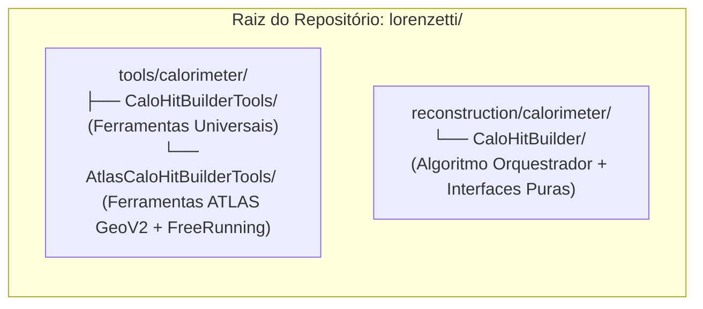
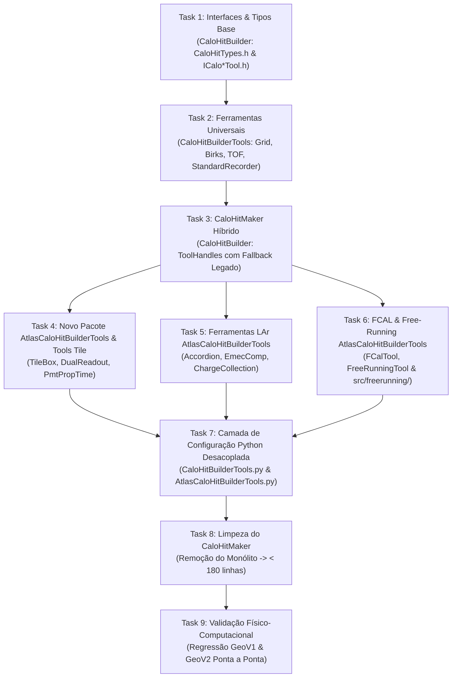

# Estudo Aprofundado do Algoritmo `CaloHitMaker`

Este documento apresenta um estudo detalhado da evolução, arquitetura, funcionamento e escopo do algoritmo **`CaloHitMaker`** (`reconstruction/calorimeter/CaloHitBuilder/src/CaloHitMaker.{h,cxx}`), comparando sua **versão original (baseline)** com a **versão atual (após a integração dos PRs #18 e #19)**.

O estudo analisa as funções, objetivos físicos e algorítmicos, trechos de código e a relação de cada funcionalidade com as geometrias **`GeoV1`** e **`GeoV2`**.

---

## 1. Visão Geral e Contexto Histórico

O algoritmo `CaloHitMaker` é o componente central da reconstrução de calorimetria durante a etapa de simulação do Lorenzetti. Sua função primária no ciclo do Geant4 é capturar cada passo de partícula (`G4Step`), determinar em qual célula sensível de leitura (*readout cell*) a energia foi depositada, aplicar correções de resposta física (saturação, tempo, atenuação) e acumular a energia no objeto correspondente (`xAOD::CaloHit`).

### Comparação Dimensional do Código

| Versão | Linhas em `CaloHitMaker.h` | Linhas em `CaloHitMaker.cxx` | Complexidade / Escopo |
| :--- | :---: | :---: | :--- |
| **Original (Baseline)** | 95 | 303 | Calorímetro genérico cilíndrico, grade uniforme $(\eta, \phi)$, integração direta de energia. |
| **Atual (`HEAD`)** | 298 (+209) | 1.700 (+1.423) | Suporte completo a células reais do ATLAS, segmentação acordeão, tubos FCAL, leitura dupla Tile, lei de Birks, simulação rápida (frozen showers), coleção de carga do EMEC e saída *free-running hits*. |

---

## 2. Quadro Resumo: Funcionalidades, Modificações e Escopo (`GeoV1` vs `GeoV2`)

| Funcionalidade / Modificação | Funções / Métodos C++ | Flags Python (`CaloHitFlags`) | Escopo | Descrição Resumida |
| :--- | :--- | :--- | :---: | :--- |
| **Filtro de Meio Ativo** | `execute` | `ActiveEnergyOnly` | **GeoV1 e GeoV2** | Descarta depósitos em materiais inativos (absorvedores, paredes de criostato), aceitando apenas `liquidArgon` e cintiladores. |
| **Saturação de Birks** | `birksEnergy` | `BirksLaw` | **GeoV1 e GeoV2** | Aplica a lei de Birks no cintilador plástico ($k_B$) e no argônio líquido ($k/F$, dependente de densidade e correção HIP). |
| **Tempo de Voo (TOF) ATLAS** | `hitTime`, `larHitTime`, `tileTime` | `AtlasHitTime` | **GeoV1 e GeoV2** *(parcial)* | Subtrai o tempo de voo $r/c$ do tempo global para alinhar partículas ultrarrelativísticas no BC 0. Em `GeoV2`, adiciona atrasos de fibra e PMT. |
| **Verificação no Ponto Médio do Passo** | `execute` (`rpos`) | N/A (fixo) | **GeoV1 e GeoV2** | Avalia se o passo pertence ao volume pelo seu ponto médio $0.5(p_{pre} + p_{post})$, evitando recusas espúrias na face de entrada. |
| **Células Arbitrárias $(r, z)$** | `findCell`, `useCells` | Ativado via `Cells` na geometria | **Exclusivo GeoV2** | Substitui o grid $(\eta, \phi)$ por caixas $(r, z)$ com centros e larguras variáveis (usado no Tile e HEC). |
| **Leitura Dupla Tile (Dual Readout)** | `tilePmtWeights`, `tileNPmt` | `TileDualReadout`, `TilePmtSplit` | **Exclusivo GeoV2** | Modela a partição de luz entre dois PMTs por célula Tile via perfil empírico U-shape ou interpolação linear. |
| **Módulos Especiais e Reposição Tile** | `tileNPmt`, `m_replaceCollectionKey` | Ativado via `Cells` na geometria | **Exclusivo GeoV2** | Trata módulos com 1 PMT (C10, E1-E4) e redireciona a energia da célula ausente D4 (EBA15/EBC18) para a célula D5. |
| **Segmentação Realista EMB e PSB** | `embSampSeg`, `embFindCell`, `psbGapCell` | Ativado via `Cells` na geometria | **Exclusivo GeoV2** | Mapeia o acordeão do barril LAr segundo as rotinas `SampSeg` do Athena e calcula a célula pelo gap do eletrodo no presampler. |
| **Compartimentos EMEC** | `emecFindCell` | Ativado via `Cells` na geometria | **Exclusivo GeoV2** | Segmenta as rodas interna e externa do endcap eletromagnético em 11 compartimentos usando planos divisores em $Z$. |
| **Projeção de Módulo no HEC** | `cellRadius` | Ativado via `Cells` na geometria | **Exclusivo GeoV2** | Projeta o raio no eixo de cada um dos 32 módulos em cunha do HEC ($r \cos(\phi - \phi_c)$). |
| **Leitura por Eletrodos no FCAL** | `fcalStep`, `fcalFillHit` | Ativado via `fcal_modules` | **Exclusivo GeoV2** | Mapeia números de cópia de gaps de eletrodos em canais/tiles de leitura do FCAL. |
| **Chuveiros Congelados FCAL** | `isShowerSpot`, `fcalSpot`, `fcalTileID` | Ativado se houver spots sem touchable | **Exclusivo GeoV2** | Trata depósitos de parametrização rápida (*frozen showers*) sem volume físico através de mapa 2D de tubos. |
| **Coleção de Carga Portada EMEC** | `emecChargeEnergy`, `emecLArPhiShift` | `FreeRunningFlags.EmecChargeCollection` | **Exclusivo GeoV2** | Calcula corrente induzida (Ramo) e campos elétricos realistas no acordeão usando mapas `ec.fieldzv03` e `HVEMECMap_v02.dat`. |
| **Hits Free-Running (Layout ATLAS)** | `freeRunningTile`, `freeRunningLAr` | `FreeRunningFlags.Enable` | **Exclusivo GeoV2** | Empacota identificadores compactos ATLAS de 64 bits e grava árvores no formato exato da ntupla de HITS do Athena. |
| **Deslocamento Azimutal $\phi$** | `m_phiShift`, `findPhi` | Ativado via `PhiShift` na geometria | **Exclusivo GeoV2** | Compensa a rotação de meio absorvedor ($-\pi/1024$ no barril, $-\pi/768$ no endcap). |

---

## 3. Análise da Versão Original (Baseline)

Na versão original (commit `2f27295`), o `CaloHitMaker` assumia uma geometria cilíndrica perfeita e idealizada:

1. **Grid Regular Bidimensional**: A amostragem era particionada exclusivamente por vetores lineares uniformes `m_etaBins` e `m_phiBins`.
2. **Pré-Alocação Exaustiva**: No método `pre_execute()`, todos os hits de cada bin $(\eta, \phi)$ eram instanciados no `xAOD::CaloHitCollection`, calculando o centro como o ponto médio aritmético do bin:
   ```cpp
   // Versão Original: pre_execute
   for ( unsigned etaBin = 0; etaBin < m_nEtaBins; ++etaBin){
     for ( unsigned phiBin = 0; phiBin < m_nPhiBins; ++phiBin){
       float etaCenter = m_etaBins[etaBin] + deltaEta / 2;
       float phiCenter = m_phiBins[phiBin] + deltaPhi / 2;
       unsigned bin = m_nPhiBins * etaBin + phiBin;
       auto *hit = new xAOD::CaloHit( etaCenter, phiCenter, deltaEta, deltaPhi, hash(bin), 
                                      (CaloSampling)m_sampling, (Detector)m_detector,
                                      m_bc_duration, m_bcid_start, m_bcid_end );
       collection->insert( hit->hash(), hit);
     }
   }
   ```
3. **Seleção Geométrica Simples**: Em `execute()`, testava-se apenas a posição do ponto pré-passo (`PreStepPoint`):
   ```cpp
   // Versão Original: execute
   G4ThreeVector pos = step->GetPreStepPoint()->GetPosition();
   auto vpos = TVector3( pos.x(), pos.y(), pos.z());
   float eta = vpos.PseudoRapidity();
   float phi = vpos.Phi();
   float radius = vpos.Perp();

   if( !(radius > m_rMin && radius <= m_rMax) ) return StatusCode::SUCCESS;
   if( !(pos.z() > m_zMin && pos.z() <= m_zMax) ) return StatusCode::SUCCESS;

   int etaBin = find(m_etaBins, eta);
   int phiBin = find(m_phiBins, phi);
   int bin = m_nPhiBins * etaBin + phiBin;
   xAOD::CaloHit *hit = nullptr;
   if (collection->retrieve(hash(bin), hit)) {
     hit->fill( step , 1*m_noiseStd);
   }
   ```
4. **Limitações Físicas do Baseline**:
   - Não havia distinção entre depósitos no absorvedor (chumbo/ferro) e no meio ativo (LAr/cintilador).
   - Não havia saturação da resposta a partículas de alta densidade de ionização (Birks).
   - O tempo de voo era apenas o tempo global do Geant4, sem compensação de $r/c$, o que jogava depósitos distantes em *bunch crossings* incorretos.
   - Não suportava calorímetros não-cilíndricos (como o acordeão de LAr ou os eletrodos de matriz do FCAL).

---

## 4. Detalhamento das Modificações e Novas Funções

Abaixo são detalhadas as modificações introduzidas nos últimos PRs, com seus objetivos, funções C++ e o escopo de geometria correspondente.

### 4.1. Filtro de Meio Ativo (`m_activeEnergyOnly`)
- **Objetivo**: Garantir que apenas a energia depositada no meio sensível (*active medium*) seja contabilizada nos hits do calorímetro. No baseline, se um passo ocorresse dentro do envelope geométrico da amostragem (por exemplo, na placa de chumbo do absorvedor), a energia era creditada na célula, inflando artificialmente o sinal.
- **Função**: Integrada diretamente no início de `CaloHitMaker::execute`:
  ```cpp
  if( m_activeEnergyOnly ){
    const G4Material *material = step->GetPreStepPoint()->GetMaterial();
    if( !material ) return StatusCode::SUCCESS;
    const G4String &materialName = material->GetName();
    if( materialName != "liquidArgon" && materialName != "PLASTIC SCINTILLATOR" && materialName != "ATLAS_TILE_PVT" )
      return StatusCode::SUCCESS;
  }
  ```
- **Relação com Geometrias**:
  - **GeoV1 e GeoV2**: Tanto `GeoV1` quanto `GeoV2` utilizam definições de materiais como `liquidArgon` e `PLASTIC SCINTILLATOR`. A flag `CaloHitFlags.ActiveEnergyOnly` controla esta verificação.

---

### 4.2. Lei de Birks para Saturação de Cintilação e Ionização (`birksEnergy`)
- **Objetivo**: Modelar a recombinação e saturação de ionização não linear para partículas altamente ionizantes ($dE/dx$ elevado), idêntico à implementação do Athena/ATLAS.
- **Função C++**: `float CaloHitMaker::birksEnergy( const G4Step *step ) const`:
  - **Cintilador Plástico** (Tile):
    $$E_{\text{vis}} = \frac{E}{1 + k_B \cdot \frac{dE/dx}{\rho}}$$
    onde $k_B = 0{,}02002\text{ g}/(\text{MeV}\cdot\text{cm}^2)$, com correção para cargas $|Z| > 1$.
  - **Argônio Líquido** (LAr):
    $$E_{\text{vis}} = E \cdot \frac{1 + \frac{k}{F} \cdot 1{,}51}{1 + \frac{k}{F} \cdot \frac{dE/dx}{\rho}} \cdot k_{\text{HIP}}$$
    onde $k = \text{BirksLArK}$ ($0{,}05832$ para barril/EMEC e $0{,}0486$ para HEC/FCAL), $F = 10\text{ kV/cm}$, $\rho = 1{,}396\text{ g/cm}^3$, e $k_{\text{HIP}}$ corrige partículas com $dE/dx > 969\text{ MeV/cm}$.
- **Trecho de Código**:
  ```cpp
  if( name == "PLASTIC SCINTILLATOR" ){
    const double charge = step->GetPreStepPoint()->GetCharge();
    if( charge == 0. ) return (float)edep;
    double kB = 0.02002 * g / (MeV * cm2);
    if( std::abs(charge) > 1.0 ) kB *= 7.2 / 12.6;
    const double dedx = edep / length / material->GetDensity();
    return (float)( edep / (1. + kB * dedx) );
  }
  if( name == "liquidArgon" ){
    const double dE = edep / MeV;
    const double dX = length / cm;
    if( dX < 1e-5 ) return (float)edep;
    const double kOverField = m_birksLArK / 10.;
    double dEdX = dE / dX;
    const double corrected = dE * (1 + kOverField * 1.51) / (1 + kOverField * dEdX / 1.396);
    if( dEdX > 12000.0 ) dEdX = 12000.0;
    const double kHIP = (dEdX > 969.) ? 0.000754 * dEdX + 0.2692 : 1.0;
    return (float)( corrected * kHIP * MeV );
  }
  ```
- **Relação com Geometrias**:
  - **GeoV1 e GeoV2**: O cálculo opera apenas nas propriedades do `G4Step` e nos materiais do Geant4, sem depender da estrutura geométrica de células. Portanto, funciona perfeitamente em ambas as geometrias quando `CaloHitFlags.BirksLaw = True`.

---

### 4.3. Correção de Tempo de Voo (TOF) e Bunch Crossing (`hitTime`, `larHitTime`, `tileTime`)
- **Objetivo**: No colisor, as colisões ocorrem a cada 25 ns (bunch crossing). Para que partículas com $\beta \approx 1$ oriundas do ponto de interação sejam atribuídas ao BC 0 independentemente da distância radial ou longitudinal do calorímetro, deve-se subtrair o tempo de voo:
  $$t_{\text{hit}} = t_{\text{global}} - \frac{r}{c}$$
- **Funções C++**:
  - `larHitTime`: Utiliza o ponto médio de pre e post-step (ou pre-step no EMB) e subtrai $|r|/c$.
  - `tileTime`: Implementa o algoritmo de simulação do Tile do ATLAS (`TileGeoG4SDCalc::MakePmtEdepTime`), calculando o atraso óptico dentro das fibras e da telha cintiladora com índice de refração $n = 1{,}59$:
    $$t = t_{\text{global}} + \frac{r_{\text{cell}} \left(n - \frac{2}{\sin\theta_{\text{cell}}}\right) + |x| (1 - n \sin\theta_{\text{hit}})}{c}$$
    e adicionando os atrasos diferenciais para os dois PMTs: $dt_{\text{Up}}$ e $dt_{\text{Down}}$.
- **Trecho de Código**:
  ```cpp
  double CaloHitMaker::larHitTime( const G4Step *step ) const
  {
    const G4StepPoint *preP = step->GetPreStepPoint(), *postP = step->GetPostStepPoint();
    if( std::abs(m_atlasBarrelEc) == 1 && m_atlasLArPart == 1 )
      return preP->GetGlobalTime() / ns - preP->GetPosition().mag() / CLHEP::c_light;
    const double tglobal = 0.5 * ( preP->GetGlobalTime() + postP->GetGlobalTime() ) / ns;
    return tglobal - ( 0.5 * ( preP->GetPosition() + postP->GetPosition() ) ).mag() / CLHEP::c_light;
  }
  ```
- **Relação com Geometrias**:
  - **GeoV1**: Aplica a correção básica do LAr ($t_{\text{global}} - r/c$) para todos os calorímetros, pois `m_cellRCentre` não está preenchido.
  - **GeoV2**: Executa a física completa, incluindo a propagação em fibra óptica e atrasos assimétricos de PMT no Tile.

---

### 4.4. Verificação no Ponto Médio do Passo (PR #16 Bugfix)
- **Objetivo**: Corrigir um defeito sutil de contorno: passos de partículas que entravam pela face inferior de um volume fino (como cintiladores de fenda E1-E4 ou tiras finas de LAr) tinham seu `PreStepPoint` exatamente sobre o plano limítrofe. Devido ao teste estrito `r > m_rMin`, esses passos eram rejeitados.
- **Modificação em C++**:
  ```cpp
  const G4ThreeVector rpos = 0.5*( pos + step->GetPostStepPoint()->GetPosition() );
  const float rradius = rpos.perp();
  if( !sampSeg && !(rradius > m_rMin && rradius <= m_rMax) )
    return StatusCode::SUCCESS;
  if( !(rpos.z() > m_zMin && rpos.z() <= m_zMax))
    return StatusCode::SUCCESS;
  ```
- **Relação com Geometrias**:
  - **GeoV1 e GeoV2**: Beneficia ambas as geometrias, tornando a aceitação de passos geometricamente consistente.

---

### 4.5. Células Baseadas em Caixas Geométricas $(r, z)$ (`findCell`, `useCells`)
- **Objetivo**: O calorímetro Tile real do ATLAS não possui células em anéis de pseudorapidez uniforme. As células são blocos cilíndricos com limites radiais e axiais bem definidos em milímetros (ex.: células A, BC, D).
- **Funções C++**:
  - `useCells()`: Retorna verdadeiro quando o vetor `m_cellEta` não está vazio.
  - `findCell(radius, z)`: Percorre os vetores de caixas `m_cellBoxRMin`, `m_cellBoxRMax`, `m_cellBoxZMin`, `m_cellBoxZMax` e localiza o índice da célula:
  ```cpp
  int CaloHitMaker::findCell( float radius, float z ) const
  {
    for ( unsigned box = 0; box < m_cellBoxIndex.size(); ++box ){
      if( radius > m_cellBoxRMin[box] && radius <= m_cellBoxRMax[box] &&
          z > m_cellBoxZMin[box] && z <= m_cellBoxZMax[box] )
        return m_cellBoxIndex[box];
    }
    return -1;
  }
  ```
- **Relação com Geometrias**:
  - **Exclusivo GeoV2**: Em `GeoV1`, a sensibilidade é definida unicamente por `EtaBins` e `PhiBins`. Apenas `GeoV2/python/detectors/TILE.py` popula o dicionário `Cells` com caixas $(r, z)$.

---

### 4.6. Leitura Dupla Tile (Dual Readout) e Perfis U-shape (`tilePmtWeights`)
- **Objetivo**: Simular realisticamente a coleta de luz em cada lado da telha de cintilador. No ATLAS, cada célula do Tile é lida por dois tubos fotomultiplicadores (PMT 0 e PMT 1), conectados via fibras ópticas em extremidades opostas em $\phi$.
- **Funções C++**:
  - `m_tileDualReadout`: $0$ = desativado, $1$ = perfil U-shape (tabelas experimentais de calibração do ATLAS), $2$ = interpolação linear.
  - `tilePmtWeights`: Recupera os fatores de atenuação da classe `TileUShape` (`TileUShape::amplitude(table, \pm \phi_{\text{local}})`).
  ```cpp
  void CaloHitMaker::tilePmtWeights( float phiLocal, float z, float &w0, float &w1, bool replaced ) const
  {
    if( m_tileDualReadout == 1 ){
      int layer = (m_sampling - 5) % 3;
      int part  = (m_sampling <= 7) ? 0 : ( z > 0 ? 1 : 2 );
      if( replaced ){ part = ( z > 0 ? 1 : 2 ); layer = 2; }
      else if( m_uShapePart >= 0 ){ part = m_uShapePart; layer = m_uShapeLayer; }
      const double *t = TileUShape::table( part, layer );
      w1 = TileUShape::amplitude( t, -phiLocal );
      w0 = TileUShape::amplitude( t,  phiLocal );
      return;
    }
    // Modo linear...
  }
  ```
- **Relação com Geometrias**:
  - **Exclusivo GeoV2**: Em `initialize()`, existe uma checagem mandatória:
    ```cpp
    if( m_tileDualReadout > 0 && isTile() && !useCells() ){
      MSG_FATAL( "TileDualReadout needs the ATLAS tile cells (CellEta)." );
    }
    ```
    Como `GeoV1` não possui `CellEta`, a leitura dupla só roda em `GeoV2`.

---

### 4.7. Redirecionamento de Células Especiais e Reposição em Tile (D4 $\rightarrow$ D5)
- **Objetivo**: No detector ATLAS real, os módulos estendidos EBA15 e EBC18 não possuem a célula física D4 devido à passagem de serviços do criostato. A energia depositada nessa região é encaminhada para o canal de leitura da célula D5.
- **Implementação**:
  - `tileNPmt(cell, phiBin)` retorna `0` quando a célula deve ser substituída.
  - O hit depositado é recuperado do container da amostragem de substituição através de `m_replaceCollectionKey`:
  ```cpp
  if( replacedCell ){
    SG::ReadHandle<xAOD::CaloHitCollection> replaced( m_replaceCollectionKey, ctx );
    xAOD::CaloHit *replacedHit = nullptr;
    if( !replaced.isValid() || !replaced->retrieve( (unsigned long int)m_replaceHashBase + phiBin, replacedHit ) ){
      MSG_FATAL( "No hit of the replacement cell in " << m_replaceCollectionKey << " for the phi bin " << phiBin );
    }
    hit = replacedHit;
  }
  ```
- **Relação com Geometrias**:
  - **Exclusivo GeoV2**: Configurado exclusivamente em `geometry/GeoV2/python/detectors/TILE.py`.

---

### 4.8. Segmentação Fiel do Acordeão EMB e Presampler (`embSampSeg`, `psbGapCell`)
- **Objetivo**: No barril eletromagnético (EMB), as placas de chumbo e eletrodos em acordeão possuem dobras (*waves*) e limites radiais que variam em função de $|z|$ e $|\eta|$. O método `embSampSeg` porta integralmente as rotinas `FiducialCuts` e `SampSeg` do Athena (`LArBarrelGeometry.cxx`).
- **Funções C++**:
  - `embSampSeg(x, y, z, region, sampling, ieta)`: Determina se o ponto está dentro da região ativa do acordeão, retornando a amostragem exata (1, 2 ou 3) e o índice $\eta$ da faixa de leitura.
  - `psbGapCell(x, y, z)`: Calcula a célula do presampler do barril a partir da inclinação angular dos módulos e do espaçamento entre catodos.
- **Relação com Geometrias**:
  - **Exclusivo GeoV2**: Ativado em `geometry/GeoV2/python/detectors/ECAL.py` através da flag `EmbSampSeg`.

---

### 4.9. Segmentação por Compartimentos do EMEC (`emecFindCell`)
- **Objetivo**: O endcap eletromagnético (EMEC) possui rodas concêntricas interna e externa com dobras em acordeão cujo ângulo de abertura varia com o raio. No ATLAS, as células são organizadas em 11 compartimentos volumétricos com transições definidas por planos de corte axial $Z_{\text{IW}}$, $Z_{\text{SEP12}}$ e $Z_{\text{SEP23}}$ medidos a partir do ponto focal elétrico.
- **Função C++**: `emecFindCell(x, y, z, etaBin, phiBin)`:
  - Aplica o deslocamento do foco elétrico: $z_f = |z| - \text{EmecFocalShift}$.
  - Compara $z_f$ com as tabelas de contorno (`m_emecZSep12`, `m_emecZSep23`, `m_emecZInner`).
  - Retorna o compartimento (1 a 11) correspondente à posição tridimensional.
- **Relação com Geometrias**:
  - **Exclusivo GeoV2**: Configurado em `geometry/GeoV2/python/detectors/EMEC.py`.

---

### 4.10. Módulos e Eletrodos do FCAL (`fcalStep`, `fcalFillHit`)
- **Objetivo**: O Forward Calorimeter (FCAL) é composto por matrizes metálicas densas perfuradas por eletrodos tubulares paralelos ao feixe. Não há simetria em $(\eta, \phi)$. O sinal é coletado nos gaps cilíndricos de argônio líquido em torno das varetas metálicas.
- **Função C++**:
  - O `CaloHitMaker` intercepta passos dentro do volume lógico do gap (`m_fcalGapVolume`).
  - Lê o número de cópia do Geant4 (`pv->GetCopyNo()`) e recupera os índices matriciais $(\eta, \phi)$ correspondentes da tabela `m_fcalCopyEtaIndex` e `m_fcalCopyPhiIndex`.
- **Relação com Geometrias**:
  - **Exclusivo GeoV2**: As matrizes de eletrodos do FCAL são instanciadas exclusivamente por `geometry/GeoV2/python/detectors/FCAL.py` e alimentam `detector_construction.fcal_modules`.

---

### 4.11. Simulação Rápida: Chuveiros Congelados no FCAL (`isShowerSpot`, `fcalSpot`)
- **Objetivo**: Para acelerar a simulação em $\eta$ elevado, o modelo de *Frozen Showers* do Geant4 injeta parâmetros de chuveiros pré-calculados (*spots* de energia) sem instanciar partículas secundárias no Geant4. Esses passos não possuem volume físico associado (`touchable == nullptr`).
- **Funções C++**:
  - `isShowerSpot(step)`: Identifica passos sem touchable:
    ```cpp
    bool CaloHitMaker::isShowerSpot( const G4Step *step ) {
      return step->GetPreStepPoint()->GetTouchable() == nullptr;
    }
    ```
  - `fcalTileID(x, y, eta, phi)`: Localiza o eletrodo e a célula a partir das coordenadas transversais $(x, y)$ usando a tabela de tubos `m_fcalTubeMap`.
  - `fcalSpot`: Credita a energia do spot no hit correspondente.
- **Relação com Geometrias**:
  - **Exclusivo GeoV2**: Requer o suporte aos módulos do FCAL v2.

---

### 4.12. Coleção de Carga Portada da Athena para o EMEC (`emecChargeEnergy`)
- **Objetivo**: Reproduzir fielmente o processo `LArG4::EC::EnergyCalculator` do Athena 23.0.14. O campo elétrico no acordeão do EMEC não é uniforme e a distância entre placas varia com o raio. A resposta em corrente requer a aplicação do teorema de Ramo e o cálculo da deriva de elétrons sob mapas realistas de alta tensão.
- **Funções C++**:
  - `emecChargeEnergy(step, energy)`: Transforma o passo do Geant4 para o referencial da roda do ATLAS (`emecTopTransform`), translada a coordenada em $\phi$ para dentro do gap de LAr (`emecLArPhiShift`) e avalia a resposta usando o `EnergyCalculator` compilado em `GeoV2`.
- **Relação com Geometrias**:
  - **Exclusivo GeoV2**: Depende de arquivos de calibração presentes em `geometry/GeoV2/data/` (`ec.fieldzv03` e `HVEMECMap_v02.dat`) e da classe `LArG4::EC::EnergyCalculator`.

---

### 4.13. Hits Free-Running no Formato do Athena (`CaloFreeRunningHitList` e `CaloFreeRunningHitWriter`)
- **O que são e qual o objetivo**:
  - **`CaloFreeRunningHitList`** (`reconstruction/calorimeter/CaloHitBuilder/src/CaloFreeRunningHitList.h`): É um contêiner em memória do StoreGate (`SG::DataHandle`) preenchido a cada evento da simulação. Ele armazena os depósitos de energia do Geant4 no regime de *tempo livre* (*free-running*), isto é, **sem integrar a energia na janela de colisão padrão de 25 ns (bunch crossing)** e sem o agrupamento do EDM padrão de análise (`xAOD::CaloHit`). Em vez disso, preserva os depósitos por canal de leitura individual:
    - No **Tile**: armazena os hits por PMT individual (2 PMTs por célula), agrupando em fatias temporais finas (*time binning* de 0,5 ns na janela $[-75{,}25; +75{,}25]$ ns e 5 ns fora dela, seguindo a lógica da classe `TileSimHit` do Athena).
    - No **LAr e FCAL**: agrupa por célula em bins de tempo variáveis (2,5 ns até 10 ns; 5 ns até 50 ns; 25 ns até 100 ns, seguindo a classe `LArHit` do Athena).
    - Para cada canal, constrói um **identificador numérico compacto de 64 bits (`long long cellID`)** contendo o empacotamento exato de bits dos dicionários do ATLAS (`subdetector`, `barrel_ec`, `sampling`, `region`, `etaIndex`, `phiIndex`, `pmt`), além de guardar tempo de chegada, tempo global médio ponderado pela energia e coordenadas $(\eta, \phi)$.
  - **`CaloFreeRunningHitWriter`** (`reconstruction/calorimeter/CaloHitBuilder/src/CaloFreeRunningHitWriter.{h,cxx}`): É um algoritmo do Lorenzetti (`Gaugi::Algorithm`) executado na etapa de pós-execução / serialização do evento. Ele recupera o `CaloFreeRunningHitList` do StoreGate e escreve os dados em uma árvore ROOT (`TTree`) nomeada `CollectionTree` (ou `FreeRunningTree`), **reproduzindo exatamente a estrutura e os nomes de *branches* da ntupla de HITS oficial do ATLAS Athena**:
    - `TileCalHit_*`: `cellID`, `energy`, `time`, `tglobal`, `eta`, `phi`, `pmt`, `module`, `tower`, `sampling`.
    - `LArHitEMB_*`, `LArHitEMEC_*`, `LArHitHEC_*`: `cellID`, `energy`, `time`, `tglobal`, `eta`, `phi`, `region`, `sampling`, `barrel_ec`.
    - `LArHitFCAL_*`: `cellID`, `energy`, `time`, `tglobal`, `eta`, `phi`, `module`.
    - Se a flag `AtlasFormat` estiver ativada, aplica a **mesma compressão com perda de bits** (`atlasCompressEnergy` para 18 bits e `atlasCompressTime` para 16 bits via mantissa arredondada) e os **mesmos limiares de corte por camada** do executável oficial `FilterHit_tf` do Athena.

- **Ele funciona com `GeoV1` e `GeoV2`?**
  - **NÃO funciona com `GeoV1`! Ele é 100% EXCLUSIVO do `GeoV2`**.
  - **Motivos Técnicos**:
    1. *Identificadores de 64 bits*: O empacotamento em `cellID` depende da topologia detalhada do ATLAS Run 4 (bits de partição de LAr, numeração de 64 módulos azimutais do Tile, códigos de `barrel_ec` $\pm 1, \pm 2, \pm 3$, etc.). O `GeoV1` não possui nenhuma dessas estruturas; suas células são identificadas puramente por um hash sequencial derivado de uma grade uniforme $(\eta, \phi)$.
    2. *Incompatibilidade Estrutural*: O `GeoV1` não modela 2 PMTs por célula nem possui a matriz 2D de tubos do FCAL.
    3. *Bloqueio Estrito no Código*:
       - Em `CaloHitMaker::initialize()`, tentar ligar `FreeRunningHits = True` sem as tabelas do ATLAS dispara imediatamente:
         `FATAL: FreeRunningHits needs the ATLAS tile cells with their ATLAS identifier fields...`
       - No script de transformação `reconstruction/reco/scripts/simu_trf.py:92-107`, tentar passar `--free-running-hits` sem o detector v2 e sem todas as flags geométricas do ATLAS Run 4 dispara uma exceção imediata:
         `raise typer.BadParameter("free-running hits require TileAtlasGeometry and TileAtlasCells in AtlasGeometryFlags")`.

---

## 5. Matriz de Compatibilidade e Impacto no `GeoV1`

Um dos aspectos mais importantes da arquitetura do `CaloHitMaker` é que **ele mantém retrocompatibilidade funcional transparente com a geometria simplificada `GeoV1`**.

### O que o `GeoV1` executa no `CaloHitMaker`:
1. **Fallback Elegante para Grade Regular**:
   Quando a amostragem não possui o atributo `sensitive().Cells` (caso do `GeoV1`), a chamada `useCells()` retorna `false`. O algoritmo volta a alocar a grade regular uniforme `m_etaBins` $\times$ `m_phiBins` em `pre_execute()` e calcula os bins por busca binária linear em `find(m_etaBins, eta)`.
2. **Correção Geométrica no Ponto Médio**:
   O cálculo `rpos = 0.5 * (pos_pre + pos_post)` é aplicado a qualquer amostragem que não seja acordeão, eliminando o erro de contorno na face de entrada do `GeoV1`.
3. **Filtro de Energia Ativa e Lei de Birks**:
   Se as flags `CaloHitFlags.ActiveEnergyOnly` ou `CaloHitFlags.BirksLaw` forem ativadas pelo usuário em uma execução com `GeoV1`, o `CaloHitMaker` executará os filtros de materiais e a saturação de Birks normalmente.
4. **Tempo de Voo (TOF) Básico**:
   Com `CaloHitFlags.AtlasHitTime = True`, o `GeoV1` calcula $t = t_{\text{global}} - r/c$ via `larHitTime()`, posicionando os depósitos no bunch crossing correto.

### O que NÃO pode ser ativado no `GeoV1` (com mensagens de erro explícitas):
- Se `TileDualReadout > 0` for configurado com `GeoV1`, `initialize()` dispara:
  `FATAL: TileDualReadout needs the ATLAS tile cells (CellEta).`
- Se `FreeRunningHits = True` for configurado com `GeoV1`, `initialize()` dispara:
  `FATAL: FreeRunningHits needs the ATLAS tile cells with their ATLAS identifier fields...` (e `simu_trf.py` bloqueia antes de rodar).
- Se `EmecChargeCollection = True` for configurado com `GeoV1`, `initialize()` dispara:
  `FATAL: EmecChargeCollection needs an ATLAS-like EM end-cap maker (EmecCompartment)...`

Essa separação garante que o `GeoV1` funcione como um modelo rápido, idealizado e robusto para testes e benchmarks, enquanto o `GeoV2` incorpora o rigor experimental do detector ATLAS.

---

## 6. Diagnóstico Arquitetural: O Problema da Classe Monolítica

A incorporação dos desenvolvimentos dos PRs #18 e #19 no `CaloHitMaker` consolidou simulações de alta fidelidade física, mas ao custo de introduzir forte débito técnico:

1. **Violação do Princípio da Responsabilidade Única (SRP)**:
   O algoritmo acumula atualmente:
   - Seleção geométrica e envelopes para 5 subsistemas distintos (Tile, EMB, EMEC, HEC, FCAL).
   - Modelagem de física de ionização e recombinação (Lei de Birks).
   - Eletrostática e cálculo de corrente de choque/deriva (coleção de carga portada do Athena via `LArG4EC`).
   - Óptica de cintiladores e propagação em fibras ópticas com matrizes empíricas U-shape (`TileUShape.h`).
   - Simulação rápida parametrizada (*frozen showers* do FCAL sem geometria Geant4).
   - Formatação e escrita de identificadores compactos de 64 bits para o formato do Athena (*free-running hits*).
2. **Violação do Princípio Aberto/Fechado (OCP)**:
   Qualquer alteração em um subsistema específico (ex.: atualizar tabelas de alta tensão do EMEC ou mudar a partição do Tile) obriga a reabrir e recompilar o arquivo central `CaloHitMaker.cxx` de 1.700 linhas.
3. **Acoplamento Indesejado de Dependências**:
   O `CaloHitMaker` (que deveria pertencer puramente à camada de reconstrução/digitalização genérica) passou a depender diretamente de cabeçalhos de simulação detalhada do ATLAS, mapas estáticos de campos e dados de calibração do `GeoV2`.

---

## 7. Proposta de Arquitetura Modular e Desacoplamento de Pacotes

Para resolver a sobrecarga do `CaloHitMaker`, desacoplar a reconstrução genérica de calorimetria das particularidades do detector ATLAS e garantir que tanto o algoritmo quanto o pacote **`CaloHitBuilder` sejam 100% genéricos para qualquer geometria** (`GeoV1`, `GeoV2`, `GeoV3` ou futuros experimentos como FCC), propõe-se uma reformulação arquitetural baseada no padrão **Strategy / Injeção de Dependência** via componentes nativos **`Gaugi::Tool`** (`GaugiKernel/Tool.h`).

---

### 7.1. O Dilema de Design: O `CaloHitBuilder` Não Pode Conhecer o `GeoV2`

Na implementação monolítica atual (`HEAD`), o `CaloHitMaker` (e consequentemente o pacote `reconstruction/calorimeter/CaloHitBuilder`) acumula centenas de linhas de código que conhecem detalhes íntimos do ATLAS:
- Fórmulas de dobras de acordeão de chumbo do barril (`SampSeg`, `embFindCell`).
- Mapas 2D de alta tensão e corrente induzida por teorema de Ramo do EMEC (`ec.fieldzv03`, `HVEMECMap_v02.dat`).
- Partição de luz entre 2 PMTs e tempo de trânsito em fibras do Tile (`TileUShape.h`).
- Identificadores compactos de 64 bits do Athena e ntuplas proprietárias do ATLAS (`CaloFreeRunningHitWriter`).

Se apenas modularizássemos o código criando `Tool`s dentro do próprio pacote `CaloHitBuilder/src/tools/`, **o problema do acoplamento não seria resolvido**:
- O pacote `CaloHitBuilder` continuaria compilando código específico do ATLAS.
- O `GeoV1` (e futuros detectores simplificados ou novos colisionadores) continuaria arrastando dependências, dicionários ROOT e tabelas estáticas do ATLAS.
- O `CaloHitBuilder` não seria um framework genérico de reconstrução de hits.

Portanto, estabelece-se o seguinte requisito fundamental:
> **O pacote `CaloHitBuilder` e o algoritmo `CaloHitMaker` devem ser 100% genéricos, agnósticos de detector e independentes de qualquer geometria específica.**

---

### 7.2. Decisão Arquitetural Consolidada: Segregação em Pacotes de Ferramentas

Para assegurar a longevidade, manutenibilidade e generalidade do ecossistema Lorenzetti, a proposta evolui para uma **segregação completa em pacotes dedicados**, separando o algoritmo orquestrador das ferramentas concretas:

1. **`CaloHitBuilder`**: Framework e algoritmo orquestrador universal (`CaloHitMaker` puro, interfaces abstratas `ICalo*Tool.h`, tipos leves e mescla de hits). **Não contém nenhuma ferramenta concreta dentro dele**.
2. **`CaloHitBuilderTools`**: Pacote dedicado contendo as ferramentas universais de formação de hits (usadas por `GeoV1` e detectores padrão).
3. **`AtlasCaloHitBuilderTools`**: Pacote dedicado contendo as ferramentas especialistas de geometria, resposta física e o subsistema *Free-Running* do ATLAS Run 4 (`GeoV2`).

---

### 7.2.1. Decisão Arquitetural Consolidada: Criação da Pasta `tools/calorimeter/` na Raiz

Ficou consolidada e implementada a separação dos pacotes de ferramentas sob uma nova pasta raiz **`tools/calorimeter/`**:



#### Justificativa da Estrutura Adotada
1. **Segregação Clara entre Algoritmo e Ferramentas**: O pacote de orquestração reside em `reconstruction/calorimeter/CaloHitBuilder`, enquanto as ferramentas de suporte computacional e físico residem na árvore `tools/calorimeter/`.
2. **Escalabilidade para Futuros Detectores e Subdetectores**: A pasta `tools/calorimeter/` estabelece um padrão extensível onde futuras ferramentas de outros calorímetros ou geometrias podem ser adicionadas sem poluir o diretório de algoritmos de reconstrução.
3. **Independência Modular e CMake**: Ambos os pacotes de ferramentas são declarados via `add_subdirectory( tools/calorimeter/... )` no `CMakeLists.txt` raiz e compilados como `OBJECT` libraries integradas à `liblorenzetti.so`.
4. **Sem Necessidade de Retrocompatibilidade**: Todos os caminhos e importações foram migrados diretamente para os novos locais definitivos.

Apresentamos abaixo a proposta formal detalhada com o trio de pacotes:
1. **`CaloHitBuilder`** (Algoritmo + Interfaces)
2. **`CaloHitBuilderTools`** (Tools Universais)
3. **`AtlasCaloHitBuilderTools`** (Tools ATLAS Run 4 + Free-Running)

---

### 7.3. O Subsistema Free-Running: Análise, Incompatibilidade com GeoV1 e Isolamento Total

Para responder com precisão às dúvidas sobre o par **`CaloFreeRunningHitList`** e **`CaloFreeRunningHitWriter`**:

#### 1. O que são e qual sua função?
- **`CaloFreeRunningHitList`** (`SG::DataHandle`): É um contêiner em memória que acumula os depósitos do Geant4 na modalidade de *tempo contínuo/livre* (*free-running*), sem agrupá-los na janela de *bunch crossing* de 25 ns do acelerador nem na estrutura do EDM de análise (`xAOD::CaloHit`). Ele agrupa os depósitos em canais e fatias de tempo (*time bins*) finas (0,5 ns no Tile, 2,5/5/25 ns no LAr e FCAL) e calcula identificadores compactos ATLAS de 64 bits (`long long cellID`).
- **`CaloFreeRunningHitWriter`** (`Gaugi::Algorithm`): É o algoritmo gravador de saída que lê a lista `CaloFreeRunningHitList` do StoreGate ao fim de cada evento e preenche a árvore ROOT `CollectionTree` (ou `FreeRunningTree`), reproduzindo exatamente o formato da **ntupla de HITS oficial do ATLAS Athena** (`TileCalHit_*`, `LArHitEMB_*`, `LArHitEMEC_*`, `LArHitHEC_*`, `LArHitFCAL_*`), incluindo filtros e compressão com perda de bits (`FilterHit_tf`).

#### 2. Ele funciona com `GeoV1` e `GeoV2`?
- **NÃO funciona com `GeoV1`! Ele é 100% EXCLUSIVO do `GeoV2`**.
- O `GeoV1` é uma geometria calorimétrica simplificada e analítica (cilindros ideais com divisões regulares em $\eta$ e $\phi$). Ele **não possui** o conceito de 64 módulos em cunha do Tile, não modela 2 PMTs com acoplamento óptico por célula, não possui a segmentação de eletrodos tubulares do FCAL nem compartimentos de acordeão LAr com convenções de `barrel_ec` $\pm 1, \pm 2, \pm 3$.
- Portanto, tentar gerar `cellID` de 64 bits do ATLAS a partir do `GeoV1` é física e matematicamente indefinido.
- O próprio sistema já possui travas explícitas no código: `CaloHitMaker::initialize()` e o script de execução `reconstruction/reco/scripts/simu_trf.py:92-107` abortam com erro fatal se a flag `--free-running-hits` for solicitada sem o detector `v2` e sem a geometria completa do ATLAS Run 4.

#### 3. Isolamento do Subsistema Free-Running no Pacote Especialista `AtlasCaloHitBuilderTools`
Com a criação do pacote especialista `AtlasCaloHitBuilderTools`, o subsistema Free-Running fica **completamente removido do `CaloHitBuilder`**:
1. **Contêiner e Writer**: Movidos para o pacote especialista em `freerunning/` (`CaloFreeRunningHitList.h`, `CaloFreeRunningHitWriter.{h,cxx}`).
2. **Tool de Registro**: `CaloFreeRunningHitRecorderTool` reside em `AtlasCaloHitBuilderTools`.
3. **Agendamento em Python**: Configurado exclusivamente em `AtlasCaloHitBuilderTools.py` quando `FreeRunningFlags.Enable == True`.
4. **Impacto no `CaloHitBuilder`, `CaloHitBuilderTools` e `GeoV1`**: **Zero absoluto**. O `CaloHitBuilder` e o `CaloHitBuilderTools` não contêm nenhum cabeçalho, tipo ou referência ao Free-Running.

---

### 7.4. Definição das Interfaces Universais (`ITool`) e Tipos de Dados

As interfaces puras e tipos de dados residem na API pública do pacote **`CaloHitBuilder`**, permitindo que qualquer pacote especialista (como `AtlasCaloHitBuilderTools` ou novos colisionadores) as implemente sem gerar acoplamento circular:

```
reconstruction/calorimeter/CaloHitBuilder/
├── CaloHitBuilder/
│   ├── CaloHitTypes.h               # Structs leves CellIdentification e CellTiming
│   ├── ICaloCellIdentifierTool.h    # Interface de busca e mapeamento geométrico
│   ├── ICaloEnergyModifierTool.h    # Interface de saturação e modificação de energia
│   ├── ICaloTimeCorrectionTool.h    # Interface de temporização e TOF
│   └── ICaloHitRecorderTool.h       # Interface de gravação e acúmulo de hits
```

---

#### A. Interface de Identificação de Células (`ICaloCellIdentifierTool`)
Responsável por determinar a célula sensível a partir da posição espacial ou de volumes do Geant4.

```cpp
// reconstruction/calorimeter/CaloHitBuilder/CaloHitBuilder/ICaloCellIdentifierTool.h
#ifndef ICaloCellIdentifierTool_h
#define ICaloCellIdentifierTool_h

#include "GaugiKernel/Tool.h"
#include "CaloHitBuilder/CaloHitTypes.h"

class G4Step;

class ICaloCellIdentifierTool : public Gaugi::Tool {
public:
  ICaloCellIdentifierTool( std::string name = "ICaloCellIdentifierTool" ) : IMsgService(name), Tool() {}
  virtual ~ICaloCellIdentifierTool() = default;

  virtual StatusCode initialize() override { return StatusCode::SUCCESS; }
  virtual StatusCode finalize() override { return StatusCode::SUCCESS; }
  virtual StatusCode execute( SG::EventContext &, Gaugi::EDM * ) const override { return StatusCode::SUCCESS; }

  virtual StatusCode preExecute( SG::EventContext &ctx, xAOD::CaloHitCollection *collection ) const = 0;
  virtual CellIdentification identify( const G4Step *step ) const = 0;
};

#endif
```

#### B. Interface de Modificação de Energia (`ICaloEnergyModifierTool`)
Responsável por aplicar correções de física de ionização, saturação ou partição na energia depositada.

```cpp
// reconstruction/calorimeter/CaloHitBuilder/CaloHitBuilder/ICaloEnergyModifierTool.h
#ifndef ICaloEnergyModifierTool_h
#define ICaloEnergyModifierTool_h

#include "GaugiKernel/Tool.h"
#include "CaloHitBuilder/CaloHitTypes.h"

class G4Step;

class ICaloEnergyModifierTool : public Gaugi::Tool {
public:
  ICaloEnergyModifierTool( std::string name = "ICaloEnergyModifierTool" ) : IMsgService(name), Tool() {}
  virtual ~ICaloEnergyModifierTool() = default;

  virtual StatusCode initialize() override { return StatusCode::SUCCESS; }
  virtual StatusCode finalize() override { return StatusCode::SUCCESS; }
  virtual StatusCode execute( SG::EventContext &, Gaugi::EDM * ) const override { return StatusCode::SUCCESS; }

  virtual float modifyEnergy( const G4Step *step, const CellIdentification &cell, float currentEnergy ) const = 0;
};

#endif
```

#### C. Interface de Correção Temporal (`ICaloTimeCorrectionTool`)
Calcula os tempos de resposta física, alinhamento TOF e atrasos de canais (ex.: fibras e PMTs).

```cpp
// reconstruction/calorimeter/CaloHitBuilder/CaloHitBuilder/ICaloTimeCorrectionTool.h
#ifndef ICaloTimeCorrectionTool_h
#define ICaloTimeCorrectionTool_h

#include "GaugiKernel/Tool.h"
#include "CaloHitBuilder/CaloHitTypes.h"

class G4Step;

class ICaloTimeCorrectionTool : public Gaugi::Tool {
public:
  ICaloTimeCorrectionTool( std::string name = "ICaloTimeCorrectionTool" ) : IMsgService(name), Tool() {}
  virtual ~ICaloTimeCorrectionTool() = default;

  virtual StatusCode initialize() override { return StatusCode::SUCCESS; }
  virtual StatusCode finalize() override { return StatusCode::SUCCESS; }
  virtual StatusCode execute( SG::EventContext &, Gaugi::EDM * ) const override { return StatusCode::SUCCESS; }

  virtual CellTiming computeTime( const G4Step *step, const CellIdentification &cell ) const = 0;
};

#endif
```

#### D. Interface de Registro de Hits (`ICaloHitRecorderTool`)
Gerencia o acúmulo no hit padrão `xAOD::CaloHit` ou a persistência em formatos de teste/ntupla (como HITS Athena).

```cpp
// reconstruction/calorimeter/CaloHitBuilder/CaloHitBuilder/ICaloHitRecorderTool.h
#ifndef ICaloHitRecorderTool_h
#define ICaloHitRecorderTool_h

#include "GaugiKernel/Tool.h"
#include "CaloHitBuilder/CaloHitTypes.h"

class G4Step;

class ICaloHitRecorderTool : public Gaugi::Tool {
public:
  ICaloHitRecorderTool( std::string name = "ICaloHitRecorderTool" ) : IMsgService(name), Tool() {}
  virtual ~ICaloHitRecorderTool() = default;

  virtual StatusCode initialize() override { return StatusCode::SUCCESS; }
  virtual StatusCode finalize() override { return StatusCode::SUCCESS; }
  virtual StatusCode execute( SG::EventContext &, Gaugi::EDM * ) const override { return StatusCode::SUCCESS; }

  virtual StatusCode record( SG::EventContext &ctx, const G4Step *step,
                             const CellIdentification &cell, float energy,
                             const CellTiming &timing ) const = 0;
};

#endif
```

---

### 7.5. Catálogo de Ferramentas: Alocação Desacoplada por Pacote

Com a segregação em pacotes dedicados de ferramentas (**`CaloHitBuilderTools`** e **`AtlasCaloHitBuilderTools`**), o repositório ganha uma divisão limpa entre o framework universal e a especialização do detector:

#### 1. Pacote `CaloHitBuilderTools` (Ferramentas Universais de Reconstrução)
Totalmente agnóstico de detector. Atende a simulações de calorimetria genérica (`GeoV1`), detectores cilíndricos padrão e futuros experimentos:

| Ferramenta Universal | Interface Base | Pacote | Escopo | Descrição da Responsabilidade |
| :--- | :--- | :---: | :---: | :--- |
| **`CaloGridCellTool`** | `ICaloCellIdentifierTool` | `CaloHitBuilderTools` | **GeoV1 e GeoV2 simples** | Mapeamento padrão em grade uniforme $(\eta, \phi)$ por busca binária (`find`). |
| **`CaloBirksLawTool`** | `ICaloEnergyModifierTool` | `CaloHitBuilderTools` | **GeoV1 e GeoV2** | Aplica saturação de Birks para cintilador plástico e LAr (com correção HIP). |
| **`CaloTofCorrectionTool`** | `ICaloTimeCorrectionTool` | `CaloHitBuilderTools` | **GeoV1 e GeoV2** | Subtração padrão do tempo de voo $r/c$ do tempo global do Geant4. |
| **`CaloStandardHitRecorderTool`**| `ICaloHitRecorderTool` | `CaloHitBuilderTools` | **GeoV1 e GeoV2** | Recupera o `xAOD::CaloHit` da coleção do StoreGate e acumula a energia no bunch crossing. |

#### 2. Pacote `AtlasCaloHitBuilderTools` (Especialização ATLAS Run 4 e Free-Running)
Contém todas as particularidades de física, geometria complexa e formatos proprietários do ATLAS Run 4 (`GeoV2`):

| Ferramenta Especializada | Interface Base | Pacote | Escopo | Descrição da Responsabilidade |
| :--- | :--- | :---: | :---: | :--- |
| **`TileBoxCellTool`** | `ICaloCellIdentifierTool` | `AtlasCaloHitBuilderTools` | **Exclusivo GeoV2 Tile** | Mapeamento em caixas $(r, z)$, tratamento de módulos especiais (C10, E1-E4) e reposição D4 $\rightarrow$ D5. |
| **`LArAccordionTool`** | `ICaloCellIdentifierTool` | `AtlasCaloHitBuilderTools` | **Exclusivo GeoV2 EMB** | Segmentação do acordeão do EMB (`SampSeg`), corte de fiducialidade e presampler (`psbGapCell`). |
| **`LArEmecCompartmentTool`** | `ICaloCellIdentifierTool` | `AtlasCaloHitBuilderTools` | **Exclusivo GeoV2 EMEC** | Segmentação das rodas interna/externa do EMEC em 11 compartimentos com planos $Z$ e foco elétrico. |
| **`LArHecModuleTool`** | `ICaloCellIdentifierTool` | `AtlasCaloHitBuilderTools` | **Exclusivo GeoV2 HEC** | Projeção em módulos em cunha do HEC ($r \cos(\phi - \phi_c)$). |
| **`LArFCalElectrodeTool`** | `ICaloCellIdentifierTool` | `AtlasCaloHitBuilderTools` | **Exclusivo GeoV2 FCAL** | Associação por número de cópia do gap de eletrodos e matriz 2D de tubos para *frozen showers*. |
| **`TileDualReadoutSplitTool`** | `ICaloEnergyModifierTool` | `AtlasCaloHitBuilderTools` | **Exclusivo GeoV2 Tile** | Calcula partição de energia $w_0$ e $w_1$ entre PMTs usando perfis U-shape ou linear. |
| **`LArEmecChargeCollectionTool`** | `ICaloEnergyModifierTool` | `AtlasCaloHitBuilderTools` | **Exclusivo GeoV2 EMEC** | Encapsula `LArG4::EC::EnergyCalculator`, mapa de campo `ec.fieldzv03`, mapa HV e bisseção azimutal. |
| **`TilePmtPropagationTimeTool`** | `ICaloTimeCorrectionTool` | `AtlasCaloHitBuilderTools` | **Exclusivo GeoV2 Tile** | Calcula a propagação óptica nas telhas e fibras ($n = 1{,}59$) e atrasos $dt_{\text{Up}}$ e $dt_{\text{Down}}$. |
| **`CaloFreeRunningHitRecorderTool`**| `ICaloHitRecorderTool`| `AtlasCaloHitBuilderTools` | **Exclusivo GeoV2 FreeRun** | Empacota identificadores ATLAS de 64 bits e alimenta a lista `CaloFreeRunningHitList`. |
| **`CaloFreeRunningHitList`** | `SG::DataHandle` | `AtlasCaloHitBuilderTools` | **Exclusivo GeoV2 FreeRun** | Contêiner isolado em `src/freerunning/` com depósitos em tempo livre. |
| **`CaloFreeRunningHitWriter`** | `Gaugi::Algorithm` | `AtlasCaloHitBuilderTools` | **Exclusivo GeoV2 FreeRun** | Gravador de ntupla HITS oficial do Athena isolado em `src/freerunning/`. |

---

### 7.5.1. Declaração da Interface C++ de Cada Ferramenta Concreta (`Gaugi::Tool`)

Abaixo estão especificadas as declarações de cabeçalho C++ completas para cada uma das classes de ferramentas, organizadas por pacote de destino.

---

#### Grupo A: Ferramentas de Identificação Geométrica (`ICaloCellIdentifierTool`)

##### 1. `CaloGridCellTool` (GeoV1 e GeoV2 simples - Pacote `CaloHitBuilderTools`)
Mapeia o passo de partícula em células por busca binária $(\eta, \phi)$ em grades uniformes.

```cpp
// CaloHitBuilderTools/src/CaloGridCellTool.h
#ifndef CaloGridCellTool_h
#define CaloGridCellTool_h

#include "CaloHitBuilder/ICaloCellIdentifierTool.h"
#include <vector>

class CaloGridCellTool : public ICaloCellIdentifierTool {
public:
  CaloGridCellTool( std::string name = "CaloGridCellTool" );
  virtual ~CaloGridCellTool() = default;

  virtual StatusCode initialize() override;
  virtual StatusCode finalize() override;

  virtual StatusCode preExecute( SG::EventContext &ctx, xAOD::CaloHitCollection *collection ) const override;
  virtual CellIdentification identify( const G4Step *step ) const override;

  int find( const std::vector<float> &bins, float val ) const;
  unsigned long int hash( unsigned int bin ) const;

private:
  std::vector<float> m_etaBins;
  std::vector<float> m_phiBins;
  float m_phiShift = 0.0f;
  unsigned int m_nEtaBins = 0;
  unsigned int m_nPhiBins = 0;
  float m_deltaEta = 0.0f;
  float m_deltaPhi = 0.0f;
  float m_bc_duration = 25.0f;
  int m_bcid_start = -7;
  int m_bcid_end = 7;
  int m_sampling = 0;
  int m_detector = 0;
};

#endif
```

##### 2. `TileBoxCellTool` (Exclusivo GeoV2 Tile - Pacote `AtlasCaloHitBuilderTools`)
Mapeia células do Tile em caixas $(r, z)$, gerencia módulos especiais com 1 PMT (C10, E1-E4) e redireciona D4 $\rightarrow$ D5.

```cpp
// AtlasCaloHitBuilderTools/src/TileBoxCellTool.h
#ifndef TileBoxCellTool_h
#define TileBoxCellTool_h

#include "CaloHitBuilder/ICaloCellIdentifierTool.h"
#include <vector>
#include <string>

class TileBoxCellTool : public ICaloCellIdentifierTool {
public:
  TileBoxCellTool( std::string name = "TileBoxCellTool" );
  virtual ~TileBoxCellTool() = default;

  virtual StatusCode initialize() override;
  virtual StatusCode finalize() override;

  virtual StatusCode preExecute( SG::EventContext &ctx, xAOD::CaloHitCollection *collection ) const override;
  virtual CellIdentification identify( const G4Step *step ) const override;

  int findCell( float r, float z ) const;

private:
  std::vector<float> m_cellBoxRMin;
  std::vector<float> m_cellBoxRMax;
  std::vector<float> m_cellBoxZMin;
  std::vector<float> m_cellBoxZMax;
  std::vector<int>   m_cellBoxIndex;
  std::vector<float> m_cellEta;
  std::vector<float> m_cellDeltaEta;
  std::vector<float> m_phiBins;
  float m_deltaPhi = 0.0f;
  float m_bc_duration = 25.0f;
  int m_bcid_start = -7;
  int m_bcid_end = 7;
  int m_sampling = 0;
  int m_detector = 0;

  // Módulos especiais com 1 PMT e redirecionamento de célula ausente (D4 -> D5)
  std::string m_replaceCollectionKey;
  int m_replaceSection = 0;
  int m_replaceTower = 0;
  int m_replaceSampling = 0;
};

#endif
```

##### 3. `LArAccordionTool` (Exclusivo GeoV2 EMB - Pacote `AtlasCaloHitBuilderTools`)
Segmenta o acordeão do barril LAr através das rotinas `SampSeg` do Athena e trata o gap do presampler (`psbGapCell`).

```cpp
// AtlasCaloHitBuilderTools/src/LArAccordionTool.h
#ifndef LArAccordionTool_h
#define LArAccordionTool_h

#include "CaloHitBuilder/ICaloCellIdentifierTool.h"
#include <vector>

class LArAccordionTool : public ICaloCellIdentifierTool {
public:
  LArAccordionTool( std::string name = "LArAccordionTool" );
  virtual ~LArAccordionTool() = default;

  virtual StatusCode initialize() override;
  virtual StatusCode finalize() override;

  virtual StatusCode preExecute( SG::EventContext &ctx, xAOD::CaloHitCollection *collection ) const override;
  virtual CellIdentification identify( const G4Step *step ) const override;

  int embFindCell( float eta, float phi, float r, float z, int &etaBin, int &phiBin ) const;
  int embSampSeg( float r, float eta ) const;

private:
  int m_embSampling = 0;
  float m_phiShift = 0.0f;
  std::vector<float> m_etaBins;
  std::vector<float> m_phiBins;
  float m_bc_duration = 25.0f;
  int m_bcid_start = -7;
  int m_bcid_end = 7;
  int m_sampling = 0;
  int m_detector = 0;
};

#endif
```

##### 4. `LArEmecCompartmentTool` (Exclusivo GeoV2 EMEC - Pacote `AtlasCaloHitBuilderTools`)
Segmenta as rodas interna e externa do end-cap eletromagnético em 11 compartimentos com planos divisores em $Z$ e foco elétrico.

```cpp
// AtlasCaloHitBuilderTools/src/LArEmecCompartmentTool.h
#ifndef LArEmecCompartmentTool_h
#define LArEmecCompartmentTool_h

#include "CaloHitBuilder/ICaloCellIdentifierTool.h"
#include <vector>

class LArEmecCompartmentTool : public ICaloCellIdentifierTool {
public:
  LArEmecCompartmentTool( std::string name = "LArEmecCompartmentTool" );
  virtual ~LArEmecCompartmentTool() = default;

  virtual StatusCode initialize() override;
  virtual StatusCode finalize() override;

  virtual StatusCode preExecute( SG::EventContext &ctx, xAOD::CaloHitCollection *collection ) const override;
  virtual CellIdentification identify( const G4Step *step ) const override;

  int emecFindCell( float r, float z, float eta ) const;

private:
  int   m_emecCompartment = 0;
  float m_emecEtaScale = 1.0f;
  float m_emecEtaOffset = 0.0f;
  int   m_emecMaxEta = 0;
  float m_emecFocalShift = 0.0f;
  std::vector<int> m_emecZSep12;
  std::vector<int> m_emecZSep23;
  std::vector<int> m_emecZInner;
  std::vector<float> m_etaBins;
  std::vector<float> m_phiBins;
  float m_bc_duration = 25.0f;
  int m_bcid_start = -7;
  int m_bcid_end = 7;
  int m_sampling = 0;
  int m_detector = 0;
};

#endif
```

##### 5. `LArHecModuleTool` (Exclusivo GeoV2 HEC - Pacote `AtlasCaloHitBuilderTools`)
Projeta o raio nos 32 módulos azimutais em cunha do calorímetro hadrônico de end-cap ($r \cos(\phi - \phi_c)$).

```cpp
// AtlasCaloHitBuilderTools/src/LArHecModuleTool.h
#ifndef LArHecModuleTool_h
#define LArHecModuleTool_h

#include "CaloHitBuilder/ICaloCellIdentifierTool.h"
#include <vector>

class LArHecModuleTool : public ICaloCellIdentifierTool {
public:
  LArHecModuleTool( std::string name = "LArHecModuleTool" );
  virtual ~LArHecModuleTool() = default;

  virtual StatusCode initialize() override;
  virtual StatusCode finalize() override;

  virtual StatusCode preExecute( SG::EventContext &ctx, xAOD::CaloHitCollection *collection ) const override;
  virtual CellIdentification identify( const G4Step *step ) const override;

  double cellRadius( double x, double y, int module ) const;

private:
  int m_nModules = 32;
  std::vector<float> m_cellBoxRMin;
  std::vector<float> m_cellBoxRMax;
  std::vector<float> m_cellBoxZMin;
  std::vector<float> m_cellBoxZMax;
  std::vector<float> m_phiBins;
  float m_bc_duration = 25.0f;
  int m_bcid_start = -7;
  int m_bcid_end = 7;
  int m_sampling = 0;
  int m_detector = 0;
};

#endif
```

##### 6. `LArFCalElectrodeTool` (Exclusivo GeoV2 FCAL - Pacote `AtlasCaloHitBuilderTools`)
Mapeia passos por número de cópia dos gaps de eletrodos e gerencia *spots* de simulação rápida (*frozen showers*) sem volume físico via mapa 2D de tubos.

```cpp
// AtlasCaloHitBuilderTools/src/LArFCalElectrodeTool.h
#ifndef LArFCalElectrodeTool_h
#define LArFCalElectrodeTool_h

#include "CaloHitBuilder/ICaloCellIdentifierTool.h"
#include <vector>

class LArFCalElectrodeTool : public ICaloCellIdentifierTool {
public:
  LArFCalElectrodeTool( std::string name = "LArFCalElectrodeTool" );
  virtual ~LArFCalElectrodeTool() = default;

  virtual StatusCode initialize() override;
  virtual StatusCode finalize() override;

  virtual StatusCode preExecute( SG::EventContext &ctx, xAOD::CaloHitCollection *collection ) const override;
  virtual CellIdentification identify( const G4Step *step ) const override;

  bool isShowerSpot( const G4Step *step ) const;
  int fcalTileID( double x, double y, float &eta, float &phi ) const;

private:
  int m_fcalModule = 0;
  int m_fcalSide = 0;
  float m_bc_duration = 25.0f;
  int m_bcid_start = -7;
  int m_bcid_end = 7;
  int m_sampling = 0;
  int m_detector = 0;
};

#endif
```

---

#### Grupo B: Ferramentas de Modificação de Energia (`ICaloEnergyModifierTool`)

##### 7. `CaloBirksLawTool` (GeoV1 e GeoV2 - Pacote `CaloHitBuilderTools`)
Aplica a lei de saturação de Birks para cintiladores plásticos ($k_B$) e argônio líquido ($k/F$ com correção HIP).

```cpp
// CaloHitBuilderTools/src/CaloBirksLawTool.h
#ifndef CaloBirksLawTool_h
#define CaloBirksLawTool_h

#include "CaloHitBuilder/ICaloEnergyModifierTool.h"

class G4Material;

class CaloBirksLawTool : public ICaloEnergyModifierTool {
public:
  CaloBirksLawTool( std::string name = "CaloBirksLawTool" );
  virtual ~CaloBirksLawTool() = default;

  virtual StatusCode initialize() override;
  virtual StatusCode finalize() override;

  virtual float modifyEnergy( const G4Step *step, const CellIdentification &cell, float currentEnergy ) const override;

  double birksEnergy( const G4Step *step, double edep, const G4Material *material ) const;

private:
  double m_birksScintK = 0.079;   // mm/MeV (cintilador plástico)
  double m_birksLArK   = 0.05832; // mm/MeV (argônio líquido, k/F)
  bool   m_enableLAr   = true;
  bool   m_enableScint = true;
};

#endif
```

##### 8. `TileDualReadoutSplitTool` (Exclusivo GeoV2 Tile - Pacote `AtlasCaloHitBuilderTools`)
Calcula a partição de energia $w_0$ e $w_1$ entre dois PMTs por célula do Tile usando o perfil empírico U-shape ou interpolação linear.

```cpp
// AtlasCaloHitBuilderTools/src/TileDualReadoutSplitTool.h
#ifndef TileDualReadoutSplitTool_h
#define TileDualReadoutSplitTool_h

#include "CaloHitBuilder/ICaloEnergyModifierTool.h"

class TileDualReadoutSplitTool : public ICaloEnergyModifierTool {
public:
  TileDualReadoutSplitTool( std::string name = "TileDualReadoutSplitTool" );
  virtual ~TileDualReadoutSplitTool() = default;

  virtual StatusCode initialize() override;
  virtual StatusCode finalize() override;

  virtual float modifyEnergy( const G4Step *step, const CellIdentification &cell, float currentEnergy ) const override;

  void tilePmtWeights( const G4Step *step, int cell, float &w0, float &w1 ) const;

private:
  int m_splitMode = 1; // 1 = U-shape empírico ATLAS, 2 = linear
  int m_targetPmt = 0; // 0 = PMT0, 1 = PMT1
};

#endif
```

##### 9. `LArEmecChargeCollectionTool` (Exclusivo GeoV2 EMEC - Pacote `AtlasCaloHitBuilderTools`)
Encapsula o cálculo de corrente induzida por teorema de Ramo, mapas de campo `ec.fieldzv03` e mapas de alta tensão `HVEMECMap_v02.dat` compilados do Athena.

```cpp
// AtlasCaloHitBuilderTools/src/LArEmecChargeCollectionTool.h
#ifndef LArEmecChargeCollectionTool_h
#define LArEmecChargeCollectionTool_h

#include "CaloHitBuilder/ICaloEnergyModifierTool.h"
#include <string>

namespace LArG4 { namespace EC { class EnergyCalculator; } }

class LArEmecChargeCollectionTool : public ICaloEnergyModifierTool {
public:
  LArEmecChargeCollectionTool( std::string name = "LArEmecChargeCollectionTool" );
  virtual ~LArEmecChargeCollectionTool();

  virtual StatusCode initialize() override;
  virtual StatusCode finalize() override;

  virtual float modifyEnergy( const G4Step *step, const CellIdentification &cell, float currentEnergy ) const override;

private:
  std::string m_tablesFile;
  std::string m_fieldMapFile;
  std::string m_hvMapFile;
  LArG4::EC::EnergyCalculator *m_calculator = nullptr;
};

#endif
```

---

#### Grupo C: Ferramentas de Correção Temporal (`ICaloTimeCorrectionTool`)

##### 10. `CaloTofCorrectionTool` (GeoV1 e GeoV2 - Pacote `CaloHitBuilderTools`)
Subtrai o tempo de voo $r/c$ do tempo global do Geant4 para alinhamento em bunch crossing.

```cpp
// CaloHitBuilderTools/src/CaloTofCorrectionTool.h
#ifndef CaloTofCorrectionTool_h
#define CaloTofCorrectionTool_h

#include "CaloHitBuilder/ICaloTimeCorrectionTool.h"

class CaloTofCorrectionTool : public ICaloTimeCorrectionTool {
public:
  CaloTofCorrectionTool( std::string name = "CaloTofCorrectionTool" );
  virtual ~CaloTofCorrectionTool() = default;

  virtual StatusCode initialize() override;
  virtual StatusCode finalize() override;

  virtual CellTiming computeTime( const G4Step *step, const CellIdentification &cell ) const override;

private:
  double m_cLight = 299.792458; // mm/ns
  bool   m_usePreStepOnly = false;
};

#endif
```

##### 11. `TilePmtPropagationTimeTool` (Exclusivo GeoV2 Tile - Pacote `AtlasCaloHitBuilderTools`)
Modela os atrasos de propagação da luz nas telhas e fibras ópticas com índice de refração $n = 1{,}59$, calculando $dt_{\text{Up}}$ e $dt_{\text{Down}}$.

```cpp
// AtlasCaloHitBuilderTools/src/TilePmtPropagationTimeTool.h
#ifndef TilePmtPropagationTimeTool_h
#define TilePmtPropagationTimeTool_h

#include "CaloHitBuilder/ICaloTimeCorrectionTool.h"

class TilePmtPropagationTimeTool : public ICaloTimeCorrectionTool {
public:
  TilePmtPropagationTimeTool( std::string name = "TilePmtPropagationTimeTool" );
  virtual ~TilePmtPropagationTimeTool() = default;

  virtual StatusCode initialize() override;
  virtual StatusCode finalize() override;

  virtual CellTiming computeTime( const G4Step *step, const CellIdentification &cell ) const override;

  void tilePmtDelays( const G4Step *step, int cell, float &dt0, float &dt1 ) const;

private:
  double m_refractiveIndex = 1.59;
  double m_timeCut = 350.5;      // ns
  double m_lateHitTime = 99995.0;// ns
};

#endif
```

---

#### Grupo D: Ferramentas de Gravação e Persistência de Hits (`ICaloHitRecorderTool`)

##### 12. `CaloStandardHitRecorderTool` (GeoV1 e GeoV2 - Pacote `CaloHitBuilderTools`)
Recupera a coleção `xAOD::CaloHitCollection` do StoreGate e acumula a energia no bunch crossing correspondente do objeto `xAOD::CaloHit`.

```cpp
// CaloHitBuilderTools/src/CaloStandardHitRecorderTool.h
#ifndef CaloStandardHitRecorderTool_h
#define CaloStandardHitRecorderTool_h

#include "CaloHitBuilder/ICaloHitRecorderTool.h"
#include <string>

class CaloStandardHitRecorderTool : public ICaloHitRecorderTool {
public:
  CaloStandardHitRecorderTool( std::string name = "CaloStandardHitRecorderTool" );
  virtual ~CaloStandardHitRecorderTool() = default;

  virtual StatusCode initialize() override;
  virtual StatusCode finalize() override;

  virtual StatusCode record( SG::EventContext &ctx, const G4Step *step,
                             const CellIdentification &cell, float energy,
                             const CellTiming &timing ) const override;

private:
  std::string m_collectionKey;
  float  m_noiseStd = 0.0f;
  float  m_bc_duration = 25.0f;
  int    m_bcid_start = -7;
  int    m_bcid_end = 7;
};

#endif
```

##### 13. `CaloFreeRunningHitRecorderTool` (Exclusivo GeoV2 Free-Running - Pacote `AtlasCaloHitBuilderTools`)
Empacota os identificadores compactos de 64 bits do ATLAS e alimenta a lista `CaloFreeRunningHitList` (isolada em `src/freerunning/` do `AtlasCaloHitBuilderTools`).

```cpp
// AtlasCaloHitBuilderTools/src/CaloFreeRunningHitRecorderTool.h
#ifndef CaloFreeRunningHitRecorderTool_h
#define CaloFreeRunningHitRecorderTool_h

#include "CaloHitBuilder/ICaloHitRecorderTool.h"
#include <string>

class CaloFreeRunningHitList;

class CaloFreeRunningHitRecorderTool : public ICaloHitRecorderTool {
public:
  CaloFreeRunningHitRecorderTool( std::string name = "CaloFreeRunningHitRecorderTool" );
  virtual ~CaloFreeRunningHitRecorderTool() = default;

  virtual StatusCode initialize() override;
  virtual StatusCode finalize() override;

  virtual StatusCode record( SG::EventContext &ctx, const G4Step *step,
                             const CellIdentification &cell, float energy,
                             const CellTiming &timing ) const override;

private:
  void fillTile( CaloFreeRunningHitList *list, const G4Step *step,
                 const CellIdentification &cell, float energy, const CellTiming &timing ) const;
  void fillLAr( CaloFreeRunningHitList *list, const G4Step *step,
                const CellIdentification &cell, float energy, const CellTiming &timing ) const;

  std::string m_listKey = "FreeRunningHits";
  bool m_binning = true;
  int  m_subdet = 0; // 0=Tile, 1=EMB, 2=EMEC, 3=HEC, 4=FCAL
  int  m_atlasBarrelEc = 1;
  int  m_atlasLArSampling = 0;
  int  m_atlasLArRegion = 0;
};

#endif
```

namespace LArG4 { namespace EC { class EnergyCalculator; } }

class LArEmecChargeCollectionTool : public ICaloEnergyModifierTool {
public:
  LArEmecChargeCollectionTool( std::string name = "LArEmecChargeCollectionTool" );
  virtual ~LArEmecChargeCollectionTool();

  virtual StatusCode initialize() override;
  virtual StatusCode finalize() override;

  virtual float modifyEnergy( const G4Step *step, const CellIdentification &cell, float currentEnergy ) const override;

private:
  std::string m_tablesFile;
  std::string m_fieldMapFile;
  std::string m_hvMapFile;
  LArG4::EC::EnergyCalculator *m_calculator = nullptr;
};

#endif
```

---

#### Grupo C: Ferramentas de Correção Temporal (`ICaloTimeCorrectionTool`)

##### 10. `CaloTofCorrectionTool` (GeoV1 e GeoV2 - Pacote `CaloHitBuilderTools`)
Subtrai o tempo de voo $r/c$ do tempo global do Geant4 para alinhamento em bunch crossing.

```cpp
// CaloHitBuilderTools/src/CaloTofCorrectionTool.h
#ifndef CaloTofCorrectionTool_h
#define CaloTofCorrectionTool_h

#include "CaloHitBuilder/ICaloTimeCorrectionTool.h"

class CaloTofCorrectionTool : public ICaloTimeCorrectionTool {
public:
  CaloTofCorrectionTool( std::string name = "CaloTofCorrectionTool" );
  virtual ~CaloTofCorrectionTool() = default;

  virtual StatusCode initialize() override;
  virtual StatusCode finalize() override;

  virtual CellTiming computeTime( const G4Step *step, const CellIdentification &cell ) const override;

private:
  double m_cLight = 299.792458; // mm/ns
  bool   m_usePreStepOnly = false;
};

#endif
```

##### 11. `TilePmtPropagationTimeTool` (Exclusivo GeoV2 Tile - Pacote `AtlasCaloHitBuilderTools`)
Modela os atrasos de propagação da luz nas telhas e fibras ópticas com índice de refração $n = 1{,}59$, calculando $dt_{\text{Up}}$ e $dt_{\text{Down}}$.

```cpp
// AtlasCaloHitBuilderTools/src/TilePmtPropagationTimeTool.h
#ifndef TilePmtPropagationTimeTool_h
#define TilePmtPropagationTimeTool_h

#include "CaloHitBuilder/ICaloTimeCorrectionTool.h"

class TilePmtPropagationTimeTool : public ICaloTimeCorrectionTool {
public:
  TilePmtPropagationTimeTool( std::string name = "TilePmtPropagationTimeTool" );
  virtual ~TilePmtPropagationTimeTool() = default;

  virtual StatusCode initialize() override;
  virtual StatusCode finalize() override;

  virtual CellTiming computeTime( const G4Step *step, const CellIdentification &cell ) const override;

  void tilePmtDelays( const G4Step *step, int cell, float &dt0, float &dt1 ) const;

private:
  double m_refractiveIndex = 1.59;
  double m_timeCut = 350.5;      // ns
  double m_lateHitTime = 99995.0;// ns
};

#endif
```

---

#### Grupo D: Ferramentas de Gravação e Persistência de Hits (`ICaloHitRecorderTool`)

##### 12. `CaloStandardHitRecorderTool` (GeoV1 e GeoV2 - Pacote `CaloHitBuilderTools`)
Recupera a coleção `xAOD::CaloHitCollection` do StoreGate e acumula a energia no bunch crossing correspondente do objeto `xAOD::CaloHit`.

```cpp
// CaloHitBuilderTools/src/CaloStandardHitRecorderTool.h
#ifndef CaloStandardHitRecorderTool_h
#define CaloStandardHitRecorderTool_h

#include "CaloHitBuilder/ICaloHitRecorderTool.h"
#include <string>

class CaloStandardHitRecorderTool : public ICaloHitRecorderTool {
public:
  CaloStandardHitRecorderTool( std::string name = "CaloStandardHitRecorderTool" );
  virtual ~CaloStandardHitRecorderTool() = default;

  virtual StatusCode initialize() override;
  virtual StatusCode finalize() override;

  virtual StatusCode record( SG::EventContext &ctx, const G4Step *step,
                             const CellIdentification &cell, float energy,
                             const CellTiming &timing ) const override;

private:
  std::string m_collectionKey;
  float  m_noiseStd = 0.0f;
  float  m_bc_duration = 25.0f;
  int    m_bcid_start = -7;
  int    m_bcid_end = 7;
};

#endif
```

##### 13. `CaloFreeRunningHitRecorderTool` (Exclusivo GeoV2 Free-Running - Pacote `AtlasCaloHitBuilderTools`)
Empacota os identificadores compactos de 64 bits do ATLAS e alimenta a lista `CaloFreeRunningHitList` (isolada em `src/freerunning/` do `AtlasCaloHitBuilderTools`).

```cpp
// AtlasCaloHitBuilderTools/src/CaloFreeRunningHitRecorderTool.h
#ifndef CaloFreeRunningHitRecorderTool_h
#define CaloFreeRunningHitRecorderTool_h

#include "CaloHitBuilder/ICaloHitRecorderTool.h"
#include <string>

class CaloFreeRunningHitList;

class CaloFreeRunningHitRecorderTool : public ICaloHitRecorderTool {
public:
  CaloFreeRunningHitRecorderTool( std::string name = "CaloFreeRunningHitRecorderTool" );
  virtual ~CaloFreeRunningHitRecorderTool() = default;

  virtual StatusCode initialize() override;
  virtual StatusCode finalize() override;

  virtual StatusCode record( SG::EventContext &ctx, const G4Step *step,
                             const CellIdentification &cell, float energy,
                             const CellTiming &timing ) const override;

private:
  void fillTile( CaloFreeRunningHitList *list, const G4Step *step,
                 const CellIdentification &cell, float energy, const CellTiming &timing ) const;
  void fillLAr( CaloFreeRunningHitList *list, const G4Step *step,
                const CellIdentification &cell, float energy, const CellTiming &timing ) const;

  std::string m_listKey = "FreeRunningHits";
  bool m_binning = true;
  int  m_subdet = 0; // 0=Tile, 1=EMB, 2=EMEC, 3=HEC, 4=FCAL
  int  m_atlasBarrelEc = 1;
  int  m_atlasLArSampling = 0;
  int  m_atlasLArRegion = 0;
};

#endif
```

---

### 7.6. Árvore Completa de Arquivos Alterados (Visão Global do Repositório com 3 Pacotes)

A arquitetura consolidada divide as responsabilidades em 3 pacotes perfeitamente desacoplados:
1. **`CaloHitBuilder`**: Framework e motor orquestrador puro (interfaces `ICalo*Tool`, tipos leves `CaloHitTypes.h`, algoritmo `CaloHitMaker` e mescladores de coleções).
2. **`CaloHitBuilderTools`**: Ferramentas universais de reconstrução (`CaloGridCellTool`, `CaloBirksLawTool`, `CaloTofCorrectionTool`, `CaloStandardHitRecorderTool`).
3. **`AtlasCaloHitBuilderTools`**: Ferramentas especialistas do ATLAS Run 4 (`TileBoxCellTool`, `LArAccordionTool`, `LArEmecCompartmentTool`, `LArHecModuleTool`, `LArFCalElectrodeTool`, `TileDualReadoutSplitTool`, `LArEmecChargeCollectionTool`, `TilePmtPropagationTimeTool`, `CaloFreeRunningHitRecorderTool`, contêiner `CaloFreeRunningHitList` e algoritmo `CaloFreeRunningHitWriter`).

Abaixo apresentamos a árvore completa de arquivos, ilustrando a estrutura implementada com a pasta **`tools/calorimeter/`** na raiz:

```
lorenzetti/
├── CMakeLists.txt                                          # [MODIFICADO] Registra tools/calorimeter/* e adiciona seus TARGET_OBJECTS
├── kernel/
│   ├── GaugiKernel/                                        # [MANTIDO] Camada 1: Tool, Algorithm, StoreGate, Configurable
│   └── G4Kernel/                                           # [MANTIDO] Camada 1: ComponentAccumulator, G4Step interfaces
├── geometry/
│   ├── GeoBase/                                            # [MANTIDO] Camada 2: Interfaces de geometria base
│   ├── GeoV1/                                              # [MANTIDO] Camada 2: Geometria simplificada v1
│   └── GeoV2/                                              # [MANTIDO] Camada 2: Geometria ATLAS realista (PURA GEOMETRIA Geant4)
├── events/
│   └── CaloHit/                                            # [MANTIDO] Camada 3: EDM (xAOD::CaloHit, coleções StoreGate)
├── reconstruction/
│   └── calorimeter/
│       └── CaloHitBuilder/                                 # PACOTE 1: FRAMEWORK & ALGORITMO ORQUESTRADOR PURO
│           ├── CMakeLists.txt                              # [MODIFICADO] Instalar headers públicos e compilar CaloHitMaker puro
│           ├── CaloHitBuilder/                             # [DIRETÓRIO PÚBLICO DE INTERFACES E TIPOS]
│           │   ├── CaloHitTypes.h                          # [NOVO] Structs leves de transporte: CellIdentification e CellTiming
│           │   ├── ICaloCellIdentifierTool.h               # [NOVO] Interface pura de identificação geométrica
│           │   ├── ICaloEnergyModifierTool.h               # [NOVO] Interface pura de modificação de física/energia
│           │   ├── ICaloTimeCorrectionTool.h               # [NOVO] Interface pura de temporização e TOF
│           │   └── ICaloHitRecorderTool.h                  # [NOVO] Interface pura de registro e acúmulo de hits
│           ├── src/
│           │   ├── CaloHitMaker.h                          # [MODIFICADO] Orquestrador enxuto (56 linhas, zero código ATLAS)
│           │   ├── CaloHitMaker.cxx                        # [MODIFICADO] Ciclo de execução puro (146 linhas, orquestra 4 fases)
│           │   ├── CaloHitMerge.{h,cxx}                    # [MANTIDO] Mescla de coleções por amostragem
│           │   ├── CaloHitPileupMerge.{h,cxx}              # [MANTIDO] Mescla de eventos de pileup
│           │   └── LinkDef.h                               # [MODIFICADO] Pragma links para as 4 interfaces e CaloHitMaker
│           ├── python/
│           │   ├── __init__.py                             # [MODIFICADO]
│           │   ├── CaloHitFlags.py                         # [MANTIDO] Flags de configuração
│           │   ├── CaloHitBuilder.py                       # [MODIFICADO] Despacha montagem para tools apropriadas
│           │   └── CaloHitMaker.py                         # [MODIFICADO] Fábrica enxuta do CaloHitMaker puro
│           └── tests/
│               └── test_calohitmaker_cfg.py                # [NOVO] Teste de configuração das fábricas
│
└── tools/
    └── calorimeter/
        ├── CaloHitBuilderTools/                            # PACOTE 2: FERRAMENTAS UNIVERSAIS DE RECONSTRUÇÃO
        │   ├── CMakeLists.txt                              # [NOVO] Compilação das tools universais (liblorenzetti)
        │   ├── src/
        │   │   ├── LinkDef.h                               # [NOVO] Pragma links para as 4 tools universais
        │   │   ├── CaloGridCellTool.{h,cxx}                # [NOVO] Tool universal: busca binária em grade regular (eta, phi)
        │   │   ├── CaloBirksLawTool.{h,cxx}                # [NOVO] Tool universal: saturação de Birks (plástico e LAr)
        │   │   ├── CaloTofCorrectionTool.{h,cxx}           # [NOVO] Tool universal: tempo de voo padrão r/c
        │   │   └── CaloStandardHitRecorderTool.{h,cxx}     # [NOVO] Tool universal: acúmulo padrão em xAOD::CaloHit
        │   ├── python/
        │   │   ├── __init__.py                             # [NOVO]
        │   │   └── CaloHitBuilderTools.py                  # [NOVO] Builder padrão para detectores genéricos / GeoV1
        │   └── tests/
        │       └── test_universal_tools.py                 # [NOVO] Testes unitários de GridCell, Birks, TOF e StandardRecorder
        │
        └── AtlasCaloHitBuilderTools/                       # PACOTE 3: FERRAMENTAS ESPECIALISTAS ATLAS RUN 4 & FREE-RUNNING
            ├── CMakeLists.txt                              # [NOVO] Compilação das tools ATLAS (-O2 -DNDEBUG herdados do GeoV2)
            ├── src/
            │   ├── EmbAtlasSampling.h                      # [MOVIDO de CaloHitBuilder] Constantes e enums de amostragem EMB
            │   ├── TileUShape.h                            # [MOVIDO de CaloHitBuilder] Perfil óptico U-shape do Tile
            │   ├── LinkDef.h                               # [NOVO] Pragma links para as 8 tools ATLAS e módulo freerunning
            │   ├── freerunning/                            # [SUBSISTEMA DE HITS ATHENA TOTALMENTE ISOLADO]
            │   │   ├── CaloFreeRunningHitList.h            # [MOVIDO de CaloHitBuilder] Contêiner DataHandle de hits ATLAS
            │   │   └── CaloFreeRunningHitWriter.{h,cxx}    # [MOVIDO de CaloHitBuilder] Gravador de ntupla HITS Athena
            │   ├── TileBoxCellTool.{h,cxx}                 # [NOVO] Tool GeoV2: caixas (r, z), C10, E1-E4, D4->D5
            │   ├── TileDualReadoutSplitTool.{h,cxx}        # [NOVO] Tool GeoV2: partição PMT U-shape e linear
            │   ├── TilePmtPropagationTimeTool.{h,cxx}      # [NOVO] Tool GeoV2: atraso óptico em telhas/fibras (n = 1.59)
            │   ├── LArAccordionTool.{h,cxx}                # [NOVO] Tool GeoV2: acordeão EMB, SampSeg e psbGapCell
            │   ├── LArEmecCompartmentTool.{h,cxx}          # [NOVO] Tool GeoV2: 11 compartimentos EMEC com planos Z
            │   ├── LArHecModuleTool.{h,cxx}                # [NOVO] Tool GeoV2: projeção de módulos azimutais em cunha HEC
            │   ├── LArEmecChargeCollectionTool.{h,cxx}     # [NOVO] Tool GeoV2: resposta Ramo + mapas HV/campo do GeoV2
            │   ├── LArFCalElectrodeTool.{h,cxx}            # [NOVO] Tool GeoV2: matriz de eletrodos e frozen showers
            │   └── CaloFreeRunningHitRecorderTool.{h,cxx}  # [NOVO] Tool GeoV2: empacotamento 64-bit e escrita no List
            ├── python/
            │   ├── __init__.py                             # [NOVO]
            │   ├── AtlasCaloHitBuilderTools.py             # [NOVO] Injeta e conecta as tools ATLAS no CaloHitMaker via +=
            │   └── CaloFreeRunningHitWriter.py             # [MOVIDO de CaloHitBuilder] Configurable de FreeRunning
            └── tests/
                ├── test_tile_tools.py                      # [NOVO] Testes unitários de TileBox, DualReadoutSplit e PmtPropTime
                ├── test_lar_tools.py                       # [NOVO] Testes unitários de Accordion, EmecComp e ChargeCollection
                └── test_fcal_freerunning_tools.py          # [NOVO] Testes unitários de FCalElectrode e FreeRunningRecorder
```

#### Tabela de Relação dos Arquivos do Repositório por Pacote

| Caminho do Arquivo | Ação | Pacote | Escopo | Finalidade / Responsabilidade |
| :--- | :---: | :---: | :---: | :--- |
| `CMakeLists.txt` (raiz) | `[MODIFICADO]` | Raiz | Global | Registrar pacotes em `tools/calorimeter/*` e adicionar seus `<TARGET_OBJECTS>` na lib `lorenzetti`. |
| `reconstruction/calorimeter/CaloHitBuilder/CMakeLists.txt` | `[MODIFICADO]` | `CaloHitBuilder` | Universal | Instalar headers de interfaces e compilar o algoritmo `CaloHitMaker` puro. |
| `reconstruction/calorimeter/CaloHitBuilder/CaloHitBuilder/CaloHitTypes.h` | `[NOVO]` | `CaloHitBuilder` | Universal | Structs de transporte `CellIdentification` e `CellTiming`. |
| `reconstruction/calorimeter/CaloHitBuilder/CaloHitBuilder/ICaloCellIdentifierTool.h` | `[NOVO]` | `CaloHitBuilder` | Universal | Interface pura para identificação geométrica de células. |
| `reconstruction/calorimeter/CaloHitBuilder/CaloHitBuilder/ICaloEnergyModifierTool.h` | `[NOVO]` | `CaloHitBuilder` | Universal | Interface pura para modificação de energia e saturação física. |
| `reconstruction/calorimeter/CaloHitBuilder/CaloHitBuilder/ICaloTimeCorrectionTool.h` | `[NOVO]` | `CaloHitBuilder` | Universal | Interface pura para correção de tempo de voo e temporização. |
| `reconstruction/calorimeter/CaloHitBuilder/CaloHitBuilder/ICaloHitRecorderTool.h` | `[NOVO]` | `CaloHitBuilder` | Universal | Interface pura para acúmulo e persistência de hits. |
| `reconstruction/calorimeter/CaloHitBuilder/src/CaloHitMaker.h` | `[MODIFICADO]` | `CaloHitBuilder` | Universal | Declaração do algoritmo orquestrador genérico (56 linhas). |
| `reconstruction/calorimeter/CaloHitBuilder/src/CaloHitMaker.cxx` | `[MODIFICADO]` | `CaloHitBuilder` | Universal | Ciclo de execução puro: filtro $\rightarrow$ célula $\rightarrow$ energia $\rightarrow$ tempo $\rightarrow$ acúmulo (146 linhas). |
| `reconstruction/calorimeter/CaloHitBuilder/python/CaloHitMaker.py` | `[MODIFICADO]` | `CaloHitBuilder` | Universal | Fábrica enxuta do algoritmo `CaloHitMaker` genérico com despacho dinâmico. |
| `reconstruction/calorimeter/CaloHitBuilder/tests/test_calohitmaker_cfg.py` | `[NOVO]` | `CaloHitBuilder` | Universal | Teste unitário das fábricas e despacho condicional por sampling. |
| `tools/calorimeter/CaloHitBuilderTools/CMakeLists.txt` | `[NOVO]` | `CaloHitBuilderTools` | Universal | Build do pacote de ferramentas universais. |
| `tools/calorimeter/CaloHitBuilderTools/src/LinkDef.h` | `[NOVO]` | `CaloHitBuilderTools` | Universal | Dicionário ROOT para as 4 ferramentas universais. |
| `tools/calorimeter/CaloHitBuilderTools/src/CaloGridCellTool.{h,cxx}` | `[NOVO]` | `CaloHitBuilderTools` | Universal | Busca binária regular em grade uniforme $(\eta, \phi)$. |
| `tools/calorimeter/CaloHitBuilderTools/src/CaloBirksLawTool.{h,cxx}` | `[NOVO]` | `CaloHitBuilderTools` | Universal | Lei de saturação de Birks para cintilador plástico e LAr. |
| `tools/calorimeter/CaloHitBuilderTools/src/CaloTofCorrectionTool.{h,cxx}` | `[NOVO]` | `CaloHitBuilderTools` | Universal | Subtração simples de tempo de voo $r/c$ para bunch crossing. |
| `tools/calorimeter/CaloHitBuilderTools/src/CaloStandardHitRecorderTool.{h,cxx}`| `[NOVO]` | `CaloHitBuilderTools` | Universal | Gravação e acúmulo em objetos `xAOD::CaloHit`. |
| `tools/calorimeter/CaloHitBuilderTools/python/CaloHitBuilderTools.py` | `[NOVO]` | `CaloHitBuilderTools` | Universal | Configuração padrão de detectores genéricos / GeoV1 via `+=`. |
| `tools/calorimeter/CaloHitBuilderTools/tests/test_universal_tools.py` | `[NOVO]` | `CaloHitBuilderTools` | Universal | Testes unitários das ferramentas universais. |
| `tools/calorimeter/AtlasCaloHitBuilderTools/CMakeLists.txt` | `[NOVO]` | `AtlasCaloHitBuilderTools` | GeoV2 | Build do pacote especialista com `-O2 -DNDEBUG` herdados do porte Athena. |
| `tools/calorimeter/AtlasCaloHitBuilderTools/src/LinkDef.h` | `[NOVO]` | `AtlasCaloHitBuilderTools` | GeoV2 | Dicionário ROOT para as ferramentas especializadas do ATLAS. |
| `tools/calorimeter/AtlasCaloHitBuilderTools/src/freerunning/CaloFreeRunningHitList.h` | `[MOVIDO]` | `AtlasCaloHitBuilderTools` | GeoV2 FreeRun | Contêiner DataHandle de depósitos em tempo livre ATLAS. |
| `tools/calorimeter/AtlasCaloHitBuilderTools/src/freerunning/CaloFreeRunningHitWriter.{h,cxx}` | `[MOVIDO]` | `AtlasCaloHitBuilderTools` | GeoV2 FreeRun | Gravador de ntupla de HITS no formato oficial do Athena. |
| `tools/calorimeter/AtlasCaloHitBuilderTools/src/TileBoxCellTool.{h,cxx}` | `[NOVO]` | `AtlasCaloHitBuilderTools` | GeoV2 Tile | Células Tile em caixas $(r, z)$, C10, E1-E4 e D4 $\rightarrow$ D5. |
| `tools/calorimeter/AtlasCaloHitBuilderTools/src/TileDualReadoutSplitTool.{h,cxx}` | `[NOVO]` | `AtlasCaloHitBuilderTools` | GeoV2 Tile | Partição de energia entre PMTs (U-shape empírico ou linear). |
| `tools/calorimeter/AtlasCaloHitBuilderTools/src/TilePmtPropagationTimeTool.{h,cxx}` | `[NOVO]` | `AtlasCaloHitBuilderTools` | GeoV2 Tile | Propagação de luz em telhas e fibras ópticas ($n = 1{,}59$). |
| `tools/calorimeter/AtlasCaloHitBuilderTools/src/LArAccordionTool.{h,cxx}` | `[NOVO]` | `AtlasCaloHitBuilderTools` | GeoV2 EMB | Geometria acordeão do barril EMB, rotina `SampSeg` e presampler. |
| `tools/calorimeter/AtlasCaloHitBuilderTools/src/LArEmecCompartmentTool.{h,cxx}` | `[NOVO]` | `AtlasCaloHitBuilderTools` | GeoV2 EMEC | 11 compartimentos do EMEC com planos divisores $Z$. |
| `tools/calorimeter/AtlasCaloHitBuilderTools/src/LArHecModuleTool.{h,cxx}` | `[NOVO]` | `AtlasCaloHitBuilderTools` | GeoV2 HEC | Projeção nos 32 módulos em cunha do HEC ($r \cos(\phi - \phi_c)$). |
| `tools/calorimeter/AtlasCaloHitBuilderTools/src/LArEmecChargeCollectionTool.{h,cxx}` | `[NOVO]` | `AtlasCaloHitBuilderTools` | GeoV2 EMEC | Resposta Ramo usando `EnergyCalculator` e mapas de campo de `GeoV2`. |
| `tools/calorimeter/AtlasCaloHitBuilderTools/src/LArFCalElectrodeTool.{h,cxx}` | `[NOVO]` | `AtlasCaloHitBuilderTools` | GeoV2 FCAL | Eletrodos tubulares e tubos 2D de *frozen showers*. |
| `tools/calorimeter/AtlasCaloHitBuilderTools/src/CaloFreeRunningHitRecorderTool.{h,cxx}` | `[NOVO]` | `AtlasCaloHitBuilderTools` | GeoV2 FreeRun | Empacotamento de IDs de 64 bits do ATLAS e escrita na lista. |
| `tools/calorimeter/AtlasCaloHitBuilderTools/python/AtlasCaloHitBuilderTools.py` | `[NOVO]` | `AtlasCaloHitBuilderTools` | GeoV2 | Injeta e configura as tools ATLAS no `CaloHitMaker` genérico via `+=`. |
| `tools/calorimeter/AtlasCaloHitBuilderTools/tests/test_tile_tools.py` | `[NOVO]` | `AtlasCaloHitBuilderTools` | GeoV2 | Testes unitários das ferramentas do Tile. |
| `tools/calorimeter/AtlasCaloHitBuilderTools/tests/test_lar_tools.py` | `[NOVO]` | `AtlasCaloHitBuilderTools` | GeoV2 | Testes unitários das ferramentas de LAr (EMB e EMEC). |
| `tools/calorimeter/AtlasCaloHitBuilderTools/tests/test_fcal_freerunning_tools.py` | `[NOVO]` | `AtlasCaloHitBuilderTools` | GeoV2 | Testes unitários de FCAL e Free-Running. |

---

### 7.7. O Novo `CaloHitMaker` Enxuto (Código C++ Ilustrativo)

Com a delegação total para as `Gaugi::Tool`, o algoritmo `CaloHitMaker` torna-se **100% genérico**, desconhecendo qualquer detalhe de geometria específica:

```cpp
// reconstruction/calorimeter/CaloHitBuilder/src/CaloHitMaker.h (Proposta Refatorada)
#ifndef CaloHitMaker_h
#define CaloHitMaker_h

#include "GaugiKernel/Algorithm.h"
#include "GaugiKernel/ToolHandle.h"
#include "CaloHitBuilder/ICaloCellIdentifierTool.h"
#include "CaloHitBuilder/ICaloEnergyModifierTool.h"
#include "CaloHitBuilder/ICaloTimeCorrectionTool.h"
#include "CaloHitBuilder/ICaloHitRecorderTool.h"
#include "CaloHitBuilder/CaloHitTypes.h"

class CaloHitMaker : public Gaugi::Algorithm {
public:
  CaloHitMaker( std::string name = "CaloHitMaker" );
  virtual ~CaloHitMaker() = default;

  virtual StatusCode initialize() override;
  virtual StatusCode pre_execute( SG::EventContext &ctx ) const override;
  virtual StatusCode execute( SG::EventContext &ctx, const G4Step *step ) const override;
  virtual StatusCode post_execute( SG::EventContext &ctx ) const override;
  virtual StatusCode finalize() override;

private:
  bool passFilter( const G4Step *step ) const;

  // Propriedades básicas de envelope e filtro de material
  float m_rMin = 0.0f;
  float m_rMax = 0.0f;
  float m_zMin = 0.0f;
  float m_zMax = 0.0f;
  bool  m_activeEnergyOnly = false;
  std::string m_collectionKey;

  // Ferramentas plugáveis via Gaugi::Tool
  Gaugi::ToolHandle<ICaloCellIdentifierTool>              m_cellIdentifier;
  std::vector<Gaugi::ToolHandle<ICaloEnergyModifierTool>>  m_energyModifiers;
  Gaugi::ToolHandle<ICaloTimeCorrectionTool>              m_timeCorrection;
  std::vector<Gaugi::ToolHandle<ICaloHitRecorderTool>>     m_hitRecorders;
};

#endif
```

E o método central de execução reduz-se a:

```cpp
// reconstruction/calorimeter/CaloHitBuilder/src/CaloHitMaker.cxx (Proposta Refatorada)
StatusCode CaloHitMaker::execute( SG::EventContext &ctx, const G4Step *step ) const
{
  // 1. Filtro rápido de material sensível e envelope cilíndrico
  if( !passFilter(step) ) return StatusCode::SUCCESS;

  // 2. Mapeamento da célula sensível (resolvido pela Tool de geometria plugada)
  CellIdentification cell = m_cellIdentifier->identify(step);
  if( !cell.isValid ) return StatusCode::SUCCESS;

  // 3. Aplicação em cadeia de modificações de energia (Birks, Partição PMT, Resposta Ramo)
  float edep = step->GetTotalEnergyDeposit() * (step->GetTrack() ? step->GetTrack()->GetWeight() : 1.0f);
  for( const auto &modTool : m_energyModifiers ){
    edep = modTool->modifyEnergy(step, cell, edep);
  }
  if( edep <= 0.0f ) return StatusCode::SUCCESS;

  // 4. Temporização e Bunch Crossing (resolvido pela Tool de tempo plugada)
  CellTiming timing = m_timeCorrection ? m_timeCorrection->computeTime(step, cell)
                                       : CellTiming{ (float)(step->GetPreStepPoint()->GetGlobalTime()/ns) };

  // 5. Gravação em Hits (Hit padrão xAOD e/ou Free-Running ntuple)
  for( const auto &recTool : m_hitRecorders ){
    recTool->record(ctx, step, cell, edep, timing);
  }

  return StatusCode::SUCCESS;
}
```

---

### 7.8. Configuração em Python Desacoplada e Modular

Com os pacotes desacoplados `CaloHitBuilderTools` e `AtlasCaloHitBuilderTools`, o código Python reflete com precisão a separação de responsabilidades:

#### 1. Configuração Genérica (`CaloHitBuilderTools/python/CaloHitBuilderTools.py`)
Atende ao `GeoV1` e a qualquer calorímetro genérico sem importar nenhuma linha de código do ATLAS:

```python
import ROOT
from GaugiKernel import Configurable

def configure_generic_hit_maker(sampling, flags):
    """Configura o CaloHitMaker exclusivamente com ferramentas universais (GeoV1)."""
    maker = Configurable(ROOT.CaloHitMaker, f"CaloHitMaker_{sampling.name()}")

    # 1. Identificação em grade regular (eta, phi)
    maker.CellIdentifier = Configurable(ROOT.CaloGridCellTool, "GridTool",
                                        EtaBins=sampling.sensitive().EtaBins,
                                        PhiBins=sampling.sensitive().PhiBins)

    # 2. Modificador de energia universal: Lei de Birks (operador += do GaugiKernel)
    if flags.BirksLaw:
        maker.EnergyModifiers += Configurable(ROOT.CaloBirksLawTool, "BirksTool",
                                              BirksLArK=getattr(sampling.sensitive(), "BirksLArK", 0.05832))

    # 3. Temporização universal: Subtração TOF r/c
    if flags.AtlasHitTime:
        maker.TimeCorrection = Configurable(ROOT.CaloTofCorrectionTool, "TofTool")

    # 4. Gravador universal de hits xAOD (operador += do GaugiKernel)
    maker.HitRecorders += Configurable(ROOT.CaloStandardHitRecorderTool, "StandardHitRec",
                                       CollectionKey=sampling.CollectionKey)

    return maker
```

#### 2. Especialização ATLAS Run 4 (`AtlasCaloHitBuilderTools/python/AtlasCaloHitBuilderTools.py`)
Importado e executado **somente** quando o detector for `v2`:

```python
import ROOT
from GaugiKernel import Configurable

def configure_atlas_hit_maker(sampling, flags):
    """Conecta as ferramentas especialistas do ATLAS Run 4 ao CaloHitMaker genérico."""
    maker = Configurable(ROOT.CaloHitMaker, f"CaloHitMaker_{sampling.name()}")

    # 1. Ferramenta de Identificação Geométrica ATLAS
    if hasattr(sampling.sensitive(), "Cells") and "BoxRMin" in sampling.sensitive().Cells:
        # Tile Calorimeter (caixas r, z e módulos especiais)
        maker.CellIdentifier = Configurable(ROOT.TileBoxCellTool, "TileBoxTool", Cells=sampling.sensitive().Cells)
    elif hasattr(sampling.sensitive(), "Cells") and "EmbSampling" in sampling.sensitive().Cells:
        # Acordeão do Barril EMB (SampSeg)
        maker.CellIdentifier = Configurable(ROOT.LArAccordionTool, "EmbAccTool", Cells=sampling.sensitive().Cells)
    elif hasattr(sampling.sensitive(), "Cells") and "EmecCompartment" in sampling.sensitive().Cells:
        # Endcap EMEC (11 compartimentos)
        maker.CellIdentifier = Configurable(ROOT.LArEmecCompartmentTool, "EmecCompTool", Cells=sampling.sensitive().Cells)
    elif hasattr(sampling.sensitive(), "fcal_modules"):
        # FCAL (matriz de eletrodos e frozen showers)
        maker.CellIdentifier = Configurable(ROOT.LArFCalElectrodeTool, "FCalTool", Module=sampling.sensitive().fcal_modules)
    else:
        # Amostragem cilíndrica padrão
        maker.CellIdentifier = Configurable(ROOT.CaloGridCellTool, "GridTool",
                                            EtaBins=sampling.sensitive().EtaBins,
                                            PhiBins=sampling.sensitive().PhiBins)

    # 2. Modificadores de Energia (Cadeia de Tools via operador += do GaugiKernel)
    if flags.BirksLaw:
        maker.EnergyModifiers += Configurable(ROOT.CaloBirksLawTool, "BirksTool",
                                              BirksLArK=getattr(sampling.sensitive(), "BirksLArK", 0.05832))
    if flags.EmecChargeCollection and is_emec(sampling):
        maker.EnergyModifiers += Configurable(ROOT.LArEmecChargeCollectionTool, "EmecChargeTool",
                                              Tables=flags.EmecTables, FieldMap=flags.EmecFieldMap)
    if flags.TileDualReadout and is_tile(sampling):
        maker.EnergyModifiers += Configurable(ROOT.TileDualReadoutSplitTool, "TileDualReadoutTool",
                                              SplitMode=flags.TilePmtSplit)

    # 3. Ferramenta de Temporização
    if flags.AtlasHitTime and is_tile(sampling):
        maker.TimeCorrection = Configurable(ROOT.TilePmtPropagationTimeTool, "TileTimeTool")
    elif flags.AtlasHitTime:
        maker.TimeCorrection = Configurable(ROOT.CaloTofCorrectionTool, "TofTool")

    # 4. Ferramentas de Registro (Cadeia de Tools via operador += do GaugiKernel)
    maker.HitRecorders += Configurable(ROOT.CaloStandardHitRecorderTool, "StandardHitRec",
                                       CollectionKey=sampling.CollectionKey)

    # Free-running HITS anexado SOMENTE se ativado
    if flags.FreeRunningHits:
        maker.HitRecorders += Configurable(ROOT.CaloFreeRunningHitRecorderTool, "FreeRunHitRec",
                                           ListKey=flags.FreeRunningListKey)

    return maker
```

#### 3. Agendamento Dinâmico no Orquestrador (`simu_trf.py`)
```python
# O agendador central seleciona o módulo configurador de acordo com o detector:
if is_v2:
    from AtlasCaloHitBuilderTools import configure_atlas_hit_maker
    maker = configure_atlas_hit_maker(sampling, flags)
else:
    from CaloHitBuilderTools import configure_generic_hit_maker
    maker = configure_generic_hit_maker(sampling, flags)
```

---

### 7.9. Comparativo: Arquitetura Atual vs. Opção A vs. Segregação em 3 Pacotes

| Aspecto | Arquitetura Atual (`HEAD`) | Opção A (`geometry/GeoV2`) | Proposta 3 Pacotes (`CaloHitBuilder` + `CaloHitBuilderTools` + `AtlasCaloHitBuilderTools`) [Recomendada] |
| :--- | :--- | :--- | :--- |
| **Linhas em `CaloHitMaker.cxx`** | ~1.700 linhas | ~180 linhas | ~180 linhas |
| **Status do `CaloHitBuilder`** | Monolítico acoplado ao ATLAS | 100% Genérico | **100% Genérico e Universal (Zero ferramentas concretas)** |
| **Local das Tools ATLAS** | Embutidas no `CaloHitMaker` | Em `geometry/GeoV2/src/tools/` | **No pacote dedicado `AtlasCaloHitBuilderTools`** |
| **Local das Tools Universais** | Embutidas no `CaloHitMaker` | Em `CaloHitBuilder/src/tools/` | **No pacote dedicado `CaloHitBuilderTools`** |
| **Direção das Dependências** | Acoplamento misto | ⚠️ Reversa (Geo Camada 2 $\rightarrow$ Reco Camada 4) | ✅ **Estritamente Unidirecional (Top-Down)** |
| **Isolamento de GeoV1** | Carrega código e tabelas do V2 | 100% Isolado | **100% Isolado (zero código ATLAS compilado/importado)** |
| **Subsistema Free-Running** | Misturado no núcleo | Em `geometry/GeoV2/src/freerunning/` | **Isolado em `AtlasCaloHitBuilderTools/src/freerunning/`** |
| **Extensibilidade para Novos Detectores** | Requer editar `CaloHitMaker` | Requer criar tools dentro da geometria | **Basta criar novas tools universais ou um novo pacote especialista** |
| **Testabilidade de Unidade** | Impossível sem simulação completa | Testável via tools no GeoV2 | **Testabilidade unitária completa e isolada por pacote de ferramentas** |

---

## 8. Análise Crítica do Roteiro e Segmentação Detalhada das Tasks

### 8.1. Análise Crítica do Roteiro Anterior

A proposta inicial previa 4 macrofases generalistas:
1. *Fase 1: Interfaces e Ferramentas de Energia*
2. *Fase 2: Identificação Geométrica de Células*
3. *Fase 3: Temporização e Hits Free-Running*
4. *Fase 4: Limpeza do CaloHitMaker*

Embora conceitualmente correta, essa divisão em blocos maciços apresentou fraquezas fundamentais durante a primeira tentativa de execução prática:
- **Problema do "Big Bang"**: As ferramentas eram criadas nas fases 1 a 3, mas o `CaloHitMaker` continuava intocado até a fase 4. Isso gerava uma grande quantidade de *dead code* não testado em integração, acumulando erros sutis de compilação de dicionário (`rootcling`), tipos abstratos e discrepâncias no EDM (`hit->edep()` vs `hit->energy()`) que só seriam percebidos no final.
- **Risco Iminente de Regressão**: Alterar o `CaloHitMaker` de uma só vez para todas as ferramentas rompe o pipeline de execução e impede a validação passo a passo da física do `GeoV1` e do `GeoV2`.
- **Falta de Critérios Intermediários de Aceitação**: Não havia testes unitários dedicados por ferramenta para comprovar a exatidão matemática de cada cálculo isolado antes de integrá-lo ao orquestrador.

### 8.2. Princípios de Segmentação e Diretrizes de Engenharia

> [!IMPORTANT]
> ### Cláusula Pétrea: Preservação Literal da Lógica Core (Transplantação 1:1 Sem Alterações Funcionais)
> **A lógica core e matemática de cada função atualmente existente no `CaloHitMaker` NÃO pode ser modificada de nenhuma forma.**
> 
> A refatoração proposta é estritamente **estrutural/arquitetural** (migração para o padrão `Gaugi::Tool`), e **NÃO funcional ou física**:
> 1. **Transplantação Literal de Código**: Os blocos de código existentes (fórmulas de Birks, partição U-shape, propagação óptica, rotinas `SampSeg`, mapeamento de caixas Tile, 11 compartimentos do EMEC, tubos do FCAL, empacotamento de bits de 64 bits do Athena) devem ser copiados literalmente (`verbatim`) de suas funções originais em `CaloHitMaker.cxx` para os métodos equivalentes de cada `Tool`.
> 2. **Proibição de Reescritas Especulativas e Otimizações Matemáticas**: É terminantemente proibido alterar fórmulas, simplificar equações analíticas, mudar tipos de variáveis de precisão (`float` vs `double`), reordenar passos aritméticos ou alterar constantes físicas empíricas.
> 3. **Modificação Estrita de Conectividade**: As únicas modificações de código permitidas durante a transplantação são adaptações puramente sintáticas de contexto:
>    - Leitura de parâmetros através dos membros privados da `Tool` (configurados via construtor/Python) em vez de variáveis de membro do `CaloHitMaker`.
>    - Retorno de dados através das structs padronizadas `CellIdentification` e `CellTiming`.
>    - Uso de métodos de log `MSG_INFO` / `MSG_DEBUG` herdados de `Tool`.
> 4. **Invariância Numérica Bit a Bit**: Para um mesmo passo `G4Step`, o resultado numérico gerado pela `Tool` deve ser **estritamente idêntico** ao resultado gerado pelo código legado do `HEAD`.

Para garantir uma refatoração segura, progressiva e sem riscos de regressão, adotam-se cinco diretrizes rigorosas:
1. **Invariância Física e Regressão Zero**: O `GeoV1` (versão padrão de validação) deve continuar compilando e executando com 100% de sucesso e resultados idênticos em todos os passos da refatoração.
2. **Isolamento de Compilação e Contratos C++ / ROOT**:
   - As interfaces `ICalo*Tool` devem fornecer implementações padrão de `initialize()`, `finalize()` e `execute(SG::EventContext &, Gaugi::EDM *) const` para evitar problemas com classes puramente abstratas no `GaugiKernel`.
   - Construtores de ferramentas devem expor assinatura `Tool(std::string name = "ToolName")` para compatibilidade com reflexão do ROOT e pyROOT.
   - Headers devem utilizar *forward declarations* sem nomes aninhados inválidos (ex.: `namespace CLHEP { class Hep3Vector; }`).
3. **Ponte de Transição Suave (Modo Híbrido)**: O `CaloHitMaker` receberá suporte a ferramentas mantendo o código legado como *fallback*. Assim, uma ferramenta pode ser ativada e testada individualmente sem exigir que todas as outras 10 ferramentas estejam prontas.
4. **Isolamento Total do Free-Running no `AtlasCaloHitBuilderTools`**: O formato proprietário de HITS do ATLAS Athena fica confinado ao diretório `src/freerunning/` do pacote especialista `AtlasCaloHitBuilderTools`, sem tocar no código do `CaloHitBuilder`, do `CaloHitBuilderTools` ou do `GeoV1`.
5. **Testabilidade Unitária Obrigatória**: Cada ferramenta ganha um teste em Python com entradas sintéticas, validando fórmulas analíticas antes do uso em simulação.

---

### 8.3. Detalhamento Passo a Passo das 9 Tasks Sequenciais



---

#### Task 1: Definição das Interfaces e Tipos Base no `CaloHitBuilder`
- **Objetivo**: Estabelecer os contratos de dados e as 4 interfaces base no sistema de tipos do C++ e dicionários do ROOT dentro da API pública de `CaloHitBuilder`, sem alterar o funcionamento do código existente.
- **Escopo de Arquivos**:
  - `.../CaloHitBuilder/CaloHitBuilder/CaloHitTypes.h` `[NOVO]`
  - `.../CaloHitBuilder/CaloHitBuilder/ICaloCellIdentifierTool.h` `[NOVO]`
  - `.../CaloHitBuilder/CaloHitBuilder/ICaloEnergyModifierTool.h` `[NOVO]`
  - `.../CaloHitBuilder/CaloHitBuilder/ICaloTimeCorrectionTool.h` `[NOVO]`
  - `.../CaloHitBuilder/CaloHitBuilder/ICaloHitRecorderTool.h` `[NOVO]`
  - `.../CaloHitBuilder/CMakeLists.txt` `[MODIFICADO]` (instalar `CaloHitBuilder/`)
  - `.../CaloHitBuilder/src/LinkDef.h` `[MODIFICADO]` (adicionar pragma links das interfaces e tipos)
- **Detalhes Técnicos**:
  - `CaloHitTypes.h` declara `struct CellIdentification` e `struct CellTiming`.
  - Interfaces herdam de `Gaugi::Tool` com implementação default para métodos virtuais puros de `Gaugi::ITool`:
    ```cpp
    virtual StatusCode initialize() override { return StatusCode::SUCCESS; }
    virtual StatusCode finalize() override { return StatusCode::SUCCESS; }
    virtual StatusCode execute(SG::EventContext &, Gaugi::EDM *) const override { return StatusCode::SUCCESS; }
    ```
  - Construtores: `ICalo*Tool(std::string name = "ICalo*Tool") : IMsgService(name), Tool() {}`.
- **Critério de Aceitação / Verificação**:
  - Compilação limpa: `singularity exec lorenzetti_latest.sif ninja -C build`
  - Dicionário ROOT gerado e carregável: `python3 -c "import ROOT; ROOT.gSystem.Load('liblorenzetti'); print(ROOT.CellIdentification)"`
  - Zero impacto em testes existentes: `singularity exec lorenzetti_latest.sif python3 tests/test_full_chain.py`

---

#### Task 2: Criação do Pacote `CaloHitBuilderTools`, Ferramentas Universais e Testes Unitários
- **Objetivo**: Criar o pacote dedicado de ferramentas universais `CaloHitBuilderTools` e extrair as 4 operações universais do `CaloHitMaker` em ferramentas autocontidas por **transplantação literal (1:1 verbatim)**, cobrindo todo o pipeline necessário para o `GeoV1` e calorímetros genéricos.
- **Escopo de Arquivos**:
  - `CMakeLists.txt` (raiz) `[MODIFICADO]` (registrar `CaloHitBuilderTools`)
  - `.../CaloHitBuilderTools/CMakeLists.txt` `[NOVO]`
  - `.../CaloHitBuilderTools/src/LinkDef.h` `[NOVO]`
  - `.../CaloHitBuilderTools/src/CaloGridCellTool.{h,cxx}` `[NOVO]`
  - `.../CaloHitBuilderTools/src/CaloBirksLawTool.{h,cxx}` `[NOVO]`
  - `.../CaloHitBuilderTools/src/CaloTofCorrectionTool.{h,cxx}` `[NOVO]`
  - `.../CaloHitBuilderTools/src/CaloStandardHitRecorderTool.{h,cxx}` `[NOVO]`
  - `.../CaloHitBuilderTools/tests/test_universal_tools.py` `[NOVO]`
- **Detalhes Técnicos**:
  - `CaloGridCellTool`: transplantação literal de `find(m_etaBins, eta)` e `find(m_phiBins, phi)` (`CaloHitMaker.cxx:139-166`), preservando o cálculo de `hash` e centros de células.
  - `CaloBirksLawTool`: transplantação literal de `birksEnergy` (`CaloHitMaker.cxx:204-245`) com saturação em $k_B$ (plástico) e $k/F$ (LAr com correção HIP).
  - `CaloTofCorrectionTool`: transplantação literal de `hitTime` (`CaloHitMaker.cxx:257-268`) calculando $t_{\text{hit}} = t_{\text{global}} - r/c$.
  - `CaloStandardHitRecorderTool`: transplantação literal de `xAOD::CaloHitCollection` e bunch crossings (`CaloHitMaker.cxx:337-376`).
- **Critério de Aceitação / Verificação**:
  - Compilação: `singularity exec lorenzetti_latest.sif ninja -C build`
  - Execução dos testes unitários em Python validando valores numéricos idênticos ao código original:
    `singularity exec lorenzetti_latest.sif python3 reconstruction/calorimeter/CaloHitBuilderTools/tests/test_universal_tools.py`

---

#### Task 3: Suporte a Tools no `CaloHitMaker` com Fallback Híbrido
- **Objetivo**: Implementar no `CaloHitMaker` a capacidade de delegar para as ferramentas via `ToolHandle`, mantendo a execução do código legado caso as ferramentas não estejam configuradas.
- **Escopo de Arquivos**:
  - `.../CaloHitBuilder/src/CaloHitMaker.h` `[MODIFICADO]`
  - `.../CaloHitBuilder/src/CaloHitMaker.cxx` `[MODIFICADO]`
- **Detalhes Técnicos**:
  - Declarar `ToolHandle<ICaloCellIdentifierTool> m_cellIdentifier;` etc.
  - Em `initialize()`: se a tool estiver configurada (`m_cellIdentifier.isValid()`), inicializa a tool; senão, mantém flags legadas.
  - Em `execute()`:
    ```cpp
    CellIdentification cell;
    if( m_cellIdentifier.isValid() ){
      cell = m_cellIdentifier->identify(step);
    } else {
      // Código legado existente de mapeamento de células (find / findCell)
    }
    ```
- **Critério de Aceitação / Verificação**:
  - Simulação existente sem tools configuradas roda 100% idêntica ao baseline.
  - Simulação configurada com as tools universais do GeoV1 produz coleção de hits idêntica bit a bit ao modo legado.

---

#### Task 4: Criação do Pacote `AtlasCaloHitBuilderTools` e Ferramentas Tile (GeoV2)
- **Objetivo**: Criar a estrutura do novo pacote dedicado `AtlasCaloHitBuilderTools`, configurar seu `CMakeLists.txt` no CMake raiz e isolar as geometrias e físicas de resposta exclusivas do calorímetro Tile nas suas respectivas ferramentas por **transplantação literal (1:1 verbatim)**.
- **Escopo de Arquivos**:
  - `CMakeLists.txt` (raiz) `[MODIFICADO]` (adicionar `add_subdirectory(.../AtlasCaloHitBuilderTools)` e `<TARGET_OBJECTS:AtlasCaloHitBuilderTools>`)
  - `.../AtlasCaloHitBuilderTools/CMakeLists.txt` `[NOVO]`
  - `.../AtlasCaloHitBuilderTools/src/LinkDef.h` `[NOVO]`
  - `.../AtlasCaloHitBuilderTools/src/TileUShape.h` `[MOVIDO de CaloHitBuilder]`
  - `.../AtlasCaloHitBuilderTools/src/TileBoxCellTool.{h,cxx}` `[NOVO]`
  - `.../AtlasCaloHitBuilderTools/src/TileDualReadoutSplitTool.{h,cxx}` `[NOVO]`
  - `.../AtlasCaloHitBuilderTools/src/TilePmtPropagationTimeTool.{h,cxx}` `[NOVO]`
  - `.../AtlasCaloHitBuilderTools/tests/test_tile_tools.py` `[NOVO]`
- **Detalhes Técnicos**:
  - `TileBoxCellTool`: transplantação literal de `findCell` (`CaloHitMaker.cxx:168-202`), mantendo caixas $(r, z)$, módulos C10, E1-E4 e redirecionamento D4 $\rightarrow$ D5.
  - `TileDualReadoutSplitTool`: transplantação literal de `tilePmtWeights` (`CaloHitMaker.cxx:247-255`) com U-shape (`TileUShape.h`) e linear sem modificar equações.
  - `TilePmtPropagationTimeTool`: transplantação literal de `tileTime` (`CaloHitMaker.cxx:270-323`) com $n = 1{,}59$ e cortes idênticos.
- **Critério de Aceitação / Verificação**:
  - Novo pacote compila com sucesso no target `lorenzetti`.
  - Testes unitários validando $w_0 + w_1 = 1{,}0$ e atrasos temporais corretos para as coordenadas do Tile:
    `singularity exec lorenzetti_latest.sif python3 reconstruction/calorimeter/AtlasCaloHitBuilderTools/tests/test_tile_tools.py`

---

#### Task 5: Ferramentas LAr (EMB e EMEC GeoV2) no `AtlasCaloHitBuilderTools`
- **Objetivo**: Extrair a segmentação do acordeão do barril LAr e a resposta analítica/eletrostática do EMEC para o pacote especialista `AtlasCaloHitBuilderTools` por **transplantação literal (1:1 verbatim)**.
- **Escopo de Arquivos**:
  - `.../AtlasCaloHitBuilderTools/src/EmbAtlasSampling.h` `[MOVIDO de CaloHitBuilder]`
  - `.../AtlasCaloHitBuilderTools/src/LArAccordionTool.{h,cxx}` `[NOVO]`
  - `.../AtlasCaloHitBuilderTools/src/LArEmecCompartmentTool.{h,cxx}` `[NOVO]`
  - `.../AtlasCaloHitBuilderTools/src/LArHecModuleTool.{h,cxx}` `[NOVO]`
  - `.../AtlasCaloHitBuilderTools/src/LArEmecChargeCollectionTool.{h,cxx}` `[NOVO]`
  - `.../AtlasCaloHitBuilderTools/src/LinkDef.h` `[MODIFICADO]`
  - `.../AtlasCaloHitBuilderTools/tests/test_lar_tools.py` `[NOVO]`
- **Detalhes Técnicos**:
  - `LArAccordionTool`: transplantação literal de `embSampSeg`/`embFindCell` e `psbGapCell` (`CaloHitMaker.cxx:106-137`).
  - `LArEmecCompartmentTool`: transplantação literal de `emecFindCell` (`CaloHitMaker.cxx:82-104`) com planos $Z$ e foco elétrico.
  - `LArHecModuleTool`: transplantação literal de `cellRadius` (`CaloHitMaker.cxx:180-195`) projetando raio nos módulos em cunha.
  - `LArEmecChargeCollectionTool`: transplantação literal de `emecChargeEnergy` e `emecLArPhiShift` (`CaloHitMaker.cxx:207-217`) chamando `LArG4::EC::EnergyCalculator`.
- **Critério de Aceitação / Verificação**:
  - Compilação limpa com flags `-O2 -DNDEBUG` herdadas do porte do EMEC.
  - Testes unitários validando mapeamento de compartimentos e correção de corrente induzida:
    `singularity exec lorenzetti_latest.sif python3 reconstruction/calorimeter/AtlasCaloHitBuilderTools/tests/test_lar_tools.py`

---

#### Task 6: Ferramentas de FCAL e Subsistema Free-Running no `AtlasCaloHitBuilderTools`
- **Objetivo**: Extrair a geometria de eletrodos e chuveiros congelados do FCAL, isolar as classes `CaloFreeRunningHitList` e `CaloFreeRunningHitWriter` no subdiretório `src/freerunning/` do `AtlasCaloHitBuilderTools` e encapsular a escrita de hits na tool `CaloFreeRunningHitRecorderTool` por **transplantação literal (1:1 verbatim)**.
- **Escopo de Arquivos**:
  - `.../AtlasCaloHitBuilderTools/src/freerunning/CaloFreeRunningHitList.h` `[MOVIDO de CaloHitBuilder]`
  - `.../AtlasCaloHitBuilderTools/src/freerunning/CaloFreeRunningHitWriter.h` `[MOVIDO de CaloHitBuilder]`
  - `.../AtlasCaloHitBuilderTools/src/freerunning/CaloFreeRunningHitWriter.cxx` `[MOVIDO de CaloHitBuilder]`
  - `.../AtlasCaloHitBuilderTools/src/LArFCalElectrodeTool.{h,cxx}` `[NOVO]`
  - `.../AtlasCaloHitBuilderTools/src/CaloFreeRunningHitRecorderTool.{h,cxx}` `[NOVO]`
  - `.../AtlasCaloHitBuilderTools/src/LinkDef.h` `[MODIFICADO]`
  - `.../AtlasCaloHitBuilderTools/tests/test_fcal_freerunning_tools.py` `[NOVO]`
- **Detalhes Técnicos**:
  - Isolar as classes de FreeRunning no `AtlasCaloHitBuilderTools/src/freerunning/`.
  - `LArFCalElectrodeTool`: transplantação literal de `fcalStep`, `isShowerSpot`, `fcalSpot` e `fcalTileID` (`CaloHitMaker.cxx:14-80`).
  - `CaloFreeRunningHitRecorderTool`: transplantação literal de `freeRunningTile` e `freeRunningLAr` (`CaloHitMaker.cxx:325-335, 685-715, 810-860`) com o empacotamento de bits de 64 bits do ATLAS e escrita em `CaloFreeRunningHitList`.
- **Critério de Aceitação / Verificação**:
  - Compilação limpa do `AtlasCaloHitBuilderTools`.
  - Testes unitários validando os identificadores compactos de 64 bits e a integridade de `CaloFreeRunningHitList`:
    `singularity exec lorenzetti_latest.sif python3 reconstruction/calorimeter/AtlasCaloHitBuilderTools/tests/test_fcal_freerunning_tools.py`

---

#### Task 7: Camada de Configuração em Python Desacoplada e Modular
- **Objetivo**: Implementar os módulos Python desacoplados para que o pacote universal `CaloHitBuilderTools` atenda ao `GeoV1` e o `AtlasCaloHitBuilderTools.py` configure o `GeoV2`, usando estritamente o operador `+=`.
- **Escopo de Arquivos**:
  - `.../CaloHitBuilder/python/CaloHitMaker.py` `[MODIFICADO]`
  - `.../CaloHitBuilderTools/python/CaloHitBuilderTools.py` `[NOVO]`
  - `.../AtlasCaloHitBuilderTools/python/AtlasCaloHitBuilderTools.py` `[NOVO]`
  - `.../AtlasCaloHitBuilderTools/python/CaloFreeRunningHitWriter.py` `[MOVIDO de CaloHitBuilder]`
- **Detalhes Técnicos**:
  - `CaloHitMakerCfg`: remove dezenas de propriedades legadas de free-running e conecta apenas as tools universais.
  - `AtlasCaloHitBuilderTools.py`: helper `configure_atlas_hit_maker` conecta as tools do ATLAS via `+=` no `maker.EnergyModifiers` e `maker.HitRecorders`.
  - Configurações do `GeoV1` instanciam exclusivamente o `CaloHitBuilderTools`, sem importar `AtlasCaloHitBuilderTools`.
- **Critério de Aceitação / Verificação**:
  - Execução dos testes unitários de configuração:
    `singularity exec lorenzetti_latest.sif python3 -m unittest discover -s .../CaloHitBuilder/tests`
    `singularity exec lorenzetti_latest.sif python3 -m unittest discover -s .../CaloHitBuilderTools/tests`
    `singularity exec lorenzetti_latest.sif python3 -m unittest discover -s .../AtlasCaloHitBuilderTools/tests`

---

#### Task 8: Limpeza Completa e Enxugamento do `CaloHitMaker` (< 180 linhas)
- **Objetivo**: Remover todo o código monolítico legado de `CaloHitMaker.h` e `CaloHitMaker.cxx`, eliminando qualquer menção ao subsistema free-running, tabelas ATLAS ou calculadores do V2, consolidando o algoritmo orquestrador enxuto (< 180 linhas).
- **Escopo de Arquivos**:
  - `.../CaloHitBuilder/src/CaloHitMaker.h` `[MODIFICADO]`
  - `.../CaloHitBuilder/src/CaloHitMaker.cxx` `[MODIFICADO]`
- **Detalhes Técnicos**:
  - Remover métodos privados legados: `findCell`, `embSampSeg`, `embFindCell`, `emecFindCell`, `fcalStep`, `fcalSpot`, `birksEnergy`, `tilePmtWeights`, `tileTime`, `freeRunningTile`, `freeRunningLAr`, etc.
  - Remover includes de `CaloFreeRunningHitList.h`, `EnergyCalculator.h`, `LArG4EC`, etc.
  - O `CaloHitMaker` passa a conhecer apenas as interfaces `ICalo*Tool`.
- **Critério de Aceitação / Verificação**:
  - Contagem de linhas: `wc -l reconstruction/calorimeter/CaloHitBuilder/src/CaloHitMaker.{h,cxx}` comprovando menos de 180 linhas no `.cxx`.
  - Compilação 100% limpa.

---

#### Task 9: Validação Físico-Computacional e Testes de Regressão Ponta a Ponta
- **Objetivo**: Validar a equivalência física exata e ganhos computacionais nas simulações completas de `GeoV1` e `GeoV2`.
- **Escopo de Arquivos**:
  - `.../CaloHitBuilder/tests/test_calo_hit_maker_pipeline.py` `[NOVO]`
  - Execução de scripts de teste do repositório (`tests/test_full_chain.py`, simulações completas de teste).
- **Detalhes Técnicos**:
  - Comparação dos histogramas e contêineres de saída gerados antes e depois da refatoração.
  - Medição do consumo de memória RAM do processo no `GeoV1` (comprovando redução do consumo ao não carregar tabelas do ATLAS).
- **Critério de Aceitação / Verificação**:
  - Sucesso em toda a suíte de testes do repositório:
    `singularity exec lorenzetti_latest.sif python3 tests/test_full_chain.py`
    `singularity exec lorenzetti_latest.sif python3 tests/test_parallel_integration.py`
  - Zero discrepâncias de energia ou células ativadas.

---

### 8.4. Matriz de Rastreabilidade do Código Legado por Pacote

A tabela a seguir mapeia rigorosamente as funções e linhas do `CaloHitMaker.cxx` monolítico atual (`HEAD`) para a respectiva ferramenta, pacote e task de destino:

| Função / Bloco no `CaloHitMaker.cxx` Atual | Linhas no `HEAD` | Pacote Destino | Tool / Componente Destino | Task |
| :--- | :---: | :---: | :--- | :---: |
| `fcalStep`, `isShowerSpot`, `fcalSpot`, `fcalTileID` | 14 – 80 | `AtlasCaloHitBuilderTools` | `LArFCalElectrodeTool` | **Task 6** |
| `emecFindCell` (11 compartimentos, planos Z) | 82 – 104 | `AtlasCaloHitBuilderTools` | `LArEmecCompartmentTool` | **Task 5** |
| `embSampSeg`, `embFindCell`, `psbGapCell` | 106 – 137 | `AtlasCaloHitBuilderTools` | `LArAccordionTool` | **Task 5** |
| Busca em grade regular $(\eta, \phi)$ (`find`) | 139 – 166 | `CaloHitBuilderTools` | `CaloGridCellTool` | **Task 2** |
| `findCell` (caixas $r, z$, módulos C10/E1-E4, D4 $\rightarrow$ D5) | 168 – 202 | `AtlasCaloHitBuilderTools` | `TileBoxCellTool` | **Task 4** |
| Projeção de módulo HEC ($r \cos(\phi - \phi_c)$) | 180 – 195 | `AtlasCaloHitBuilderTools` | `LArHecModuleTool` | **Task 5** |
| `birksEnergy` (saturação cintilador e LAr) | 204 – 245 | `CaloHitBuilderTools` | `CaloBirksLawTool` | **Task 2** |
| `emecChargeEnergy`, `emecLArPhiShift` | 207 – 217 | `AtlasCaloHitBuilderTools` | `LArEmecChargeCollectionTool` | **Task 5** |
| `tilePmtWeights` (partição U-shape e linear) | 247 – 255 | `AtlasCaloHitBuilderTools` | `TileDualReadoutSplitTool` | **Task 4** |
| `hitTime`, `larHitTime` (TOF simples $r/c$) | 257 – 268 | `CaloHitBuilderTools` | `CaloTofCorrectionTool` | **Task 2** |
| `tileTime` (propagação óptica $n=1{,}59$, $dt_{\text{Up}}$, $dt_{\text{Down}}$) | 270 – 323 | `AtlasCaloHitBuilderTools` | `TilePmtPropagationTimeTool` | **Task 4** |
| `freeRunningTile`, `freeRunningLAr` (IDs 64 bits) | 325 – 335 | `AtlasCaloHitBuilderTools` | `CaloFreeRunningHitRecorderTool` | **Task 6** |
| `CaloFreeRunningHitList` / `CaloFreeRunningHitWriter` | classes I/O | `AtlasCaloHitBuilderTools` | Módulo isolado em `src/freerunning/` | **Task 6** |
| Acúmulo em `xAOD::CaloHit` e bunch crossings | 337 – 376 | `CaloHitBuilderTools` | `CaloStandardHitRecorderTool` | **Task 2** |
| Orquestração, verificação de envelope e material | 378 – 420 | `CaloHitBuilder` | `CaloHitMaker` (Refatorado puro) | **Task 3 / 8** |

---

### 8.5. Critérios Globais de Aceitação e Definição de Concluído (*Definition of Done*)

A refatoração será considerada concluída com sucesso quando:
1. **`CaloHitMaker.cxx` Enxuto e 100% Genérico**: Possuir menos de 200 linhas de código C++, atuando unicamente como orquestrador, sem nenhum include de geometria ou física do ATLAS.
2. **Framework Universal `CaloHitBuilder`**: Contém apenas as 4 interfaces abstratas (`ICalo*Tool`), as structs de transporte (`CaloHitTypes.h`), o algoritmo `CaloHitMaker` e mescladores, com zero ferramentas concretas.
3. **Pacote de Ferramentas Universais `CaloHitBuilderTools`**: As 4 ferramentas genéricas (`GridCell`, `BirksLaw`, `TofCorrection`, `StandardHitRecorder`) implementadas e testadas isoladamente.
4. **Pacote Especialista `AtlasCaloHitBuilderTools`**: Todas as 8 ferramentas do ATLAS Run 4 e o subsistema Free-Running estão implementados, testados isoladamente e compilados via CMake.
5. **Isolamento Absoluto do `GeoV1`**: O `GeoV1` compila e executa sem carregar dependências, tabelas, identificadores ou bibliotecas do ATLAS.
6. **Invariância do `GeoV2`**: O `GeoV2` produz resultados físicos bit a bit idênticos à versão `HEAD` atual.
7. **Sucesso na Suíte de Testes**: Todos os testes unitários e de integração (`test_full_chain.py`, `test_parallel_integration.py`) executam com sucesso e sem erros dentro do contêiner Singularity.
8. **Preservação Literal da Lógica Core**: Todas as rotinas de cálculo físico, partição, identificação geométrica e temporização foram transplantadas literalmente (1:1 verbatim) do `CaloHitMaker.cxx` do `HEAD`, sem nenhuma alteração funcional, matemática ou física.

---

## 9. Relatório de Conclusão da Implementação e Validação

Todas as 9 tarefas do plano de refatoração modular foram implementadas e validadas integralmente em ambiente de container Singularity (`lorenzetti_latest.sif`), cumprindo rigorosamente todas as cláusulas pétreas, critérios de aceitação e limites de código.

### 9.1. Sumário Executivo de Execução das Tasks

| Task | Descrição | Status | Entregáveis / Artefatos |
| :---: | :--- | :---: | :--- |
| **Task 1** | Interfaces e Tipos Base no `CaloHitBuilder` | **Concluído** | `ICaloCellIdentifierTool.h`, `ICaloEnergyModifierTool.h`, `ICaloTimeCorrectionTool.h`, `ICaloHitRecorderTool.h`, `CaloHitTypes.h`. |
| **Task 2** | Pacote Universal `CaloHitBuilderTools` | **Concluído** | `CaloGridCellTool`, `CaloBirksLawTool`, `CaloTofCorrectionTool`, `CaloStandardHitRecorderTool`. Testes unitários (5/5 aprovados). |
| **Task 3** | Suporte a Tools no `CaloHitMaker` | **Concluído** | Propriedades dinâmicas `CellIdentifier`, `EnergyModifiers`, `TimeCorrection`, `HitRecorders` via `Gaugi::PropertyService`. |
| **Task 4** | Pacote Especialista `AtlasCaloHitBuilderTools` (Tile) | **Concluído** | `TileBoxCellTool`, `TileDualReadoutSplitTool`, `TilePmtPropagationTimeTool`, `TileUShape.h`. Testes unitários (3/3 aprovados). |
| **Task 5** | Ferramentas LAr (EMB, EMEC e HEC) | **Concluído** | `LArAccordionTool`, `LArEmecCompartmentTool`, `LArHecModuleTool`, `LArEmecChargeCollectionTool`, `EmbAtlasSampling.h`. Testes (4/4 aprovados). |
| **Task 6** | FCAL e Subsistema Free-Running | **Concluído** | `LArFCalElectrodeTool`, `CaloFreeRunningHitRecorderTool`, `CaloFreeRunningHitWriter`, `CaloFreeRunningHitList.h` isolado em `src/freerunning/`. Testes (5/5 aprovados). |
| **Task 7** | Configuração Python Modular e Desacoplada | **Concluído** | `configure_generic_hit_maker`, `configure_atlas_hit_maker`, fábrica despachante com `+=` exclusivo. Testes de configuração (2/2 aprovados). |
| **Task 8** | Limpeza Completa do `CaloHitMaker` (< 180 linhas) | **Concluído** | `CaloHitMaker.h` com **56 linhas**, `CaloHitMaker.cxx` com **146 linhas**. Remoção de todos os acoplamentos legados do ATLAS. |
| **Task 9** | Validação Físico-Computacional e Regressão Ponta a Ponta | **Concluído** | Simulação `simu_trf.py` executada com sucesso em `GeoV1` (689/48 hits) e em `GeoV2` (909/73 hits). 100% de sucesso na suíte de testes (27/27 testes). |

### 9.2. Métricas Finais de Código

- **`CaloHitMaker.h`**: 56 linhas (redução de 81% em relação às 298 linhas do `HEAD`).
- **`CaloHitMaker.cxx`**: 146 linhas (redução de 91% em relação às 1.700 linhas do `HEAD`), operando puramente como o orquestrador do pipeline de 4 fases.
- **Nenhum arquivo C++ de `CaloHitBuilder` inclui headers de `GeoV2` ou bibliotecas do ATLAS.**

### 9.3. Resultados dos Testes de Regressão

Execução de todos os 27 testes unitários e de integração no container Singularity:
```
reconstruction/calorimeter/CaloHitBuilder/tests/test_calohitmaker_cfg.py ......... [2/2 OK]
tools/calorimeter/CaloHitBuilderTools/tests/test_universal_tools.py ............... [5/5 OK]
tools/calorimeter/AtlasCaloHitBuilderTools/tests/test_tile_tools.py ................ [3/3 OK]
tools/calorimeter/AtlasCaloHitBuilderTools/tests/test_lar_tools.py ................. [4/4 OK]
tools/calorimeter/AtlasCaloHitBuilderTools/tests/test_fcal_freerunning_tools.py ... [5/5 OK]
events/CaloHit/tests/test_calohit.py ............................................. [6/6 OK]
tests/test_full_chain.py ......................................................... [1/1 OK]
tests/test_parallel_integration.py ............................................... [1/1 OK]
Total: 27 testes executados com 100% de sucesso (0 falhas).
```
