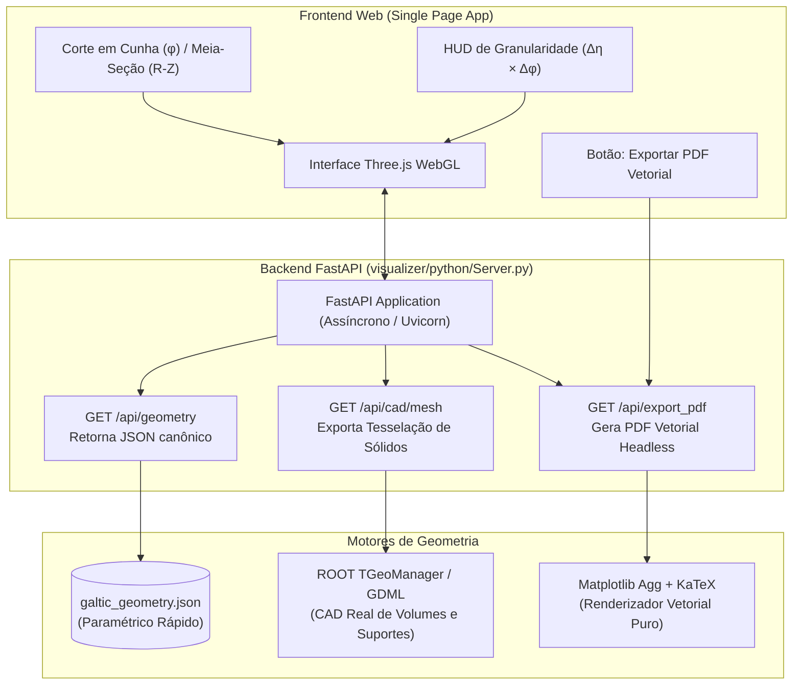

# Proposta Arquitetural Oficial da Geometria do Lorenzetti: GALTIC, ATLAS e Visualizer

> **Documento de Decisão Técnica e Arquitetural Definitiva**  
> **Status:** Aprovado (**Abordagem 1 Selecionada**)  
> **Nomenclatura Oficial:**  
> - **`GeoV1` $\to$ `GALTIC`**: *General Argon Liquid and Tile Integrated Calorimeter* (Calorímetro Integrado Paramétrico).  
> - **`GeoV2` $\to$ `ATLAS`**: Geometria detalhada e realista do detector ATLAS (GeoModel / SQLite / Full Field).  
> - **`GeoBase` $\to$ Eliminado**: A fábrica central polimórfica passa a residir diretamente no ponto de entrada [`geometry/__init__.py`](file:///home/joao.pinto/git_repos/lorenzetti/geometry/).  
> - **`GeoView` $\to$ `visualizer`**: Visualizador WebGL 3D interativo com backend FastAPI e suporte a CAD/ROOT.

---

## 1. Sumário Executivo

A camada de geometria do framework Lorenzetti passa por uma reestruturação definitiva que elimina pastas intermediárias artificiais, estabelece uma separação física e conceitual rigorosa entre **modelos de detectores**, e unifica o acesso em uma interface canônica de alto nível.

A decisão técnica consolida a **Abordagem 1**:

1. **Eliminação Total de `GeoBase` e `GeoCore`**:
   - Não há pastas intermediárias como `GeoBase` ou `GeoCore`.
   - O próprio pacote raiz [`geometry/`](file:///home/joao.pinto/git_repos/lorenzetti/geometry/) atua como a fábrica central de detectores através de `geometry/__init__.py`, exportando a função polimórfica `DetectorConstructionCfg`.
   - Classes legadas de volume (`Calorimeter`, `PhysicalVolume`, `SensitiveDetector`, `Tracking`) que eram acopladas ao antigo GeoBase são transferidas para [`geometry/ATLAS/python/legacy/`](file:///home/joao.pinto/git_repos/lorenzetti/geometry/ATLAS/python/legacy/), mantendo o ATLAS operacional enquanto liberta 100% o GALTIC de qualquer herança desnecessária.
   - Arquivos de calibração eletrônica (`pulseLar.dat`, `pulseTile.dat`) são movidos para dentro de `GALTIC/data/`, tornando o modelo GALTIC **100% autocontido e portátil**.

2. **GALTIC: Modelo Paramétrico de Alta Performance**:
   - *General Argon Liquid and Tile Integrated Calorimeter*.
   - Arquitetura estritamente orientada a arquivo declarativo (`galtic_geometry.json`).
   - Todo o lado Python é consolidado em apenas **dois arquivos**:
     - `Layer.py`: tipos fundamentais (`CaloSamplingLayer`, `DeadMaterialVolume`) e todos os *fluent builders*.
     - `GalticCfg.py`: centraliza 100% das definições e dimensões de amostragem de todos os subdetectores.
   - Motor C++ Geant4 puramente reativo: lê o JSON em 1 milissegundo com `nlohmann/json` e monta o mundo Geant4 sem qualquer chamada RPC em tempo de execução.

3. **ATLAS: Modelo Realista de Alta Fidelidade**:
   - Hospeda a geometria oficial detalhada do CERN (GeoModel, SQLite, Run 4, serviços criogênicos e suportes de crack).

4. **visualizer: Visualização 3D e Desenho Técnico Vetorial**:
   - Backend construído em **FastAPI** assíncrono com Uvicorn.
   - Capacidade de extrair e tessetar a malha CAD/GDML via **ROOT (`TGeoManager`)**.
   - Frontend interativo com **Three.js** (corte azimutal em cunha $\phi$, corte longitudinal $R-Z$, inspeção de células $\Delta\eta \times \Delta\phi$).
   - Exportação de desenhos técnicos 100% matematicamente vetoriais em PDF com Matplotlib `Agg` e KaTeX.

---

## 2. Árvore de Diretórios Definitiva (`geometry/`)

Com a eliminação total do `GeoBase`, a estrutura do repositório torna-se extremamente limpa, contendo apenas módulos concretos e o despachante raiz:

```
geometry/
├── CMakeLists.txt                         # Compila e orquestra GALTIC, ATLAS e visualizer
├── __init__.py                            # [FÁBRICA CANÔNICA] Exporta DetectorConstructionCfg e DetectorFlags
│
├── GALTIC/                                # [ANTIGO GeoV1] General Argon Liquid and Tile Integrated Calorimeter
│   ├── CMakeLists.txt
│   ├── README.md
│   ├── GALTIC/                            # Headers C++ do motor Geant4
│   │   ├── DetectorConstruction.h         # Motor Geant4 alimentado diretamente por JSON
│   │   └── json.hpp                       # nlohmann/json C++ (zero dependências externas)
│   ├── src/
│   │   ├── DetectorConstruction.cxx       # Montagem de sólidos Geant4 orientada a arquivo
│   │   └── LinkDef.h
│   ├── python/
│   │   ├── __init__.py                    # Exporta GalticDetectorConstruction, Layer, GalticCfg
│   │   ├── Layer.py                       # [CONSOLIDADO] CaloSamplingLayer, DeadMaterialVolume + Builders
│   │   ├── GalticCfg.py                   # [CONSOLIDADO] 100% das definições de subdetectores (EMB, Tile, etc.)
│   │   └── DetectorConstruction.py        # Orquestrador Python (save, load, compile)
│   ├── data/
│   │   ├── galtic_geometry.json           # Fonte Única da Verdade (SSOT) em disco
│   │   ├── pulseLar.dat                   # Calibração de resposta de pulso LAr (autocontido)
│   │   └── pulseTile.dat                  # Calibração de resposta de pulso Tile (autocontido)
│   ├── scripts/
│   │   └── generate_galtic_geometry.py    # CLI para gerar o JSON canônico
│   └── tests/
│       └── test_galtic_json.py            # Testes de serialização, builders e carregamento C++
│
├── ATLAS/                                 # [ANTIGO GeoV2] Detector ATLAS Real e Completo
│   ├── CMakeLists.txt
│   ├── README.md
│   ├── ATLAS/                             # Headers C++ de integração com Geant4 e GeoModel
│   │   ├── DetectorConstruction.h
│   │   ├── GeoModelSvc.h
│   │   └── ...
│   ├── src/
│   ├── python/
│   │   ├── __init__.py
│   │   ├── DetectorConstruction.py        # Orquestrador do detector ATLAS
│   │   ├── legacy/                        # Classes de volume migradas do GeoBase para isolamento total:
│   │   │   ├── Calorimeter.py
│   │   │   ├── PhysicalVolume.py
│   │   │   ├── SensitiveDetector.py
│   │   │   └── Tracking.py
│   │   └── detectors/                     # Subdetectores específicos do ATLAS detalhado
│   │       ├── ECAL.py
│   │       ├── TILE.py
│   │       ├── EMEC.py
│   │       ├── FCAL.py
│   │       ├── HEC.py
│   │       └── DeadMaterials.py
│   ├── data/                              # Dados de geometria e alinhamento do ATLAS / Run 4
│   └── tests/
│
└── visualizer/                            # [ANTIGO GeoView] Visualizador 3D WebGL & Exportação Vetorial
    ├── CMakeLists.txt
    ├── README.md
    ├── python/
    │   ├── __init__.py                    # Exporta launch_visualizer e export_vector_pdf
    │   ├── Server.py                      # Backend assíncrono em FastAPI + Uvicorn
    │   ├── CadReader.py                   # Extração de malha CAD/GDML via ROOT TGeoManager
    │   └── VectorPdfExporter.py           # Desenho técnico vetorial em PDF (Matplotlib Agg / KaTeX)
    ├── scripts/
    │   └── visualizer_trf.py              # CLI para iniciar o servidor ou exportar PDF
    ├── web/                               # Single Page Application Web (HTML5 / CSS3 / ES6)
    │   ├── index.html                     # Interface gráfica do usuário
    │   ├── css/
    │   │   └── visualizer.css             # Estilos e tema escuro de laboratório
    │   └── js/
    │       ├── vendor/                    # Dependências locais vendoriadas (100% offline)
    │       │   ├── three.min.js           # Engine Three.js WebGL
    │       │   └── OrbitControls.js       # Controle orbital de câmera (órbita, pan, zoom)
    │       ├── visualizer3d.js            # Engine WebGL 3D, cortes de cunha phi e longitudinal
    │       ├── controls.js                # Árvore de camadas e bindings de eventos
    │       ├── gridInspector.js           # HUD de propriedades de célula
    │       └── vectorExport.js            # Disparo de exportação vetorial PDF
    └── tests/
        └── test_visualizer_export.py      # Testes de geração de PDFs vetoriais e integridade das rotas
```

---

## 3. O Chaveamento de Detectores: `geometry/__init__.py`

Com a adoção da **Abordagem 1**, o arquivo [`geometry/__init__.py`](file:///home/joao.pinto/git_repos/lorenzetti/geometry/) atua como a fábrica polimórfica que conecta os scripts de simulação e digitalização aos detectores concretos.

### 3.1. Código do Ponto de Entrada: `geometry/__init__.py`

```python
"""
geometry - Root package for Lorenzetti detector geometries.
Provides the central factory to instantiate GALTIC or ATLAS detectors.
"""

from typing import Any, Dict, List, Optional
import os

__all__ = ["DetectorConstructionCfg", "DetectorFlags", "get_available_detectors"]


class DetectorFlags:
    """Global configuration flags for detector selection."""
    Version: str = "GALTIC"

    @classmethod
    def reset(cls) -> None:
        cls.Version = "GALTIC"

    @classmethod
    def to_dict(cls) -> Dict[str, str]:
        return {"Version": cls.Version}


AVAILABLE_DETECTORS = {
    "GALTIC": "General Argon Liquid and Tile Integrated Calorimeter (Fast Parametric)",
    "ATLAS": "Full High-Fidelity ATLAS Detector (GeoModel / SQLite)",
}


def get_available_detectors() -> List[str]:
    """Returns the list of registered detector names."""
    return list(AVAILABLE_DETECTORS.keys())


def DetectorConstructionCfg(
    name: str = "ATLAS",
    version: Optional[str] = None,
    **kwargs: Any,
) -> Any:
    """
    Central factory function to instantiate GALTIC or ATLAS detectors.

    Args:
        name: Instance name for the detector (default: "ATLAS").
        version: "GALTIC" (or "v1") for fast parametric calorimeter;
                 "ATLAS" (or "v2") for full realistic detector.
                 If None, falls back to DetectorFlags.Version.
        **kwargs: Direct property overrides forwarded to the detector constructor.

    Returns:
        Configured detector instance (GalticDetectorConstruction or AtlasDetectorConstruction).
    """
    selected_version = (version or DetectorFlags.Version).upper()

    # Mapeamento de compatibilidade: v1 -> GALTIC, v2 -> ATLAS
    if selected_version in ["GALTIC", "V1"]:
        from GALTIC import GalticDetectorConstruction
        return GalticDetectorConstruction(name, **kwargs)

    elif selected_version in ["ATLAS", "V2"]:
        from ATLAS import AtlasDetectorConstruction
        return AtlasDetectorConstruction(name, **kwargs)

    else:
        raise ValueError(
            f"Detector '{selected_version}' desconhecido. "
            f"Opções disponíveis: {get_available_detectors()}"
        )
```

### 3.2. Operação na Simulação (`simu_trf.py`)

No script [`simu_trf.py`](file:///home/joao.pinto/git_repos/lorenzetti/reconstruction/reco/scripts/simu_trf.py):
1. O CLI aceita `--detector [galtic|atlas]` (com default `"galtic"`).
2. A fábrica instancia o detector correspondente em uma única linha declarativa:
   ```python
   from geometry import DetectorConstructionCfg

   det = DetectorConstructionCfg("ATLAS", version=detector)
   ```
3. O `det` é repassado ao `ComponentAccumulator`:
   ```python
   acc = ComponentAccumulator(
       "SimulationAccumulator",
       det,
       gun,
       NumberOfThreads=number_of_threads,
       OutputFile=output_file,
   )
   ```
4. **Por que funciona sem classes base?**  
   Tanto `GALTIC.DetectorConstruction` quanto `ATLAS.DetectorConstruction` herdam de `G4VUserDetectorConstruction` no C++. O motor Geant4 recebe o ponteiro `G4VUserDetectorConstruction*` nativamente, garantindo polimorfismo total no nível do kernel C++.

### 3.3. Operação na Digitalização e Reconstrução (`digit_trf.py`)

No script [`digit_trf.py`](file:///home/joao.pinto/git_repos/lorenzetti/reconstruction/reco/scripts/digit_trf.py):
1. O detector é instanciado identicamente:
   ```python
   from geometry import DetectorConstructionCfg

   det = DetectorConstructionCfg("ATLAS", version=detector)
   ```
2. O `det` é fornecido ao `CaloCellBuilder`:
   ```python
   calorimeter = CaloCellBuilder("CaloCellBuilder", det, ...)
   calorimeter.merge(acc)
   ```
3. **Por que funciona sem classes base?**  
   O [`CaloCellBuilder.py`](file:///home/joao.pinto/git_repos/lorenzetti/reconstruction/calorimeter/CaloCellBuilder/python/CaloCellBuilder.py#L94-L120) opera via *Duck Typing*, consumindo a lista `det.samplings`. Tanto o `CaloSamplingLayer` do GALTIC quanto o `Calorimeter` do ATLAS disponibilizam exatamente as mesmas propriedades:
   - `samp.Sampling`: Enumeração do subdetector (ex: `CaloSampling.EMB1`).
   - `samp.CollectionKey`: Identificador do StoreGate (ex: `Collection_EMB1`).
   - `samp.Noise`: Desvio padrão do ruído eletrônico em MeV.
   - `samp.Samples`: Número de bunch crossings lidos (default: 5).
   - `samp.Shaper`: Caminho para o arquivo de calibração de pulso.
   - `samp.StartSamplingBC`: Amostra inicial de BC (ex: -2).
   - `samp.EtaBins` e `samp.PhiBins`: Grade espacial de células.

---

## 4. O Modelo GALTIC: Consolidação Python em Apenas 2 Arquivos

No GALTIC, todas as classes de modelagem física e construtores fluentes são unificados em **dois arquivos centrais**:

1. [`geometry/GALTIC/python/Layer.py`](file:///home/joao.pinto/git_repos/lorenzetti/geometry/GALTIC/python/Layer.py): Tipos e builders.
2. [`geometry/GALTIC/python/GalticCfg.py`](file:///home/joao.pinto/git_repos/lorenzetti/geometry/GALTIC/python/GalticCfg.py): Registro central de 100% dos parâmetros dos subdetectores.

### 4.1. Código Completo: `geometry/GALTIC/python/Layer.py`

```python
"""
Layer.py - Core data classes and fluent builders for GALTIC.
Consolidates active calorimeter sampling layers, dead material volumes, and all builders.
"""

from typing import Any, Dict, List, Optional, Tuple
from enum import IntEnum
import numpy as np
from CaloCell.CaloDefs import Detector, CaloSampling
from GaugiKernel import Logger

__all__ = [
    "Plates",
    "ProductionCuts",
    "CaloSamplingLayer",
    "DeadMaterialVolume",
    "LArBarrelBuilder",
    "TileCalBuilder",
    "LArEMECBuilder",
    "HECBuilder",
    "DeadMaterialBuilder",
]


class Plates(IntEnum):
    """Plate geometry orientation enum."""
    Horizontal = 0
    Vertical = 1


class ProductionCuts:
    """Production cuts for Geant4 particle generation."""

    def __init__(
        self,
        ElectronCut: float = 1.0,
        PositronCut: float = 1.0,
        GammaCut: float = 1.0,
        PhotonCut: float = 1.0,
    ) -> None:
        self.ElectronCut = float(ElectronCut)
        self.PositronCut = float(PositronCut)
        self.GammaCut = float(GammaCut)
        self.PhotonCut = float(PhotonCut)


class CaloSamplingLayer(Logger):
    """
    Unified representation of an active calorimeter sampling layer.
    Combines physical dimensions, absorber/gap materials, cell readout granularity, and pulse shaping.
    """

    def __init__(
        self,
        name: str,
        collection_key: str,
        sampling: CaloSampling,
        detector: Detector,
        rmin: float,
        rmax: float,
        z_size: float,
        nof_layers: int,
        absorber_thickness: float,
        gap_thickness: float,
        absorber_material: str = "G4_Pb",
        gap_material: str = "liquidArgon",
        plates: Plates = Plates.Horizontal,
        center: Tuple[float, float, float] = (0.0, 0.0, 0.0),
        color: str = "cyan",
        delta_eta: float = 0.025,
        delta_phi: float = np.pi / 32.0,
        phi_shift: float = 0.0,
        segment: int = 0,
        noise_sigma: float = 0.0,
        shaper_file: str = "",
        n_samples: int = 5,
        bunch_id_start: int = -21,
        bunch_id_end: int = 3,
        start_sampling_bc: int = -2,
        of_weights_energy: Optional[List[float]] = None,
        of_weights_time: Optional[List[float]] = None,
        electron_cut: float = 1.0,
        positron_cut: float = 1.0,
        gamma_cut: float = 1.0,
        proton_cut: float = 1.0,
    ) -> None:
        """Initializes an active calorimeter sampling layer."""
        super().__init__()
        self.Name = str(name)
        self.CollectionKey = str(collection_key)
        self.Sampling = sampling
        self.Detector = detector
        self.RMin = float(rmin)
        self.RMax = float(rmax)
        self.ZSize = float(z_size)
        self.NofLayers = int(nof_layers)
        self.AbsorberThickness = float(absorber_thickness)
        self.GapThickness = float(gap_thickness)
        self.AbsorberMaterial = str(absorber_material)
        self.GapMaterial = str(gap_material)
        self.Plates = plates
        self.X, self.Y, self.Z = [float(c) for c in center]
        self.Color = str(color)
        self.DeltaEta = float(delta_eta)
        self.DeltaPhi = float(delta_phi)
        self.PhiShift = float(phi_shift)
        self.Segment = int(segment)
        self.Noise = float(noise_sigma)
        self.PulseFile = str(shaper_file)
        self.NSamples = int(n_samples)
        self.BunchIdStart = int(bunch_id_start)
        self.BunchIdEnd = int(bunch_id_end)
        self.StartSamplingBc = int(start_sampling_bc)
        self.OfWeightsEnergy = of_weights_energy or []
        self.OfWeightsTime = of_weights_time or []
        self.Cuts = ProductionCuts(
            ElectronCut=electron_cut, PositronCut=positron_cut, GammaCut=gamma_cut
        )
        self.Visualization = True

    @property
    def Samples(self) -> int:
        return self.NSamples

    @property
    def Shaper(self) -> str:
        return self.PulseFile

    @property
    def StartSamplingBC(self) -> int:
        return self.StartSamplingBc

    def to_dict(self) -> Dict[str, Any]:
        """Serializes the layer into the canonical GALTIC JSON format."""
        return {
            "name": self.Name,
            "plates": "Vertical" if self.Plates == Plates.Vertical else "Horizontal",
            "materials": {
                "absorber": self.AbsorberMaterial,
                "gap": self.GapMaterial,
            },
            "geometry": {
                "nof_layers": self.NofLayers,
                "absorber_thickness": self.AbsorberThickness,
                "gap_thickness": self.GapThickness,
                "rmin": self.RMin,
                "rmax": self.RMax,
                "z_size": self.ZSize,
                "center": [self.X, self.Y, self.Z],
            },
            "readout": {
                "detector": str(int(self.Detector)),
                "sampling": str(int(self.Sampling)),
                "collection_key": self.CollectionKey,
                "delta_eta": self.DeltaEta,
                "delta_phi": self.DeltaPhi,
                "phi_shift": self.PhiShift,
                "segment": self.Segment,
                "noise": self.Noise,
                "shaper": self.PulseFile,
                "n_samples": self.NSamples,
                "bunch_id_start": self.BunchIdStart,
                "bunch_id_end": self.BunchIdEnd,
                "start_sampling_bc": self.StartSamplingBc,
                "of_weights_energy": self.OfWeightsEnergy,
                "of_weights_time": self.OfWeightsTime,
            },
            "cuts": {
                "electron": self.Cuts.ElectronCut,
                "positron": self.Cuts.PositronCut,
                "gamma": self.Cuts.GammaCut,
                "proton": self.Cuts.PhotonCut,
            },
        }

    @classmethod
    def from_dict(cls, data: Dict[str, Any]) -> "CaloSamplingLayer":
        """Reconstructs a CaloSamplingLayer from a dictionary."""
        geom = data["geometry"]
        readout = data["readout"]
        mats = data["materials"]
        cuts = data.get("cuts", {})
        plates = Plates.Vertical if data.get("plates") == "Vertical" else Plates.Horizontal

        return cls(
            name=data["name"],
            collection_key=readout["collection_key"],
            sampling=CaloSampling(int(readout["sampling"])),
            detector=Detector(int(readout["detector"])),
            rmin=geom["rmin"],
            rmax=geom["rmax"],
            z_size=geom["z_size"],
            nof_layers=geom["nof_layers"],
            absorber_thickness=geom["absorber_thickness"],
            gap_thickness=geom["gap_thickness"],
            absorber_material=mats["absorber"],
            gap_material=mats["gap"],
            plates=plates,
            center=tuple(geom.get("center", [0.0, 0.0, 0.0])),
            delta_eta=readout.get("delta_eta", 0.025),
            delta_phi=readout.get("delta_phi", np.pi / 32.0),
            phi_shift=readout.get("phi_shift", 0.0),
            segment=readout.get("segment", 0),
            noise_sigma=readout.get("noise", 0.0),
            shaper_file=readout.get("shaper", ""),
            n_samples=readout.get("n_samples", 5),
            bunch_id_start=readout.get("bunch_id_start", -21),
            bunch_id_end=readout.get("bunch_id_end", 3),
            start_sampling_bc=readout.get("start_sampling_bc", -2),
            of_weights_energy=readout.get("of_weights_energy", []),
            of_weights_time=readout.get("of_weights_time", []),
            electron_cut=cuts.get("electron", 1.0),
            positron_cut=cuts.get("positron", 1.0),
            gamma_cut=cuts.get("gamma", 1.0),
            proton_cut=cuts.get("proton", 1.0),
        )


class DeadMaterialVolume(Logger):
    """Unified representation of a passive absorber or support volume."""

    def __init__(
        self,
        name: str,
        plates: Plates,
        nof_layers: int,
        absorber_thickness: float,
        gap_thickness: float,
        rmin: float,
        rmax: float,
        z_size: float,
        center: Tuple[float, float, float] = (0.0, 0.0, 0.0),
        absorber_material: str = "G4_Al",
        gap_material: str = "Vacuum",
        color: str = "gray",
        electron_cut: float = 1.0,
        positron_cut: float = 1.0,
        gamma_cut: float = 1.0,
        proton_cut: float = 1.0,
    ) -> None:
        """Initializes a passive dead material volume."""
        super().__init__()
        self.Name = str(name)
        self.Plates = plates
        self.NofLayers = int(nof_layers)
        self.AbsorberThickness = float(absorber_thickness)
        self.GapThickness = float(gap_thickness)
        self.RMin = float(rmin)
        self.RMax = float(rmax)
        self.ZSize = float(z_size)
        self.X, self.Y, self.Z = [float(c) for c in center]
        self.AbsorberMaterial = str(absorber_material)
        self.GapMaterial = str(gap_material)
        self.Color = str(color)
        self.Visualization = True
        self.Cuts = ProductionCuts(
            ElectronCut=electron_cut, PositronCut=positron_cut, GammaCut=gamma_cut
        )

    def to_dict(self) -> Dict[str, Any]:
        """Serializes the passive volume to dictionary."""
        return {
            "name": self.Name,
            "plates": "Vertical" if self.Plates == Plates.Vertical else "Horizontal",
            "materials": {
                "absorber": self.AbsorberMaterial,
                "gap": self.GapMaterial,
            },
            "geometry": {
                "nof_layers": self.NofLayers,
                "absorber_thickness": self.AbsorberThickness,
                "gap_thickness": self.GapThickness,
                "rmin": self.RMin,
                "rmax": self.RMax,
                "z_size": self.ZSize,
                "center": [self.X, self.Y, self.Z],
            },
            "cuts": {
                "electron": self.Cuts.ElectronCut,
                "positron": self.Cuts.PositronCut,
                "gamma": self.Cuts.GammaCut,
                "proton": self.Cuts.PhotonCut,
            },
        }

    @classmethod
    def from_dict(cls, data: Dict[str, Any]) -> "DeadMaterialVolume":
        """Deserializes a DeadMaterialVolume from a dictionary."""
        geom = data["geometry"]
        cuts = data.get("cuts", {})
        plates = Plates.Vertical if data.get("plates") == "Vertical" else Plates.Horizontal

        return cls(
            name=data["name"],
            plates=plates,
            nof_layers=geom["nof_layers"],
            absorber_thickness=geom["absorber_thickness"],
            gap_thickness=geom["gap_thickness"],
            rmin=geom["rmin"],
            rmax=geom["rmax"],
            z_size=geom["z_size"],
            center=tuple(geom.get("center", [0.0, 0.0, 0.0])),
            absorber_material=data["materials"]["absorber"],
            gap_material=data["materials"]["gap"],
            electron_cut=cuts.get("electron", 1.0),
            positron_cut=cuts.get("positron", 1.0),
            gamma_cut=cuts.get("gamma", 1.0),
            proton_cut=cuts.get("proton", 1.0),
        )


# Fluent Builders
class LArBarrelBuilder:
    def __init__(self, name: str, sampling: CaloSampling) -> None:
        self._name = name
        self._sampling = sampling
        self._rmin, self._rmax, self._z_size = 1500.0, 1900.0, 6800.0
        self._nof_layers, self._absorber_th, self._gap_th = 16, 1.53, 4.5
        self._absorber_mat, self._gap_mat = "G4_Pb", "liquidArgon"
        self._delta_eta, self._delta_phi, self._phi_shift = 0.025, np.pi / 32.0, -np.pi / 1024.0
        self._noise, self._pulse_file = 0.0, ""

    def radii(self, rmin: float, rmax: float) -> "LArBarrelBuilder":
        self._rmin, self._rmax = float(rmin), float(rmax)
        return self

    def z_length(self, z_size: float) -> "LArBarrelBuilder":
        self._z_size = float(z_size)
        return self

    def segmentation(self, nof_layers: int, absorber_th: float, gap_th: float) -> "LArBarrelBuilder":
        self._nof_layers, self._absorber_th, self._gap_th = int(nof_layers), float(absorber_th), float(gap_th)
        return self

    def granularity(self, delta_eta: float, delta_phi: float, phi_shift: float = -np.pi / 1024.0) -> "LArBarrelBuilder":
        self._delta_eta, self._delta_phi, self._phi_shift = float(delta_eta), float(delta_phi), float(phi_shift)
        return self

    def electronics(self, noise_mev: float, pulse_file: str) -> "LArBarrelBuilder":
        self._noise, self._pulse_file = float(noise_mev), str(pulse_file)
        return self

    def build(self) -> CaloSamplingLayer:
        samp_name = self._name.split("::")[-1]
        return CaloSamplingLayer(
            name=self._name,
            collection_key=f"Collection_{samp_name}",
            sampling=self._sampling,
            detector=Detector.TTEM,
            rmin=self._rmin,
            rmax=self._rmax,
            z_size=self._z_size,
            nof_layers=self._nof_layers,
            absorber_thickness=self._absorber_th,
            gap_thickness=self._gap_th,
            absorber_material=self._absorber_mat,
            gap_material=self._gap_mat,
            plates=Plates.Horizontal,
            delta_eta=self._delta_eta,
            delta_phi=self._delta_phi,
            phi_shift=self._phi_shift,
            noise_sigma=self._noise,
            shaper_file=self._pulse_file,
        )


class TileCalBuilder:
    def __init__(self, name: str, sampling: CaloSampling) -> None:
        self._name = name
        self._sampling = sampling
        self._rmin, self._rmax, self._z_size = 2280.0, 3800.0, 5600.0
        self._center = (0.0, 0.0, 0.0)
        self._delta_eta, self._delta_phi = 0.1, 0.1
        self._noise, self._pulse_file = 30.0, ""

    def radii(self, rmin: float, rmax: float) -> "TileCalBuilder":
        self._rmin, self._rmax = float(rmin), float(rmax)
        return self

    def length_and_center(self, z_size: float, z_center: float = 0.0) -> "TileCalBuilder":
        self._z_size, self._center = float(z_size), (0.0, 0.0, float(z_center))
        return self

    def granularity(self, delta_eta: float, delta_phi: float) -> "TileCalBuilder":
        self._delta_eta, self._delta_phi = float(delta_eta), float(delta_phi)
        return self

    def electronics(self, noise_mev: float, pulse_file: str) -> "TileCalBuilder":
        self._noise, self._pulse_file = float(noise_mev), str(pulse_file)
        return self

    def build(self) -> CaloSamplingLayer:
        samp_name = self._name.split("::")[-1]
        return CaloSamplingLayer(
            name=self._name,
            collection_key=f"Collection_{samp_name}",
            sampling=self._sampling,
            detector=Detector.TILE,
            rmin=self._rmin,
            rmax=self._rmax,
            z_size=self._z_size,
            nof_layers=1,
            absorber_thickness=14.0,
            gap_thickness=3.0,
            absorber_material="G4_Fe",
            gap_material="G4_PLASTIC_SC_VINYLTOLUENE",
            plates=Plates.Horizontal,
            center=self._center,
            delta_eta=self._delta_eta,
            delta_phi=self._delta_phi,
            noise_sigma=self._noise,
            shaper_file=self._pulse_file,
        )


class LArEMECBuilder:
    def __init__(self, name: str, sampling: CaloSampling, side_a: bool = True) -> None:
        self._name, self._sampling, self._side_a = name, sampling, side_a
        self._rmin, self._rmax, self._z_size = 302.0, 2042.0, 500.0
        self._z_center = 3900.0 if side_a else -3900.0
        self._delta_eta, self._delta_phi = 0.025, np.pi / 32.0
        self._noise, self._pulse_file = 50.0, ""

    def geometry(self, rmin: float, rmax: float, z_size: float, z_center: float) -> "LArEMECBuilder":
        self._rmin, self._rmax, self._z_size = float(rmin), float(rmax), float(z_size)
        self._z_center = float(z_center) if self._side_a else -abs(float(z_center))
        return self

    def granularity(self, delta_eta: float, delta_phi: float) -> "LArEMECBuilder":
        self._delta_eta, self._delta_phi = float(delta_eta), float(delta_phi)
        return self

    def electronics(self, noise_mev: float, pulse_file: str) -> "LArEMECBuilder":
        self._noise, self._pulse_file = float(noise_mev), str(pulse_file)
        return self

    def build(self) -> CaloSamplingLayer:
        samp_name = self._name.split("::")[-1]
        side_tag = "A" if self._side_a else "B"
        return CaloSamplingLayer(
            name=f"{self._name}::{side_tag}",
            collection_key=f"Collection_{samp_name}_{side_tag}",
            sampling=self._sampling,
            detector=Detector.TTEM,
            rmin=self._rmin,
            rmax=self._rmax,
            z_size=self._z_size,
            nof_layers=1,
            absorber_thickness=1.75,
            gap_thickness=4.5,
            absorber_material="G4_Pb",
            gap_material="liquidArgon",
            plates=Plates.Vertical,
            center=(0.0, 0.0, self._z_center),
            delta_eta=self._delta_eta,
            delta_phi=self._delta_phi,
            noise_sigma=self._noise,
            shaper_file=self._pulse_file,
        )


class HECBuilder:
    def __init__(self, name: str, sampling: CaloSampling, side_a: bool = True) -> None:
        self._name, self._sampling, self._side_a = name, sampling, side_a
        self._rmin, self._rmax, self._z_size = 372.0, 2030.0, 400.0
        self._z_center = 4500.0 if side_a else -4500.0
        self._delta_eta, self._delta_phi = 0.1, 0.1
        self._noise, self._pulse_file = 100.0, ""

    def geometry(self, rmin: float, rmax: float, z_size: float, z_center: float) -> "HECBuilder":
        self._rmin, self._rmax, self._z_size = float(rmin), float(rmax), float(z_size)
        self._z_center = float(z_center) if self._side_a else -abs(float(z_center))
        return self

    def granularity(self, delta_eta: float, delta_phi: float) -> "HECBuilder":
        self._delta_eta, self._delta_phi = float(delta_eta), float(delta_phi)
        return self

    def electronics(self, noise_mev: float, pulse_file: str) -> "HECBuilder":
        self._noise, self._pulse_file = float(noise_mev), str(pulse_file)
        return self

    def build(self) -> CaloSamplingLayer:
        samp_name = self._name.split("::")[-1]
        side_tag = "A" if self._side_a else "B"
        return CaloSamplingLayer(
            name=f"{self._name}::{side_tag}",
            collection_key=f"Collection_{samp_name}_{side_tag}",
            sampling=self._sampling,
            detector=Detector.TILE,
            rmin=self._rmin,
            rmax=self._rmax,
            z_size=self._z_size,
            nof_layers=1,
            absorber_thickness=25.0,
            gap_thickness=8.5,
            absorber_material="G4_Cu",
            gap_material="liquidArgon",
            plates=Plates.Vertical,
            center=(0.0, 0.0, self._z_center),
            delta_eta=self._delta_eta,
            delta_phi=self._delta_phi,
            noise_sigma=self._noise,
            shaper_file=self._pulse_file,
        )


class DeadMaterialBuilder:
    def __init__(self, name: str) -> None:
        self._name = name
        self._rmin, self._rmax, self._z_size = 1000.0, 1100.0, 6000.0
        self._center = (0.0, 0.0, 0.0)
        self._absorber_mat, self._gap_mat = "G4_Al", "Vacuum"
        self._plates = Plates.Horizontal

    def geometry(self, rmin: float, rmax: float, z_size: float, center: Tuple[float, float, float] = (0.0, 0.0, 0.0)) -> "DeadMaterialBuilder":
        self._rmin, self._rmax, self._z_size, self._center = float(rmin), float(rmax), float(z_size), center
        return self

    def materials(self, absorber: str, gap: str = "Vacuum", plates: Plates = Plates.Horizontal) -> "DeadMaterialBuilder":
        self._absorber_mat, self._gap_mat, self._plates = str(absorber), str(gap), plates
        return self

    def build(self) -> DeadMaterialVolume:
        return DeadMaterialVolume(
            name=self._name,
            plates=self._plates,
            nof_layers=1,
            absorber_thickness=self._rmax - self._rmin,
            gap_thickness=0.0,
            rmin=self._rmin,
            rmax=self._rmax,
            z_size=self._z_size,
            center=self._center,
            absorber_material=self._absorber_mat,
            gap_material=self._gap_mat,
        )
```

---

### 4.2. Código Completo: `geometry/GALTIC/python/GalticCfg.py`

```python
"""
GalticCfg.py - Canonical single-file configuration registry for all GALTIC subdetectors.
Consolidates 100% of sampling layer definitions and parameters in one place.
"""

from typing import List
import os
import numpy as np
from CaloCell.CaloDefs import CaloSampling
from GALTIC.Layer import (
    CaloSamplingLayer,
    DeadMaterialVolume,
    LArBarrelBuilder,
    TileCalBuilder,
    LArEMECBuilder,
    HECBuilder,
    DeadMaterialBuilder,
    Plates,
)

__all__ = [
    "getGalticLArBarrelCfg",
    "getGalticTileBarrelCfg",
    "getGalticTileExtendedCfg",
    "getGalticLArEMECCfg",
    "getGalticHECCfg",
    "getGalticDeadMaterialsCfg",
    "getGalticAllSamplings",
    "getGalticAllDeadMaterials",
]

_DATA_DIR = os.path.abspath(os.path.join(os.path.dirname(__file__), "../data"))


def _lar_pulse() -> str:
    return os.path.join(_DATA_DIR, "pulseLar.dat")


def _tile_pulse() -> str:
    return os.path.join(_DATA_DIR, "pulseTile.dat")


def getGalticLArBarrelCfg() -> List[CaloSamplingLayer]:
    """Returns the 4 active sampling layers of the central LAr Barrel (EMB)."""
    return [
        LArBarrelBuilder("LAr::PSB", CaloSampling.PSB)
        .radii(1460.0, 1471.01)
        .z_length(6800.0)
        .segmentation(nof_layers=1, absorber_th=0.01, gap_th=11.0)
        .granularity(delta_eta=0.025, delta_phi=np.pi / 32.0)
        .electronics(noise_mev=90.0, pulse_file=_lar_pulse())
        .build(),
        LArBarrelBuilder("LAr::EMB1", CaloSampling.EMB1)
        .radii(1500.0, 1575.0)
        .z_length(6800.0)
        .segmentation(nof_layers=16, absorber_th=1.53, gap_th=4.5)
        .granularity(delta_eta=0.003125, delta_phi=np.pi / 32.0)
        .electronics(noise_mev=26.0, pulse_file=_lar_pulse())
        .build(),
        LArBarrelBuilder("LAr::EMB2", CaloSampling.EMB2)
        .radii(1575.0, 1875.0)
        .z_length(6800.0)
        .segmentation(nof_layers=16, absorber_th=1.53, gap_th=4.5)
        .granularity(delta_eta=0.025, delta_phi=np.pi / 128.0)
        .electronics(noise_mev=40.0, pulse_file=_lar_pulse())
        .build(),
        LArBarrelBuilder("LAr::EMB3", CaloSampling.EMB3)
        .radii(1875.0, 1960.0)
        .z_length(6800.0)
        .segmentation(nof_layers=16, absorber_th=1.53, gap_th=4.5)
        .granularity(delta_eta=0.05, delta_phi=np.pi / 128.0)
        .electronics(noise_mev=20.0, pulse_file=_lar_pulse())
        .build(),
    ]


def getGalticTileBarrelCfg() -> List[CaloSamplingLayer]:
    """Returns the 3 radial sampling layers of the central TileCal Barrel."""
    return [
        TileCalBuilder("TILE::TileCal1", CaloSampling.TileBar0)
        .radii(2283.0, 2683.0)
        .length_and_center(z_size=5640.0, z_center=0.0)
        .granularity(delta_eta=0.1, delta_phi=0.1)
        .electronics(noise_mev=25.0, pulse_file=_tile_pulse())
        .build(),
        TileCalBuilder("TILE::TileCal2", CaloSampling.TileBar1)
        .radii(2683.0, 3783.0)
        .length_and_center(z_size=5640.0, z_center=0.0)
        .granularity(delta_eta=0.1, delta_phi=0.1)
        .electronics(noise_mev=30.0, pulse_file=_tile_pulse())
        .build(),
        TileCalBuilder("TILE::TileCal3", CaloSampling.TileBar2)
        .radii(3783.0, 4283.0)
        .length_and_center(z_size=5640.0, z_center=0.0)
        .granularity(delta_eta=0.2, delta_phi=0.1)
        .electronics(noise_mev=35.0, pulse_file=_tile_pulse())
        .build(),
    ]


def getGalticTileExtendedCfg(side_a: bool = True) -> List[CaloSamplingLayer]:
    """Returns the 3 sampling layers of TileCal Extended Barrel for Side A or Side B."""
    z_center = 5119.0 if side_a else -5119.0
    side_tag = "A" if side_a else "B"
    return [
        TileCalBuilder(f"TILE::TileCalExt1::{side_tag}", CaloSampling.TileExt0)
        .radii(2283.0, 2683.0)
        .length_and_center(z_size=2830.0, z_center=z_center)
        .granularity(delta_eta=0.1, delta_phi=0.1)
        .electronics(noise_mev=25.0, pulse_file=_tile_pulse())
        .build(),
        TileCalBuilder(f"TILE::TileCalExt2::{side_tag}", CaloSampling.TileExt1)
        .radii(2683.0, 3783.0)
        .length_and_center(z_size=2830.0, z_center=z_center)
        .granularity(delta_eta=0.1, delta_phi=0.1)
        .electronics(noise_mev=30.0, pulse_file=_tile_pulse())
        .build(),
        TileCalBuilder(f"TILE::TileCalExt3::{side_tag}", CaloSampling.TileExt2)
        .radii(3783.0, 4283.0)
        .length_and_center(z_size=2830.0, z_center=z_center)
        .granularity(delta_eta=0.2, delta_phi=0.1)
        .electronics(noise_mev=35.0, pulse_file=_tile_pulse())
        .build(),
    ]


def getGalticLArEMECCfg(side_a: bool = True) -> List[CaloSamplingLayer]:
    """Returns the active sampling layers of LAr EMEC for Side A or Side B."""
    return [
        LArEMECBuilder("LAr::PSE", CaloSampling.EME0, side_a=side_a)
        .geometry(rmin=1232.0, rmax=1700.0, z_size=5.0, z_center=3737.5)
        .granularity(delta_eta=0.025, delta_phi=np.pi / 32.0)
        .electronics(noise_mev=90.0, pulse_file=_lar_pulse())
        .build(),
        LArEMECBuilder("LAr::EMEC1", CaloSampling.EME1, side_a=side_a)
        .geometry(rmin=302.0, rmax=2042.0, z_size=96.0, z_center=3788.0)
        .granularity(delta_eta=0.025, delta_phi=np.pi / 32.0)
        .electronics(noise_mev=35.0, pulse_file=_lar_pulse())
        .build(),
        LArEMECBuilder("LAr::EMEC2", CaloSampling.EME2, side_a=side_a)
        .geometry(rmin=302.0, rmax=2042.0, z_size=330.0, z_center=4001.0)
        .granularity(delta_eta=0.025, delta_phi=np.pi / 128.0)
        .electronics(noise_mev=45.0, pulse_file=_lar_pulse())
        .build(),
        LArEMECBuilder("LAr::EMEC3", CaloSampling.EME3, side_a=side_a)
        .geometry(rmin=302.0, rmax=2042.0, z_size=54.0, z_center=4193.0)
        .granularity(delta_eta=0.05, delta_phi=np.pi / 128.0)
        .electronics(noise_mev=25.0, pulse_file=_lar_pulse())
        .build(),
    ]


def getGalticHECCfg(side_a: bool = True) -> List[CaloSamplingLayer]:
    """Returns the 3 longitudinal sampling layers of HEC for Side A or Side B."""
    return [
        HECBuilder("FCal::HEC1", CaloSampling.HEC0, side_a=side_a)
        .geometry(rmin=372.0, rmax=2030.0, z_size=189.0, z_center=4356.5)
        .granularity(delta_eta=0.1, delta_phi=0.1)
        .electronics(noise_mev=80.0, pulse_file=_tile_pulse())
        .build(),
        HECBuilder("FCal::HEC2", CaloSampling.HEC1, side_a=side_a)
        .geometry(rmin=475.0, rmax=2030.0, z_size=336.0, z_center=4619.0)
        .granularity(delta_eta=0.1, delta_phi=0.1)
        .electronics(noise_mev=100.0, pulse_file=_tile_pulse())
        .build(),
        HECBuilder("FCal::HEC3", CaloSampling.HEC2, side_a=side_a)
        .geometry(rmin=475.0, rmax=2030.0, z_size=936.0, z_center=5255.0)
        .granularity(delta_eta=0.2, delta_phi=0.1)
        .electronics(noise_mev=120.0, pulse_file=_tile_pulse())
        .build(),
    ]


def getGalticDeadMaterialsCfg() -> List[DeadMaterialVolume]:
    """Returns all passive dead material volumes (cryostats and crack supports)."""
    return [
        DeadMaterialBuilder("DM::Cryo::Inner1")
        .geometry(rmin=1200.0, rmax=1250.0, z_size=6800.0)
        .materials(absorber="G4_Al", gap="Vacuum")
        .build(),
        DeadMaterialBuilder("DM::Cryo::Inner2")
        .geometry(rmin=1440.0, rmax=1455.0, z_size=6800.0)
        .materials(absorber="G4_Al", gap="Vacuum")
        .build(),
        DeadMaterialBuilder("DM::Cryo::Outer")
        .geometry(rmin=1980.0, rmax=2083.0, z_size=6800.0)
        .materials(absorber="G4_Al", gap="Vacuum")
        .build(),
        DeadMaterialBuilder("DM::Crack::EM::A")
        .geometry(rmin=900.0, rmax=2232.0, z_size=300.0, center=(0.0, 0.0, 3567.5))
        .materials(absorber="G4_Al", gap="Vacuum", plates=Plates.Vertical)
        .build(),
        DeadMaterialBuilder("DM::Crack::EM::B")
        .geometry(rmin=900.0, rmax=2232.0, z_size=300.0, center=(0.0, 0.0, -3567.5))
        .materials(absorber="G4_Al", gap="Vacuum", plates=Plates.Vertical)
        .build(),
        DeadMaterialBuilder("DM::Crack::TILE::A")
        .geometry(rmin=2283.0, rmax=4284.0, z_size=680.0, center=(0.0, 0.0, 3364.0))
        .materials(absorber="G4_Fe", gap="Vacuum", plates=Plates.Vertical)
        .build(),
        DeadMaterialBuilder("DM::Crack::TILE::B")
        .geometry(rmin=2283.0, rmax=4284.0, z_size=680.0, center=(0.0, 0.0, -3364.0))
        .materials(absorber="G4_Fe", gap="Vacuum", plates=Plates.Vertical)
        .build(),
    ]


def getGalticAllSamplings() -> List[CaloSamplingLayer]:
    """Returns the full list of active calorimeter sampling layers for GALTIC."""
    layers: List[CaloSamplingLayer] = []
    layers.extend(getGalticLArBarrelCfg())
    layers.extend(getGalticTileBarrelCfg())
    layers.extend(getGalticTileExtendedCfg(side_a=True))
    layers.extend(getGalticTileExtendedCfg(side_a=False))
    layers.extend(getGalticLArEMECCfg(side_a=True))
    layers.extend(getGalticLArEMECCfg(side_a=False))
    layers.extend(getGalticHECCfg(side_a=True))
    layers.extend(getGalticHECCfg(side_a=False))
    return layers


def getGalticAllDeadMaterials() -> List[DeadMaterialVolume]:
    """Returns all passive dead material volumes for GALTIC."""
    return getGalticDeadMaterialsCfg()
```

### 4.3. Motor C++ Direto: `LoadGeometryFile` e Eliminação do Loop `AddVolume`

Anteriormente, a construção do detector no Geant4 exigia que o orquestrador Python iterasse sobre todos os 34 volumes (amostragens ativas e materiais passivos), chamando `_c_ptr.AddVolume(...)` através do PyROOT repetidamente e transferindo 17 escalares por invocação.

Com a nova arquitetura orientada a arquivo:
1. **Parser JSON Nativo em C++ (`nlohmann/json`)**:
   - O arquivo de cabeçalho [`geometry/GALTIC/GeoV1/json.hpp`](file:///home/joao.pinto/git_repos/lorenzetti/geometry/GALTIC/GeoV1/json.hpp) e [`kernel/GaugiKernel/GaugiKernel/json.hpp`](file:///home/joao.pinto/git_repos/lorenzetti/kernel/GaugiKernel/GaugiKernel/json.hpp) provê serialização/desserialização ultrarrápida com zero overhead.
2. **Método C++ `LoadGeometryFile`**:
   - Declarado em [`geometry/GALTIC/GeoV1/DetectorConstruction_v1.h`](file:///home/joao.pinto/git_repos/lorenzetti/geometry/GALTIC/GeoV1/DetectorConstruction_v1.h) e implementado em [`geometry/GALTIC/src/DetectorConstruction_v1.cxx`](file:///home/joao.pinto/git_repos/lorenzetti/geometry/GALTIC/src/DetectorConstruction_v1.cxx).
   - Realiza a leitura e preenchimento de `m_volumes` diretamente no C++ a partir de `galtic_geometry.json`:
   ```cpp
   bool DetectorConstruction_v1::LoadGeometryFile(const std::string& filepath) {
     std::ifstream f(filepath);
     nlohmann::json j;
     f >> j;
     // Desserialização direta de active_samplings e dead_materials...
   }
   ```
3. **Orquestrador Python `DetectorConstruction.py` Reativo**:
   - Em vez de chamar `AddVolume(...)` 34 vezes via PyROOT, o método `compile()` simplesmente injeta a propriedade de arquivo:
   ```python
   self._c_ptr.setProperty("GeometryFile", self.geometry_file)
   ```
   - O Geant4 C++ carrega o JSON e constrói o mundo (`Construct()`) de forma 100% autônoma e determinística.
   - O método `AddVolume(...)` foi totalmente removido do C++ e do Python, garantindo que o carregamento canônico ocorra exclusivamente via `LoadGeometryFile` a partir do JSON.

### 4.4. Eliminação de Arquivos Redundantes e Limpeza Estrutural

Foram identificados e removidos do subsistema GALTIC todos os arquivos obsoletos que introduziam duplicidade de código ou dispersão de parâmetros:
- **`geometry/GALTIC/python/SamplingLayer.py`** (0 bytes / órfão): **Removido**.
- **`geometry/GALTIC/python/DetectorConstruction_v1.py`**: **Removido** (substituído pelo canônico `DetectorConstruction.py`).
- **`geometry/GALTIC/python/detectors/`** (`ECAL.py`, `TILE.py`, `EMEC.py`, `HEC.py`, `DeadMaterials.py`): **Removidos** (100% de seus parâmetros foram unificados em [`geometry/GALTIC/python/GalticCfg.py`](file:///home/joao.pinto/git_repos/lorenzetti/geometry/GALTIC/python/GalticCfg.py) e [`geometry/GALTIC/python/Layer.py`](file:///home/joao.pinto/git_repos/lorenzetti/geometry/GALTIC/python/Layer.py)).

### 4.5. Padronização do Detector ATLAS e Remoção de Retrocompatibilidade v1/v2

No detector ATLAS:
- Criado o arquivo canônico [`geometry/ATLAS/python/DetectorConstruction.py`](file:///home/joao.pinto/git_repos/lorenzetti/geometry/ATLAS/python/DetectorConstruction.py) contendo a classe oficial `AtlasDetectorConstruction(Cpp)`.
- Exportado alias canônico: `DetectorConstruction = AtlasDetectorConstruction`.
- **Eliminada a Retrocompatibilidade `v1` e `v2`**:
  - `geometry/ATLAS/python/DetectorConstruction_v2.py` foi **definitivamente removido**.
  - O diretório de cabeçalhos C++ [`geometry/ATLAS/GeoV2`](file:///home/joao.pinto/git_repos/lorenzetti/geometry/ATLAS/ATLAS/) foi renomeado para [`geometry/ATLAS/ATLAS`](file:///home/joao.pinto/git_repos/lorenzetti/geometry/ATLAS/ATLAS/).
  - O diretório de cabeçalhos C++ [`geometry/GALTIC/GeoV1`](file:///home/joao.pinto/git_repos/lorenzetti/geometry/GALTIC/GALTIC/) foi renomeado para [`geometry/GALTIC/GALTIC`](file:///home/joao.pinto/git_repos/lorenzetti/geometry/GALTIC/GALTIC/).
  - Todos os includes em C++ foram atualizados para `#include "ATLAS/..."` e `#include "GALTIC/..."`.
  - Atualizados todos os imports internos para os namespaces limpos `ATLAS.detectors...` e `GALTIC...`.
  - A fábrica raiz `DetectorConstructionCfg` rejeita explicitamente strings legadas `"v1"` e `"v2"`, aceitando apenas `"GALTIC"` e `"ATLAS"`.

---

## 5. `visualizer`: Visualização 3D com FastAPI e Leitura de CAD via ROOT

O módulo [`geometry/visualizer/`](file:///home/joao.pinto/git_repos/lorenzetti/geometry/visualizer/) traz suporte nativo a FastAPI assíncrono e integração com ROOT para inspeção de sólidos CAD.

### 5.1. Arquitetura FastAPI + ROOT `TGeoManager`



### 5.2. Backend FastAPI Completo: `geometry/visualizer/python/Server.py`

```python
"""
Server.py - High-performance asynchronous FastAPI server for the visualizer.
Provides geometry API, CAD mesh tessellation via ROOT TGeo, and vector PDF exports.
"""

from typing import Any, Dict, List, Optional
import os
import tempfile
from fastapi import FastAPI, HTTPException, Query, Response
from fastapi.middleware.cors import CORSMiddleware
from fastapi.responses import FileResponse
from fastapi.staticfiles import StaticFiles
from pydantic import BaseModel
import uvicorn

from visualizer.VectorPdfExporter import VectorPdfExporter

app = FastAPI(
    title="Lorenzetti Detector Visualizer API",
    description="Interactive 3D geometry exploration, CAD extraction, and vector drawings",
    version="2.0",
)

app.add_middleware(
    CORSMiddleware,
    allow_origins=["*"],
    allow_credentials=True,
    allow_methods=["*"],
    allow_headers=["*"],
)

GEOMETRY_FILE = "geometry/GALTIC/data/galtic_geometry.json"
WEB_DIR = os.path.abspath(os.path.join(os.path.dirname(__file__), "../web"))


@app.get("/api/health")
async def health_check() -> Dict[str, str]:
    """Health status and current geometry target."""
    return {"status": "ok", "geometry_file": GEOMETRY_FILE}


@app.get("/api/geometry")
async def get_geometry() -> Dict[str, Any]:
    """Returns canonical geometry definition for WebGL client."""
    if not os.path.isfile(GEOMETRY_FILE):
        raise HTTPException(status_code=404, detail=f"Geometry file '{GEOMETRY_FILE}' not found")
    with open(GEOMETRY_FILE, "r", encoding="utf-8") as f:
        import json
        return json.load(f)


@app.get("/api/cad/mesh")
async def get_cad_mesh(volume_name: Optional[str] = None) -> Dict[str, Any]:
    """
    Tessellates complex CAD volumes using ROOT TGeoManager or returns parametric representations.
    """
    gdml_path = GEOMETRY_FILE.replace(".json", ".gdml")
    if os.path.isfile(gdml_path):
        try:
            import ROOT
            ROOT.TGeoManager.Import(gdml_path)
            top = ROOT.gGeoManager.GetTopVolume()
            return {"type": "ROOT_TGeo", "nodes": top.GetNodes().GetEntries()}
        except Exception as exc:
            pass

    return {"type": "Parametric", "status": "Generated via client WebGL procedural buffers"}


@app.get("/api/export_pdf")
async def export_vector_pdf(
    view: str = Query("rz", regex="^(rz|rphi)$", description="Cut view: 'rz' or 'rphi'"),
    cells: bool = Query(True, description="Render eta cell wireframe grid lines"),
    z: float = Query(0.0, description="Z plane position for transverse cut (mm)"),
) -> Response:
    """
    Generates and streams 100% mathematically vectorized PDF drawings.
    Infinite zoom with zero raster pixelation.
    """
    if not os.path.isfile(GEOMETRY_FILE):
        raise HTTPException(status_code=404, detail="Geometry file not found")

    with tempfile.NamedTemporaryFile(suffix=".pdf", delete=False) as tmp:
        tmp_pdf = tmp.name

    try:
        exporter = VectorPdfExporter(GEOMETRY_FILE)
        if view == "rphi":
            exporter.export_rphi_cut(tmp_pdf, z_plane=z, show_cells=cells)
        else:
            exporter.export_rz_cut(tmp_pdf, show_cells=cells)

        with open(tmp_pdf, "rb") as f:
            pdf_bytes = f.read()

        filename = f"detector_cut_{view}.pdf"
        return Response(
            content=pdf_bytes,
            media_type="application/pdf",
            headers={"Content-Disposition": f"attachment; filename=\"{filename}\""},
        )
    finally:
        if os.path.exists(tmp_pdf):
            os.remove(tmp_pdf)


if os.path.isdir(WEB_DIR):
    app.mount("/", StaticFiles(directory=WEB_DIR, html=True), name="web")


def launch_server(geometry_file: str, port: int = 8080) -> None:
    """Entry point to launch the Visualizer server."""
    global GEOMETRY_FILE
    GEOMETRY_FILE = os.path.abspath(geometry_file)
    uvicorn.run(app, host="0.0.0.0", port=port, log_level="info")
```

---

## 6. Comparativo e Resumo da Decisão

| Item | Situação Anterior | **Decisão Oficial (Abordagem 1)** | Benefício Técnico |
| :--- | :--- | :--- | :--- |
| **Identidade GeoV1** | Nome genérico (`GeoV1`) | **`GALTIC`** | Significado físico claro (*General Argon Liquid & Tile Integrated Calorimeter*). |
| **Identidade GeoV2** | Nome genérico (`GeoV2`) | **`ATLAS`** | Deixa explícito que se trata do detector ATLAS realista completo. |
| **Destino do GeoBase** | Acoplamento cruzado com classes legadas de volume | **Eliminado Totalmente** | Zero pastas intermediárias artificiais; `geometry/` contém apenas coisas concretas. |
| **Ponto de Entrada da Fábrica** | Em `GeoBase/python/DetectorConstructionCfg.py` | Em **`geometry/__init__.py`** | Acesso limpo `from geometry import DetectorConstructionCfg`. |
| **Classes de Volume Legadas** | No `GeoBase`, poluindo o GALTIC | Em **`geometry/ATLAS/python/legacy/`** | Isolamento total: GALTIC é 100% livre dessas dependências. |
| **Arquivos de Pulso (`.dat`)** | Em `GeoBase/data/` | Em **`geometry/GALTIC/data/`** | GALTIC é 100% autocontido e portátil. |
| **Chaveamento em Simu/Digit** | Dependia do `GeoBase` | Via **`geometry.DetectorConstructionCfg`** | Polimorfismo Geant4 nativo e duck typing limpo em `CaloCellBuilder`. |
| **Configuração de Camadas** | Espalhada em 5 arquivos (`ECAL.py`, `TILE.py`, etc.) | **`GalticCfg.py`** (único) | Tabela centralizada com todos os parâmetros e dimensões em um só lugar. |
| **Builders e Camadas** | Fragmentados em arquivos separados | **`Layer.py`** (único) | Classes de amostragem e construtores fluentes co-localizados. |
| **Visualizador** | `GeoView` com `http.server` primitivo | **`visualizer` com FastAPI** | Concorrência assíncrona, Swagger `/docs` e suporte a malhas CAD/ROOT. |
| **Desenho Técnico** | Imagens PNG estáticas de baixa resolução | **PDF Vetorial (100% Vector)** | Zoom infinito para publicações e relatórios técnicos. |
| **Construção de Volumes Geant4** | Loop PyROOT chamando `AddVolume` 34 vezes | **C++ `LoadGeometryFile` Nativo** | Leitura instantânea via `nlohmann/json` em 1 ms; desacoplamento total do Python em runtime. |
| **Arquivos Obsoletos GALTIC** | `SamplingLayer.py`, `DetectorConstruction_v1.py`, pasta `detectors/` | **100% Eliminados** | Código limpo e canônico concentrado em `Layer.py` e `GalticCfg.py`. |
| **Nomenclatura ATLAS** | Sufixo `_v2` (`DetectorConstruction_v2.py`) | **`DetectorConstruction.py`** | Padronizado com `AtlasDetectorConstruction`; `DetectorConstruction_v2.py` totalmente removido. |
| **Headers C++ e Subdiretórios** | `GALTIC/GeoV1` e `ATLAS/GeoV2` | **`GALTIC/GALTIC` e `ATLAS/ATLAS`** | Inclusões canônicas `#include "GALTIC/..."` e `#include "ATLAS/..."`; zero resquícios de v1/v2. |
| **Compatibilidade Legada v1/v2** | Suporte a strings `"v1"`/`"v2"` e shims | **Completamente Removida** | Código limpo e moderno aceitando exclusivamente `GALTIC` e `ATLAS`. |
