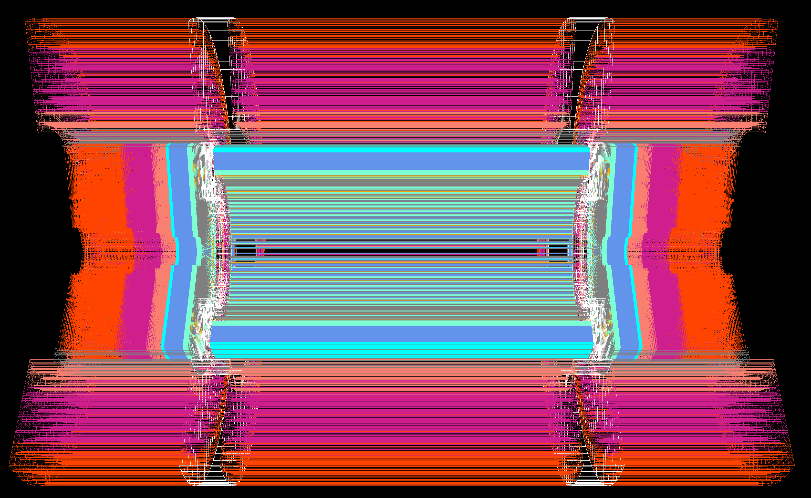
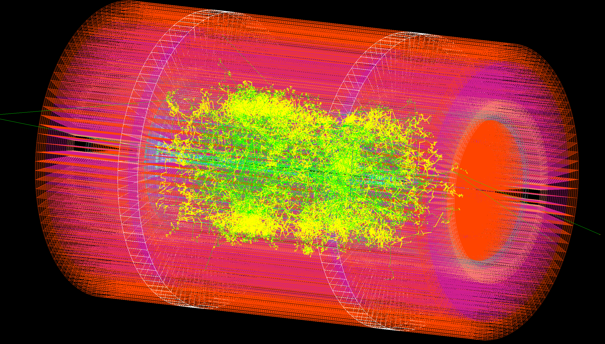

[](https://zenodo.org/badge/latestdoi/370090835)
[](https://github.com/lorenzetti-ufrj-br/lorenzetti/actions/workflows/pages.yml)
[](https://github.com/lorenzetti-ufrj-br/lorenzetti/actions/workflows/reco_sequence.yml)
[](https://github.com/lorenzetti-ufrj-br/lorenzetti/actions/workflows/anomaly_sequence.yml)

# 🔬 Lorenzetti Framework

Lorenzetti is a modular High Energy Physics (HEP) simulation, digitization, and reconstruction framework designed for research and development in calorimeter signal processing, trigger algorithms, and machine learning applications.

Built upon **Geant4**, **Pythia8**, and **ROOT**, the framework models the complete calorimeter readout chain: primary particle generation, energy shower evolution in detector media, electronic pulse shaping across bunch crossings, Gaussian noise injection, cell-to-cell cross-talk, Optimal Filtering (OF/COF) signal reconstruction, topological clustering, concentric shower ring summation (Ringer), and electron/photon identification.

This framework addresses a critical gap in the community: **Access to quality data**. Experiment-specific data is often restricted or difficult to generate for outsiders. Lorenzetti democratizes this by establishing a standard reference for:

- 🧠 **Algorithm Development**: Fast prototyping of filters (Optimal Filtering, Wiener), clustering algorithms, and jet reconstruction.
- 🤖 **Machine Learning**: Generating massive, labelled datasets ideal for training Neural Networks (e.g., for _anomaly detection_, _pileup mitigation_, or _super-resolution_).
- ⚡ **Trigger Studies**: Simulating hardware-level constraints to test fast decision-making logic.

### 🌪️ Advanced Pileup Simulation via Overlay

One of Lorenzetti's most defining features is its ability to realistically simulate **high-luminosity environments** through a sophisticated **Overlay Strategy**. High Energy Physics experiments often face the challenge of **Pileup**—multiple proton-proton collisions occurring simultaneously. Lorenzetti accurately models this by overlaying background "Minimum Bias" events onto the signal event of interest.

---

## Installation

### Singularity / Docker (Recommended)

Pre-built container images provide the full environment (ROOT, Geant4, Pythia8, HepMC3, FastJet) with all dependencies pre-configured:

```bash
# Pull container image
singularity pull docker://lorenzetti/lorenzetti:latest

# Enter container shell
singularity run lorenzetti_latest.sif
```

### Local Build

To build the framework from source inside the container environment:

```bash
git clone https://github.com/lorenzetti-ufrj-br/lorenzetti.git
cd lorenzetti
make
source build/lzt_setup.sh
```

### 💻 macOS (Apple Silicon)

> 💡 **Prerequisite:** Lorenzetti requires an `x86_64` architecture. Using **[OrbStack](https://orbstack.dev/)** (`brew install orbstack`) instead of Docker Desktop is strongly recommended for much faster Rosetta 2 emulation (_OrbStack Settings > System > Use Rosetta to run Intel code_).

Create a local workspace folder and run the container (`--platform linux/amd64` forces Rosetta emulation):

```bash
mkdir -p ~/lorenzetti_work
cd ~/lorenzetti_work

docker run --platform linux/amd64 -it --rm \
  --name lorenzetti_session \
  -v "$PWD:/workspace" \
  -w /workspace \
  lorenzetti/lorenzetti:latest
```

Once inside the container, proceed with the **Local Build** instructions above to clone the repository into `/workspace`, compile, and load the environment.

📄 **Full Installation Guide**: [docs/installation.md](docs/installation.md)

---

## Calorimeter Implementation

Lorenzetti implements a high-granularity cylindrical $4\pi$ sampling calorimeter layout mimicking modern LHC detector designs (e.g. ATLAS). It is divided into two primary systems:

### 1. Electromagnetic Calorimeter (ECAL)
Designed for high-precision measurement of electrons and photons:
- **Barrel (EMB)**: Lead ($Pb$) absorber plates interleaved with Liquid Argon ($LAr$) active gaps. Composed of a thin Pre-Sampler (Layer 0), a finely segmented front strip layer (Layer 1) for $\pi^0/\gamma$ separation, a middle layer (Layer 2) containing the bulk of electromagnetic shower energy, and a back layer (Layer 3) to measure longitudinal leakage.
- **EndCap (EMEC)**: Lead/Liquid Argon sampling layers covering the forward region ($1.5 < |\eta| < 3.2$).

### 2. Hadronic Calorimeter (HCAL)
Surrounds the electromagnetic calorimeter to measure hadronic showers and missing transverse energy:
- **TileCal (Barrel)**: Iron ($Fe$) absorber plates with Plastic Scintillator tiles, segmented longitudinally into three layers.
- **HEC (EndCap)**: Copper ($Cu$) absorber plates with Liquid Argon active gaps.

### Sampling Layers and Granularity

| System | Region | Layer | Name | Material (Absorber / Active) | Granularity ($\Delta\eta \times \Delta\phi$) |
| :--- | :--- | :---: | :--- | :--- | :---: |
| **ECAL** | Barrel | 0 | Pre-Sampler | $Pb / LAr$ | $0.025 \times 0.1$ |
| | Barrel | 1 | Front (Strips) | $Pb / LAr$ | $0.003125 \times 0.1$ |
| | Barrel | 2 | Middle | $Pb / LAr$ | $0.025 \times 0.025$ |
| | Barrel | 3 | Back | $Pb / LAr$ | $0.050 \times 0.025$ |
| | EndCap (EMEC) | 0 | Pre-Sampler | $Pb / LAr$ | $0.025 \times 0.1$ |
| | EndCap (EMEC) | 1 | Front | $Pb / LAr$ | $(0.003\text{--}0.006) \times 0.1$ |
| | EndCap (EMEC) | 2 | Middle | $Pb / LAr$ | $0.025 \times 0.025$ |
| | EndCap (EMEC) | 3 | Back | $Pb / LAr$ | $0.050 \times 0.025$ |
| **HCAL** | Barrel (TileCal) | 1 | Front | $Fe / \text{Scintillator}$ | $0.1 \times 0.1$ |
| | Barrel (TileCal) | 2 | Middle | $Fe / \text{Scintillator}$ | $0.1 \times 0.1$ |
| | Barrel (TileCal) | 3 | Back | $Fe / \text{Scintillator}$ | $0.2 \times 0.1$ |
| | EndCap (HEC) | 1--3 | All Layers | $Cu / LAr$ | $0.1 \times 0.1 \text{ to } 0.2 \times 0.2$ |

Detector geometry parameters (depths, materials, and segmentation) are fully configurable via Python descriptors without requiring C++ kernel recompilation.


*(Cut view of the detector geometry)*


*(Front view showing the concentric calorimeter layers)*

---

## 📦 Package Architecture

| Package | Subpackages / Path | Description | Key Technologies |
| :--- | :--- | :--- | :--- |
| **`kernel/`** | `GaugiKernel`, `G4Kernel`, `GenKernel` | Core framework orchestration, event loop, StoreGate, message streaming, units, and Geant4 integration. | C++, OpenMP, Geant4 |
| **`magfield/`** | `MagField`, `MagFieldElements` | Standalone magnetic field service (ATLAS 2D/3D tabulated solenoid & toroid field maps, SIMD cache, Geant4 steppers). | C++, Geant4, ROOT |
| **`geometry/v1/`** | `v1`, `src`, `python`, `data`, `scripts`, `doc` | Classical Lorenzetti cylindrical $4\pi$ calorimeter model. Self-contained and lightweight. | Geant4, Python, ROOT |
| **`geometry/v2/`** | `v2`, `src`, `python`, `data`, `scripts` | High-fidelity ATLAS Run 4 calorimeter model with GeoModel SQLite import, detailed FCal, and frozen showers. | C++20, GeoModel, SQLite, ROOT |
| **`events/`** | `CaloHit`, `CaloCell`, `CaloCluster`, `CaloRings`, `Egamma`, `EventInfo` | Event Data Model (EDM) containers, smart pointers, and persistified objects. | C++, ROOT TTree |
| **`reconstruction/`** | `calorimeter`, `physics`, `io`, `reco` | Digitization, optimal filtering (OF/COF), clustering, Ringer feature extraction, and pipeline transforms (`simu_trf.py`, `digit_trf.py`). | C++, Python (Typer) |
| **`generator/`** | `filters` | Primary event generation with Pythia8, particle guns, and kinematic filter chains. | Pythia8, HepMC3 |

---

## 🏗️ Detector Construction (Version 2): the ATLAS detector

`simu_trf.py --detector v2` and `digit_trf.py --detector v2` build the calorimeters, field ([`magfield/`](magfield/README.md)) and physics of ATLAS, following the public ATLAS sources (GeoModel geometry database, Athena code). Every part is on by default with `--detector v2`. Fine-grained subdetectors, physics options, and cryostats can be tuned via `--pre-init` with [Job Flags](doc/flags.md) or via `--job-file`. Version 1 stays the default.

Version 2 needs three external files, too large for the repository, and the GeoModel libraries:

| What | Size | How to get it | Where Lorenzetti looks |
| :--- | :---: | :--- | :--- |
| GeoModel 6.29.0 (libraries) | | `bash geometry/v2/scripts/build_geomodel.sh [prefix]` in the Lorenzetti container (default prefix `~/geomodel`) | `GEOMODEL_DIR` at build time |
| Run 4 geometry dump, `geometry-ATLAS-P2-RUN4-01-01-00-sim.db` | 92 MB | `bash geometry/v2/scripts/atlas_run4_dumpgeo.sh` on a machine with CVMFS and Athena (lxplus) | `--atlas-run4-geometry` or `LORENZETTI_ATLAS_RUN4_GEOMETRY` |
| ATLAS field map, `bfieldmap_7730_20400_14m.root` | 126 MB | `/cvmfs/atlas.cern.ch/repo/sw/database/GroupData/MagneticFieldMaps/` | `--atlas-field-map` or `LORENZETTI_FIELD_MAP` |
| FCal shower libraries, `MC23_v1` | 31 MB | `/cvmfs/atlas.cern.ch/repo/sw/database/GroupData/LArG4ShowerLibData/MC23_v1` | `geometry/v2/data/LArG4ShowerLibData/MC23_v1` |

Build with GeoModel:

```bash
bash geometry/v2/scripts/build_geomodel.sh ~/geomodel
export GEOMODEL_DIR=~/geomodel
make
source build/lzt_setup.sh
```

Without `GEOMODEL_DIR`, Lorenzetti builds as before; version 1 runs, and version 2 stops with a message (the Run 4 geometry needs GeoModel). A missing file stops the job with a message naming the option or variable to set. For full technical details, consult:
- **[geometry/v1 Documentation](geometry/v1/README.md)**
- **[geometry/v2 Documentation](geometry/v2/README.md)**
- **[magfield Documentation](magfield/README.md)**

---

## 🎛️ Job Steering & Configuration Flags

Lorenzetti provides a streamlined CLI interface and delegates fine-grained configuration to typed Python `@dataclass` objects. Sub-detectors, physics responses, electronic noise, and I/O streams are easily tuned via `--pre-init`:

```bash
# Example: Disable EMB and set custom neutron time cut in simulation
simu_trf.py -i input.EVT.root -o output.HIT.root --detector v2 \
  --pre-init "from geometry.v2 import AtlasGeometryFlags as Geo; from CaloHitBuilder import CaloHitFlags; Geo.AtlasEmb = False; CaloHitFlags.NeutronTimeCut = 200.0"

# Example: Enable electronic cross-talk and defect simulation in digitization
digit_trf.py -i input.HIT.root -o output.ESD.root --detector v2 \
  --pre-init "from CaloCellBuilder import CaloFlags; CaloFlags.DoCrossTalk = True; CaloFlags.DoDefects = True"
```

📄 **Complete Flags Reference Guide**: [doc/flags.md](doc/flags.md)**

---

## ⏱️ Free-running hits: the hits as the ATLAS simulation writes them

`simu_trf.py --detector v2 --free-running-hits` writes, in place of the HIT stream, the calorimeter hits in the layout of the ATLAS HITS ntuple (tree `CollectionTree`: `TileCalHit_*`, `LArHitEMB_*`, `LArHitEMEC_*`, `LArHitHEC_*`, `LArHitFCAL_*`). Each hit carries the ATLAS identifier, the visible energy and the time of the ATLAS simulation, summed in its time bins, with no bunch-crossing window, for a digitization made outside Lorenzetti. It is off by default, also with `--detector v2`.

| Option | What it does |
| :--- | :--- |
| `--free-running-hits` | the hits in the layout of the ATLAS HITS ntuple; Tile per PMT, LAr and FCal per cell |
| `--free-running-atlas-format` | the file as the ATLAS HITS ntuple: LAr energy and time compressed and filtered as `FilterHit_tf`, no extra `tglobal` branches; needs the EMEC charge collection |
| `--atlas-emec-charge-collection` | the EMEC energy of the ATLAS simulation (charge collection of `LArG4::EC::EnergyCalculator`, ported from Athena 23.0.14) |
| `--free-running-keep-hits` | keeps also the HIT stream, with the free-running hits in the tree `FreeRunningTree` (for checks) |
| `--free-running-no-binning` | one entry per Geant4 step, without the time bins |

The EMEC charge collection reads three files of `geometry/v2/data`. Two are in the repository (`HVEMECMap_v02.dat` and `EmecTables-ATLAS-P2-RUN4-01-01-00.csv`, made by `geometry/v2/scripts/emec_tables_from_geomdb.py`); the field map is not:

| What | Size | How to get it | Where Lorenzetti looks |
| :--- | :---: | :--- | :--- |
| EMEC field map, `ec.fieldzv03` | 24 MB | `/cvmfs/atlas.cern.ch/repo/sw/software/23.0/atlas/offline/ReleaseData/v20/LArG4EC/ec.fieldzv03` | `--atlas-emec-field-map`, default `geometry/v2/data/ec.fieldzv03` |

Copy it to `geometry/v2/data`, or give its path with `--atlas-emec-field-map`.

---

## Citation

If you use Lorenzetti in your research, please cite:

> **Lorenzetti Showers: A general-purpose framework for supporting signal reconstruction and triggering with calorimeters**  
> *Computer Physics Communications*, Volume 286, 2023, 108671.  
> DOI: [10.1016/j.cpc.2023.108671](https://doi.org/10.1016/j.cpc.2023.108671)

---

## License

This project is licensed under the **GNU General Public License v3.0 (GPLv3)**. See the [LICENSE](LICENSE) file for details.
