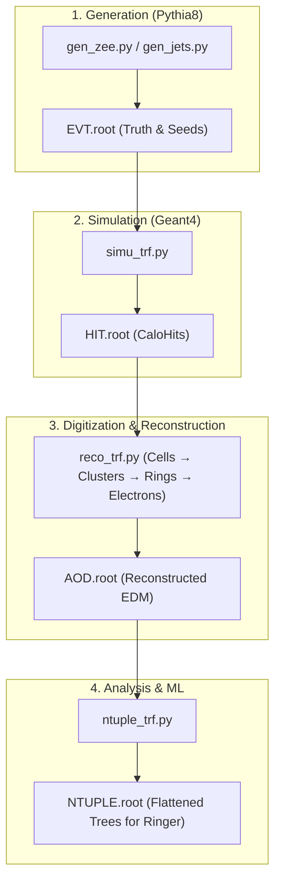

# Lorenzetti Examples & Execution Guide

This directory contains production job cards, transform templates, and examples demonstrating how to run the full simulation and reconstruction sequence.

---

## 1. End-to-End Simulation & Reconstruction Workflow



---

## 2. End-to-End Simulation, Pileup Overlay & Reconstruction Script (`run_reco_sequence.py`)

The executable Python script [`run_reco_sequence.py`](file:///home/joao.pinto/git_repos/lorenzetti/examples/run_reco_sequence.py) runs the complete Lorenzetti pipeline across all data tiers:

1. **Phase 1 (MinBias Library):** Generates and simulates 10 MinBias events (`EVT -> HIT`), split across 2 files of 5 events each.
2. **Phase 2 (Clean Signal):** Generates and reconstructs 10 clean $Z \to ee$ events (`EVT -> HIT -> ESD -> AOD -> NTUPLE -> PARQUET`), split across 2 files of 5 events each.
3. **Phase 3 (Pileup Overlay & Reconstruction):** Overlays MinBias pileup ($\langle \mu \rangle = 10$) onto the $Z \to ee$ HIT files (`merge_trf.py`) and executes the full reconstruction pipeline (`HIT_Merged -> ESD_Merged -> AOD_Merged -> NTUPLE_Merged -> PARQUET`).

### 2.1 Directory Structure Generated
Outputs are automatically structured into distinct subdirectories under `examples/data_run/`:
```
examples/data_run/
├── minbias/
│   ├── evt/         # minbias.EVT.0.root, minbias.EVT.1.root
│   └── hit/         # minbias.HIT.0.root, minbias.HIT.1.root
├── zee/
│   ├── evt/         # zee.EVT.0.root, zee.EVT.1.root
│   ├── hit/         # zee.HIT.0.root, zee.HIT.1.root
│   ├── esd/         # zee.ESD.0.root, zee.ESD.1.root
│   ├── aod/         # zee.AOD.0.root, zee.AOD.1.root
│   ├── ntuple/      # zee.NTUPLE.0.root, zee.NTUPLE.1.root
│   └── parquet/     # zee.AOD.0.parquet, zee.AOD.1.parquet
└── zee_pileup/
    ├── hit/         # zee.HIT_Merged.0.root, zee.HIT_Merged.1.root
    ├── esd/         # zee.ESD_Merged.0.root, zee.ESD_Merged.1.root
    ├── aod/         # zee.AOD_Merged.0.root, zee.AOD_Merged.1.root
    ├── ntuple/      # zee.NTUPLE_Merged.0.root, zee.NTUPLE_Merged.1.root
    └── parquet/     # zee.AOD_Merged.0.parquet, zee.AOD_Merged.1.parquet
```

### 2.2 CLI Usage
Run inside the Singularity container:
```bash
# Run the complete sequence from scratch (clean slate):
singularity exec ../lorenzetti_latest.sif python3 examples/run_reco_sequence.py -nw 2 -nt 5 --pileup-avg 10.0

# Resume or run skipping already-generated stages:
singularity exec ../lorenzetti_latest.sif python3 examples/run_reco_sequence.py --skip-existing
```

### 2.3 Options
| Flag | Description | Default |
| :--- | :--- | :--- |
| `-o`, `--output-dir` | Base directory for datasets | `examples/data_run` |
| `-nw`, `--number-of-workers` | Worker processes across file-parallel jobs | `2` |
| `-nt`, `--simulation-threads` | Geant4 threads per worker during simulation | `5` |
| `--nov`, `--number-of-events` | Total events per dataset (2 chunks x nov/2) | `10` |
| `--pileup-avg` | Target average pileup $\langle \mu \rangle$ for overlay | `10.0` |
| `--clean / --no-clean` | Clean base directory before running | `True` |
| `--skip-existing / --no-skip-existing` | Skip stages whose output directory already exists | `False` |

---

## 3. Running a Production Chain from Scratch (Legacy Card Workflow)

### 3.1. Create Jobs from a Production Card
```bash
run_job.py create --production-card zee.card -o zee_jobs
```

### 3.2. Run a Single Job
```bash
run_job.py run -j zee_jobs/job.0.json -o experiment
```

### 3.3. Run in Parallel with Multi-Threading (`prun_jobs`)
```bash
mkdir -p zee
prun_jobs.py -i zee_jobs -o zee/job --number-of-threads 10 -c "run_job.py run -j %IN -o %OUT"
```
