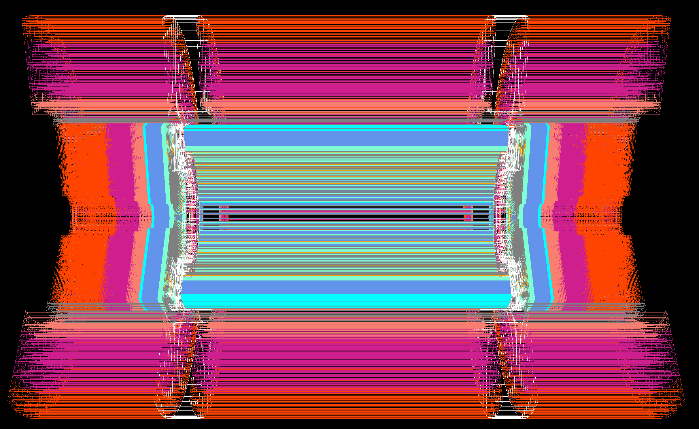
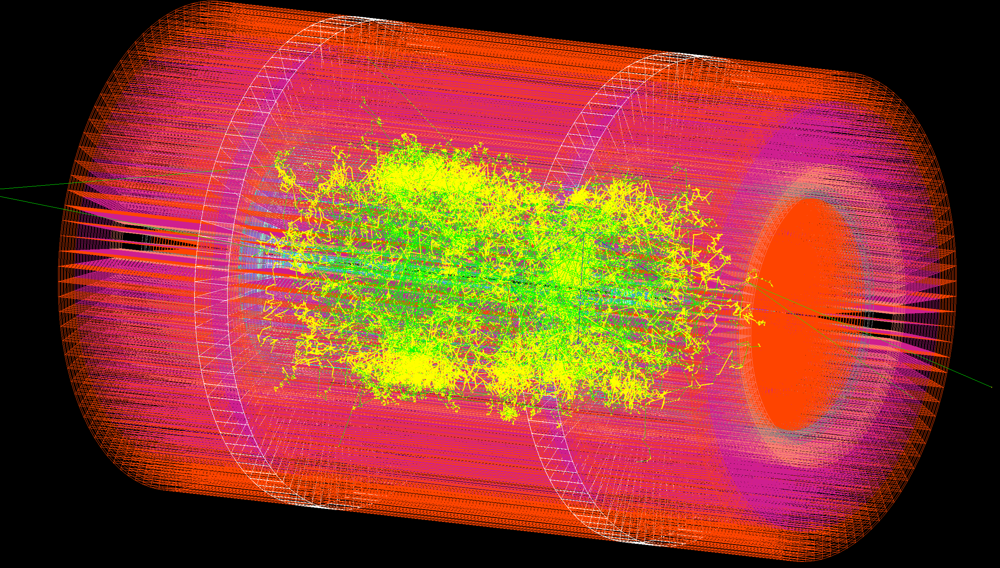
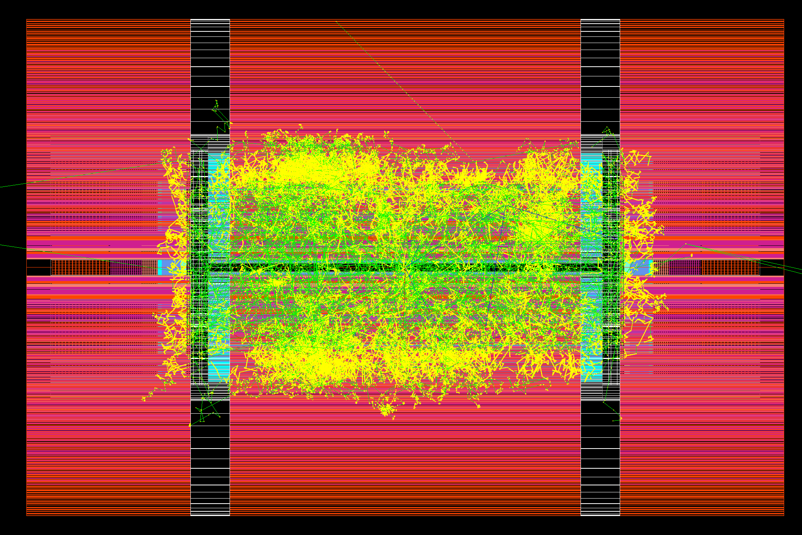
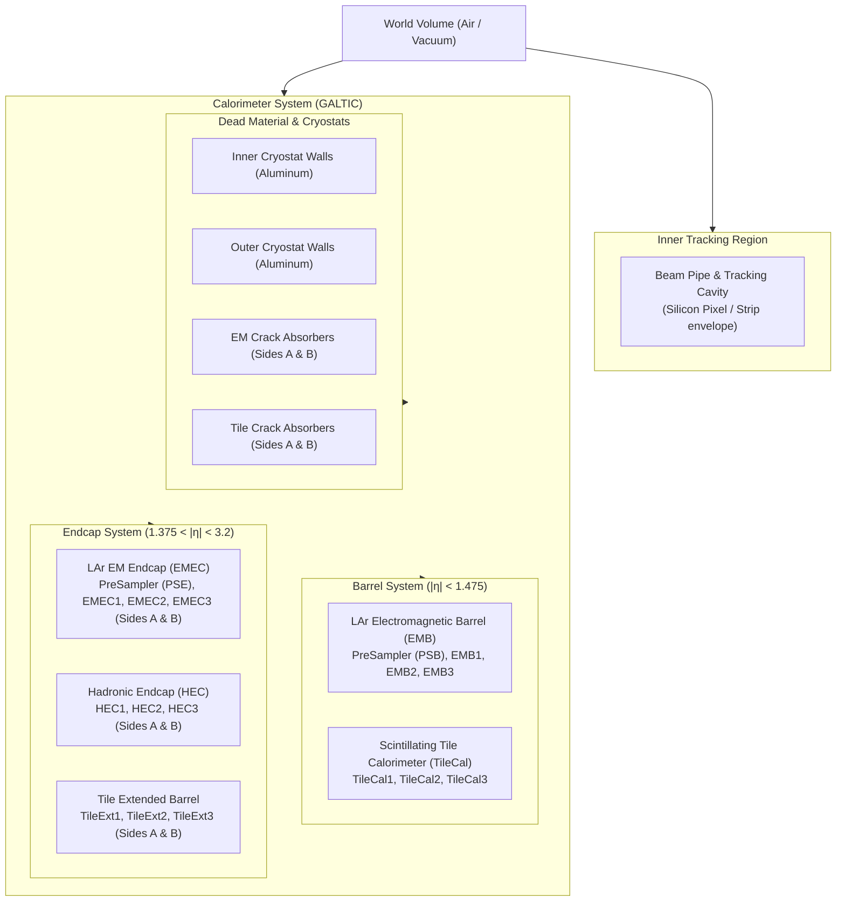

# GALTIC: General Argon Liquid and Tile Integrated Calorimeter

The `geometry/GALTIC/` package implements the **General Argon Liquid and Tile Integrated Calorimeter (GALTIC)** for the **Lorenzetti** simulation framework. GALTIC is a high-performance parametric $4\pi$ calorimeter model designed for ultra-fast simulation, algorithmic benchmarking, trigger development, and machine learning workflows.

GALTIC is **100% self-contained and declarative**, decoupling geometry definition from runtime simulation through its Single Source of Truth: [`galtic_geometry.json`](data/galtic_geometry.json).

---

## 1. Visual Overview

The calorimeter geometry features fine $\eta \times \phi$ cell readout granularity, horizontal/vertical plate arrangements, dead material cryostats, and forward endcaps:

| 3D Isometric Cutaway View | Frontal ($x-y$) Cross-Section |
| :---: | :---: |
|  |  |

| Longitudinal ($z-r$) Lateral Profile |
| :---: |
|  |

---

## 2. Geometry Hierarchy & Architecture



---

## 3. Subdetector Specifications

The calorimeter comprises 27 active sampling layers and 7 passive dead material volumes:

| Subdetector | Region | Active Medium | Absorber Medium | Segmentation / Granularity |
| :--- | :--- | :--- | :--- | :--- |
| **Presampler (PSB)** | Barrel ($|\eta| < 1.52$) | Liquid Argon | Thin shell | $\Delta\eta \times \Delta\phi = 0.025 \times \pi/32$ |
| **EMB1 (Strips)** | Barrel ($|\eta| < 1.475$) | Liquid Argon | Lead ($1.53\text{ mm}$) | $\Delta\eta \times \Delta\phi = 0.003125 \times \pi/32$ |
| **EMB2 (Middle)** | Barrel ($|\eta| < 1.475$) | Liquid Argon | Lead ($1.53\text{ mm}$) | $\Delta\eta \times \Delta\phi = 0.025 \times \pi/128$ |
| **EMB3 (Back)** | Barrel ($|\eta| < 1.475$) | Liquid Argon | Lead ($1.53\text{ mm}$) | $\Delta\eta \times \Delta\phi = 0.05 \times \pi/128$ |
| **TileCal (1-3)** | Central Barrel ($|\eta| < 1.0$) | Plastic Scintillator | Steel ($14\text{ mm}$) | $\Delta\eta \times \Delta\phi = 0.1 \times 0.1$ |
| **Extended Tile** | Extended Barrel ($0.8 < |\eta| < 1.7$) | Plastic Scintillator | Steel ($14\text{ mm}$) | $\Delta\eta \times \Delta\phi = 0.1 \times 0.1$ |
| **EMEC (0-3)** | Endcap ($1.375 < |\eta| < 3.2$) | Liquid Argon | Lead | Concentric wheels ($\Delta\eta = 0.025 - 0.05$) |
| **HEC (1-3)** | Endcap ($1.5 < |\eta| < 3.2$) | Liquid Argon | Copper ($25\text{ mm}$) | Longitudinal segments ($\Delta\eta \times \Delta\phi = 0.1 \times 0.1$) |

---

## 4. Consolidated Package Structure

All GALTIC Python logic is consolidated into **two core files** (`Layer.py` and `GalticCfg.py`), with direct C++ JSON parsing (`json.hpp`):

```text
geometry/GALTIC/
├── CMakeLists.txt                         # Builds GALTIC C++ library and installs Python/data
├── README.md                              # This specification file
├── GALTIC/                                # C++ Public Headers
│   ├── DetectorConstruction_v1.h          # Geant4 UserDetectorConstruction engine
│   └── json.hpp                           # nlohmann/json header (zero external dependencies)
├── src/                                   # C++ Implementation
│   ├── DetectorConstruction_v1.cxx        # Direct JSON parser (LoadGeometryFile) and solid builder
│   └── LinkDef.h                          # ROOT dictionary bindings
├── python/                                # Consolidated Python Module
│   ├── __init__.py                        # Exports GalticDetectorConstruction, Layer, GalticCfg
│   ├── Layer.py                           # [CORE] CaloSamplingLayer, DeadMaterialVolume, and Fluent Builders
│   ├── GalticCfg.py                       # [CORE] 100% of subdetector parameters and dimensions
│   └── DetectorConstruction.py           # Orchestrator (save, load, Geant4 compilation, PDF export)
├── data/                                  # Canonical Geometry and Pulse Calibration Assets
│   ├── galtic_geometry.json               # Canonical Single Source of Truth (SSOT)
│   ├── pulseLar.dat                       # LAr electronic pulse calibration (self-contained)
│   └── pulseTile.dat                      # Tile electronic pulse calibration (self-contained)
├── scripts/
│   ├── generate_galtic_geometry.py        # CLI generator to rebuild galtic_geometry.json
│   └── run_vis.py                         # Geant4 Qt/OpenGL interactive visualizer
└── tests/
    └── test_galtic_json.py                # Unit tests for builders, serialization, and roundtrip
```

---

## 5. Direct C++ JSON Loading (`LoadGeometryFile`)

Unlike legacy implementations that iterated through 34 volumes via PyROOT invoking `AddVolume(...)` repeatedly, GALTIC builds the Geant4 geometry directly in C++ from the canonical JSON file:

```cpp
// Direct 1 ms C++ JSON parsing in DetectorConstruction_v1.cxx
bool DetectorConstruction_v1::LoadGeometryFile(const std::string& filepath) {
    std::ifstream file(filepath);
    nlohmann::json j;
    file >> j;
    // Fast in-memory volume deserialization...
}
```

In Python, the job transform simply declares the geometry file, leaving volume construction entirely to native C++:

```python
det.compile()  # Injects GeometryFile property; Geant4 constructs volumes in C++
```

---

## 6. Usage Examples

### Instantiation via `DetectorConstructionCfg` (Recommended)

```python
from geometry import DetectorConstructionCfg

# Factory automatically configures GALTIC:
det = DetectorConstructionCfg("ATLAS", version="GALTIC")
det.compile()
```

### Direct Python Instantiation

```python
from GALTIC import GalticDetectorConstruction

# Instantiates from default canonical JSON (or custom file path):
det = GalticDetectorConstruction("MyGaltic", geometry_file="geometry/GALTIC/data/galtic_geometry.json")
det.summary()
```

### Interactive 3D Web Visualization & Technical Vector Drawings

Launch the modern WebGL 3D visualizer or export 100% mathematically vectorized PDF drawings:

```bash
# Launch FastAPI / Three.js 3D web visualizer:
visualizer_trf.py --geometry geometry/GALTIC/data/galtic_geometry.json --port 8080

# Export vector drawing (R-Z cross-section):
visualizer_trf.py --geometry geometry/GALTIC/data/galtic_geometry.json --export-pdf rz_cut.pdf --view rz
```
