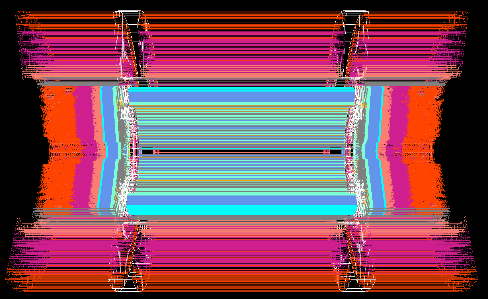
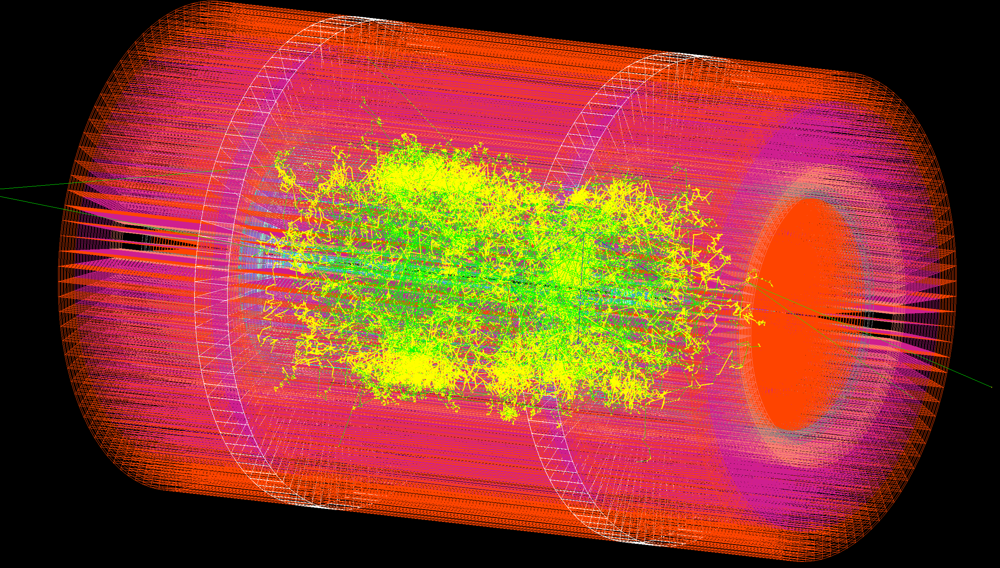
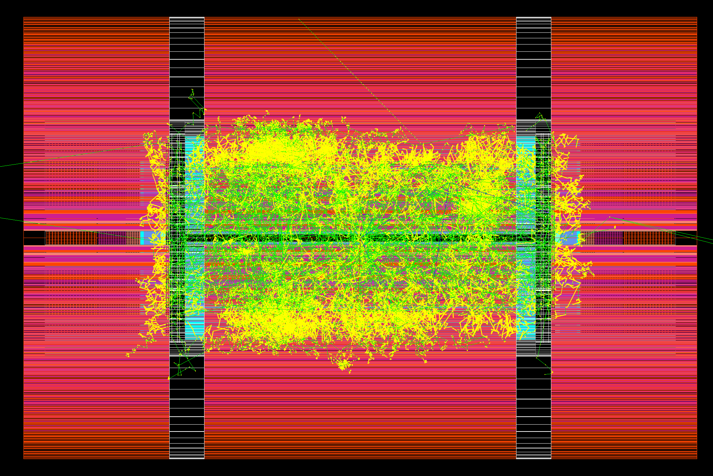
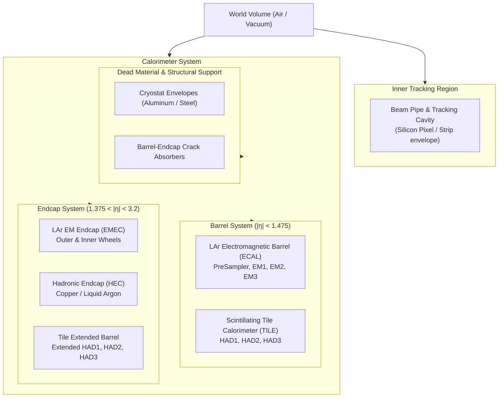

# Classical Detector Geometry (`geometry/v1/`)

The `geometry/v1/` package implements the classical full-acceptance $4\pi$ calorimeter detector description for the **Lorenzetti** simulation framework. It pairs a modular Geant4 C++ construction engine (`DetectorConstruction_v1`) with Python-configurable volume builders, ideal for fast simulation and algorithmic benchmarks.

---

## 1. Visual Overview

The detector model features fine $\eta \times \phi$ granularity, accordion/cell approximations, dead material cryostats, and forward endcaps:

| 3D Isometric Cutaway View | Frontal ($x-y$) Cross-Section |
| :---: | :---: |
|  |  |

| Longitudinal ($z-r$) Lateral Profile |
| :---: |
|  |

---

## 2. Geometry Hierarchy & Architecture



---

## 3. Subdetector Specifications

The geometry is partitioned into physical sampling layers matching standard calorimeter segmentation:

| Subdetector | Region | Active Medium | Absorber Medium | Depth / Granularity |
| :--- | :--- | :--- | :--- | :--- |
| **Presampler (PS)** | Barrel ($|\eta| < 1.52$) | Liquid Argon ($1.396\text{ g/cm}^3$) | None (thin active gap) | $11.0\text{ mm}$ ($\Delta\eta \times \Delta\phi = 0.025 \times 0.1$) |
| **EM1 (Strips)** | Barrel ($|\eta| < 1.475$) | Liquid Argon | Lead ($11.35\text{ g/cm}^3$) | $4.3\ X_0$ ($\Delta\eta \times \Delta\phi = 0.0031 \times 0.1$) |
| **EM2 (Middle)** | Barrel ($|\eta| < 1.475$) | Liquid Argon | Lead | $16.0\ X_0$ ($\Delta\eta \times \Delta\phi = 0.025 \times 0.025$) |
| **EM3 (Back)** | Barrel ($|\eta| < 1.475$) | Liquid Argon | Lead | $2.0\ X_0$ ($\Delta\eta \times \Delta\phi = 0.05 \times 0.025$) |
| **TileCal (HAD1-3)** | Barrel ($|\eta| < 1.0$) | Polystyrene Scintillator | Iron ($7.87\text{ g/cm}^3$) | $7.4\ \lambda_I$ ($\Delta\eta \times \Delta\phi = 0.1 \times 0.1$) |
| **Extended Tile** | Extended ($0.8 < |\eta| < 1.7$) | Polystyrene Scintillator | Iron | $7.4\ \lambda_I$ ($\Delta\eta \times \Delta\phi = 0.1 \times 0.1$) |
| **EMEC** | Endcap ($1.375 < |\eta| < 3.2$) | Liquid Argon | Lead | Outer/Inner Wheels ($24\ X_0$) |
| **HEC** | Endcap ($1.5 < |\eta| < 3.2$) | Liquid Argon | Copper ($8.96\text{ g/cm}^3$) | 4 longitudinal samplings ($10\ \lambda_I$) |

---

## 4. Package Structure

```text
geometry/v1/
├── CMakeLists.txt              # Builds geometry_v1 OBJECT library
├── README.md                   # This specification file
├── v1/                         # C++ Public headers
│   └── DetectorConstruction_v1.h
├── src/                        # C++ Implementation and ROOT LinkDef
│   ├── DetectorConstruction_v1.cxx
│   └── LinkDef.h
├── python/                     # Python volume builders
│   ├── DetectorConstruction_v1.py
│   ├── Calorimeter.py
│   ├── ECAL.py
│   ├── EMEC.py
│   ├── HEC.py
│   ├── TILE.py
│   ├── Tracking.py
│   ├── DeadMaterials.py
│   └── PhysicalVolume.py
├── data/                       # Pulse shaper response shapes
│   ├── pulseLar.dat
│   └── pulseTile.dat
├── scripts/                    # Interactive tools
│   └── run_vis.py              # Geant4 Qt/OpenGL visualizer
└── doc/                        # Ray-traced detector views
    ├── cut_view.png
    ├── front_view.png
    └── lateral_view.png
```

---

## 5. Usage Examples

### Python Instantiation

```python
from geometry.v1 import DetectorConstruction_v1

# Configure detector construction
detector = DetectorConstruction_v1(
    "GenericATLASDetector",
    UseBarrel=True,
    UseTile=True,
    UseTileExt=True,
    UseEMEC=True,
    UseHEC=True,
    UseDeadMaterial=True,
    UseMagneticField=True,
)
```

### Interactive Visualization

To inspect the detector interactively with Geant4 visualization drivers (Qt, OpenGL, RayTracer):

```bash
python3 geometry/v1/scripts/run_vis.py
```
