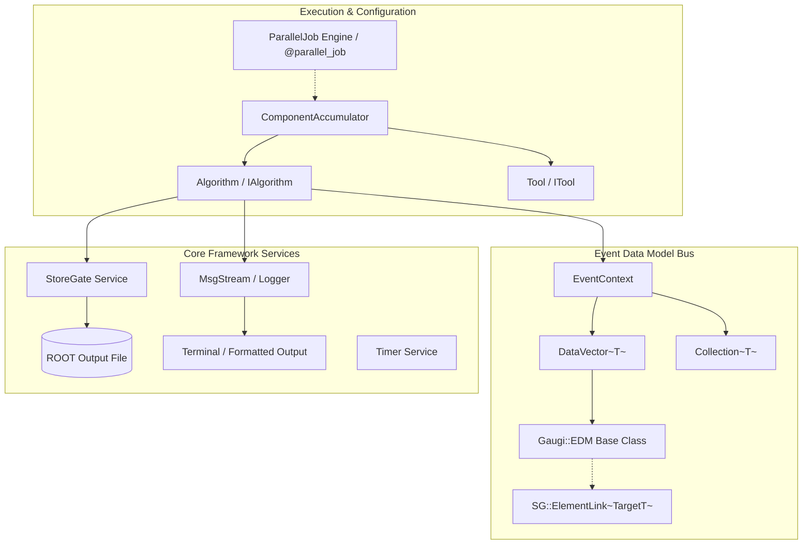
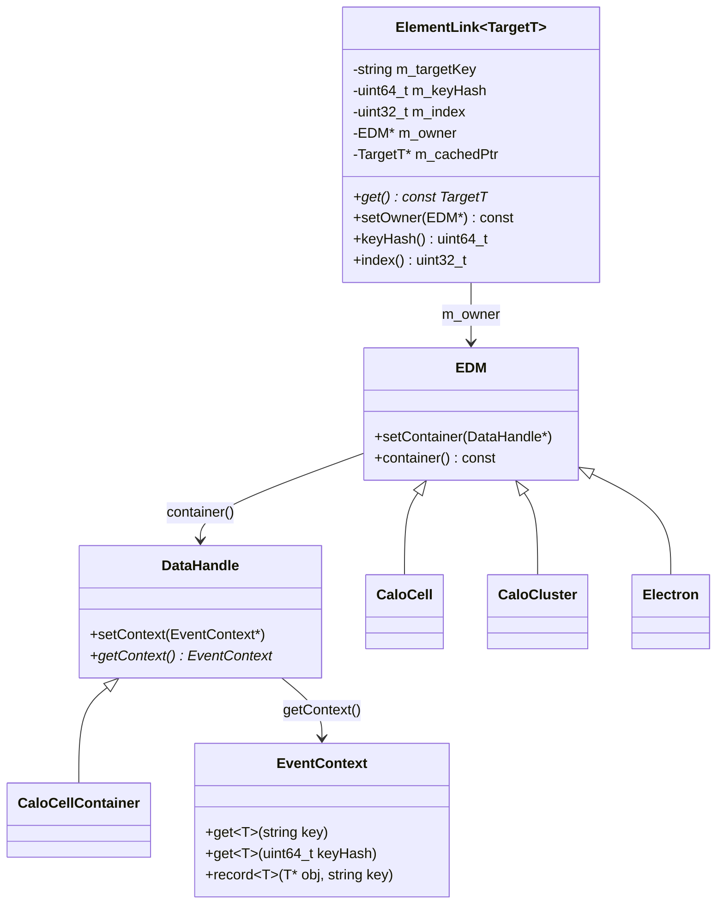
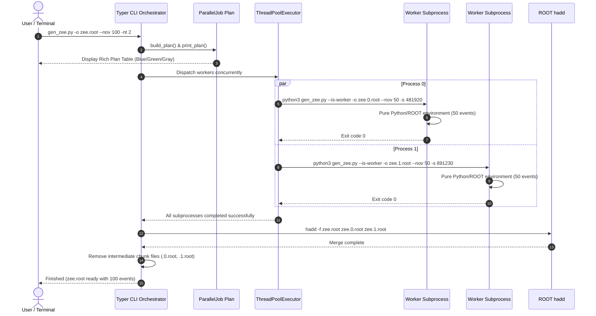

# GaugiKernel

**Core Architecture and Foundation Framework for the Lorenzetti Simulation Platform**

`GaugiKernel` provides the architectural backbone for the entire Lorenzetti high-energy physics simulation and reconstruction framework. Heavily inspired by the CERN/ATLAS **Gaudi** and **Athena** architectures, `GaugiKernel` establishes the component object model, event bus management, relational Event Data Model (EDM), messaging infrastructure, and a robust subprocess-based parallel processing engine.

---

## 1. Architecture Overview

`GaugiKernel` decouples physics algorithms, simulation engines (Geant4/Pythia8), event data structures, and execution orchestration.



---

## 2. Core Framework Components

### 2.1 Component Model (`Algorithm` & `Tool`)

All data processing tasks in Lorenzetti are encapsulated within **Algorithms** or **Tools**:

- **`Algorithm` (`GaugiKernel/Algorithm.h`)**: Primary unit of execution. Follows the standard state machine lifecycle:
  1. `initialize()`: Configuration validation, resource allocation, and histogram booking.
  2. `execute()`: Invoked once per physics event.
  3. `finalize()`: Summary reporting, efficiency calculations, and cleanup.
- **`Tool` (`GaugiKernel/Tool.h`)**: Reusable helper components callable from one or more algorithms (e.g. calorimeter pulse shaping, optimal filtering, shower shape calculations). Inherits from `Gaugi::ITool`, `MsgService`, and `PropertyService`.
- **`ComponentAccumulator` (`GaugiKernel/ComponentAccumulator.h`)**: Modern configuration container coordinating algorithms, private/public tools, and service dependencies.

#### C++ Algorithm & Tool Examples

```cpp
#include "GaugiKernel/Algorithm.h"
#include "GaugiKernel/Tool.h"
#include "GaugiKernel/StatusCode.h"

// 1. Defining a reusable Tool
class MyHelperTool : public Gaugi::Tool {
public:
  MyHelperTool() : Tool() {
    declareProperty("CorrectionFactor", m_factor = 1.05);
  }

  virtual StatusCode initialize() override {
    MSG_INFO("Initializing helper tool: " << name());
    return StatusCode::SUCCESS;
  }

  virtual StatusCode execute(SG::EventContext &ctx, Gaugi::EDM *obj) const override {
    MSG_DEBUG("Processing EDM object with factor " << m_factor);
    return StatusCode::SUCCESS;
  }

  virtual StatusCode finalize() override {
    return StatusCode::SUCCESS;
  }

private:
  double m_factor;
};

// 2. Defining an Algorithm that consumes Tools
class MyAnalysisAlg : public Gaugi::Algorithm {
public:
  MyAnalysisAlg(const std::string& name) : Algorithm(name) {
    declareProperty("Tools", m_tools);
  }

  virtual StatusCode initialize() override {
    MSG_INFO("Initializing " << name() << " with " << m_tools.size() << " tools");
    for (auto* tool : m_tools) {
      if (tool->initialize().isFailure()) return StatusCode::FAILURE;
    }
    return StatusCode::SUCCESS;
  }

  virtual StatusCode execute() override {
    MSG_DEBUG("Processing event in " << name());
    return StatusCode::SUCCESS;
  }

  virtual StatusCode finalize() override {
    for (auto* tool : m_tools) tool->finalize();
    return StatusCode::SUCCESS;
  }

private:
  std::vector<Gaugi::Tool*> m_tools;
};
```

#### Python Configuration Binding

In Python, `Configurable` automatically converts Python lists containing tools into `std::vector<Gaugi::Tool*>`:

```python
from GaugiKernel import ComponentAccumulator
from MyPackage import MyAnalysisAlgCfg, MyHelperToolCfg

acc = ComponentAccumulator("AnalysisAcc")

# Instantiate and configure
helper_tool = MyHelperToolCfg("EnergyCorrector", CorrectionFactor=1.08)
alg = MyAnalysisAlgCfg("MyAnalysis")
alg.Tools += helper_tool  # Seamlessly converts and pushes to std::vector<Gaugi::Tool*>

acc += alg
```

---

### 2.2 Event Data Model (EDM) & Relational Links (`ElementLink`)

Lorenzetti uses a type-safe, relational Event Data Model that prevents raw pointer invalidation and dangling references:



- **`Gaugi::EDM` (`GaugiKernel/EDM.h`)**: Base class for all reconstructible objects (`CaloCell`, `CaloCluster`, `TruthParticle`, `Electron`). Maintains an internal transient pointer to its parent container.
- **`SG::EventContext` (`GaugiKernel/DataHandle.h`)**: The central in-memory data store for an event, allowing $O(1)$ lookup via 64-bit FNV-1a hashes.
- **`SG::ElementLink<TargetT>` (`GaugiKernel/ElementLink.h`)**: Relational smart pointer that stores target container key hashes and entry indices. It lazily resolves pointers on demand using the owner's `EventContext` without manual pointer management.

#### ElementLink Navigation Example

```cpp
#include "Egamma/Electron.h"
#include "CaloCluster/CaloCluster.h"

// Retrieve an Electron from the EventContext
const xAOD::Electron* electron = ...;

// Navigate to the linked CaloCluster through ElementLink:
const xAOD::CaloCluster* cluster = electron->caloCluster();
if (cluster) {
    std::cout << "Cluster Energy: " << cluster->e() << " MeV" << std::endl;
}
```

---

### 2.3 StoreGate & Histogram Persistence (`StoreGate`)

`SG::StoreGate` provides an integrated interface for managing ROOT object persistence (`TTree`, `TH1F`, `TH2F`, `TH2Poly`) with automatic directory structures and support for multi-threaded merger streams (`TBufferMerger`):

```cpp
#include "GaugiKernel/StoreGate.h"

SG::StoreGate storeGate("output.root");

// Create directory in ROOT file
storeGate.mkdir("Calorimeter/Histograms");
storeGate.cd("Calorimeter/Histograms");

// Add 1D histogram
TH1F* h_pt = new TH1F("h_pt", "Transverse Momentum;p_{T} [GeV];Events", 100, 0, 100);
storeGate.add(h_pt);

// Fill and persist
h_pt->Fill(45.2);
storeGate.save();
```

---

### 2.4 Messaging and Diagnostic Logging (`MsgStream` & `Logger`)

`GaugiKernel` features structured logging with verbosity levels identical to Gaudi/Athena:

| Level | C++ Macro | Python Method | Usage |
| :--- | :--- | :--- | :--- |
| `VERBOSE` | `MSG_VERBOSE(...)` | `self._logger.verbose(...)` | Extremely detailed step-by-step diagnostic dumps. |
| `DEBUG` | `MSG_DEBUG(...)` | `self._logger.debug(...)` | Debugging and developer verification output. |
| `INFO` | `MSG_INFO(...)` | `self._logger.info(...)` | General operational milestone information. |
| `WARNING` | `MSG_WARNING(...)` | `self._logger.warning(...)` | Recoverable discrepancies or abnormal parameters. |
| `ERROR` | `MSG_ERROR(...)` | `self._logger.error(...)` | Critical process failures or missing dependencies. |
| `FATAL` | `MSG_FATAL(...)` | `self._logger.fatal(...)` | Unrecoverable conditions (aborts execution). |

---

## 3. Parallel Execution Engine (`GaugiKernel.Parallel`)

### 3.1 Total Decoupling Architecture

Physics event generation and Geant4 simulations link large C++ shared libraries (`liblorenzetti.so`, ROOT, Geant4, Pythia8). Python standard library `multiprocessing` or `joblib` relies on `fork()` or `pickle`, which frequently leads to memory corruption, `_pickle.PicklingError`, or crashes such as `undefined symbol: _Py_HashPointer`.

`GaugiKernel.Parallel` implements complete process decoupling through an **Orchestrator/Worker Subprocess Pattern**:



---

### 3.2 The `@parallel_job` Decorator

The `@parallel_job` decorator automatically transforms a standard Python function into a command-line interface with built-in multi-core parallelism:

```python
from typing import List
from typing_extensions import Annotated
import typer
from GaugiKernel import parallel_job, GeV, LoggingLevel

@parallel_job(ntuple_name="particles")
def main(
    events: List[int],
    output_file: str,
    seed: int,
    energy: Annotated[float, typer.Option("--energy", help="Energy in GeV")] = 50.0,
    output_level: Annotated[str, typer.Option("--output-level", help="Verbosity")] = "INFO",
):
    """
    Simulate particle events with custom energy.
    """
    print(f"Worker running {len(events)} events (seed={seed}) -> {output_file}")
    
    # Initialize your generator / simulation pipeline:
    # tape = EventTape("Tape", OutputFile=output_file)
    # tape.run(events)

if __name__ == "__main__":
    main()
```

---

### 3.3 Command-Line Options Reference

Every script decorated with `@parallel_job` exposes the following options:

| Option | Short | Default | Description |
| :--- | :--- | :--- | :--- |
| `--output-file` | `-o` | *(Required)* | Destination merged ROOT file. |
| `--nov`, `--number-of-events` | | `-1` | Total number of events to process. |
| `--number-of-workers` | `-nw`, `-nt` | `1` | Number of concurrent worker processes (`--number-of-threads` supported as alias). |
| `--events-per-job` | | `-1` | Custom number of events per chunk (auto-computed if `-1`). |
| `--seed` | `-s` | `512` | Base random seed (each worker receives an independent seed). |
| `--event-numbers` | `-e` | `None` | Comma-separated list of explicit event IDs (e.g. `'0,1,5,10'`). |
| `--merge` / `--no-merge` | `-m` | `True` | Merge intermediate chunk files using `hadd -f`. |
| `--overwrite` / `--no-overwrite` | | `True` | Overwrite already existing output files. |
| `--show-output` / `--no-show-output` | `-v` | `False` | Display real-time streaming output from worker processes. |
| `--dry-run` | | `False` | Display the execution plan table without running workers. |
| `--job-file` | | `None` | Path to a JSON configuration file to pre-fill/override options. |
| `--help` | `-h` | | Display help message and options. |

---

### 3.4 CLI Usage Examples

#### Run 1000 events across 8 worker processes
```bash
python3 my_generator.py -o /data/events.root --nov 1000 -nw 8
```

#### Inspect execution plan before running (Dry Run)
```bash
python3 my_generator.py -o /data/events.root --nov 1000 -nw 8 --dry-run
```

#### Stream real-time logs from all workers
```bash
python3 my_generator.py -o /data/events.root --nov 100 -nw 4 -v
```

#### Run specific non-contiguous events
```bash
python3 my_generator.py -o /data/events.root -e "0,15,42,108" -nw 2
```

---

### 3.5 The `@file_parallel_job` Decorator (Batch & Folder Parallelism)

While `@parallel_job` partitions an **event count** across processes for event generators, `@file_parallel_job` partitions a **collection of files or an entire folder** across isolated worker processes.

```python
from pathlib import Path
from typing_extensions import Annotated
import typer
from GaugiKernel import file_parallel_job

@file_parallel_job(ntuple_name="CollectionTree")
def main(
    input_file: Annotated[str | Path, typer.Option("-i", "--input-file", help="Input file")],
    output_file: Annotated[str | Path, typer.Option("-o", "--output-file", help="Output file")],
    number_of_threads: Annotated[int, typer.Option("-nt", "--number-of-threads", help="Threads per job")] = 1,
):
    """Process a single file (executed inside clean worker subprocess)."""
    print(f"Worker processing {input_file} -> {output_file} using {number_of_threads} threads")

if __name__ == "__main__":
    main()
```

#### Concurrency and Hierarchical Multithreading
For file processing workloads (such as Geant4 in `simu_trf.py` or digitization in `digit_trf.py`), `@file_parallel_job` allows explicit control over worker concurrency and threads per job:

| Option | Short | Default | Description |
| :--- | :--- | :--- | :--- |
| `--number-of-workers` | `-nw` | `None` | **Number of concurrent worker processes** to process files simultaneously. |
| `--number-of-threads` | `-nt` | `1` | Total machine cores allocated across jobs (or threads per worker if `-nw` is set). |
| `--threads-per-job` | | `-1` | Threads assigned to each worker subprocess (`-1` auto-computes). |
| `--pattern`, `--file-pattern` | | `"*.root"` | Glob pattern when input is a directory. |
| `--merge` / `--no-merge` | `-m` | `False` | Merge output ROOT files with `hadd -f` after completion. |
| `--overwrite` / `--no-overwrite` | | `True` | Overwrite existing output files. |
| `--show-output` / `--no-show-output` | `-v` | `False` | Stream stdout/stderr from worker processes in real time. |
| `--dry-run` | | `False` | Display execution plan table without running workers. |

#### Usage Examples:
```bash
# 1. Process files using 8 concurrent worker processes:
simu_trf.py -i /data/evts/ -o /data/hits/ -nw 8

# 2. Process files using 4 workers, each running with 2 threads (4 * 2 = 8 cores):
simu_trf.py -i /data/evts/ -o /data/hits/ -nw 4 -nt 2

# 3. Automatic division: 40 total cores with 4 threads per Geant4 job -> 10 workers:
simu_trf.py -i /data/evts/ -o /data/hits/ -nt 40 --threads-per-job 4
```

- Supports input directories (`-i /data/evts/ -o /data/hits/`), glob patterns (`--pattern "*.EVT.root"`), comma-separated files, and automatic output name transformations (`.EVT.` $\to$ `.HIT.`).

---

## 4. Setup and Environment

To configure the runtime environment for `GaugiKernel`:

```bash
cd build
source lzt_setup.sh
```

This ensures that:
- `/opt/lorenzetti-python/bin` is placed in `PATH` (using the container's Python 3.10 runtime).
- `LD_LIBRARY_PATH` includes `liblorenzetti.so` and ROOT dictionaries.
- `PYTHONPATH` includes `build/python` (`GaugiKernel`, `CaloCell`, `CaloCluster`, `filters`, etc.).
