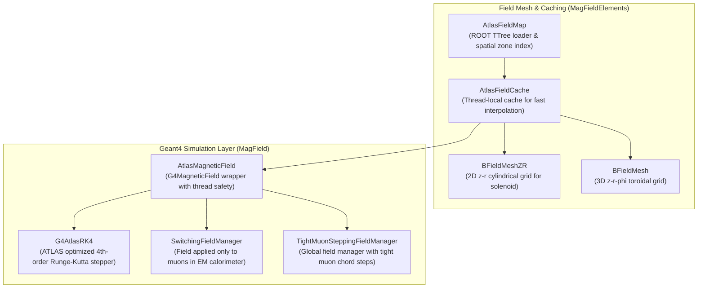

# Magnetic Field Package (`magfield/`)

The `magfield/` package provides the magnetic field description and tracking integration for the **Lorenzetti** simulation and reconstruction framework. It ports the high-precision magnetic field implementation from the ATLAS experiment at CERN (Athena release 23.0.14), decoupled into a standalone, modular library.

---

## 1. Overview & Physics Capabilities

The ATLAS magnetic field system consists of:
- **Central Solenoid**: Generates a nominal axial magnetic field of $\approx 2.0\text{ T}$ within the tracking and calorimeter inner cavity ($|z| < 2.8\text{ m}$, $r < 1.075\text{ m}$).
- **Barrel Toroid & End-Cap Toroids**: Produces a toroidal field ($\approx 0.5\text{--}1.0\text{ T}$) bending charged particles in the muon spectrometer.

The field is represented as a tabulated grid loaded from standard ROOT field map files (e.g. `bfield_7730_20400.root` with nominal currents of $7730\text{ A}$ for the solenoid and $20400\text{ A}$ for the toroid).

---

## 2. Architecture & Components



### Components

1. **`MagFieldElements/`**:
   - `AtlasFieldMap`: Reads ROOT field maps and partitions space into field zones.
   - `AtlasFieldCache`: Thread-local cache performing bilinear (2D) and trilinear (3D) field interpolation with SIMD vectorization via `GaugiKernel/vec.h`.
   - `BFieldMeshZR` / `BFieldMesh`: Spatial mesh representations with optimized boundaries.

2. **`MagField/`**:
   - `AtlasMagneticField`: Geant4 `G4MagneticField` implementation. Thread-safe: threads share the immutable `AtlasFieldMap` while owning individual `AtlasFieldCache` instances.
   - `G4AtlasRK4`: Specialized 4th-order Runge-Kutta equation-of-motion integrator.
   - `SwitchingFieldManager`: Fast simulation tool activating field calculation exclusively for muons within selected calorimeter volumes (e.g. LAr EM barrel), saving CPU time for EM showers.
   - `TightMuonSteppingFieldManager`: Field manager enforcing tighter chord miss distance and step parameters for precise muon deflection.

---

## 3. Build & Integration

- **CMake Target**: `MagField` (OBJECT library).
- **Dependencies**: `GaugiKernel`, Geant4, ROOT (`RIO`, `Tree`).
- **Linking**: Automatically bundled into `liblorenzetti.so`.

### C++ Usage Example

```cpp
#include "MagField/AtlasMagneticField.h"
#include "MagField/G4AtlasRK4.h"
#include "MagField/TightMuonSteppingFieldManager.h"

// Load field map from ROOT file
auto fieldMap = AtlasMagneticField::loadMap(mapFilePath, 7730.0 /*solenoid A*/, 20400.0 /*toroid A*/);

// Create thread-local Geant4 field wrapper
auto *field = new AtlasMagneticField(fieldMap.get(), 1.0 /*scaleSol*/, 1.0 /*scaleTor*/);

// Attach to stepper and integration driver
auto *equation = new G4Mag_UsualEqRhs(field);
auto *stepper = new G4AtlasRK4(equation);
auto *driver = new G4IntegrationDriver<G4AtlasRK4>(0.01 * CLHEP::mm, stepper, stepper->GetNumberOfVariables());
```
