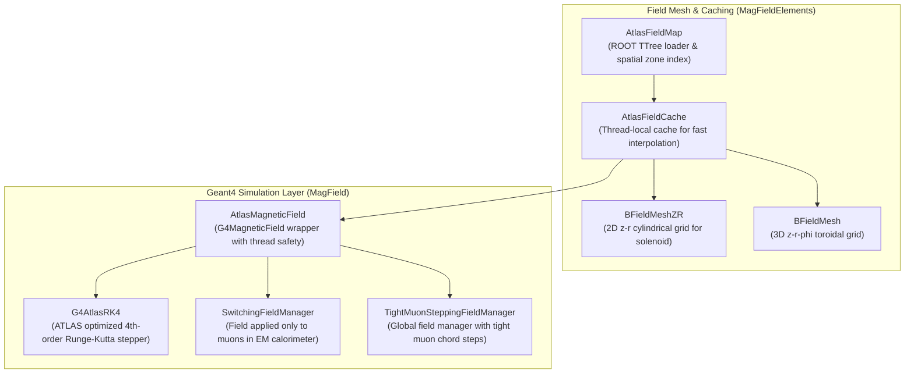

# Magnetic Field Subsystem (`magfield/`)

The `magfield/` subsystem provides magnetic field descriptions, numerical integration steppers, and tracking management for the **Lorenzetti** simulation framework. It ports the high-precision magnetic field implementation from the ATLAS experiment at CERN (Athena release 23.0.14), modularized into two distinct packages:

- **[MagFieldElements](MagFieldElements/)**: Low-level spatial field meshes, thread-local SIMD cache, and ROOT `TTree` field map parsers. Independent of Geant4.
- **[MagField](MagField/)**: Geant4 tracking adapters (`AtlasMagneticField`), equation-of-motion steppers (`G4AtlasRK4`), field managers, and Python job steering flags (`MagFieldFlags`).

---

## 1. Architecture Overview



---

## 2. Subsystem Structure

```text
magfield/
├── README.md                   # This subsystem overview
├── MagFieldElements/           # Package 1: Mesh, cache & map parsing (pure C++/ROOT)
│   ├── CMakeLists.txt          # Target: MagFieldElements (OBJECT library)
│   ├── README.md               # MagFieldElements documentation
│   ├── MagFieldElements/       # Public C++ headers & .icc templates
│   └── src/                    # C++ Implementations
└── MagField/                   # Package 2: Geant4 integration & Python steering
    ├── CMakeLists.txt          # Target: MagField (OBJECT library)
    ├── README.md               # MagField documentation
    ├── MagField/               # Public Geant4 C++ headers
    ├── src/                    # C++ Implementations
    └── python/                 # Python module 'magfield' (MagFieldFlags)
```

---

## 3. Subsystem Packages

### [MagFieldElements](MagFieldElements/)
- **Zero Geant4 Dependency:** Operates solely on standard C++, ROOT, and GaugiKernel.
- **Data Structures:** Represents both azimuthally symmetric 2D meshes for the central solenoid and 3D meshes for the toroidal muon system.
- **Vektorization & Performance:** Uses `GaugiKernel/vec.h` and local cache blocks to evaluate magnetic vectors at high event rates without contention.

### [MagField](MagField/)
- **Geant4 Integration:** Wraps `AtlasFieldMap` into a thread-safe `G4MagneticField` instance.
- **Runge-Kutta Stepper:** Employs the `G4AtlasRK4` 4th-order integration stepper.
- **Steering:** Provides `MagFieldFlags` (`EnableField`, `EnableSolenoidOnly`) for simulation transforms.

---

## 4. Documentation Links

- **[MagFieldElements Documentation](MagFieldElements/README.md)**: Detailed data structures and C++ cache API.
- **[MagField Documentation](MagField/README.md)**: Geant4 integration, field managers, and Python steering.
- **[Flags Reference Manual](../doc/flags.md)**: Configuration flags reference for `MagFieldFlags`.
