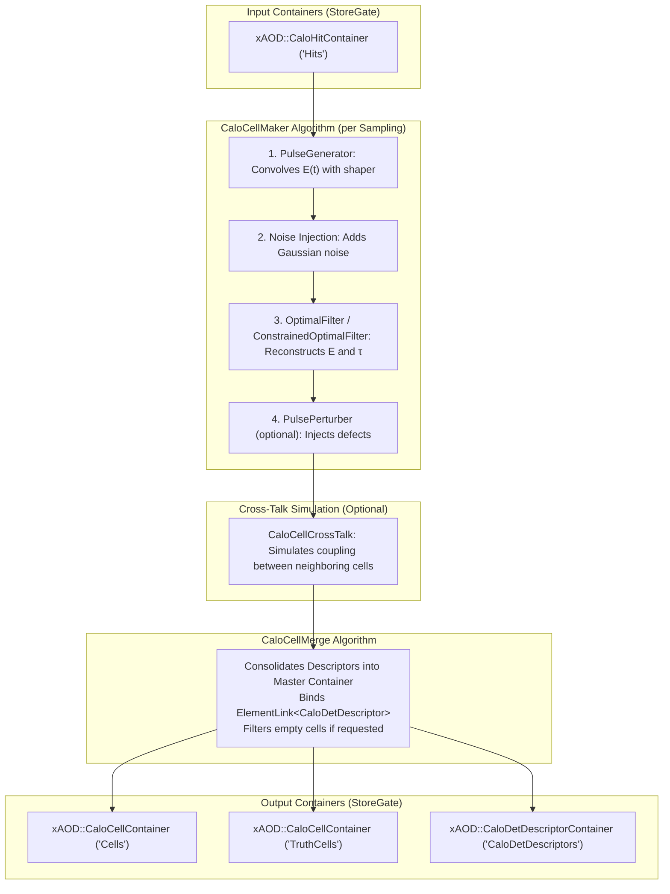
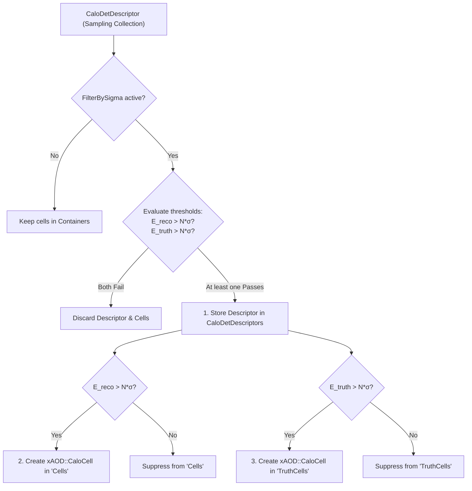

# CaloCellBuilder

The `CaloCellBuilder` package provides algorithms, tools, and configuration infrastructure for the complete **Calorimeter Digitization and Cell Reconstruction chain** in the Lorenzetti framework.

It converts simulated energy deposits (`xAOD::CaloHitContainer`) in sensitive calorimeter volumes into digitized readout cells (`xAOD::CaloCellContainer`), simulating electronic pulse shaping, noise injection, optimal filtering, cross-talk, and detector defects, while maintaining relational `ElementLink` references to a unified master descriptor container (`xAOD::CaloDetDescriptorContainer`).

---

## 1. Digitization Pipeline Architecture

The digitization chain executes event-by-event and sampling-by-sampling:



---

## 2. Algorithms and Electronics Tools

### Core Algorithms (`src/`)
* **`CaloCellMaker` (`C++`)**:
  Manages sampling-level digitization. Discretizes calorimeter geometry into $\eta$-$\phi$ cell descriptors, transfers hit bunch-crossing energy deposits, executes `PulseGenerator`, and invokes configured `Gaugi::Tool` filters.
* **`CaloCellMerge` (`C++`)**:
  Merges sampling descriptor collections into a master `xAOD::CaloDetDescriptorContainer` and unified reconstructed (`"Cells"`) and truth (`"TruthCells"`) containers. Establishes relational `ElementLink<xAOD::CaloDetDescriptor>` with lazy resolution capability.
* **`CaloCellNoiseSuppression` (`C++`)**:
  Dedicated offline algorithm performing cell noise suppression ($E > \text{threshold} \times \sigma$). Reads an input `CaloCellContainer` (e.g., `"Cells_original"`), evaluates energy against the cell's `CaloDetDescriptor` electronic noise level ($\sigma$), and records the surviving cells into an output `CaloCellContainer` (e.g., `"Cells"`).
* **`CaloCellCrossTalk` (`C++`, alias `CrossTalkMaker`)**:
  Simulates capacitive, inductive, and resistive cross-talk between neighboring cells in dense calorimeter layers (`EMB2`, `EMEC2`).

### Electronics Modeling Tools (`src/electronics/`, inheriting from `Gaugi::Tool`)
* **`PulseGenerator` (`C++`)**:
  Convolves energy deposits with realistic shaper response curves and adds Gaussian noise.
* **`OptimalFilter` (`C++`)**:
  Estimates cell energy $E = \sum a_i S_i$ and time $\tau = \sum b_i S_i$ using precalculated OF weights.
* **`ConstrainedOptimalFilter` (`C++`)**:
  Constrained Optimal Filter (COF) for signal reconstruction in the Tile calorimeter.
* **`PulsePerturber` (`C++`)**:
  Injects detector defects (dead modules, abnormal noise levels) based on Bad Run List (BRL) specifications.

> [!NOTE]
> Hit-level pileup merging (`PileupMerge`) has been migrated to `CaloHitBuilder` as `CaloHitPileupMerge`, operating directly on `xAOD::CaloHitContainer`.

---

## 3. Configuration Flags

Global digitization flags are controlled via stringified enums:

### `CaloFlags`
* `SamplingnoiseStd` (`float`, default `0.0`): Global noise standard deviation.
* `DoCrossTalk` (`bool`, default `False`): Enables cell-to-cell cross-talk simulation.
* `DoCOF` (`bool`, default `False`): Enables Constrained Optimal Filtering for Tile calorimeter.
* `DoDefects` (`bool`, default `False`): Enables anomaly injection via `PulsePerturber`.
* `FilterBySigma` (`bool`, default `False`): Enables noise-sigma based cell filtering ($E > N\sigma$).
* `SigmaThreshold` (`float`, default `2.0`): Multiplier threshold for noise cut ($N$).

### `CrossTalkFlags`
* `MinEnergy` (`float`, default `1.0 * GeV`): Energy threshold to trigger cross-talk propagation.
* `AmpCapacitive` (`float`, default `4.2`): Capacitive coupling percentage.
* `AmpInductive` (`float`, default `2.3`): Inductive coupling percentage.
* `AmpResistive` (`float`, default `1.0`): Resistive coupling percentage.

### `AnomalyFlags`
* `BadRunListFile` (`str`, default `""`): Path to JSON file containing bad run and dead module definitions.

---

## 4. Python Configuration Interface

### `CaloCellBuilder` Class

```python
class CaloCellBuilder(Logger):
    def __init__(
        self,
        name: str,
        detector: Any,
        HistogramPath: str = "Expert",
        InputHitsKey: str = "Hits",
        OutputCellsKey: str = "Cells",
        OutputTruthCellsKey: str = "TruthCells",
        OutputDescriptorsKey: str = "CaloDetDescriptors",
        InputEventKey: str = "Events",
        FilterBySigma: Optional[bool] = None,
        SigmaThreshold: Optional[float] = None,
        OutputLevel: int = LoggingLevel.toC("INFO"),
    ) -> None:
        ...
```

### Usage Example

```python
import ROOT
from GaugiKernel import LoggingLevel, ComponentAccumulator
from CaloCellBuilder import CaloCellBuilder, CaloFlags, CrossTalkFlags, AnomalyFlags

def configure_digitization(detector_construction: Any) -> ComponentAccumulator:
    acc = ComponentAccumulator("CaloDigitizationAcc")

    # 1. Set global flags
    CaloFlags.DoCrossTalk = True
    CaloFlags.DoDefects = False

    # 2. Instantiate and configure CaloCellBuilder
    cell_builder = CaloCellBuilder(
        name="CaloCellBuilder",
        detector=detector_construction,
        InputHitsKey="Hits",
        OutputCellsKey="Cells",
        OutputTruthCellsKey="TruthCells",
        OutputDescriptorsKey="CaloDetDescriptors",
        FilterBySigma=True,
        SigmaThreshold=2.0,
        OutputLevel=LoggingLevel.toC("INFO"),
    )

    # 3. Merge into the accumulator
    cell_builder.merge(acc)

    return acc
```

---

## 5. ATLAS Run 4 Noise Suppression ($E > 2\sigma$ Filtering)

### 5.1 Context and Motivation
In High-Luminosity LHC (HL-LHC / ATLAS Run 4), the extreme calorimeter readout bandwidth and high-pileup environment dictate stringent zero-suppression and noise filtering policies. To optimize storage and downstream reconstruction latency, calorimeter cells whose reconstructed energy does not exceed **$2\sigma$ of the electronic noise** are filtered out:

$$E_{\text{reco}} > N \cdot \sigma_{\text{noise}} \quad (\text{with } N = 2.0)$$

### 5.2 Merge-Level Filtering Mechanism
Filtering is executed online within the `CaloCellMerge` algorithm during the creation of unified event collections. Both reconstructed cells ($E_{\text{reco}}$) and truth cells ($E_{\text{truth}}$) are evaluated **independently** against the noise threshold:



### 5.3 Independent Filtering Policy
Reconstructed and truth cells are filtered independently without cross-matching constraints:
* Real cells are recorded into `Cells` if $E_{\text{reco}} > N\sigma$.
* Truth cells are recorded into `TruthCells` if $E_{\text{truth}} > N\sigma$.
* If neither passes the threshold, the descriptor is omitted entirely from `CaloDetDescriptors`.
* For surviving cells, the `ElementLink<xAOD::CaloDetDescriptor>` points to the common master descriptor index in `CaloDetDescriptors`.

### 5.4 Operational Deployment: ESD Preservation & Reconstruction Filtering

Following ATLAS Athena recommendations, calorimeter digitization (`digit_trf.py`) preserves complete cell information by default (`FilterBySigma=False`), outputting an unattenuated Event Summary Data (ESD) tier.

Noise suppression is cleanly decoupled into offline reconstruction (`reco_trf.py`), where `RootStreamESDReader` loads the input cells into `"Cells_original"`, and `CaloCellNoiseSuppression` produces the filtered `"Cells"` container:

```bash
# Standard reconstruction with Run 4 2-sigma noise cut:
reco_trf.py -i Zee.ESD.root -o Zee_2sigma.AOD.root --filter-by-sigma --sigma-threshold 2.0

# Alternate 3-sigma noise cut:
reco_trf.py -i Zee.ESD.root -o Zee_3sigma.AOD.root --filter-by-sigma --sigma-threshold 3.0

# Full cell analysis / calibration (default, no noise cut):
reco_trf.py -i Zee.ESD.root -o Zee_all.AOD.root
```

This architecture allows analysts to compare filtered and unfiltered physics objects (clusters, rings, electrons) from the exact same ESD dataset without re-running Geant4 or electronics digitization.

---

## 6. Dependencies
* `kernel/GaugiKernel`: Algorithm and Tool interfaces, StoreGate `EventContext`, Data Handles, `ElementLink`.
* `events/CaloCell`: `xAOD::CaloCell`, `xAOD::CaloDetDescriptor`, `xAOD::CaloCellContainer`, `xAOD::CaloDetDescriptorContainer`.
* `events/CaloHit`: `xAOD::CaloHitContainer`.
