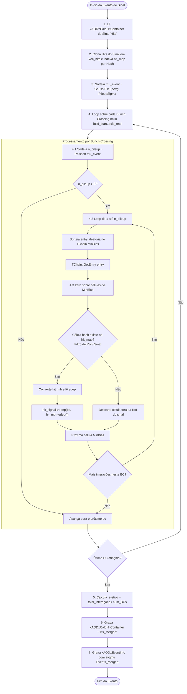

# Proposta de Refatoração: CaloHitPileupMerge

## 1. Sumário Executivo

Esta proposta formaliza a reestruturação e simplificação do algoritmo **`CaloHitPileupMerge`** dentro do pacote **`CaloHitBuilder`**.

O objetivo primordial é eliminar o modelo legado de arquivos duplos (*low pileup* vs. *high pileup*), substituindo-o por um mecanismo físico, robusto e direto que opera sobre uma **biblioteca única de eventos de Minimum Bias (MinBias)** gerados e simulados individualmente ($\mu = 1$ no bunch crossing central $\text{BCID} = 0$).

---

## 2. Diagnóstico da Abordagem Legada

Na versão herdada do framework:
1. **Complexidade Operacional de Produção:** O usuário precisava pré-gerar dois conjuntos de dados distintos de MinBias: arquivos com $\mu \approx 1$ (*low pileup*) e arquivos artificiais pré-agrupados com $\mu \ge 5$ ou $10$ (*high pileup*).
2. **Lógica de Seleção Artificial:** O algoritmo tentava deduzir qual árvore ler alternando entre árvores conforme $k > n_{\text{high}}$, introduzindo descontinuidades estatísticas e complexidade desnecessária.
3. **Mapeamento Rígido por Índice:** O código criava um mapa de índices no início baseado apenas no evento 0 da árvore *high*. Se os eventos subsequentes tivessem células vazias filtradas ou ordem diferente, o mapeamento falhava silenciosamente ou produzia resultados inconsistentes.
4. **Alocações Desnecessárias:** A cada evento MinBias, ocorriam alocações e desalocações repetidas de objetos sem reaproveitamento.
5. **Interface Duplicada:** Flags redundantes em linha de comando (`--low-pileup-files` e `--high-pileup-files`).

---

## 3. Análise da Função `edep()` do `xAOD::CaloHit`

### 3.1 Estrutura Interna de Dados
No `xAOD::CaloHit` ([CaloHit.h](file:///home/joao.pinto/git_repos/lorenzetti/events/CaloHit/CaloHit/CaloHit.h)), os depósitos de energia por bunch crossing são armazenados internamente em um **dicionário associativo**:
```cpp
std::map<int, float> m_edep; // chave: bunch crossing ID (bc_id), valor: energia em MeV
```

### 3.2 Interface de Acesso
A classe expõe métodos de leitura e escrita nativamente indexados pelo `bc_id`:

* **Getter:**
  ```cpp
  float edep(int bc_id = 0) const {
    if (m_edep.count(bc_id)) {
      return m_edep.at(bc_id);
    } else {
      return 0.0f; // Seguro se não houver depósito no bunch crossing
    }
  }
  ```
  > [!NOTE]
  > O parâmetro padrão é `bc_id = 0`. Portanto, uma chamada sem argumentos `hit->edep()` retorna diretamente a energia do **bunch crossing central ($\text{BCID} = 0$)**.

* **Setter Cumulativo:**
  ```cpp
  void edep(int bc_id, float e) {
    m_edep[bc_id] += e; // Soma cumulativamente no bucket do bc_id indicado!
  }
  ```

### 3.3 Por que NÃO precisamos de `zero_idx`?
No design de simulação adotado:
1. Cada evento da biblioteca de MinBias é gerado e simulado como uma colisão única ocorrendo em **$\text{BCID} = 0$**.
2. Logo, a energia depositada por essa colisão em uma dada célula do MinBias é obtida diretamente por:
   ```cpp
   float e_mb = hit_mb->edep(); // ou hit_mb->edep(0)
   ```
3. Para sobrepor essa energia no evento de sinal em um bunch crossing arbitrário $bc$ (por exemplo, $bc = +4$ ou $bc = -12$), basta chamar o setter cumulativo:
   ```cpp
   hit_signal->edep(bc, hit_mb->edep());
   ```
   O getter lê a chave `0` do dicionário da célula de MinBias, e o setter soma no bucket de tempo `bc` (`m_edep[bc] += e`) do sinal.

**Não há nenhuma necessidade de cálculo de offset (`zero_idx = -bcid_start`) nem de aritmética de ponteiros/vetores.** O dicionário do `CaloHit` cuida de toda a indexação temporal de forma limpa e transparente.

---

## 4. Conceito Físico da Sobreposição Temporal

### 4.1 A Janela de Bunch Crossings
No LHC e High-Luminosity LHC (HL-LHC), as colisões ocorrem a cada $25\text{ ns}$. 
* O evento de interesse (*hard-scatter*, por exemplo $Z \to ee$) ocorre no **$\text{BCID} = 0$**.
* O calorímetro registra sinais elétricos com tempo de integração/shaping da ordem de centenas de nanossegundos. Para modelar com fidelidade o pulso analógico resultante, o detector é sensível a uma janela de bunch crossings:
  
  $$\text{BCID} \in [\text{bcid\_start}, \text{bcid\_end}] \quad (\text{por exemplo } [-21, +4] \text{ ou } [-8, +3])$$

* **In-time pileup:** Colisões inelásticas ocorrendo simultaneamente no mesmo $\text{BCID} = 0$.
* **Out-of-time pileup:** Colisões inelásticas ocorrendo em cruzamentos anteriores ($\text{BCID} < 0$, caudas de sinal ainda decaindo) e posteriores ($\text{BCID} > 0$, início de formação de sinal).

### 4.2 O Papel do MinBias
Para cada bunch crossing $bc \in [\text{bcid\_start}, \text{bcid\_end}]$, o número de colisões inelásticas segue uma distribuição de **Poisson**:

$$N_{\text{pileup}}(bc) \sim \text{Poisson}(\mu_{\text{event}})$$

Cada uma dessas $N_{\text{pileup}}$ colisões é um evento de MinBias independente retirado da biblioteca. Sua energia é mapeada e acumulada na chave $bc$ de cada célula do sinal.

---

## 5. Fluxo Detalhado de Execução



---

## 6. Passo a Passo do Algoritmo

### Passo 1: Inicialização e Carregamento da Biblioteca (`bookHistograms`)
* Recebe a lista de arquivos de MinBias através da propriedade `PileupInputFiles`.
* Cria um único `TChain` contendo todos os arquivos de MinBias.
* Anexa o `TChain` ao `StoreGate` para acesso durante a execução dos eventos.

### Passo 2: Preparação do Evento de Sinal (`post_execute` e `allocate`)
* Lê o `xAOD::CaloHitContainer` do sinal (`m_inputHitsKey`, por padrão `"Hits"`).
* Clona os hits para um vetor temporário `std::vector<xAOD::CaloHit*> vec_hits` utilizando o método nativo de clonagem `const_hit->copy()` (reproduzindo profundamente mapas de energia, TOF e vetores de tempo).
* Constrói uma tabela hash $O(1)$:
  ```cpp
  std::unordered_map<unsigned long int, xAOD::CaloHit*> hit_map;
  ```
  onde a chave é o `hit->hash()` da geometria da célula e o valor é o ponteiro para o `CaloHit`.

### Passo 3: Flutuação de Luminosidade
* Se `m_pileupSigma > 0`, sorteia o $\mu$ instantâneo do evento segundo uma distribuição Gaussiana:
  
  $$\mu_{\text{event}} \sim \text{Gauss}(\text{PileupAvg}, \text{PileupSigma})$$

* Se `m_pileupSigma == 0`, adota rigorosamente $\mu_{\text{event}} = \text{PileupAvg}$.

### Passo 4: Superposição Temporal por Bunch Crossing
* Itera por todos os bunch crossings na janela:
  ```cpp
  for (int bc = m_bcid_start; bc <= m_bcid_end; ++bc)
  ```
* Para o bunch crossing $bc$, sorteia o número de colisões inelásticas ocorridas:
  
  $$N_{\text{pileup}} \sim \text{Poisson}(\mu_{\text{event}})$$

* Acumula o total de colisões geradas: $N_{\text{total}} += N_{\text{pileup}}$.
* Para cada colisão de $1$ até $N_{\text{pileup}}$:
  1. Avança o ponteiro sequencial circular sobre a biblioteca MinBias (inicializado com offset aleatório ou `StartEntry`):
     ```cpp
     if (m_currentEntry < 0) {
       m_currentEntry = m_rng.Integer(total_entries);
     } else {
       m_currentEntry = (m_currentEntry + 1) % total_entries;
     }
     ```
  2. Carrega os dados da árvore: `chain->GetEntry(m_currentEntry)`. Como colisões de MinBias são estatisticamente não-correlacionadas, a leitura sequencial em buffer circular é indistinguível de sorteios com reposição, mas garante quase 100% de cache hits nos baskets do ROOT e elimina I/O seeking repetido.
  3. Para cada célula presente nesse evento de MinBias (`hit_t`):
     * **Filtro de RoI / Sinal:** Verifica previamente se o hash da célula está presente no sinal:
       ```cpp
       auto it = hit_map.find(hit_t.hash);
       if (it == hit_map.end()) continue; // Descarta célula fora do sinal / RoI
       ```
       Se o evento principal foi gerado com foco em uma Região de Interesse (RoI, por exemplo janela $\Delta\eta \times \Delta\phi$ em torno de um elétron/fóton), as células do MinBias fora dessa RoI são imediatamente ignoradas *antes* de qualquer conversão ou alocação em heap. Isso previne que um evento de RoI (~centenas de células) exploda para o detector completo (~187.000 células) e zera as alocações dinâmicas no loop interno.
     * Converte `hit_t` para `xAOD::CaloHit` temporário e obtém a energia em $\text{BCID} = 0$:
       ```cpp
       float e_mb = hit_mb->edep(); // Acesso direto ao dict m_edep[0]
       ```
     * Acumula a energia diretamente no bucket temporal $bc$ da célula do sinal:
       ```cpp
       if (e_mb > 0.0f) {
         it->second->edep(bc, e_mb); // m_edep[bc] += e_mb no sinal
       }
       delete hit_mb;
       ```

### Passo 5: Persistência dos Dados Fundidos
* **Hits:** Grava o novo `xAOD::CaloHitContainer` na chave `m_outputHitsKey` (por padrão `"Hits_Merged"`).
* **EventInfo:** Cria um novo `xAOD::EventInfo` baseado no original, atualiza o campo `avgmu` com o valor médio real de pileup injetado:
  
  $$\langle \mu \rangle_{\text{efetivo}} = \frac{N_{\text{total}}}{\text{bcid\_end} - \text{bcid\_start} + 1}$$
  
  e grava em `m_outputEventKey` (por padrão `"Events_Merged"`).

---

## 7. Exemplo de Código C++

### 7.1 Definição da Classe (`CaloHitPileupMerge.h`)

```cpp
#ifndef CaloHitPileupMerge_h
#define CaloHitPileupMerge_h

#include "GaugiKernel/Algorithm.h"
#include "CaloHit/CaloHitContainer.h"
#include "EventInfo/EventInfoContainer.h"
#include "CaloHit/CaloHitConverter.h"
#include "TRandom3.h"
#include <unordered_map>
#include <vector>
#include <string>

class CaloHitPileupMerge : public Gaugi::Algorithm
{
  public:
    CaloHitPileupMerge(std::string name);
    virtual ~CaloHitPileupMerge() = default;

    virtual StatusCode initialize() override;
    virtual StatusCode bookHistograms(SG::EventContext &ctx) const override;
    virtual StatusCode post_execute(SG::EventContext &ctx) const override;
    virtual StatusCode finalize() override;

  private:
    int poisson(double nAvg) const;
    void allocate(SG::ReadHandle<xAOD::CaloHitContainer> &container,
                  std::vector<xAOD::CaloHit*> &vec_hits) const;
    void deallocate(std::vector<xAOD::CaloHit*> &vec_hits) const;
    float merge(SG::EventContext &ctx, std::vector<xAOD::CaloHit*> &vec_hits) const;

    // Chaves StoreGate
    std::string m_inputHitsKey;
    std::string m_outputHitsKey;
    std::string m_inputEventKey;
    std::string m_outputEventKey;

    // Configuração de Pileup e MinBias
    std::vector<std::string> m_pileupFiles;
    std::string m_ntupleName;
    float m_pileupAvg;
    float m_pileupSigma;
    int   m_bcid_start;
    int   m_bcid_end;
    int   m_maxRetry;
    float m_trunc_mu;
    float m_seed;

    mutable TRandom3 m_rng;
};

#endif
```

### 7.2 Implementação do Método `merge` (`CaloHitPileupMerge.cxx`)

```cpp
float CaloHitPileupMerge::merge(SG::EventContext &ctx, std::vector<xAOD::CaloHit*> &vec_hits) const
{
  auto store = ctx.getStoreGateSvc();
  auto chain = (TChain*)store->decorator("minbias_chain");

  if (!chain || chain->GetEntries() == 0) {
    MSG_FATAL("MinBias TChain is empty or not loaded!");
  }

  // 1. Otimização de I/O: ativa apenas os ramos estritamente necessários
  chain->SetBranchStatus("*", 0);
  chain->SetBranchStatus(("CaloHitContainer_" + m_inputHitsKey + ".edep").c_str(), 1);
  chain->SetBranchStatus(("CaloHitContainer_" + m_inputHitsKey + ".hash").c_str(), 1);
  chain->SetBranchStatus(("CaloHitContainer_" + m_inputHitsKey + ".bcid_start").c_str(), 1);
  chain->SetBranchStatus(("CaloHitContainer_" + m_inputHitsKey + ".sampling").c_str(), 1);
  chain->SetBranchStatus(("CaloHitContainer_" + m_inputHitsKey + ".detector").c_str(), 1);
  chain->SetBranchStatus(("CaloHitContainer_" + m_inputHitsKey + ".eta").c_str(), 1);
  chain->SetBranchStatus(("CaloHitContainer_" + m_inputHitsKey + ".phi").c_str(), 1);
  chain->SetBranchStatus(("CaloHitContainer_" + m_inputHitsKey + ".deta").c_str(), 1);
  chain->SetBranchStatus(("CaloHitContainer_" + m_inputHitsKey + ".dphi").c_str(), 1);
  chain->SetBranchStatus(("CaloHitContainer_" + m_inputHitsKey + ".bc_duration").c_str(), 1);

  std::vector<xAOD::CaloHit_t> *minbias_hits_t = nullptr;
  chain->SetBranchAddress(("CaloHitContainer_" + m_inputHitsKey).c_str(), &minbias_hits_t);

  // 2. Construção da tabela hash O(1) com as células do evento de sinal
  std::unordered_map<unsigned long int, xAOD::CaloHit*> hit_map;
  hit_map.reserve(vec_hits.size() * 2);
  for (auto* hit : vec_hits) {
    hit_map[hit->hash()] = hit;
  }

  // 3. Sorteio de mu para o evento de sinal
  float mu_event = (m_pileupSigma > 0.0f) ? m_rng.Gaus(m_pileupAvg, m_pileupSigma) : m_pileupAvg;
  if (mu_event < 0.0f) mu_event = 0.0f;

  long long total_entries = chain->GetEntries();
  long long total_interactions = 0;
  int num_bunch_crossings = (m_bcid_end - m_bcid_start + 1);

  xAOD::CaloHitConverter cnv;

  // 4. Varredura temporal da janela de Bunch Crossings
  for (int bc = m_bcid_start; bc <= m_bcid_end; ++bc) {
    int n_pileup = poisson(mu_event);
    total_interactions += n_pileup;

    for (int k = 0; k < n_pileup; ++k) {
      if (m_currentEntry < 0) {
        m_currentEntry = m_rng.Integer(total_entries);
      } else {
        m_currentEntry = (m_currentEntry + 1) % total_entries;
      }

      if (chain->GetEntry(m_currentEntry) <= 0) {
        throw std::runtime_error("Erro de I/O ao ler MinBias entry: " + std::to_string(m_currentEntry));
      }

      if (!minbias_hits_t) continue;

      for (const auto& hit_t : *minbias_hits_t) {
        // Filtro prévio de RoI / Sinal: ignora células fora do evento de sinal
        auto it = hit_map.find(hit_t.hash);
        if (it == hit_map.end()) continue;

        xAOD::CaloHit *hit_mb = nullptr;
        cnv.convert(hit_t, hit_mb);
        if (!hit_mb) continue;

        // Acesso direto ao dicionário edep: retorna m_edep[0] (BC=0)
        float e_mb = hit_mb->edep(); 
        if (e_mb > 0.0f) {
          it->second->edep(bc, e_mb);
        }

        delete hit_mb;
      }
    }
  }

  delete minbias_hits_t;
  return static_cast<float>(total_interactions) / static_cast<float>(num_bunch_crossings);
}

void CaloHitPileupMerge::allocate( SG::ReadHandle<xAOD::CaloHitContainer> &container,
                                   std::vector<xAOD::CaloHit*> &vec_hits ) const
{
  MSG_INFO( "Cloning signal hits with size " << container.ptr()->size() << "...");
  vec_hits.reserve(container.ptr()->size());

  for (const auto* const_hit : **container.ptr()) {
    auto hit = const_hit->copy();
    hit->set_bcid_start(m_bcid_start);
    hit->set_bcid_end(m_bcid_end);
    vec_hits.push_back(hit);
  }
}
```

---

## 8. Configuração Python e CLI (`merge_trf.py`)

### 8.1 Python Configurable (`CaloHitPileupMergeCfg`)
```python
from typing import List, Optional
import ROOT
from GaugiKernel import Configurable, LoggingLevel

def CaloHitPileupMergeCfg(
    name: str = "CaloHitPileupMerge",
    PileupFiles: Optional[List[str]] = None,
    PileupAvg: float = 0.0,
    PileupSigma: float = 0.0,
    InputHitsKey: str = "Hits",
    InputEventKey: str = "Events",
    OutputHitsKey: str = "Hits_Merged",
    OutputEventKey: str = "Events_Merged",
    BunchIdStart: int = -21,
    BunchIdEnd: int = 4,
    Seed: float = 0.0,
    OutputLevel: int = LoggingLevel.toC("INFO"),
) -> Configurable:
    return Configurable(
        ROOT.CaloHitPileupMerge,
        name,
        PileupInputFiles=PileupFiles or [],
        PileupAvg=PileupAvg,
        PileupSigma=PileupSigma,
        InputHitsKey=InputHitsKey,
        InputEventKey=InputEventKey,
        OutputHitsKey=OutputHitsKey,
        OutputEventKey=OutputEventKey,
        BunchIdStart=BunchIdStart,
        BunchIdEnd=BunchIdEnd,
        Seed=Seed,
        OutputLevel=OutputLevel,
    )
```

### 8.2 Execução no Terminal via `merge_trf.py`
```bash
# Execução simples com MinBias puro:
merge_trf.py \
    -i Zee.HIT.root \
    --pileup-files "/data/minbias/*.root" \
    -o Zee_mu40.HIT.root \
    --pileup-avg 40 \
    --pileup-sigma 0

# Execução em lote paralela com 4 processos:
merge_trf.py \
    -i /data/hits/ \
    --pileup-files "/data/minbias/*.root" \
    -o /data/merged_hits/ \
    --pileup-avg 60 \
    -nw 4
```

---

## 9. Vantagens Consolidadas

1. **API Idiomática com Dicionário:** O uso direto de `hit_mb->edep()` e `hit_signal->edep(bc, e_mb)` respeita o design do `CaloHit`, onde `m_edep` é um dicionário (`std::map<int, float>`). Elimina código artificial de indexação de array (`zero_idx`).
2. **Simplicidade Operacional:** Apenas uma pasta ou lista de arquivos MinBias é necessária. Não é preciso criar artificialmente conjuntos *low* e *high*.
3. **Fidelidade Física:** A superposição obedece estritamente às flutuações de Poisson do LHC/HL-LHC bunch crossing a bunch crossing.
4. **Conservação de Energia:** Células que estavam vazias no sinal e receberam depósito de MinBias são automaticamente integradas ao evento.
