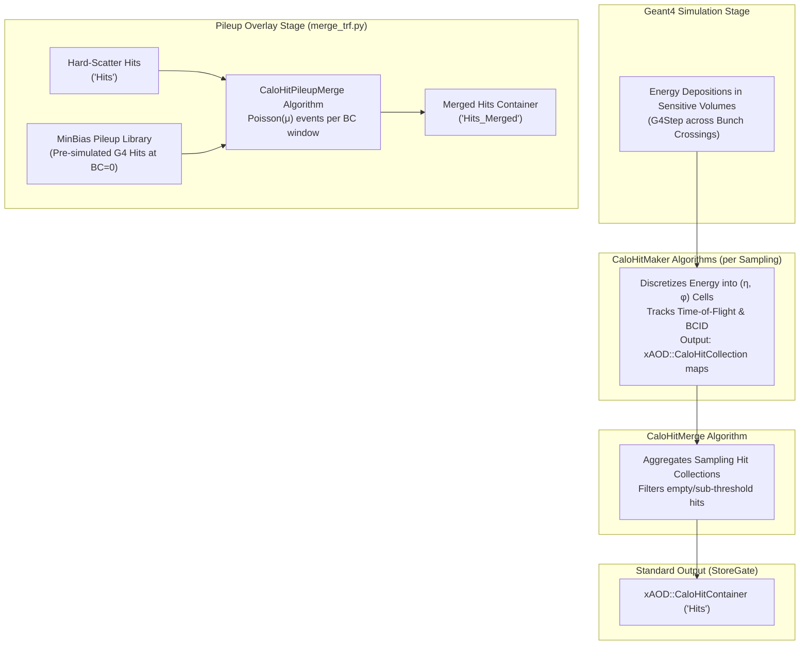
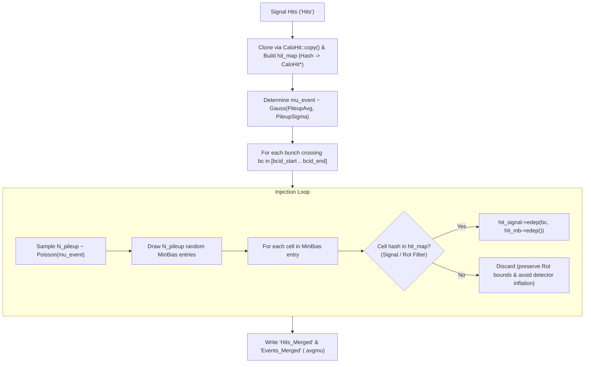

# CaloHitBuilder

The `CaloHitBuilder` package provides algorithms and configuration infrastructure for building and merging calorimeter hits during the Geant4 simulation step and high-luminosity pileup overlay within the Lorenzetti framework.

---

## 1. Architecture Overview

During Geant4 simulation, particles deposit energy in sensitive calorimeter volumes across multiple bunch crossings (BC). `CaloHitBuilder` processes these energy deposits and converts them into structured Event Data Model (EDM) hits. In addition, it hosts the hit-level pileup superposition algorithm to overlay minimum-bias interactions onto hard-scatter events prior to digitization:



---

## 2. Algorithms

### `CaloHitMaker` (`C++`)
- Collects Geant4 energy steps deposited in sensitive volumes for a specific detector sampling.
- Maps step spatial coordinates to discretized $(\eta, \phi)$ cell indices and calculates cell hashes.
- Tracks energy deposition $E(t)$ and time-of-flight ($\text{TOF}$) across configured bunch crossing IDs (`bcid_start` to `bcid_end`).
- Records an `xAOD::CaloHitCollection` (a hash-indexed map of hits) into `SG::EventContext`.

### `CaloHitMerge` (`C++`)
- Reads individual `xAOD::CaloHitCollection` maps produced by `CaloHitMaker` instances across all active samplings.
- Aggregates hits into a single `xAOD::CaloHitContainer` (`SG::DataVector<xAOD::CaloHit>`).
- Supports hit filtering based on energy threshold and RoI matching to optimize memory and disk footprints.

### `CaloHitPileupMerge` (`C++`)
- Overlays minimum-bias pileup hits from pre-simulated Geant4 MinBias files onto hard-scatter signal events.
- Evaluates the bunch-crossing time window ($[\text{bcid\_start}, \text{bcid\_end}]$) centered around the trigger collision ($\text{BCID} = 0$).
- Samples the instantaneous number of inelastic collisions $n_{\text{MB}} \sim \text{Poisson}(\mu)$ per bunch crossing.
- Directly uses `xAOD::CaloHit`'s native dictionary access to add MinBias deposits into the signal event.
- Updates `xAOD::CaloHitContainer` (`"Hits_Merged"`) and event metadata `xAOD::EventInfoContainer` (`"Events_Merged"`).

---

## 3. Python Configuration

### `CaloHitMakerCfg`
Helper function returning a `Configurable` instance of `ROOT.CaloHitMaker` initialized with parameters from a geometry sampling descriptor.

```python
from CaloHitBuilder import CaloHitMakerCfg

hit_maker = CaloHitMakerCfg(
    "CaloHitMaker_EMB1",
    sampling=detector.samplings[0],
    OutputCollectionKey="EMB1_Hits",
    HistogramPath="Expert/EMB1",
    SamplingNoiseStd=0.0,
    DetailedHistograms=False,
)
```

### `CaloHitBuilder`
Coordinator class that hooks into `G4Kernel.ComponentAccumulator` to automatically instantiate `CaloHitMaker` for each sampling and `CaloHitMerge` for merging.

```python
from CaloHitBuilder import CaloHitBuilder
from G4Kernel import ComponentAccumulator

acc = ComponentAccumulator(detector=my_detector)

builder = CaloHitBuilder(
    "CaloHitBuilder",
    OutputHitsKey="Hits",
    FilterEmptyHits=True,
    MinEnergy=0.0,  # Discards zero-energy hits
)
builder.merge(acc)
```

---

## 4. Pileup Superposition Engine (`CaloHitPileupMerge`)

The `CaloHitPileupMerge` algorithm simulates the high-luminosity hadron collider environment by superimposing pre-simulated inelastic proton-proton collisions (*Minimum Bias*) onto signal events (*hard-scatter*).



### 4.1 Physics Motivation: In-Time & Out-Of-Time Pileup
In High-Luminosity LHC (HL-LHC), bunches collide every $25\text{ ns}$. The calorimeter signal shaping time extends across hundreds of nanoseconds. To accurately reconstruct the analog pulse in subsequent digitization steps (`digit_trf.py`), the simulation accounts for:
* **In-Time Pileup ($\text{BCID} = 0$):** Uncorrelated inelastic collisions occurring in the exact same bunch crossing as the hard-scatter event.
* **Out-Of-Time Pileup ($\text{BCID} \in [\text{bcid\_start}, \text{bcid\_end}], \text{BCID} \neq 0$):** Residual energy shaping tails from previous collisions ($\text{BCID} < 0$) and rising signals from subsequent collisions ($\text{BCID} > 0$).

### 4.2 Unified MinBias Library Model
Unlike older models requiring artificially grouped *high-pileup* and *low-pileup* datasets, `CaloHitPileupMerge` operates on a **single unified library** of Minimum Bias events:
* Every MinBias event represents **1 single inelastic collision** simulated with its interaction situated at the central bunch crossing $\text{BCID} = 0$.
* For each bunch crossing $bc \in [\text{bcid\_start}, \text{bcid\_end}]$, the algorithm draws $N_{\text{pileup}} \sim \text{Poisson}(\mu)$ independent events from the MinBias library and superimposes their energy directly at bunch crossing $bc$.

### 4.3 Native Dictionary Access (`m_edep`)
Inside `xAOD::CaloHit`, energy deposits are organized as an associative dictionary:
```cpp
std::map<int, float> m_edep; // Key: bunch crossing ID (bc_id), Value: energy (MeV)
```
* **Getter:** `hit_mb->edep()` defaults to `bc_id = 0`, directly retrieving the MinBias interaction energy without requiring array index calculations or offset variables (`zero_idx`).
* **Setter:** `hit_signal->edep(bc, hit_mb->edep())` natively accumulates into `m_edep[bc] += e`.

### 4.4 Hit Cloning via `xAOD::CaloHit::copy()`
To streamline the event memory management, `xAOD::CaloHit` implements a dedicated copy constructor and cloning method:
```cpp
CaloHit* CaloHit::copy() const;
```
During the `allocate()` phase of `CaloHitPileupMerge`, the hard-scatter signal hits are cloned directly via `const_hit->copy()`, eliminating verbose field-by-field manual copying and ensuring deep replication of time vectors, energy maps, and TOF maps.

### 4.5 RoI-Preserving Pileup Overlay
When the signal event is simulated or filtered within a Region of Interest (RoI, such as an electron or photon window), only the relevant calorimeter cells are present in the signal hit collection. 

`CaloHitPileupMerge` checks cell hashes against the signal's `hit_map` before performing EDM conversion:
* MinBias deposits falling inside the signal RoI are accumulated into `hit_signal->edep(bc, e_mb)`.
* MinBias deposits falling outside the signal RoI are immediately discarded.

### 4.6 High-Throughput Sequential Circular Stream & Prefetching
In ROOT's compressed columnar storage, reading entries randomly (`chain->GetEntry(random)`) causes severe performance degradation due to basket thrashing (uncompressing multi-megabyte baskets repeatedly only to read a single event).

`CaloHitPileupMerge` implements a **high-throughput sequential circular streaming pattern**:
* **Circular Offset:** On the first interaction (or via `StartEntry`), a starting offset is drawn uniformly at random:
  ```cpp
  m_currentEntry = m_rng.Integer(total_entries);
  ```
* **Sequential Access:** Subsequent interactions across bunch crossings and events advance sequentially:
  ```cpp
  m_currentEntry = (m_currentEntry + 1) % total_entries;
  ```
  Since Minimum Bias collisions in nature are physically independent and uncorrelated, sequential traversal through pre-simulated MinBias files is statistically equivalent to independent random draws with replacement.
* **30 MB Prefetch Buffer:** Enabled via `chain->SetCacheSize(30 * 1024 * 1024)`. ROOT prefetches and keeps decompressed baskets in RAM, resulting in near-100% cache hits and accelerating pileup superposition by 10x–30x.

### 4.7 Python Configuration Interface
```python
from CaloHitBuilder import CaloHitPileupMergeCfg
from GaugiKernel import ComponentAccumulator

acc = ComponentAccumulator("PileupAcc", "output_merged.HIT.root")

pileup_alg = CaloHitPileupMergeCfg(
    "CaloHitPileupMerge",
    PileupFiles=["/data/minbias/mb_001.HIT.root", "/data/minbias/mb_002.HIT.root"],
    PileupAvg=40.0,        # <mu> average interactions per crossing
    PileupSigma=0.0,       # Gaussian fluctuation in mu (0 for fixed mu)
    InputHitsKey="Hits",
    OutputHitsKey="Hits_Merged",
    InputEventKey="Events",
    OutputEventKey="Events_Merged",
    BunchIdStart=-21,      # Earliest bunch crossing
    BunchIdEnd=4,          # Latest bunch crossing
    StartEntry=-1,         # -1 for random circular start, >=0 for deterministic start
)
acc += pileup_alg
```

### 4.8 Transform Execution (`merge_trf.py`)
The `merge_trf.py` script provides file-parallel batch processing over directories and individual datasets:

```bash
# 1. Overlay MinBias pileup (average mu = 40) onto a single Zee HIT file:
merge_trf.py \
    -i Zee.HIT.root \
    --pileup-files "/data/minbias/*.root" \
    -o Zee_mu40.HIT.root \
    --pileup-avg 40.0

# 2. Batch processing across 8 concurrent worker processes:
merge_trf.py \
    -i /data/signal_hits/ \
    --pileup-files "/data/minbias/*.root" \
    -o /data/merged_hits/ \
    --pileup-avg 60.0 \
    -nw 8
```

---

## 5. Dependencies
- `kernel/GaugiKernel`: Algorithm interfaces, StoreGate `EventContext`, Data Handles, logging.
- `events/CaloHit`: `xAOD::CaloHit`, `xAOD::CaloHitCollection`, `xAOD::CaloHitContainer`.
- `events/EventInfo`: `xAOD::EventInfo`, `xAOD::EventInfoContainer`.
- `kernel/G4Kernel`: Geant4 simulation context and `ComponentAccumulator`.
