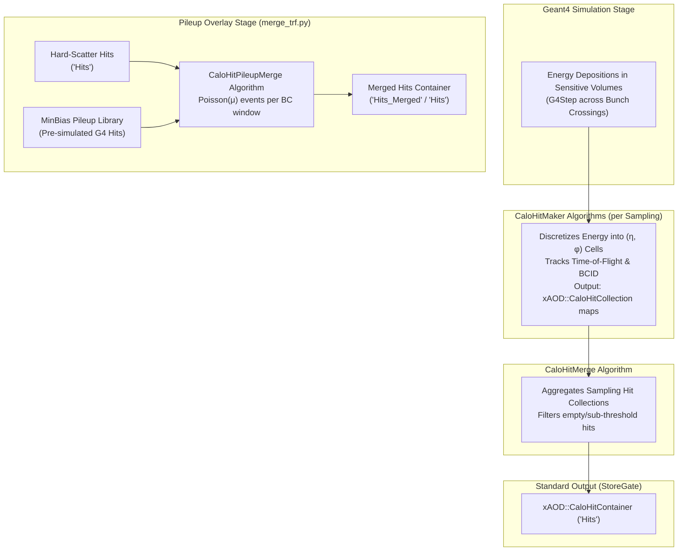

# CaloHitBuilder

The `CaloHitBuilder` package provides algorithms and configuration infrastructure for building and merging calorimeter hits during the Geant4 simulation step within the Lorenzetti framework.

---

## 1. Architecture Overview

During Geant4 simulation, particles deposit energy in sensitive calorimeter volumes across multiple bunch crossings (BC). `CaloHitBuilder` processes these energy deposits and converts them into structured Event Data Model (EDM) hits. In addition, it hosts the hit-level pileup superposition algorithm to overlay minimum-bias interactions onto hard-scatter events prior to digitization:



---

## 2. Algorithms

### `CaloHitMaker` (`C++`)
- Collects Geant4 energy steps deposited in sensitive volumes for a specific detector sampling.
- Maps step spatial coordinates to discretized $(\eta, \phi)$ cell indices and calculates cell hashes.
- Tracks energy deposition $E(t)$ and time-of-flight ($\text{TOF}$) across configured bunch crossing IDs (`bcid_start` to `bcid_end`).
- Records an `xAOD::CaloHitCollection` (a hash-indexed map of hits) into `SG::EventContext`.

### `CaloHitMerge` (`C++`)
- Reads individual `xAOD::CaloHitCollection` maps produced by `CaloHitMaker` instances across all active samplings.
- Aggregates hits into a single `xAOD::CaloHitContainer` (`SG::DataVector<xAOD::CaloHit>`).
- Supports hit filtering based on energy threshold and RoI matching to optimize memory and disk footprints.

### `CaloHitPileupMerge` (`C++`, alias `PileupMerge`)
- Overlays minimum-bias pileup hits from pre-simulated Geant4 MinBias files onto hard-scatter signal events.
- Evaluates the bunch-crossing time window ($[\text{bcid\_start}, \text{bcid\_end}]$) centered around the trigger collision ($\text{BCID} = 0$).
- Samples the instantaneous number of inelastic collisions $n_{\text{MB}} \sim \text{Poisson}(\mu)$ per bunch crossing.
- Superimposes hit energy vectors and bunch-crossing profiles cell-by-cell without needing re-simulation.
- Updates `xAOD::CaloHitContainer` (`"Hits_Merged"`) and event metadata `xAOD::EventInfoContainer` (`"Events_Merged"`).
- Configured in Python via `CaloHitPileupMergeCfg` (or `PileupMergeCfg`).

---

## 3. Python Configuration

### `CaloHitMakerCfg`
Helper function returning a `Configurable` instance of `ROOT.CaloHitMaker` initialized with parameters from a geometry sampling descriptor.

```python
from CaloHitBuilder import CaloHitMakerCfg

hit_maker = CaloHitMakerCfg(
    "CaloHitMaker_EMB1",
    sampling=detector.samplings[0],
    OutputCollectionKey="EMB1_Hits",
    HistogramPath="Expert/EMB1",
    SamplingNoiseStd=0.0,
    DetailedHistograms=False,
)
```

### `CaloHitBuilder`
Coordinator class that hooks into `G4Kernel.ComponentAccumulator` to automatically instantiate `CaloHitMaker` for each sampling and `CaloHitMerge` for merging.

```python
from CaloHitBuilder import CaloHitBuilder
from G4Kernel import ComponentAccumulator

acc = ComponentAccumulator(detector=my_detector)

builder = CaloHitBuilder(
    "CaloHitBuilder",
    OutputHitsKey="Hits",
    FilterEmptyHits=True,
    MinEnergy=0.0,  # Discards zero-energy hits
)
builder.merge(acc)
```

### `CaloHitPileupMergeCfg`
Helper function returning a `Configurable` instance of `ROOT.CaloHitPileupMerge` to overlay minimum-bias pileup events on hard-scatter hits:

```python
from CaloHitBuilder import CaloHitPileupMergeCfg
from GaugiKernel import ComponentAccumulator

acc = ComponentAccumulator("PileupOverlayAcc")

pileup_alg = CaloHitPileupMergeCfg(
    "CaloHitPileupMerge",
    InputHardScatterHitsKey="Hits",
    InputMinbiasHitsKey="Hits",
    OutputHitsKey="Hits_Merged",
    PileupFile="minbias.HIT.root",
    AvgPileup=40.0,
    BcidStart=-8,
    BcidEnd=3,
)
acc += pileup_alg
```

---

## 4. Transform Execution (`merge_trf.py`)

Lorenzetti provides the `merge_trf.py` transform script to execute pileup merging over directories or individual files:

```bash
# Overlay minbias pileup (avg mu = 40) onto hard-scatter Zee HIT file:
merge_trf.py -i Zee.HIT.root --pileup-file minbias.HIT.root -o Zee_mu40.HIT.root --avg-pileup 40.0

# Batch execution across worker processes:
merge_trf.py -i /data/hits/ -o /data/merged_hits/ --pileup-file minbias.HIT.root --avg-pileup 60.0 -nw 4
```

---

## 5. Dependencies
- `kernel/GaugiKernel`: Algorithm interfaces, StoreGate `EventContext`, Data Handles, logging.
- `events/CaloHit`: `xAOD::CaloHit`, `xAOD::CaloHitCollection`, `xAOD::CaloHitContainer`.
- `kernel/G4Kernel`: Geant4 simulation context and `ComponentAccumulator`.
