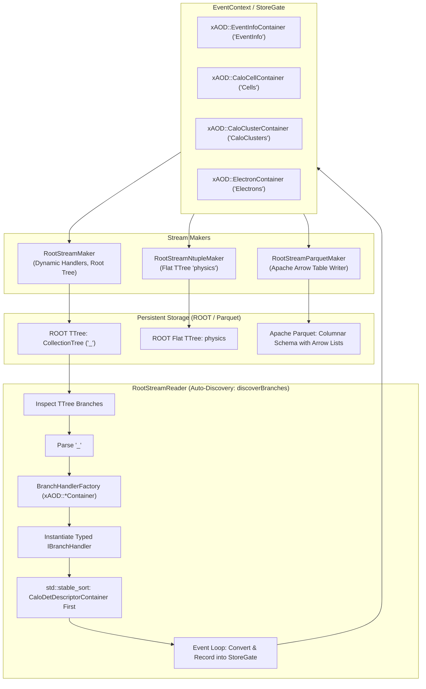
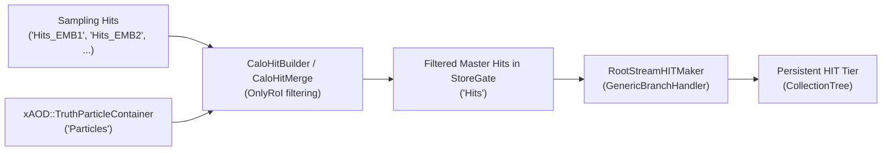
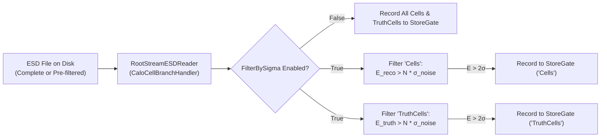

# RootStreamBuilder

The **RootStreamBuilder** package (`reconstruction/io/RootStreamBuilder`) is the central I/O (Input/Output) component of the Lorenzetti framework for persisting and retrieving EDM (`xAOD`) objects in ROOT files using `TTree`.

It provides a **generic, extensible, and data-driven** architecture:
- **`RootStreamReader`**: Smart reader with **automatic branch discovery**, inspecting the `TTree`, instantiating matching converters, and reconstructing all containers directly in `EventContext`/`StoreGate` without requiring manual per-tier configuration (HIT, ESD, AOD).
- **`RootStreamMaker`**: Generic writer configured via an item list (`ItemList`), serializing any requested `xAOD` container into standard `<TypeName>_<Key>` branches. Handlers are constructed dynamically in `bookHistograms` and `fillHistograms`, ensuring `initialize()` remains completely state-free.
- **`RootStreamNtupleMaker`**: Analysis algorithm flattening physical variables and calorimetric shower rings into a flat `TTree` (`physics`), ideal for neural network training (Ringer) and performance studies.
- **`RootStreamParquetMaker`**: High-throughput C++ columnar serializer converting AOD collections directly into an Apache Parquet file using Apache Arrow, preserving identical variables and nested ring vectors.

---

## 1. Architecture



---

## 2. C++ Components

| Class / Interface | Description |
| :--- | :--- |
| `IBranchHandler` | Polymorphic interface for binding, reading, and writing branches in the `TTree`. |
| `GenericBranchHandler<TContainer, TStruct, TConverter>` | Type-safe C++ template handler for any standard `xAOD` container type. |
| `CaloCellBranchHandler` | Specialized branch handler for `CaloCellContainer` supporting online independent noise sigma filtering ($E > N\sigma$, ATLAS Run 4) during deserialization. |
| `BranchHandlerFactory` | Central factory instantiating typed handlers based strictly on EDM container names (`*Container`). |
| `RootStreamReader` | Algorithm that discovers branches dynamically from the input tree via `discoverBranches()` and records containers into `StoreGate`. |
| `RootStreamMaker` | Algorithm that reads containers from `EventContext` specified in `ItemList` and fills the `TTree`, with dynamic on-demand handler construction. |
| `RootStreamNtupleMaker` | Analysis algorithm producing flat `TTree` structures (e.g. `cl_et`, `cl_rings`, etc.). |
| `RootStreamParquetMaker` | High-throughput C++ algorithm dumping analysis variables and calorimeter rings into an Apache Parquet file via Apache Arrow. |

---

## 3. Branch Naming Convention

All persistent branches follow the standard format:
```
<TypeName>_<Key>
```
Where `<TypeName>` strictly matches the EDM collection name (always ending in `Container`):
- `EventInfoContainer_EventInfo`
- `CaloCellContainer_Cells`
- `CaloCellContainer_TruthCells`
- `CaloDetDescriptorContainer_CaloDetDescriptors`
- `CaloClusterContainer_CaloClusters`
- `CaloRingsContainer_Rings`
- `ElectronContainer_Electrons`
- `CaloHitContainer_Hits`

---

## 4. Python Configuration

### 4.1. Automatic Reading & Branch Discovery (`RootStreamReader`)

`RootStreamReader` inspects the input `TTree` at initialization time through `discoverBranches()`:

1. **Branch Listing**: Iterates through all branches in the `TTree`.
2. **Name Parsing**: Splits each branch name by `_` into `typeName` (e.g. `"CaloCellContainer"`) and `key` (e.g. `"Cells"`).
3. **Handler Instantiation**: Uses `BranchHandlerFactory::createHandler` to instantiate the appropriate typed `IBranchHandler`.
4. **Dependency-Aware Ordering**: Executes `std::stable_sort` to ensure `CaloDetDescriptorContainer` is processed **before** `CaloCellContainer`, guaranteeing that detector geometry and noise values ($\sigma$) are in StoreGate when cell filtering and conversion take place.
5. **Execution**: During `execute()`, all discovered handlers deserialize the branches and register the reconstructed containers into `StoreGate` without requiring manual per-tier configuration.

```python
from RootStreamBuilder import RootStreamReaderCfg

# Automatically reads all branches in the input ROOT file and TTree
reader = RootStreamReaderCfg(
    name="StreamReader",
    InputFile="output_aod.root",
    TreeName="CollectionTree",
    FilterBySigma=False,      # Set to True to enable online noise suppression
    SigmaThreshold=2.0,       # E > N * sigma (default: 2.0)
)
```

### 4.2. Flexible Writing (`RootStreamMaker`) & Active `recordable()` Registry

Persisted containers are specified via `ItemList` using the standard `"TypeName#Key"` syntax.

#### Automated Stream Configuration via `recordable()`
Rather than manually repeating container keys across every algorithm and stream maker, Lorenzetti implements an **active persistence registry** via `recordable()`:

1. When configuring upstream algorithms (such as `EventReader`, `CaloHitBuilder`, `CaloCellBuilder`, `CaloClusterMaker`, etc.), wrapping output and input keys with `recordable("Key")` automatically registers the item (`"TypeName#Key"`) in the active registry according to the EDM catalog `DEFAULT_KEY_TO_TYPE_MAP`.
2. All stream presets (`RootStreamHITMakerCfg`, `RootStreamESDMakerCfg`, `RootStreamAODMakerCfg`, and `RootStreamMakerCfg`) automatically inspect the active registry when called without manual key arguments, extracting exactly the containers appropriate for that data tier.
3. Full backward compatibility is preserved: manually passing explicit `Input*Key` arguments or custom `ItemList` continues to override the automatic registry.

```python
from RootStreamBuilder import recordable, RootStreamAODMakerCfg

# Algorithms register their persistent containers automatically:
cluster = CaloClusterMakerCfg("CaloClusterMaker", OutputClusterKey=recordable("Clusters"))
hypo = ElectronBuilderCfg("ElectronBuilder", OutputElectronKey=recordable("Electrons"))

# The stream maker discovers all active recordable() items for the AOD tier automatically!
aod_maker = RootStreamAODMakerCfg("RootStreamAODMaker")
```

#### Lifecycle Architecture & Root Placement
`RootStreamMaker` adopts a strictly decoupled execution lifecycle:
* **Stateless `initialize()`**: `initialize()` performs zero file operations or branch handler allocations, preventing premature I/O handles or race conditions in multi-threaded workflows.
* **Dynamic Handler Construction**: Branch handlers (`IBranchHandler`) are constructed on demand inside `bookHistograms()` and `fillHistograms()`.
* **Clean Root Directory Placement**: All trees are registered at the root of the output `TFile` via `store->cd()`, eliminating duplicate trees or conflicting directory structures (such as `Events/CollectionTree`).

Convenience presets are available for standard data tiers:
- `RootStreamAODMakerCfg(...)` (or `RootStreamAODMaker(...)`)
- `RootStreamESDMakerCfg(...)` (or `RootStreamESDMaker(...)`)
- `RootStreamHITMakerCfg(...)` (or `RootStreamHITMaker(...)`)

### 4.3. HIT Tier Serialization (`RootStreamHITMaker`)

During Geant4 detector shower simulation, particles shower extensively throughout the calorimeter. To prevent excessive file sizes, online Region of Interest (RoI) hit filtering is managed directly upstream at the container creation stage by `CaloHitBuilder` (`CaloHitMerge`), ensuring hits outside the RoI cone are not allocated in memory.

`RootStreamHITMaker` acts as a pure, lightweight stream maker persisting the standard simulation EDM containers (`EventInfo`, `TruthParticle`, `CaloHit`, `Seed`) using standard `GenericBranchHandler`:



#### Key Architecture Principles:
* **Separation of Concerns**: `RootStreamBuilder` is strictly dedicated to serialization and deserialization, free of calorimeter geometry cuts or detector-specific filtering.
* **Zero Overhead Persistence**: Hits are serialized transparently without per-branch custom handlers.
* **StoreGate Consistency**: In-memory representations match on-disk persistent files 1:1 across all output formats (ROOT and Parquet).

#### Usage Example (`simu_trf.py`):
```python
from CaloHitBuilder import CaloHitBuilder
from RootStreamBuilder import RootStreamHITMaker, recordable

# 1. CaloHitBuilder handles RoI filtering upstream during collection merge
calorimeter = CaloHitBuilder(
    "CaloHitBuilder",
    HistogramPath="Expert/Hits",
    OutputLevel=output_level,
    OutputHitsKey=recordable("Hits"),
    OnlyRoI=not save_all_hits,  # False by default in builder; True in simu_trf when save_all_hits is not passed
)
calorimeter.merge(acc)

# 2. RootStreamHITMaker automatically resolves recorded items and streams
HIT = RootStreamHITMaker(
    "RootStreamHITMaker",
    OutputLevel=output_level,
)
acc += HIT
```

### 4.4. Flat Analysis Ntuples (`RootStreamNtupleMaker` / `ntuple_trf.py`)

`RootStreamNtupleMaker` extracts analysis-level variables (event metrics, cluster kinematics, sampling energies, shower shapes, calorimeter rings, electron PID, and truth particles) from an AOD file into a flat `TTree` named `physics`:

```python
from RootStreamBuilder import RootStreamAODReader, RootStreamNtupleMaker, recordable
from GaugiKernel import ComponentAccumulator

# Reader uses automatic branch discovery
AOD = RootStreamAODReader(
    "AODReader",
    InputFile="sample.AOD.root",
    TreeName="CollectionTree",
)

acc = ComponentAccumulator("ComponentAccumulator", "output.NTUPLE.root", AOD)

ntuple = RootStreamNtupleMaker(
    "NtupleMaker",
    InputEventKey=recordable("Events"),
    InputTruthKey=recordable("Particles"),
    InputSeedsKey=recordable("Seeds"),
    InputClusterKey=recordable("Clusters"),
    InputElectronKey=recordable("Electrons"),
    InputRingerKeys=[recordable("Rings")],
    OutputNtupleName="physics",
)
acc += ntuple
acc.run()
```

#### Command-Line Usage (`ntuple_trf.py`):
```bash
# Generate flat analysis ntuple:
ntuple_trf.py -i sample.AOD.root -o sample.NTUPLE.root --nov 1000

# With custom schema JSON:
ntuple_trf.py -i sample.AOD.root -o sample.NTUPLE.root --schema schema.json
```

### 4.5. ESD Tier & Online Noise Suppression Reading (`RootStreamESDReader` / ATLAS Run 4)

In offline reconstruction (`reco_trf.py`), `RootStreamESDReader` provides **on-the-fly cell noise filtering** ($E > N\sigma$, default $2\sigma$) via `CaloCellBranchHandler`.

This decouples the storage policy from reconstruction: a **single complete ESD** produced by `digit_trf.py` can be used to generate both Run 4 baseline AODs ($2\sigma$ cut) and control/calibration AODs (no cut or alternate thresholds) without repeating the CPU-intensive digitization step.



#### Key Advantages:
* **Workflow Efficiency**: Avoids re-running `digit_trf.py` to create separate ESD files for different cell energy thresholds.
* **Independent Filtering**: Both reconstructed cells (`Cells`) and truth cells (`TruthCells`) are filtered independently according to their own energy ($E > 2\sigma$) without cross-matching dependencies.
* **Zero Algorithmic Changes Downstream**: `CaloClusterMaker`, `CaloRingsMaker`, and `ElectronMaker` transparently process the filtered cells from StoreGate.

#### Configuration Options:
| Parameter | Type | Default | Description |
| :--- | :--- | :--- | :--- |
| `FilterBySigma` | `bool` | `False` | Enables online cell noise suppression during read. |
| `SigmaThreshold` | `float` | `2.0` | Threshold multiplier for noise cut ($E > N\sigma$). |
| `DescriptorsKey` | `str` | `"CaloDetDescriptors"` | StoreGate key of master descriptor container. |

#### Usage Example (`reco_trf.py`):
```python
from RootStreamBuilder import RootStreamESDReader, recordable

ESD = RootStreamESDReader(
    "ESDReader",
    InputFile=input_file,
    OutputCellsKey=recordable("Cells"),
    OutputCellsTruthKey=recordable("TruthCells"),
    FilterBySigma=filter_by_sigma,     # Flag from CLI (--filter-by-sigma)
    SigmaThreshold=sigma_threshold,   # e.g., 2.0
    OutputLevel=outputLevel,
)
```

#### Command-Line Usage (`reco_trf.py`):
```bash
# Standard reconstruction with Run 4 2-sigma noise cut:
reco_trf.py -i Zee.ESD.root -o Zee_2sigma.AOD.root --filter-by-sigma --sigma-threshold 2.0

# Alternate 3-sigma noise cut:
reco_trf.py -i Zee.ESD.root -o Zee_3sigma.AOD.root --filter-by-sigma --sigma-threshold 3.0

# Study / calibration mode (retain all cells, no noise cut):
reco_trf.py -i Zee.ESD.root -o Zee_all.AOD.root --no-filter-by-sigma
```

---

### 4.6. Apache Parquet Direct Serialization (`RootStreamParquetMaker` / `parquet_trf.py`)

`RootStreamParquetMaker` is a high-performance C++ algorithm that directly transforms an AOD dataset into an **Apache Parquet** (`.parquet`) file using **Apache Arrow** (`parquet/arrow/writer.h`).

It dumps the exact same features and variables as `RootStreamNtupleMaker`, allowing direct integration with modern Data Science and Machine Learning pipelines (Polars, Pandas, DuckDB, PyTorch, TensorFlow) without requiring ROOT during analysis.

#### Column Schema (1:1 with Ntuple):
* **Event**: `EventNumber` (`int32`), `RunNumber` (`int32`), `avgmu` (`float32`), `totmu` (`float32`).
* **Cluster Kinematics**: `cl_eta`, `cl_phi`, `cl_e`, `cl_et`, `cl_deta`, `cl_dphi` (`float32`).
* **Calo Samplings**: `cl_e0` through `cl_e3`, `cl_ehad1` through `cl_ehad3`, `cl_etot` (`float32`).
* **Shower Shapes**: `cl_e233`, `cl_e237`, `cl_e277`, `cl_emaxs1`, `cl_emaxs2`, `cl_e2tsts1`, `cl_reta`, `cl_rphi`, `cl_rhad`, `cl_rhad1`, `cl_eratio`, `cl_f0`..`cl_f3`, `cl_weta2` (`float32`).
* **Moments**: `cl_secondR`, `cl_lambdaCenter`, `cl_secondLambda`, `cl_fracMax`, `cl_lateralMom`, `cl_longitudinalMom` (`float32`).
* **Calorimeter Rings (Native Lists)**: `cl_rings_<key>` (`list<float32>`).
* **Electron PID**: `el_eta`, `el_et`, `el_phi`, `el_e` (`float32`), `el_tight`, `el_medium`, `el_loose`, `el_vloose` (`bool`).
* **Seed & MC Truth Particles**: `seed_eta`, `seed_phi`, `seed_e`, `seed_et`, `seed_id` (`float32`), `mc_pdgid`, `mc_eta`, `mc_phi`, `mc_e`, `mc_et` (`float32`).

#### Key Architecture Principles:
* **PIMPL Idiom**: Header uses `struct Impl; std::unique_ptr<Impl> m_impl;` to isolate Arrow C++20 headers from the ROOT dictionary generator (`rootcling`).
* **In-Memory StoreGate Mode**: When output is `.parquet`, `StoreGate` operates purely in memory, preventing empty or corrupt ROOT files on disk.
* **Parallel Chunk Merging**: `Parallel.py` automatically merges intermediate worker `.parquet` files via `pyarrow.concat_tables`.

#### Python Usage (`parquet_trf.py`):
```python
from RootStreamBuilder import RootStreamAODReader, RootStreamParquetMaker, recordable
from GaugiKernel import ComponentAccumulator

AOD = RootStreamAODReader(
    "AODReader",
    InputFile="sample.AOD.root",
    TreeName="CollectionTree",
)

acc = ComponentAccumulator("ComponentAccumulator", "output.parquet", AOD)

parquet = RootStreamParquetMaker(
    "ParquetMaker",
    OutputFile="output.parquet",
    InputEventKey=recordable("Events"),
    InputTruthKey=recordable("Particles"),
    InputSeedsKey=recordable("Seeds"),
    InputClusterKey=recordable("Clusters"),
    InputElectronKey=recordable("Electrons"),
    InputRingerKeys=[recordable("Rings")],
)
acc += parquet
acc.run()
```

#### Command-Line Usage:
```bash
# Transform AOD to Parquet:
parquet_trf.py -i sample.AOD.root -o sample.parquet --nov 1000

# Parallel transformation across multiple workers with automatic chunk merge:
parquet_trf.py -i sample.AOD.root -o sample.parquet -nw 4 -m
```

---

### 4.7. Schema-Driven Output Configuration (`RootStreamSchema`)

`RootStreamBuilder` provides a declarative schema mapping system allowing users to select and rename branches output by `RootStreamNtupleMaker` and `RootStreamParquetMaker`.

#### Schema Descriptor Format:
Each entry maps an output branch/column name to an EDM target:
```
"<OutputBranch>" : "<EDMType>#<ContainerKey>#<Property>"
```
Examples:
- `"cl_eta": "CaloCluster#Clusters#eta"`
- `"ring_0": "CaloRings#Rings#rings[0]"` (scalar ring indexing)
- `"cl_rings_Rings": "CaloRings#Rings#rings"` (vector branch/list)
- `"mc_pdgid": "TruthParticle#Particles#pdgid"`

#### Helper Functions (`RootStreamSchema.py`):
- **`get_default_schema()`**: Returns a unified dictionary with all 61 standard default variables.
- **`get_scalar_rings_schema(prefix="ring_", key="Rings", n_rings=100)`**: Generates unpacked scalar ring mappings (`ring_0` .. `ring_99`).
- **`build_custom_schema(include_default=..., include_scalar_rings=..., extra_branches=...)`**: Assembles custom schemas conveniently.

#### Example Usage:
```python
from RootStreamBuilder import build_custom_schema, RootStreamNtupleMaker

# Dump default schema + individual scalar ring branches
custom_schema = build_custom_schema(
    include_default=True,
    include_scalar_rings=True,
)

ntuple = RootStreamNtupleMaker(
    "NtupleMaker",
    Schema=custom_schema,
    OutputNtupleName="physics",
)
```


