# Reconstruction Workflow Package (`reco`)

The **`reco`** package provides the command-line production transformation scripts (`*_trf.py`) that drive the complete simulation, digitization, reconstruction, and analysis pipeline in the **Lorenzetti** framework.

Each transformation script represents a discrete, self-contained processing step in the physics chain, powered by the isolated subprocess orchestrator provided by **`GaugiKernel.file_parallel_job`**.

---

## 1. Pipeline Architecture

The transformation chain processes events through well-defined EDM (Event Data Model) tiers:

```mermaid
flowchart LR
    EVT["EVT Tier<br/><i>(Generated Events)</i><br/><code>particles</code>"]
    -->|"simu_trf.py<br/>(Geant4)"| HIT["HIT Tier<br/><i>(Simulated Hits)</i><br/><code>CollectionTree</code>"]
    
    HIT -.->|"merge_trf.py<br/>(MinBias Overlay)"| HIT_M["HIT_Merged Tier<br/><code>CollectionTree</code>"]
    HIT -->|"digit_trf.py<br/>(Electronics / OF)"| ESD["ESD Tier<br/><i>(Calo Cells)</i><br/><code>CollectionTree</code>"]
    HIT_M -->|"digit_trf.py"| ESD
    
    ESD -->|"reco_trf.py<br/>(Clusters, Rings, PID)"| AOD["AOD Tier<br/><i>(Electrons, Rings)</i><br/><code>CollectionTree</code>"]
    AOD -->|"ntuple_trf.py<br/>(Flat Ntuples)"| NTUPLE["NTUPLE Tier<br/><i>(Flat Root Ntuple)</i><br/><code>physics</code>"]

    classDef stage fill:#f8fafc,stroke:#3b82f6,stroke-width:2px,color:#1e293b;
    classDef opt fill:#f1f5f9,stroke:#94a3b8,stroke-width:2px,stroke-dasharray: 5 5,color:#334155;
    class EVT,HIT,ESD,AOD,NTUPLE stage;
    class HIT_M opt;
```



---

## 2. Transformation Scripts Summary

| Transformation | Input Tier | Output Tier | Primary Engine / Components | Output TTree |
| :--- | :--- | :--- | :--- | :--- |
| **`simu_trf.py`** | `*.EVT.root` | `*.HIT.root` | `G4Kernel` (Geant4), `CaloHitBuilder`, `geometry` | `CollectionTree` |
| **`digit_trf.py`** | `*.HIT.root` | `*.ESD.root` | `CaloCellBuilder` (Optimal Filtering, Pulse Shaping) | `CollectionTree` |
| **`reco_trf.py`** | `*.ESD.root` | `*.AOD.root` | `CaloClusterBuilder`, `CaloRingsBuilder`, `EgammaBuilder` | `CollectionTree` |
| **`ntuple_trf.py`** | `*.AOD.root` | `*.NTUPLE.root` | `RootStreamNtupleMaker` (Analysis flat tuples) | `physics` |
| **`merge_trf.py`** | `*.HIT.root` | `*.HIT_Merged.root` | `CaloHitPileupMerge` (Superposition of MinBias hits) | `CollectionTree` |

---

## 3. High-Performance Parallel Execution

All transformation scripts are decorated with `@file_parallel_job` from `GaugiKernel`. This guarantees:
- **Zero Memory Leaks / Segfaults**: Each file runs in an isolated subprocess (`--is-worker`) with its own C++, Geant4, and ROOT address space.
- **Hierarchical Multithreading**: Decouples total machine cores (`-nt`) from threads allocated per Geant4 instance (`--threads-per-job`).
- **Batch Processing**: Accepts single files, directory paths, or glob expressions (`--pattern`).
- **Automatic Output Naming**: Automatically transforms file tags when saving to a directory (e.g. `.EVT.` $\to$ `.HIT.` $\to$ `.ESD.` $\to$ `.AOD.` $\to$ `.NTUPLE.`).
- **Resilience**: Skips already completed, valid output files via `--no-overwrite`.
- **Live Monitoring**: Streams real-time subprocess outputs with worker tags via `-v` / `--show-output`.

### Concurrency Control
Worker concurrency can be set either explicitly via workers or via hierarchical multithreading:
- **Explicit Workers (`-nw` / `--number-of-workers`)**: Directly sets the number of concurrent worker processes running simultaneously.
- **Hierarchical Multithreading (`-nt` and `--threads-per-job`)**:
  $$\text{Concurrent Workers} = \max\left(1, \left\lfloor \frac{\text{Total Threads (-nt)}}{\text{Threads Per Job (--threads-per-job)}} \right\rfloor\right)$$

*Example*: Running with `-nw 10 --threads-per-job 4` (or `-nt 40 --threads-per-job 4`) schedules **10 concurrent workers** executing simultaneously, each utilizing 4 threads within Geant4 ($10 \times 4 = 40$ CPU cores).

---

## 4. Script Reference & Usage Examples

### 4.1 Simulation (`simu_trf.py`)
Propagates particles through the ATLAS calorimeter geometry using Geant4. Region-of-Interest (RoI) hit filtering is handled upstream by `CaloHitBuilder` (`OnlyRoI=not save_all_hits`), keeping hit file sizes compact by default.

```bash
# Process a folder of EVT files using 10 worker processes (4 threads per worker = 40 cores):
simu_trf.py -i /data/evts/ -o /data/hits/ -nw 10 --threads-per-job 4

# Or using total cores division:
simu_trf.py -i /data/evts/ -o /data/hits/ -nt 40 --threads-per-job 4

# Run single file with magnetic field and 100 events
simu_trf.py -i Zee.EVT.root -o Zee.HIT.root --nov 100 --enable-magnetic-field -nt 4

# Retain all simulated hits without RoI cone filtering
simu_trf.py -i Zee.EVT.root -o Zee.HIT.root --save-all-hits

# Inspect execution plan without running (Dry Run)
simu_trf.py -i /data/evts/ -o /data/hits/ -nt 16 --dry-run
```

### 4.2 Digitization (`digit_trf.py`)
Simulates calorimeter electronics response, shaping pulses, injecting electronic noise, and applying Optimal Filtering. By default, full unattenuated ESD files are generated (cell noise filtering is disabled during digitization to preserve raw cell information).

```bash
# Digitize all HIT files in a directory into ESD files
digit_trf.py -i /data/hits/ -o /data/esds/ -nt 8

# Digitize a single file
digit_trf.py -i Zee.HIT.root -o Zee.ESD.root --nov 50
```

### 4.3 Reconstruction (`reco_trf.py`)
Performs topological cluster finding, concentric ring energy extraction (Ringer), and electron candidate identification. Supports modular Run 4 cell noise suppression via `CaloCellNoiseSuppression`:

```bash
# Standard reconstruction without noise cut (default, retains all ESD cells)
reco_trf.py -i Zee.ESD.root -o Zee.AOD.root

# Reconstruct with ATLAS Run 4 2-sigma cell noise suppression
reco_trf.py -i Zee.ESD.root -o Zee_2sigma.AOD.root --filter-by-sigma --sigma-threshold 2.0

# Batch reconstruct all ESD files in a directory with 8 cores
reco_trf.py -i /data/esds/ -o /data/aods/ -nt 8 --filter-by-sigma
```

### 4.4 Analysis Ntuples (`ntuple_trf.py`)
Flattens high-level reconstructed objects into ROOT `physics` TTrees for machine learning and offline analysis.

```bash
# Generate flat ntuples for all AOD files in a directory
ntuple_trf.py -i /data/aods/ -o /data/ntuples/ -nt 8

# Generate a single merged ntuple
ntuple_trf.py -i /data/aods/ -o /data/combined.NTUPLE.root -nt 8 --merge
```

### 4.5 Pileup Merging (`merge_trf.py`)
Superimposes minimum-bias pileup hits on top of hard-scatter signal events according to Poisson distributions.

```bash
# Overlay minbias events onto signal hits with <mu> = 30, sigma = 5
merge_trf.py \
    -i signal.HIT.root \
    -o signal.HIT_Merged.root \
    --low-pileup-files /data/minbias_low/ \
    --high-pileup-files /data/minbias_high/ \
    --pileup-avg 30 \
    --pileup-sigma 5
```

---

## 5. Standard CLI Options

Every transformation script supports the standard framework options:

| Flag | Short | Default | Description |
| :--- | :--- | :--- | :--- |
| `--input-file` | `-i` | *(Required)* | Input ROOT file, directory, or pattern. |
| `--output-file` | `-o` | *(Required)* | Destination ROOT file or output directory. |
| `--number-of-threads` | `-nt` | `1` | Total CPU cores allocated to the orchestrator. |
| `--threads-per-job` | | `-1` | CPU threads per worker process (`-1` = auto). |
| `--pattern` / `--file-pattern` | | `*.root` | Glob filter pattern when reading directories. |
| `--merge` / `--no-merge` | `-m` | `no-merge` | Merge intermediate ROOT chunk files using `hadd -f`. |
| `--overwrite` / `--no-overwrite` | | `overwrite` | Overwrite existing output files (`--no-overwrite` skips). |
| `--dry-run` | | `False` | Display the execution plan table without running workers. |
| `--show-output` | `-v` | `False` | Display real-time streaming output from worker subprocesses. |
| `--job-file` | | `None` | Path to a JSON configuration file to override options. |
| `--help` | `-h` | | Show help message and available options. |
